# Page 1

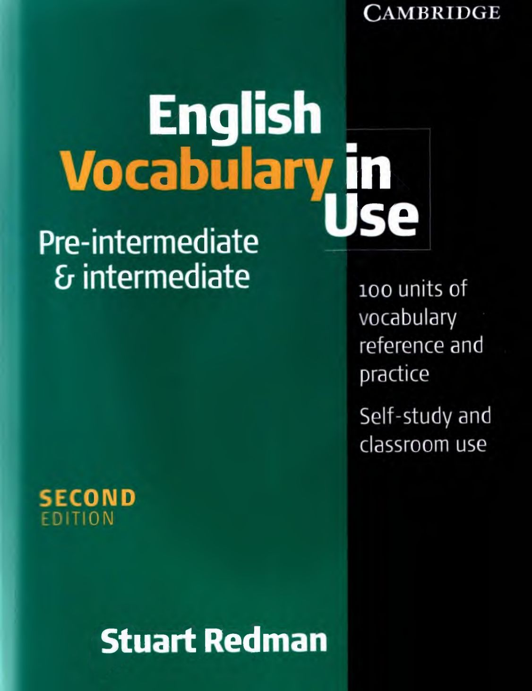

#### CAMBRIDGE

## English

&

### Vocabulary In

### Pre-intermediate Use

& intermediate ener vocabulary reference and practice

Self-study and classroom use

#### SECOND

#### EDITION

Stuart Redman

---

# Page 2

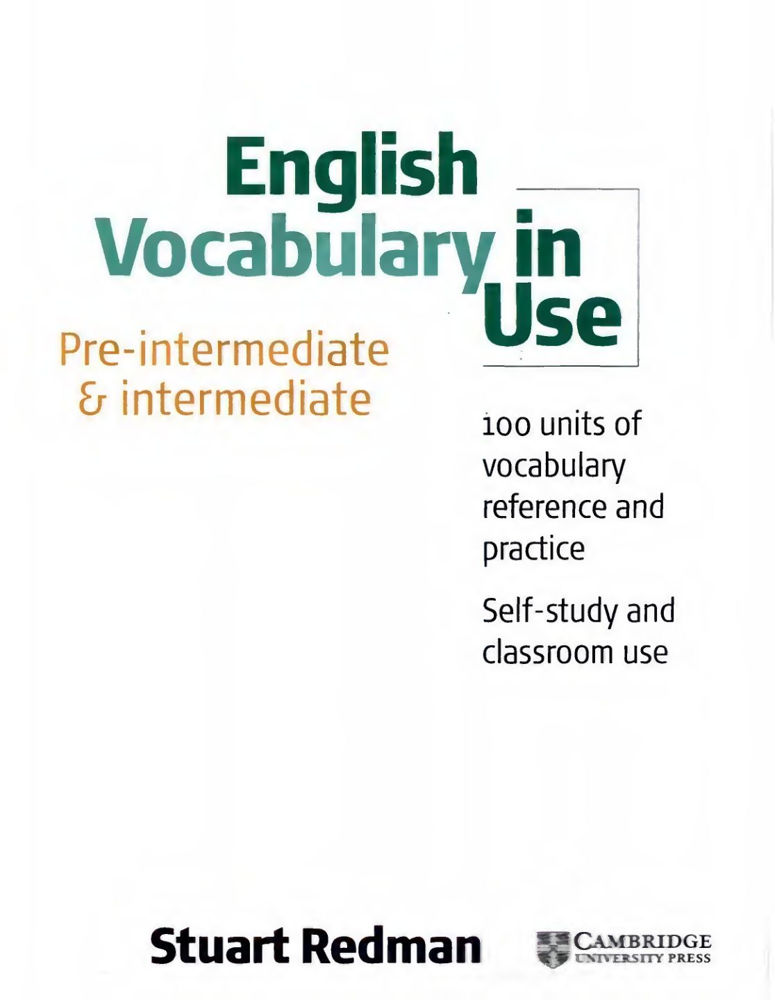

English ___

### Vocabulary In

### Use

100 units of vocabulary reference and Practice

Self-study and classroom use

Pre-intermediate & intermediate

StuartRedman 3ose22%

---

# Page 3

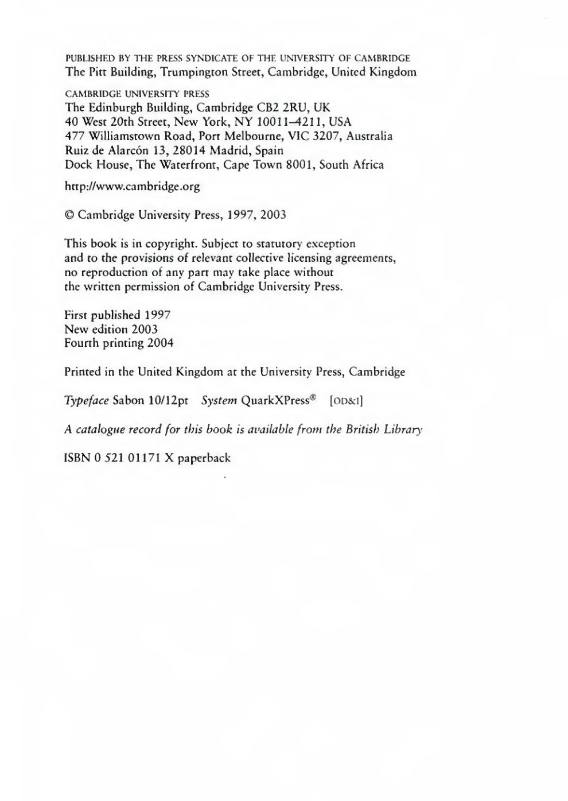

PUBLISHED BY THE PRESS SYNDICATE OF THE UNIVERSITY OF CAMBRIDGE The Pitt Building, Trumpington Street, Cambridge, United Kingdom

#### CAMBRIDGE UNIVERSITY PRESS

The Edinburgh Building, Cambridge CB2 2RU, UK

## 40 West 20th Street, New York, NY 10011-4211, USA

## 477 Williamstown Road, Port Melbourne, VIC 3207, Australia

Ruiz de Alarc6én 13, 28014 Madrid, Spain

Dock House, The Waterfront, Cape Town 8001, South Africa

hetp://www.cambridge.org

© Cambridge University Press, 1997, 2003

This book is in copyright. Subject to statutory exception

and to the provisions of relevant collective licensing agreements, no reproduction of any part may take place without

the written permission of Cambridge University Press.

First published 1997

New edition 2003

Fourth printing 2004

Printed in the United Kingdom at the University Press, Cambridge Typeface Sabon 10/12pt System QuarkXPress® [ops]

A catalogue record for this book is available from the British Library

ISBN 0 521 01171 X paperback

---

# Page 4

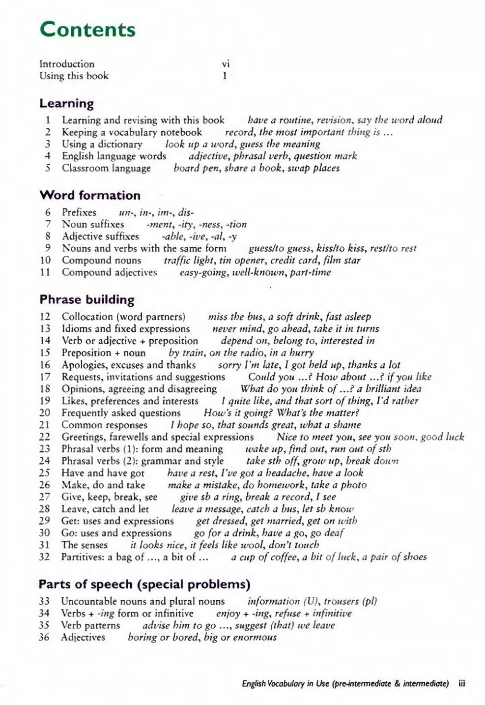

## Contents
Introduction vi
Using this book 1
## Learning
- 1 Learning and revising with this book have a routine, revision, say the word aloud
- 2 Keeping a vocabulary notebook record, the most important thing is ...
- 3 Using a dictionary look up a word, guess the meaning
- 4 English language words adjective, phrasal verb, question mark
- 5 Classroom language board pen, share a book, swap places
Word formation
- 6 Prefixes un-, in-, im-, dis-
- 7 Noun suffixes -ment, -ity, -ness, -tion
- 8 Adjective suffixes -able, -ive, -al, -y
- 9 Nouns and verbs with the same form guess/to guess, kiss/to kiss, rest/to rest
- 10 Compound nouns traffic light, tin opener, credit card, film star
- 11 Compound adjectives easy-going, well-known, part-time
Phrase building
- 12 Collocation (word partners) miss the bus, a soft drink, fast asleep
13. Idioms and fixed expressions never mind, go ahead, take it in turns
- 14 Verb or adjective + preposition depend on, belong to, interested in
- 15 Preposition + noun by train, on the radio, in a hurry
- 16 Apologies, excuses and thanks sorry I’m late, I got held up, thanks a lot
- 17 Requests, invitations and suggestions Could you ...? How about ...? if you like
- 18 Opinions, agreeing and disagreeing What do you think of ...? a brilliant idea
- 19 Likes, preferences and interests I quite like, and that sort of thing, I'd rather
- 20 Frequently asked questions How’s it going? What's the matter?
- 21 Common responses I hope so, that sounds great, what a shame
- 22 Greetings, farewells and special expressions Nice to meet you, see you soon, good luck
- 23 Phrasal verbs (1): form and meaning wake up, find out, run out of sth
- 24 Phrasal verbs (2): grammar and style take sth off, grow up, break down
- 25 Have and have got have a rest, I’ve got a headache, have a look
- 26 Make, do and take make a mistake, do homework, take a photo
- 27 Give, keep, break, see give sb a ring, break a record, I sce
- 28 Leave, catch and ler leave a message, catch a bus, let sb know
- 29 Get: uses and expressions get dressed, get married, get on with
- 30 Go: uses and expressions go for a drink, have a go, go deaf
- 31 The senses it looks nice, it feels like wool, don’t touch
- 32 Partitives: a bag of ..., a bit of ... a cup of coffee, a bit of luck, a pair of shoes
## Parts of speech (special problems)
- 33 Uncountable nouns and plural nouns information (U), trousers (pl)
- 34 Verbs + -ing form or infinitive enjoy + -ing, refuse + infinitive
- 35 Verb patterns advise him to go ..., suggest (that) we leave
- 36 Adjectives boring or bored, big or enormous
English Vocabulary in Use (pre-intermediate & intermediate) iii

---

# Page 5

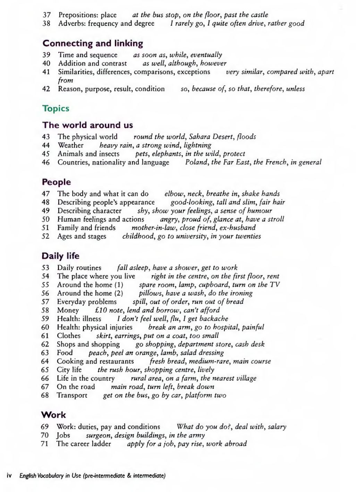

- 37 Prepositions: place at the bus stop, on the floor, past the castle
- 38 Adverbs: frequency and degree I rarely go,   quite often drive, rather good
## Connecting and linking
- 39 Time and sequence as soon as, while, eventually
- 40 Addition and contrast as well, although, however
- 41 Similarities, differences, comparisons, exceptions very similar, compared with, apart
from
- 42 Reason, purpose, result, condition so, because of, so that, therefore, unless
## Topics
The world around us
- 43 The physical world round the world, Sahara Desert, floods
- 44 Weather heavy rain, a strong wind, lightning
- 45 Animals and insects pets, elephants, in the wild, protect
- 46 Countries, nationality and language Poland, the Far East, the French, in general
## People
- 47 The body and what it can do elbow, neck, breathe in, shake hands
- 48 Describing people’s appearance good-looking, tall and slim, fair hair
- 49 Describing character shy, show your feelings, a sense of humour
- 50 Human feelings and actions angry, proud of, glance at, have a stroll
- 51 Family and friends mother-in-law, close friend, ex-husband
- 52 Ages and stages childhood, go to university, in your twenties
Daily life
- 53 Daily routines fall asleep, have a shower, get to work
- 54 The place where you live right in the centre, on the first floor, rent
- 55 Around the home (1) spare room, lamp, cupboard, turn on the TV
- 56 Around the home (2) pillows, have a wash, do the ironing
- 57 Everyday problems spill, out of order, run out of bread
- 58 Money £10 note, lend and borrow, can’t afford
- 59 Health: illness I don't feel well, flu, I get backache
- 60 Health: physical injuries break an arm, go to hospital, painful
- 61 Clothes skirt, earrings, put on a coat, too small
- 62 Shops and shopping go shopping, department store, cash desk
- 63 Food peach, peel an orange, lamb, salad dressing
- 64 Cooking and restaurants fresh bread, medium-rare, main course
- 65 City life the rush hour, shopping centre, lively
- 66 Life in the country rural area, on a farm, the nearest village
- 67 On the road main road, turn left, break down
- 68 Transport get on the bus, go by car, platform two
Work
- 69 Work: duties, pay and conditions What do you do?, deal with, salary
- 70 Jobs surgeon, design buildings, in the army
- 71 The career ladder apply for a job, pay rise, work abroad
iv English Vocabulary in Use (pre-intermediate & intermediate)

---

# Page 6

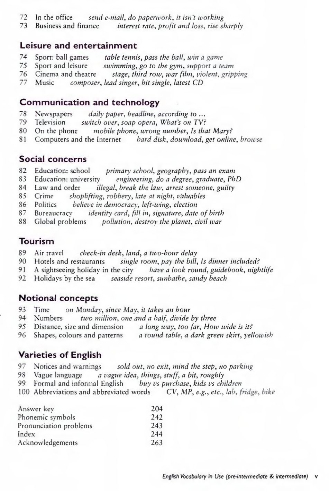

- 72 In the office send e-mail, do paperwork, it isn’t working
- 73 Business and finance interest rate, profit and loss, rise sharply
Leisure and entertainment
- 74 Sport: ball games table tennis, pass the ball, win a game
- 75 Sport and leisure swimming, go to the gym, support a team
- 76 Cinema and theatre stage, third row, war film, violent, gripping
- 77 Music composer, lead singer, hit single, latest CD
Communication and technology
- 78 Newspapers daily paper, beadline, according to ...
- 79 Television switch over, soap opera, What's on TV?
- 80 On the phone mobile phone, wrong number, Is that Mary?
- 81 Computers and the Internet hard disk, download, get online, browse
Social concerns
- 82 Education: school primary school, geography, pass an exam
- 83 Education: university engineering, do a degree, graduate, PhD
- 84 Law and order illegal, break the law, arrest someone, guilty
- 85 Crime shoplifting, robbery, late at night, valuables
- 86 Politics believe in democracy, left-wing, election
- 87 Bureaucracy identity card, fill in, signature, date of birth
- 88 Global problems pollution, destroy the planet, civil war
Tourism
- 89 Air travel check-in desk, land, a two-hour delay
- 90 Hotels and restaurants single room, pay the bill, Is dinner included?
- 91 A sightseeing holiday in the city have a look round, guidebook, nightlife
- 92 Holidays by the sea seaside resort, sunbathe, sandy beach
Notional concepts
- 93 Time on Monday, since May, it takes an hour
- 94 Numbers two million, one and a half, divide by three
- 95 Distance, size and dimension a long way, too far, How wide is it?
- 96 Shapes, colours and patterns a round table, a dark green skirt, yellowish
Varieties of English
- 97 Notices and warnings sold out, no exit, mind the step, no parking
- 98 Vague language a vague idea, things, stuff, a bit, roughly
- 99 Formal and informal English buy vs purchase, kids vs children
- 100 Abbreviations and abbreviated words CV, MP, e.g., etc., lab, fridge, bike
Answer key 204
Phonemic symbols 242
Pronunciation problems 243
Index 244
Acknowledgements 263
English Vocabulary in Use (pre-intermediate & intermediate)

---

# Page 7

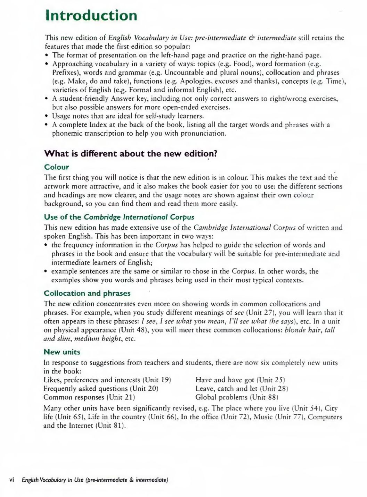

## Introduction

This new edition of English Vocabulary in Use: pre-intermediate & intermediate still retains the

features that made the first edition so popular:

¢ The format of presentation on the left-hand page and practice on the right-hand page.

© Approaching vocabulary in a variety of ways: topics (e.g. Food), word formation (e.g. Prefixes), words and grammar (e.g. Uncountable and plural nouns), collocation and phrases (e.g. Make, do and take), functions (e.g. Apologies, excuses and thanks), concepts (e.g. Time), varieties of English (e.g. Formal and informal English), etc.

¢ A student-friendly Answer key, including not only correct answers to right/wrong exercises, but also possible answers for more open-ended exercises.

¢ Usage notes that are ideal for self-study learners.

¢ A complete Index at the back of the book, listing all the target words and phrases with a phonemic transcription to help you with pronunciation.

What is different about the new edition?

Colour

The first thing you will notice is that the new edition is in colour. This makes the text and the artwork more attractive, and it also makes the book easier for you to use: the different sections and headings are now clearer, and the usage notes are shown against their own colour background, so you can find them and read them morc easily.

Use of the Combridge Internationa! Corpus

This new edition has made extensive use of the Cambridge International Corpus of written and

spoken English. This has been important in two ways:

¢ the frequency information in the Corpus has helped to guide the selection of words and phrases in the book and ensure that the vocabulary will be suitable for pre-intermediate and intermediate learners of English;

© example sentences are the same or similar to those in the Corpus. In other words, the examples show you words and phrases being used in their most typical contexts.

Collocation and phrases

The new edition concentrates even more on showing words in common collocations and phrases. For example, when you study different meanings of see (Unit 27), you will learn thar it often appears in these phrases: I see, I see what you mean, I'll see what (be says), etc. In a unit on physical appearance (Unit 48), you will meet these common collocations: blonde hair, tall and slim, mediwm height, etc.

New units

In response to suggestions from teachers and students, there are now six completely new units in the book:

Likes, preferences and interests (Unit 19) Have and have got (Unit 25)

Frequently asked questions (Unit 20) Leave, catch and let (Unit 28)

Common responses (Unit 21) Global problems (Unit 88)

Many other units have been significantly revised, e.g. The place where you live (Unit 54), City life (Unit 65), Life in the country (Unit 66), In the office (Unit 72), Music (Unit 77), Computers and the Internet (Unit 81).

vi English Vocabulary in Use (pre-intermediate & intermediate)

---

# Page 8

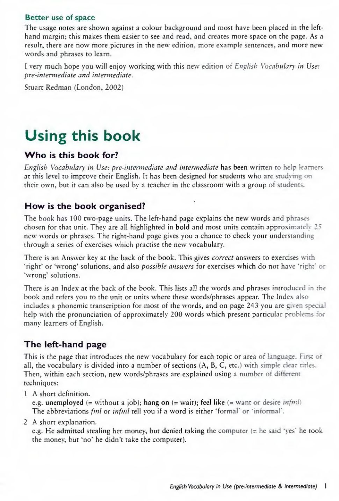

Better use of space

The usage notes are shown against a colour background and most have been placed in the left- hand margin; this makes them easier to see and read, and creates more space on the page. As a result, there are now more pictures in the new edition, more example sentences, and more new words and phrases to learn.

I very much hope you will enjoy working with this new edition of English Vocabulary in Use: pre-intermediate and intermediate.

Stuart Redman (London, 2002)

### Using this book

Who is this book for?

English Vocabulary in Use: pre-intermediate and intermediate has been written to help leamers at this level to improve their English. It has been designed for students who are studying on their own, but it can also be used by a teacher in the classroom with a group of students.

How is the book organised?

The book has 100 two-page units. The left-hand page explains the new words and phrases chosen for that unit. They are all highlighted in bold and most units contain approximately 25 new words or phrases. The right-hand page gives you a chance to check your understanding through a series of exercises which practise the new vocabulary.

There is an Answer key at the back of the book. This gives correct answers to exercises with ‘right’ or ‘wrong’ solutions, and also possible answers for exercises which do not have ‘right’ or ‘wrong’ solutions.

There is an Index at the back of the book. This lists all the words and phrases introduced in the book and refers you to the unit or units where these words/phrases appear. The Index also includes a phonemic transcription for most of the words, and on page 243 you are given special help with the pronunciation of approximately 200 words which present particular problems for many learners of English.

The left-hand page

This is the page that introduces the new vocabulary for each topic or area of language. Firs: of all, the vocabulary is divided into a number of sections (A, B, C, etc.) with simple clear utiles. Then, within each section, new words/phrases are explained using a number of different techniques: 1 A short definition. e.g. unemployed (= without a job); hang on (= wait); feel like (= want or desire snfni/) The abbreviations fon! or infil tell you if a word is either ‘formal’ or “informal”. 2 A short explanation. e.g. He admitted stealing her money, but denied taking the computer (= he said ‘yes’ he took the money, but ‘no’ he didn’t take the computer).

English Vocabulary in Use (pre-intermediate & intermediate) |

---

# Page 9

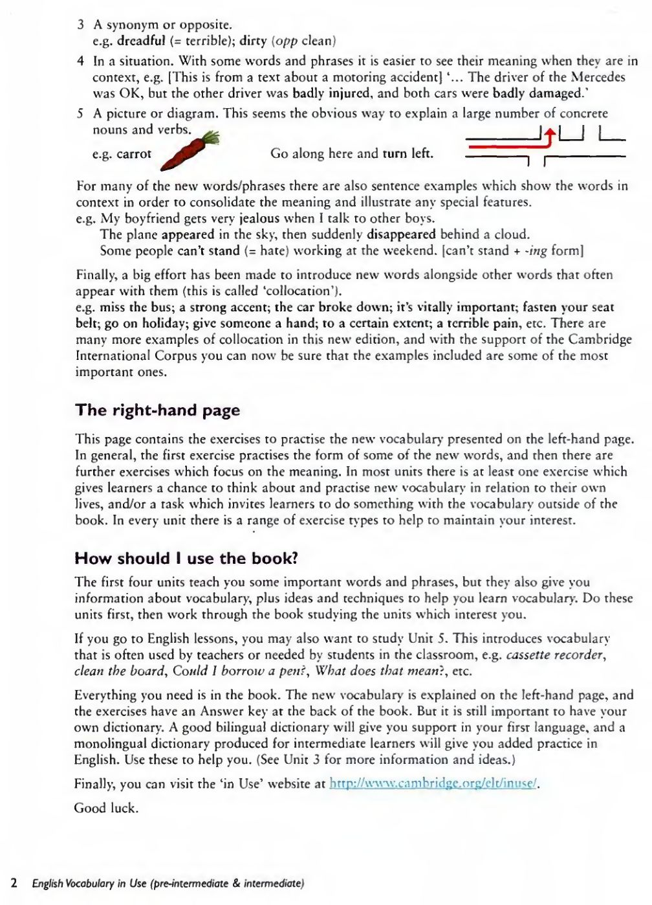

- 3 A synonym or opposite.
e.g. dreadful (= terrible); dirty (opp clean)
- 4 Ina situation. With some words and phrases it is easier to see their meaning when they are in
context, e.g. [This is from a text about a motoring accident] ‘... The driver of the Mercedes
was OK, but the other driver was badly injured, and both cars were badly damaged.’
- 5 A picture or diagram. This seems the obvious way to explain a large number of concrete
nouns and verbs. } 7 ae
e.g. Carrot Go along here and turn left. — -—_
For many of the new words/phrases there are also sentence examples which show the words in
context in order to consolidate the meaning and illustrate any special features.
e.g. My boyfriend gets very jealous when I talk to other boys.
The plane appeared in the sky, then suddenly disappeared behind a cloud.
Some people can’t stand (= hate) working at the weekend. [can’t stand + -ing form]
Finally, a big effort has been made to introduce new words alongside other words that often
appear with them (this is called ‘collocation’).
e.g. miss the bus; a strong accent; the car broke down; it’s vitally important; fasten your seat
belt; go on holiday; give someone a hand; to a certain extent; a terrible pain, etc. There are
many more examples of collocation in this new edition, and with the support of the Cambridge
International Corpus you can now be sure that the examples included are some of the most
important ones.
The right-hand page
This page contains the exercises to practise the new vocabulary presented on the left-hand page.
In general, the first exercise practises the form of some of the new words, and then there are
further exercises which focus on the meaning. In most units there is at least one exercise which
gives learners a chance to think about and practise new vocabulary in relation to their own
lives, and/or a task which invites learners to do something with the vocabulary outside of the
book. In every unit there is a range of exercise types to help to maintain your interest.
How should   use the book?
The first four units teach you some important words and phrases, but they also give you
information about vocabulary, plus ideas and techniques to help you learn vocabulary. Do these
units first, then work through the book studying the units which interest you.
If you go to English lessons, you may also want to study Unit 5. This introduces vocabulary
that is often used by teachers or needed by students in the classroom, e.g. cassette recorder,
clean the board, Could I borrow a pen?, What does that mean?, etc.
Everything you need is in the book. The new vocabulary is explained on the left-hand page, and
the exercises have an Answer key at the back of the book. But it is still important to have your
own dictionary. A good bilingual dictionary will give you support in your first language, and a
monolingual dictionary produced for intermediate learners will give you added practice in
English. Use these to help you. (See Unit 3 for more information and ideas.)
Finally, you can visit the ‘in Use’ website at hrtp://wwov.cambridge.org/elr/inuse/,
Good luck.
- 2 English Vocabulary in Use (pre-intermediate & intermediate)

---

# Page 10

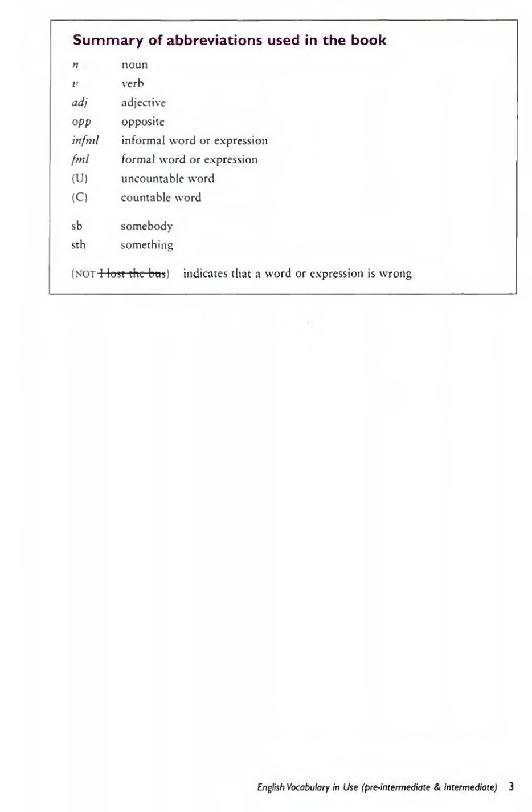

Summary of abbreviations used in the book

n noun

v verb

adj adjective

opp opposite

infml informal word or expression fl formal word or expression (U) uncountable word

(C) countable word

sb somebody sth something

(NoT-Hostthe-bus) indicates that a word or expression is wrong

English Vocabulary in Use (pre-intermediate & intermediate) 3

---

# Page 11

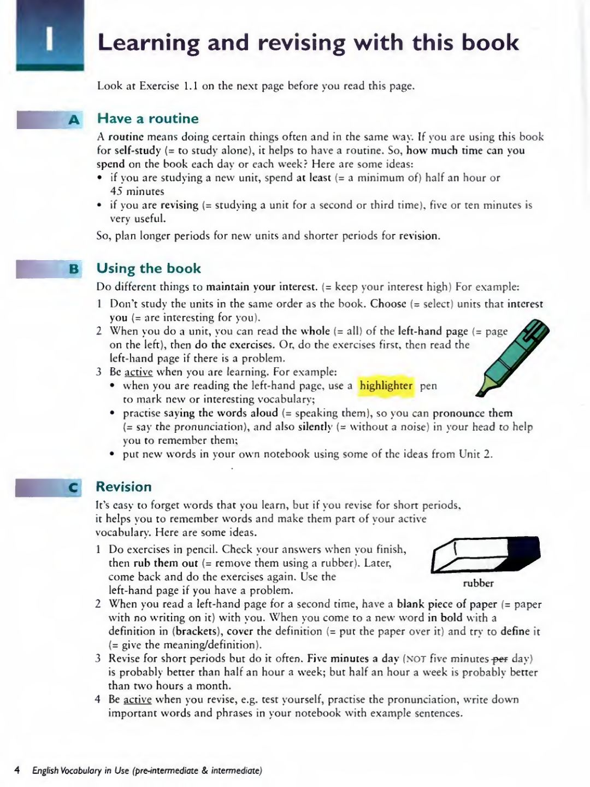

## Learning and revising with this book
Look at Exercise 1.1 on the next page before you read this page.
Have a routine
A routine means doing certain things often and in the same way. If you are using this book
for self-study (= to study alone), it helps to have a routine. So, how much time can you
spend on the book each day or cach week? Here are some ideas:
¢ if you are studying a new unit, spend at least (= a minimum of) half an hour or
45 minutes
¢ if you are revising (= studying a unit for a second or third time), five or ten minutes is
very useful.
So, plan longer periods for new units and shorter periods for revision.
Fr B_ Using the book
Do different things to maintain your interest. (= keep your interest high) For example:
- 1 Don’t study the units in the same order as the book. Choose (= select) units that interest
you (= are interesting for you).
- 2 When you do a unit, you can read the whole (= all) of the left-hand page (= page
on the left), then do the exercises. Or, do the exercises first, then read the
left-hand page if there is a problem.
- 3 Be active when you are learning. For example:
¢ when you are reading the left-hand page, use a highlighter pen
to mark new or interesting vocabulary;
* practise saying the words aloud (= speaking them), so you can pronounce them
(= say the pronunciation), and also silently (= without a noise) in your head to help
you to remember them;
© put new words in your own notebook using some of the ideas from Unit 2.
## HENNE) Revision
It’s easy to forget words that you learn, but if you revise for short periods,
it helps you to remember words and make them part of your active
vocabulary. Here are some ideas.
- 1 Do exercises in pencil. Check your answers when you finish,
then rub them out (= remove them using a rubber). Later,
come back and do the exercises again. Use the
rubber
left-hand page if you have a problem.
- 2 When you read a left-hand page for a second time, have a blank piece of paper (= paper
with no writing on it) with you. When you come to a new word in bold with a
definition in (brackets), cover the definition (= put the paper over it) and try to define it
(= give the meaning/definition).
- 3 Revise for short periods but do it often. Five minutes a day (NoT five minutes-per day)
is probably better than half an hour a week; but half an hour a week is probably better
than two hours a month.
- 4 Be active when you revise, e.g. test yourself, practise the pronunciation, write down
important words and phrases in your notebook with example sentences.
- 4 English Vocabulary in Use (pre-intermediate & intermediate)

---

# Page 12

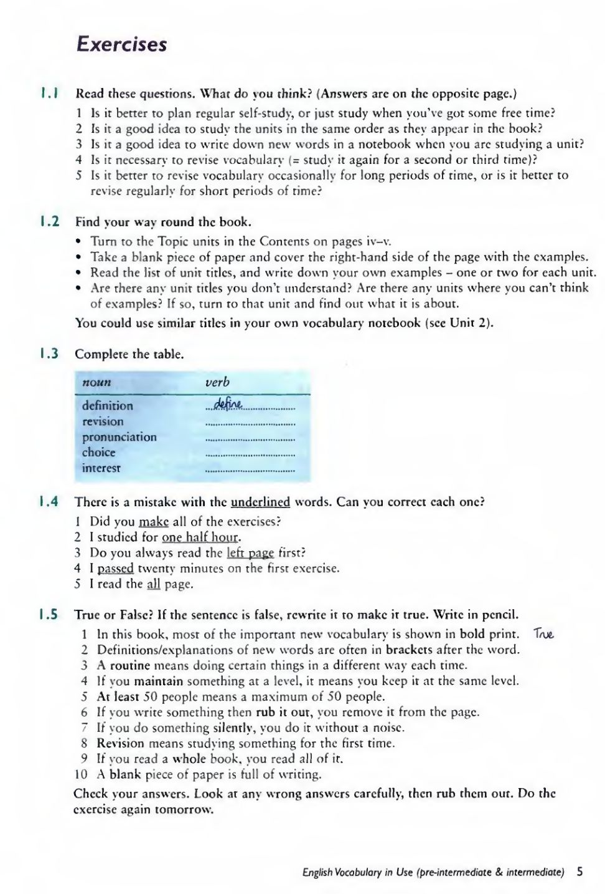

## Exercises
1.1 Read these questions. What do you think? (Answers are on the opposite page.)
- 1 Is it better to plan regular self-study, or just study when you’ve got some free time?
- 2 Is it a good idea to study the units in the same order as they appear in the book?
- 3 Is it a good idea to write down new words in a notebook when you are studying a unit?
- 4 Is it necessary to revise vocabulary (= study it again for a second or third time)?
- 5 Is it better to revise vocabulary occasionally for long periods of time, or is it better to
revise regularly for short periods of time?
1.2 Find your way round the book.
¢ Turn to the Topic units in the Contents on pages iv-v.
© Take a blank piece of paper and cover the right-hand side of the page with the examples.
* Read the list of unit titles, and write down your own examples — one or two for each unit.
¢ Are there any unit titles you don’t understand? Are there any units where you can’t think
of examples? If so, turn to that unit and find out what it is about.
You could use similar titles in your own vocabulary notebook (sce Unit 2).
1.3 Complete the table.
noun
definition
-s
pronunciation
choice
interest
1.4 There is a mistake with the underlined words. Can you correct cach one?
- 1 Did you make all of the exercises?
- 2 I studied for one half hour.
- 3 Do you always read the left page first?
- 4 I passed twenty minutes on the first exercise.
- 5 I read the all page.
1.5 True or False? If the sentence is false, rewrite it to make it true. Write in pencil.
- 1 In this book, most of the important new vocabulary is shown in bold print. Tne
- 2 Definitions/explanations of new words are often in brackets after the word.
- 3 A routine means doing certain things in a different way each time.
- 4 If you maintain something at a level, it means you keep it at the same level.
- 5 At least 50 people means a maximum of SO people.
- 6 If you write something then rub it out, you remove it from the page.
- 7 If you do something silently, you do it without a noise.
- 8 Revision means studying something for the first time.
- 9 If you read a whole book, you read all of it.
- 10 A blank piece of paper is full of writing.
Check your answers. Look at any wrong answers carefully, then rub them out. Do the
exercise again tomorrow.
English Vocabulary in Use (pre-intermediate & intermediate) 5

---

# Page 13

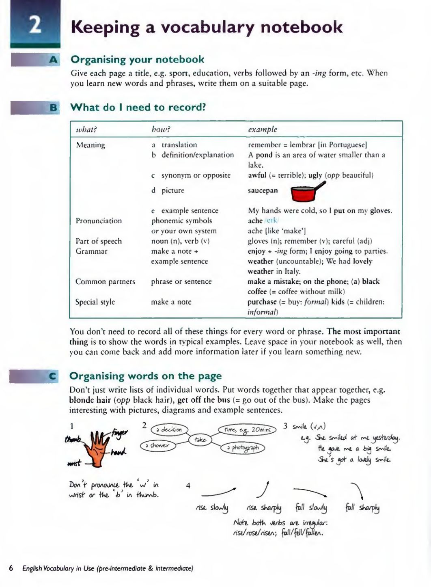

## Keeping a vocabulary notebook

Moa Organising your notebook

Give each page a title, e.g. sport, education, verbs followed by an -ing form, etc. When you learn new words and phrases, write them on a suitable page.

mm 5s What do I need to record?

what? how? example

Meaning translation remember = lembrar [in Portuguese] definition/explanation —_A pond is an area of water smaller than a lake. synonym or opposite awful (= terrible); ugly (opp beautiful)

picture saucepan

e example sentence My hands were cold, so I put on my gloves. Pronunciation phonemic symbols ache etk or your own system ache {like ‘make’] Part of speech noun (n), verb (v) gloves (n); remember (v); careful (adj) Grammar make a note + enjoy + -ing form; | enjoy going to parties. example sentence weather (uncountable); We had lovely weather in Italy. Common partners phrase or sentence make a mistake; on the phone; (a) black coffee (= coffee without milk) Special style make a note purchase (= buy: formal) kids (= children: informal)

You don’t need to record all of these things for every word or phrase. The most important thing is to show the words in typical examples. Leave space in your notebook as well, then you can come back and add more information later if you learn something new.

MS Organising words on the page

Don’t just write lists of individual words. Put words together that appear together, e.g. blonde hair (opp black hair), get off the bus (= go out of the bus). Make the pages interesting with pictures, diagrams and example sentences.

1 2 : 3° smile (v,a) fag CA ED tg. She smiled at me yesterday.

### ead: photograp i ome cab 6 fy see

### wont She's got a larly smile

### Don’t pronounce the ‘wi’ in 4

wrist or the “b’ in thumb. —= yy a ri

### rise Slowly rise sharply fall slowly fall sharply

Note both verbs ae = rise/rose/ risen; fall/fall/fallen.

6 English Vocabulary in Use (pre-intermediate & intermediate)

---

# Page 14

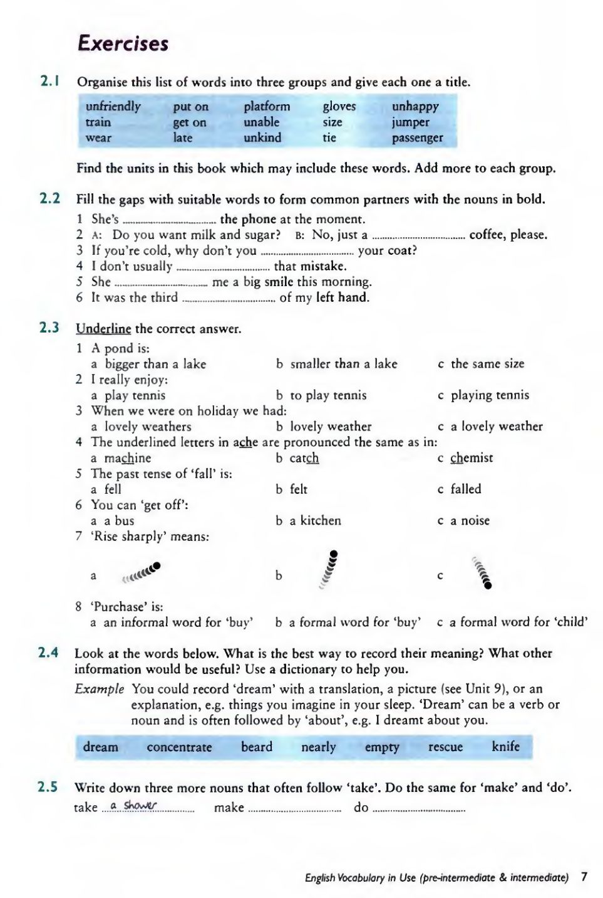

## Exercises
Zl
Organise this list of words into three groups and give each one a title.
## unfriendly put on platform gloves unhappy
## train get on unable size jumper
## wear late unkind tie passenger
Find the units in this book which may include these words. Add more to each group.
az
Fill the gaps with suitable words to form common partners with the nouns in bold.
- 1 Shes) 2 the phone at the moment.
2 a: Do you want milk and sugar? Bz No, just a o.necssssssssssseesenecesens coffee, please.
- 3 If you're cold, why don’t you wscscssssssesesuesssseenn your coat?
- 4 Noonitiisvally,, .....ccsetracsnnnte=. that mistake.
SD) ISHG)2 ersten ae .. me a big smile this morning.
- 6 Ut was the third on essesssneseennee of my left hand.
2.3
Underline the correct answer.
- 1 A pond is:
a bigger than a lake b smaller than a lake c the same size
- 2 I really enjoy:
a play tennis b to play tennis c playing tennis
- 3 When we were on holiday we had:
a lovely weathers b lovely weather c a lovely weather
- 4 The underlined letters in ache are pronounced the same as in:
a machine b catch c chemist
- 5 The past tense of ‘fall’ is:
a fell b felt c falled
- 6 You can ‘get off’:
a a bus b a kitchen c a noise
7 ‘Rise sharply’ means:
@ ,
## ow b £& c %
.
8 ‘Purchase’ is:
a an informal word for ‘buy’ —_b a formal word for ‘buy’ c a formal word for ‘child’
2.4
Look at the words below. What is the best way to record their meaning? What other
information would be useful? Use a dictionary to help you.
Example You could record ‘dream’ with a translation, a picture (see Unit 9), or an
explanation, e.g. things you imagine in your sleep. ‘Dream’ can be a verb or
noun and is often followed by ‘about’, e.g. I dreamt about you.
## dream concentrate beard nearly empty rescue knife
2.5
Write down three more nouns that often follow ‘take’. Do the same for ‘make’ and ‘do’.
English Vocabulary in Use (pre-intermediate & intermediate) 7

---

# Page 15

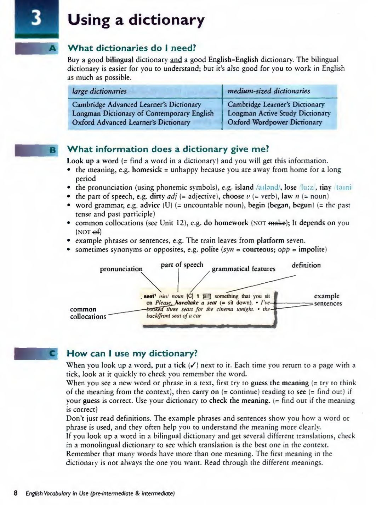

## Using a dictionary

What dictionaries do | need?

Buy a good bilingual dictionary and a good English-English dictionary. The bilingual dictionary is easier for you to understand; but it’s also good for you to work in English as much as possible.

large dictionaries medium-sized dictionaries Cambridge Advanced Learner’s Dictionary Cambridge Learner’s Dictionary Longman Dictionary of Contemporary English | Longman Active Study Dictionary Oxford Advanced Learner’s Dictionary Oxford Wordpower Dictionary

BB What information does a dictionary give me?

Look up a word (= find a word in a dictionary) and you will get this information.

¢ the meaning, e.g. homesick = unhappy because you are away from home for a long period

¢ the pronunciation (using phonemic symbols), e.g. island /atlond’, lose lu:z, tiny (taini

¢ the part of speech, e.g. dirty adj (= adjective), choose v (= verb), law 7 (= noun)

¢ word grammar, e.g. advice (U) (= uncountable noun), begin (began, begun) (= the past tense and past participle)

© common collocations (see Unit 12), e.g. do homework (NOT make); It depends on you (NOT ef)

© example phrases or sentences, e.g. The train leaves from platform seven.

® sometimes synonyms or opposites, e.g. polite (syz = courteous; opp = impolite)

part of speech definition

grammatical features

### papers

. seat’ /sin/ noun [C] 1 something that you sit example on Please, have/take a seat (= sil down). ¢ I've sentences

common _ toed three seats for the cinema tonight. + the

collocations back/front seat of a car

pronunciation

mec How can I use my dictionary?

When you look up a word, put a tick (“) next to it. Each time you return to a page with a tick, look at it quickly to check you remember the word.

When you see a new word or phrase in a text, first try to guess the meaning (= try to think of the meaning from the context), then carry on (= continue) reading to see (= find out) if your guess is correct. Use your dictionary to check the meaning. (= find out if the meaning is correct)

Don’t just read definitions. The example phrases and sentences show you how a word or phrase is used, and they often help you to understand the meaning more clearly.

If you look up a word in a bilingual dictionary and get several different translations, check in a monolingual dictionary to see which translation is the best one in the context. Remember that many words have more than one meaning. The first meaning in the dictionary is not always the one you want. Read through the different meanings.

8 English Vocabulary in Use (pre-intermediate & intermediate)

---

# Page 16

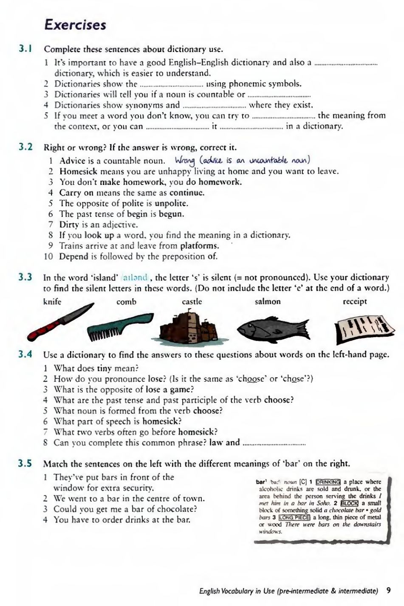

## Exercises
3.1 Complete these sentences about dictionary use.
- 1 It’s important to have a good English-English dictionary and also a wsssssessssssenesneeen
dictionary, which is easier to understand.
- 2 Dictionaries SHOW the ...ccsccssscscssessssensenes using phonemic symbols.
- 3 Dictionaries will cell you if a noun is CouMtable OF oceans:
- 4 Dictionaries show synonyms and ....ccscsssscsuseesennseees where they exist.
- 5 If you meet a word you don’t know, you can try to
inne torte secede en st the meaning from
in a dictionary.
the CONTENT, OF YOU CAM wccsscssssnnseeeenecseenneeee I Rsssoasssemssnenresvmrssssesanss
3.2 Right or wrong? If the answer is wrong, correct it.
- 1 Advice is a countable noun. Weong (adtw is an uncountable now)
- 2 Homesick means you are unhappy living at home and you want to leave.
- 3 You don't make homework, you do homework.
- 4 Carry on means the same as continue.
- 5 The opposite of polite is unpolite.
- 6 The past tense of begin is begun.
- 7 Dirty is an adjective.
- 8 If you look up a word, you find the meaning in a dictionary.
- 9 Trains arrive at and leave from platforms.
- 10 Depend is followed by the preposition of.
3.3 In the word ‘island’ ailond, the letter ‘s’ is silent (= not pronounced). Use your dictionary
to find the silent letters in these words. (Do not include the letter ‘c’ at the end of a word.)
knife comb castle salmon receipt
## a <*
3.4 Use a dictionary to find the answers to these questions about words on the left-hand page.
- 1 What does tiny mean?
- 2 How do you pronounce lose? (Is it the same as ‘chogse’ or ‘chgse’?)
- 3 What is the opposite of lose a game?
- 4 Whar are the past tense and past participle of the verb choose?
- 5 What noun is formed from the verb choose?
- 6 What part of speech is homesick?
What rwo verbs often go before homesick?
§ Can you complete this common phrase? law an wesc
3.5. Match the sentences on the left with the different meanings of ‘bar’ on the right.
o% ee, H
- 1 They ve put bars in front of the evil 4 apie woe
window for extra security. alcoholic drinks are sold and drunk, or the
- 2 We went to a bar in the centre of town. = Posse hi Praag 0 pg 4
- 3 Could you get me a bar of chocolate? block of something solid a chocolate bar © gold
- 4 You have to order drinks at the bar. eee ee ce scain anata
. seal bars 3 [ONG PIECE) a long, thin piece of metal
window's.
English Vocabulary in Use (pre-intermediate & intermediate) 9

---

# Page 17

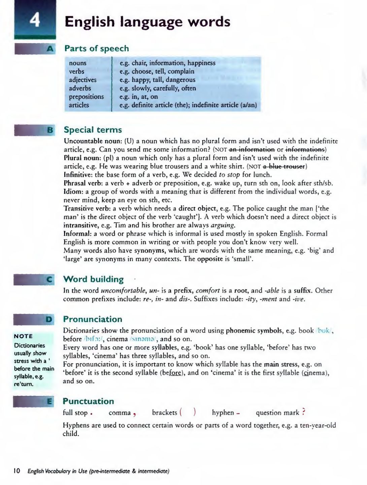

## English language words

Parts of speech

nouns e.g. chair, information, happiness

verbs e.g. choose, tell, complain

adjectives e.g. happy, tall, dangerous

adverbs e.g. slowly, carefully, often

prepositions e.g. in, at, on

articles e.g. definite article (the); indefinite article (a/an)

### WB Special terms

Uncountable noun: (U) a noun which has no plural form and isn’t used with the indefinite article, e.g. Can you send me some information? (NOT aninformation or informations) Plural noun: (pl) a noun which only has a plural form and isn’t used with the indefinite article, e.g. He was wearing blue trousers and a white shirt. (NOT a-bhie trouser) Infinitive: the base form of a verb, e.g. We decided to stop for lunch.

Phrasal verb: a verb + adverb or preposition, e.g. wake up, turn sth on, look after sth/sb. Idiom: a group of words with a meaning that is different from the individual words, e.g. never mind, keep an eye on sth, etc.

Transitive verb: a verb which needs a direct object, e.g. The police caught the man [‘the man?’ is the direct object of the verb ‘caught’}. A verb which doesn’t need a direct object is intransitive, e.g. Tim and his brother are always arguing.

Informal: a word or phrase which is informal is used mostly in spoken English. Formal English is more common in writing or with people you don’t know very well.

Many words also have synonyms, which are words with the same meaning, e.g. ‘big’ and ‘large’ are synonyms in many contexts. The opposite is ‘small’.

### BNE Word building

In the word uncomfortable, un- is a prefix, comfort is a root, and -able is a suffix. Other common prefixes include: re-, in- and dis-. Suffixes include: -ity, -ment and -ive.

### Hi » Pronunciation

Dictionaries show the pronunciation of a word using phonemic symbols, e.g. book buk , before ‘bifa:’, cinema /sinamo’, and so on. Dictionaries Every word has one or more syllables, e.g. ‘book’ has one syllable, ‘before’ has two

#### NOTE

usually ee _ syllables, ‘cinema’ has three syllables, and so on. or 2 For pronunciation, it is important to know which syllable has the main stress, e.g. on before the main. a a x. 5 eee : ilaiee: before’ it is the second syllable (before), and on ‘cinema’ it is the first syllable (cinema), Falbucee and so on.

### BEE Punctuation

full stop - comma 5 brackets ( ) hyphen - question mark ?

Hyphens are used to connect certain words or parts of a word together, e.g. a ten-year-old child.

10 English Vocabulary in Use (pre-intermediate & intermediate)

---

# Page 18

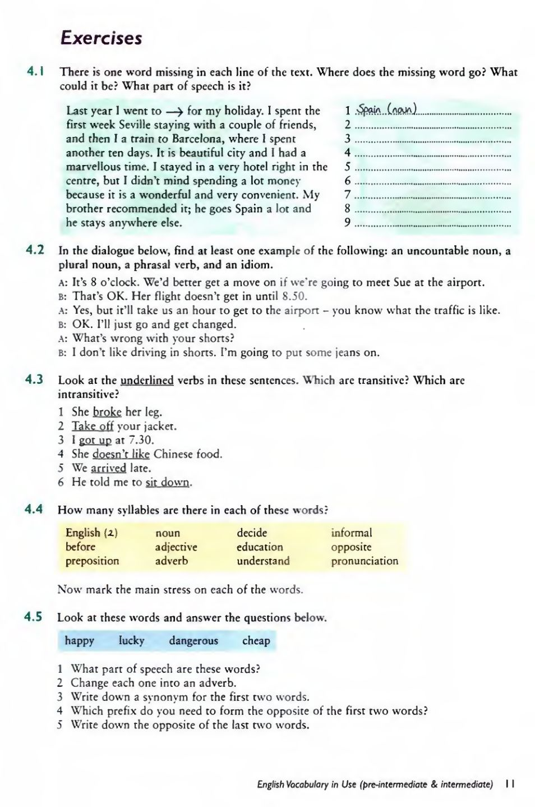

## Exercises
4.1
There is one word missing in each line of the text. Where does the missing word go? What
could it be? What part of speech is it?
Last year ] went to —> for my holiday. I spent the
first week Seville staying with a couple of friends,
and then I a train to Barcelona, where I spent
another ten days. It is beautiful city and I had a
marvellous time. I stayed in a very hotel right in the
centre, but I didn’t mind spending a lot money
because it is a wonderful and very convenient. My
brother recommended it; he goes Spain a lot and
he stays anywhere else.
4.2
In the dialogue below, find at least one example of the following: an uncountable noun, a
plural noun, a phrasal verb, and an idiom.
A: It’s 8 o’clock. We’d better get a move on if we're going to meet Sue at the airport.
B: That’s OK. Her flight doesn’t get in until 8.50.
A: Yes, but it’ll take us an hour to get to the airport —- you know what the traffic is like.
B: OK. I’ll just go and get changed.
A: What’s wrong with your shorts?
B: I don’t like driving in shorts. I’m going to put some jeans on.
4.3
Look at the underlined verbs in these sentences. Which are transitive? Which are
intransitive?
- 1 She broke her leg.
- 2 Take off your jacket.
- 3 I got up at 7.30.
- 4 She doesn’t like Chinese food.
- 5 We arrived late.
- 6 He told me to sit down.
4.4
How many syllables are there in each of these words?
English (2) noun decide informal
## before adjective education opposite
preposition adverb understand pronunciation
Now mark the main stress on each of the words.
4.5
Look at these words and answer the questions below.
## happy lucky dangerous cheap
- 1 What part of speech are these words?
- 2 Change each one into an adverb.
- 3 Write down a synonym for the first two words.
- 4 Which prefix do you need to form the opposite of the first two words?
- 5 Write down the opposite of the last two words.
English Vacabulary in Use (pre-intermediate & intermediate)   

---

# Page 19

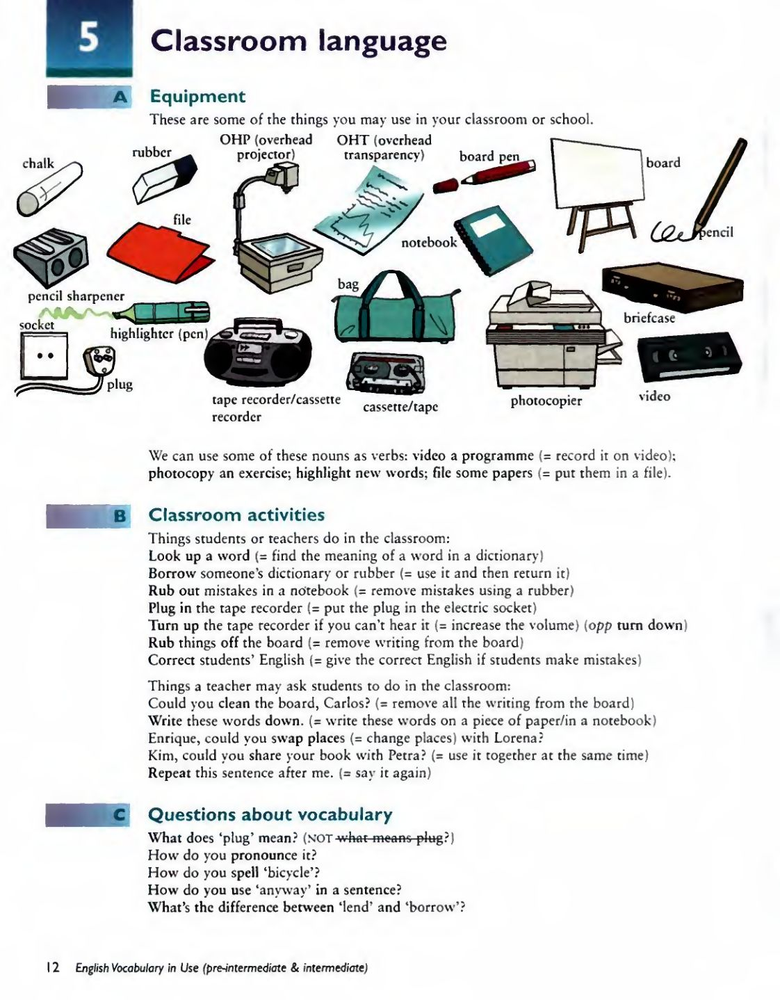

## Classroom language

## MEA Equipment

These are some of the things you may use in your classroom or school.

OHP (overhead OHT (overhead

## challe rubber r projector) transparency) board ——_ bond

; file 4a i Ses a3 : notebook =

## a

### pencil wo ES

photocopier video

### socket erent (pen) <

#### EI@.

tape = 3

cassette/tape recorder P

We can use some of these nouns as verbs: video a programme (= record it on video); photocopy an exercise; highlight new words; file some papers (= put them in a file).

Classroom activities

Things students or teachers do in the classroom:

Look up a word (= find the meaning of a word in a dictionary)

Borrow someone's dictionary or rubber (= use it and then return it)

Rub out mistakes in a notebook (= remove mistakes using a rubber)

Plug in the tape recorder (= put the plug in the electric socket)

Turn up the tape recorder if you can’t hear it (= increase the volume) (opp turn down) Rub things off the board (= remove writing from the board)

Correct students’ English (= give the correct English if students make mistakes)

Things a teacher may ask students to do in the classroom:

Could you clean the board, Carlos? (= remove all the writing from the board) Write these words down. (= write these words on a piece of paper/in a notebook) Enrique, could you swap places (= change places) with Lorena?

Kim, could you share your book with Petra? (= use it together at the same time) Repeat this sentence after me. (= say it again)

### BNE = Questions about vocabulary

What does ‘plug’ mean? (NOT a¥hat-means-phig?) How do you pronounce it? How do you spell ‘bicycle’? How do you use ‘anyway’ in a sentence? What’s the difference between ‘lend’ and ‘borrow’?

12. English Vocabulary in Use (pre-intermediate & intermediate)

---

# Page 20

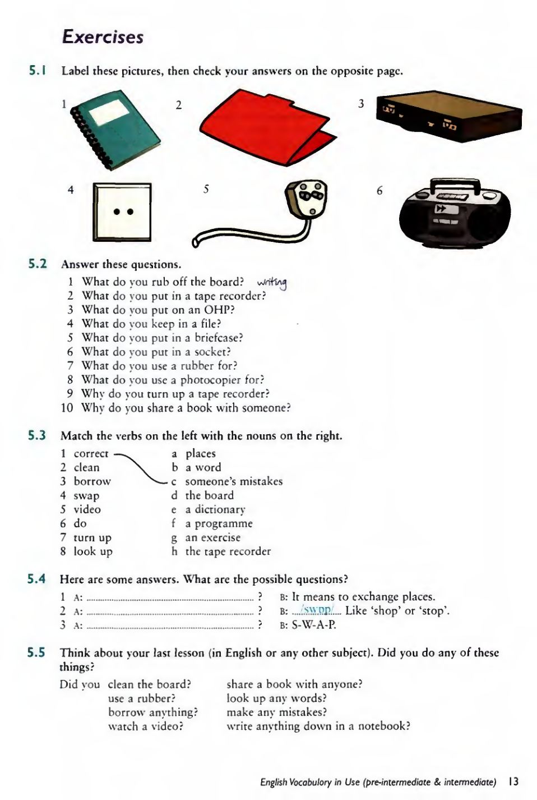

## Exercises
5.1
Label these pictures, then check your answers on the opposite page.
5.2
Answer these questions.
- 1 What do you rub off the board? — waiting
- 2 What do you put in a tape recorder?
3. What do you put on an OHP?
- 4 What do you keep in a file?
- 5 What do you put in a briefcase?
- 6 What do you put in a socket?
- 7 What do you use a rubber for?
- 8 Whar do you use a photocopier for?
- 9 Why do you turn up a tape recorder?
- 10 Why do you share a book with someone?
5.3
Match the verbs on the left with the nouns on the right.
1 correct a places
2 clean > b a word
3 borrow ¢ someone’s mistakes
4 swap d the board
5 video e a dictionary
6 do f a programme
7 turn up g an exercise
8 look up h the tape recorder
5.4
Here are some answers. What are the possible questions?
1A 8 ea ary er ?_B: It means to exchange places.
ON ar ON reer >? -B: .... SMV... Like ‘shop’ or ‘stop’.
- SGA ccc ae cere. ,crrremertece
- 2 B: S-W-A-P.
5.5
Think about your last lesson (in English or any other subject). Did you do any of these
things?
Did you clean the board? share a book with anyone?
use a rubber? look up any words?
borrow anything? make any mistakes?
watch a video? write anything down in a notebook?
13
English Vocabulory in Use (pre-intermediate & intermediate)

---

# Page 21

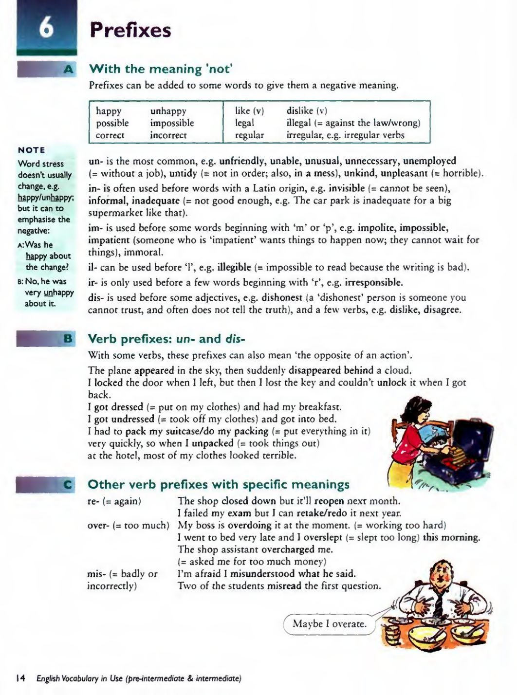

## Prefixes

With the meaning ‘not’ Prefixes can be added to some words to give them a negative meaning.

happy unhappy like (v) dislike (v)

possible impossible legal illegal (= against the law/wrong)

correct incorrect regular irregular, e.g. irregular verbs

#### NOTE

Word stress un- is the most common, e.g. unfriendly, unable, unusual, unnecessary, unemployed doesn’t usually | (= without a job), untidy (= not in order; also, in a mess), unkind, unpleasant (= horrible). change, e.g. in- is often used before words with a Latin origin, e.g. invisible (= cannot be seen), happy/unhappy: informal, inadequate (= not good enough, e.g. The car park is inadequate for a big bur Cane supermarket like that). emphasise the ; negative: im- is used before some words beginning with ‘m’ or ‘p’, e.g. impolite, impossible, Wasi impatient (someone who is ‘impatient’ wants things to happen now; they cannot wait for

happy about things), immoral. the change? __il- can be used before ‘I’, e.g. illegible (= impossible to read because the writing is bad).

8: No, he was ir- is only used before a few words beginning with ‘r’, e.g. irresponsible. ae dis- is used before some adjectives, e.g. dishonest (a ‘dishonest’ person is someone you

cannot trust, and often does not tell the truth), and a few verbs, e.g. dislike, disagree.

mm =.5 Verb prefixes: un- and dis-

With some verbs, these prefixes can also mean ‘the opposite of an action’.

The plane appeared in the sky, then suddenly disappeared behind a cloud.

I locked the door when I left, but then ] lost the key and couldn’t unlock it when I got back.

I got dressed (= put on my clothes) and had my breakfast.

I got undressed (= took off my clothes) and got into bed.

I had to pack my suitcase/do my packing (= put everything in it) very quickly, so when I unpacked (= took things our)

at the hotel, most of my clothes looked terrible.

### oc Other verb prefixes with specific meanings

re- (= again) The shop closed down but it’!] reopen next month. ] failed my exam but J can retake/redo it next year. over- (= too much) My boss is overdoing it at the moment. (= working too hard) ] went to bed very late and J overslept (= slept too long) this morning. The shop assistant overcharged me. (= asked me for too much money) mis- (= badly or I’m afraid I misunderstood what he said. incorrectly) Two of the students misread the first question.

Maybe I overate.

14 English Vocabulary in Use (pre-intermediate & intermediate)

---

# Page 22

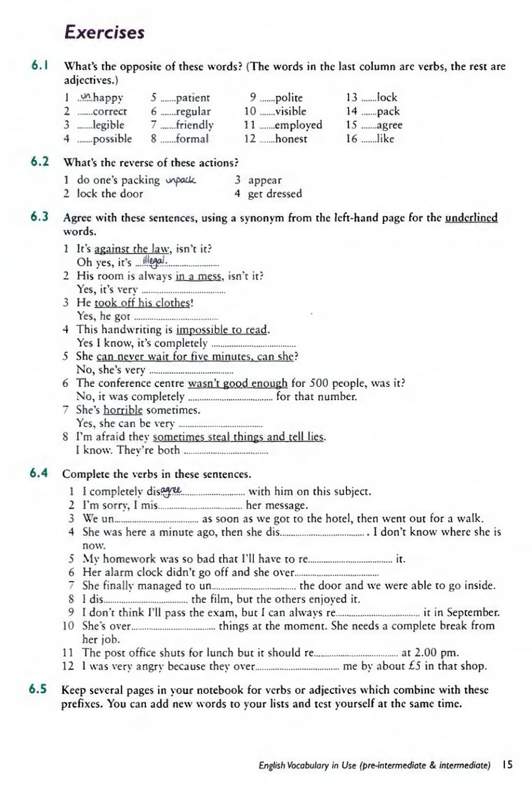

## Exercises
6.1
What’s the opposite of these words? (The words in the last column are verbs, the rest are
adjectives.)
1 happy 5 ......patient 9 ......polite 13 ......lock
2 ......correct 6 ...... regular 10 .......visible 14 .......pack
Se coat legible 7 ......friendly 11......employed 15 ......agree
ae possible —8........formal 12....... honest 16 .....ulike
6.2
What’s the reverse of these actions?
1 do one’s packing unpack 3 appear
2 lock the door 4 get dressed
6.3
Agree with these sentences, using a synonym from the left-hand page for the underlined
words.
- 1 It’s against the law, isn’t it?
Oh yes, it’s ile
- 2 His room is always in a mess, isn’t it?
Yes, it’s very
## ee oe
## D Co TC 0) eer er err
- 4 This handwriting is impossible to read.
Yes I know, it’s completely .....cccssscsssesenseesee
- 5 She can never wait for five minutes, can she?
No, she’s Very on.cccsssssssesnsesesecssseesene
- 6 The conference centre wasn’t good enough for 500 people, was it?
No, it was completely ........cscssssssssemseesenssee for that number.
- 7 She’s horrible sometimes.
Yes, she Cam be Very .ccccccccosssssssssssssseeseessnn
- 8 I'm afraid they i hi nd tell li
IT know. They’re both o.....cceccsssssesesessssseeee
6.4
Complete the verbs in these sentences.
- 1 Tcompletely disQ4 ee... scene with him on this subject.
Pe 6 0) 9 8   her message.
BS We aed a aessccsssscsssscoeesosestsone as soon as we got to the hotel, then went out for a walk.
- 4 She was here a minute ago, then she dis... csccsssueeeceseeeeees . 1 don’t know where she is
now.
- 5 My homework was so bad that I'll have £0 re..cscccsssesesessussseseenseee
- 6 Her alarm clock didn’t go off and She OVEE.....ccccsessesssssseseeenee
- 7 She finally managed £0 UN... .cssseessssesseeeeee the door and we were able to go inside.
ne ee the film, but the others enjoyed it.
- 9 I don’t think I'll pass the exam, but I cam always re... sss it in September.
LO She's OVEL ..ecsesscssssssssssesnsssssaseee things at the moment. She needs a complete break from
her job.
- 11 The post office shuts for lunch but it should re.......sssscssseseescueenseen at 2.00 pm.
- 12 I was very angry because they OVEE......ccsssssueseesseeeee me by about £5 in that shop.
6.5
Keep several pages in your notebook for verbs or adjectives which combine with these
prefixes. You can add new words to your lists and test yourself at the same time.
English Vocabulary in Use (pre-intermediate & intermediate) 5

---

# Page 23

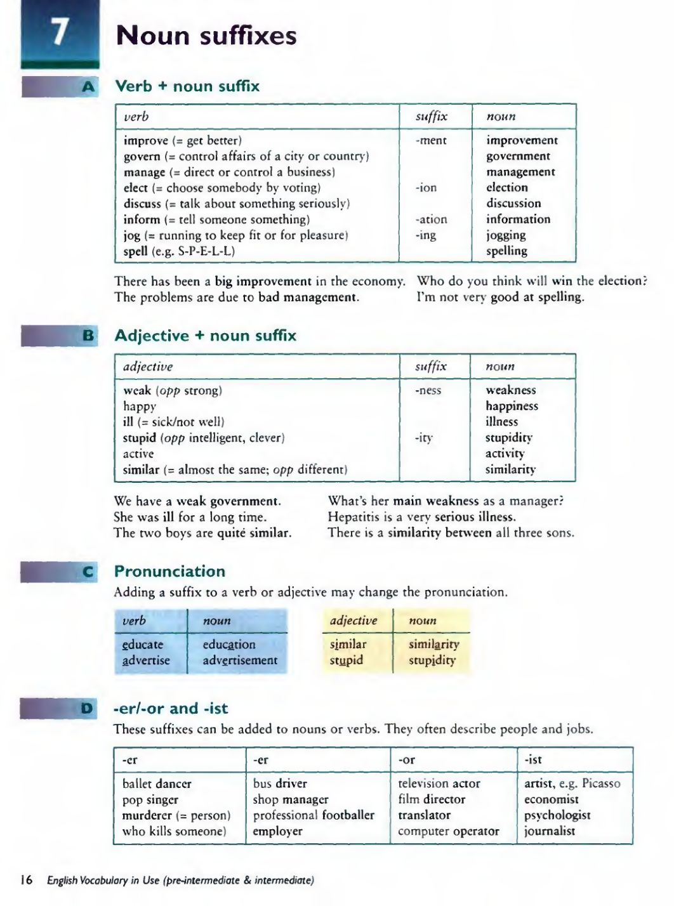

## Noun suffixes

Verb + noun suffix

## a

improve (= get better) improvement govern (= control affairs of a city or country) government manage (= direct or control a business) management

elect (= choose somebody by voting) election discuss (= talk about something seriously) discussion inform (= tell someone something) information jog (= running to keep fit or for pleasure) jogging spell (e.g. S-P-E-L-L) spelling

There has been a big improvement in the economy. Who do you think will win the election? The problems are due to bad management. I'm not very good at spelling.

By es Adjective + noun suffix

### cadens ———*di | rom

weak (opp strong) weakness

happy happiness

ill (= sick/not well) illness

stupid (opp intelligent, clever) stupidity

active activity

similar (= almost the same; opp different) similarity We have a weak government. What’s her main weakness as a manager? She was ill for a long time. Hepatitis is a very serious illness. The two boys are quité similar. There is a similarity between all three sons.

Pronunciation

Adding a suffix to a verb or adjective may change the pronunciation.

adjective

similar stupid

similarity stupidity

Mm > -er/-or and -ist

These suffixes can be added to nouns or verbs. They often describe people and jobs.

ballet dancer bus driver television actor artist, ¢.g. Picasso

pop singer shop manager film director economist murderer (= person) | professional footballer | translator psychologist who kills someone) employer computer operator journalist

16 — English Vocabulary in Use (pre-intermediate & intermediate)

---

# Page 24

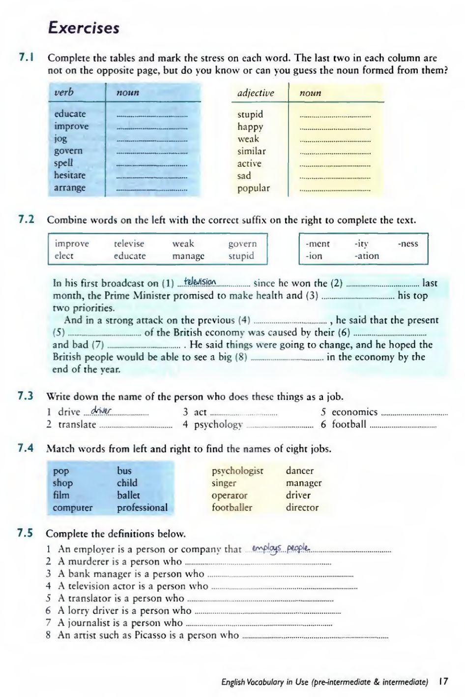

## Exercises
7.1
Complete the tables and mark the stress on cach word. The last two in each column are
not on the opposite page, but do you know or can you guess the noun formed from them?
adjective
stupid
happy
weak
similar
active
sad
popular
va
Combine words on the left with the correct suffix on the right to complete the text.
improve televise weak govern -ment -ity -ness
elect educate manage stupid -ion -ation
In his first broadcast on (1) ...fUOASI9g Since he WOM the (2) ccecscsccsscccsssrssseeseeeceseeeee last
month, the Prime Minister promised to make health and (3)
two priorities.
And in a strong attack on the previous (4) 0... , he said that the present
ne es 58 .. of the British economy was is anced by" ne (6) cesssssecssssscsssseessesesseseeseee
ANd bad (7) eeccoceecesessnenesesunee » He said things were going to es and he hoped the
British people would be able to see a big (8) ——nnnsesosssseenssaneeee 1M the economy by the
end of the year.
7.3
Write down the name of the person who does these things as a job.
1 drive AME oon 3) act) 2... ae, ©... S CCOMOMICS voeecssocsssenesssnsessnceoee
- a OL) F< ee 4 psychology occ
- 6 FOOTBALL ccceccsseeenseenneeeeee
7.4
Match words from left and right to find the names of cight jobs.
## pop bus psychologist dancer
shop child singer manager
## film ballet operaror driver
## computer professional footballer director
7.5
Complete the definitions below.
- 1 An employer is a person or company that .. &PlOYS..PROPMe ccsmssenmntnnnenene
- 2 A Murderer is a person WHO o..cccsssssoeessseseneevencunssssnenseeeeeeseen
- 3 A bank manager is a PersOM WHO occ coccncvssnsssnssssusecsseensnnnnnssseessunsecseeennnee
- 4 A television actor is a PCrsOM WHO ....sscccssccsssesseccccssseecceceeesessnsesceeesssneccteesesnet
- 5 A translator is a person who ..............
- 6 A lorry driver is a Person WHO o..c.ecccescosssssnsscsseesssussseceeseesnneseeeessnnneeseeeeenese
- 7 AvjorinmalistsIsiay PSrSOM WMO pan ansscmecsensscconcesoessssnsessmeontnteneen
- 8 An artist such as Picasso is a persOn WhO o.ceecsssseesssscussssseceessneneseseeenessssseeesnnsnsecset
English Vocabulary in Use (pre-intermediate & intermediate) 17

---

# Page 25

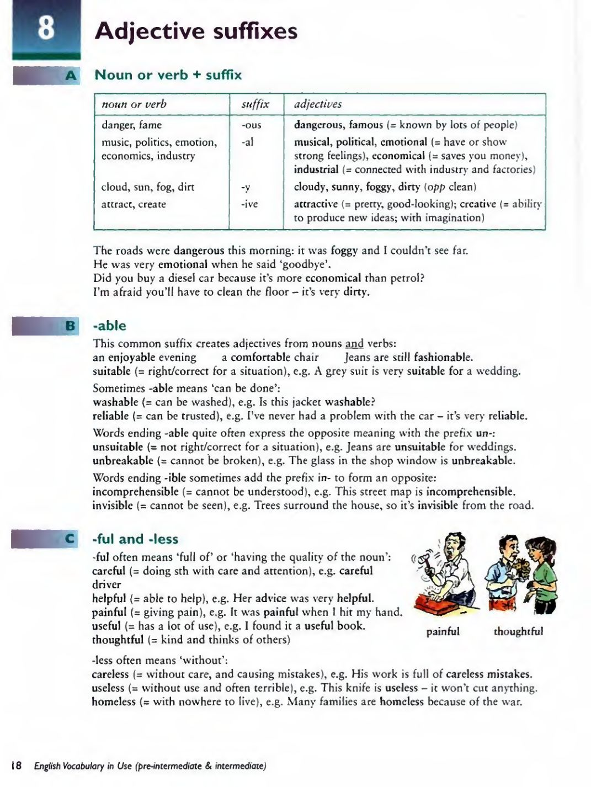

## Adjective suffixes

Noun or verb + suffix

danger, fame dangerous, famous (= known by lots of people)

music, politics, emotion, musical, political, emotional (= have or show economics, industry strong feelings), economical (= saves you money), industrial (= connected with industry and factories)

cloud, sun, fog, dirt } cloudy, sunny, foggy, dirty (opp clean)

attract, create attractive (= pretty, good-looking); creative (= abilicy to produce new ideas; with imagination)

The roads were dangerous this morning: it was foggy and I couldn't see far. He was very emotional when he said ‘goodbye’.

Did you buy a diesel car because it’s more economical than petrol?

I'm afraid you'll have to clean the floor — it’s very dirty.

### MENG) -abie

This common suffix creates adjectives from nouns and verbs: an enjoyable evening a comfortable chair Jeans are still fashionable. suitable (= right/correct for a situation), e.g. A grey suit is very suitable for a wedding.

Sometimes -able means ‘can be done’: washable (= can be washed), e.g. Is this jacket washable? reliable (= can be trusted), e.g. I've never had a problem with the car — it’s very reliable.

Words ending -able quite often express the opposite meaning with the prefix un-: unsuitable (= not right/correct for a situation), e.g. Jeans are unsuitable for weddings. unbreakable (= cannot be broken), e.g. The glass in the shop window is unbreakable.

Words ending -ible sometimes add the prefix in- to form an opposite: incomprehensible (= cannot be understood), e.g. This street map is incomprehensible. invisible (= cannot be seen), e.g. Trees surround the house, so it’s invisible from the road.

Mc -ful and -less

-ful often means ‘full of’ or ‘having the quality of the noun’: = ¢ careful (= doing sth with care and attention), e.g. careful ; driver

helpful (= able to help), e.g. Her advice was very helpful. painful (= giving pain), e.g. It was painful when I hit my hand. useful (= has a lot of use), e.g. I found it a useful book. thoughtful (= kind and thinks of others)

-less often means ‘without’:

careless (= without care, and causing mistakes), e.g. His work is full of careless mistakes. useless (= without use and often terrible), e.g. This knife is useless — it won’t cut anything. homeless (= with nowhere to live), e.g. Many families are homeless because of the war.

### painful thoughtful

18 — English Vocabulary in Use (pre-intermediate & intermediate)

---

# Page 26

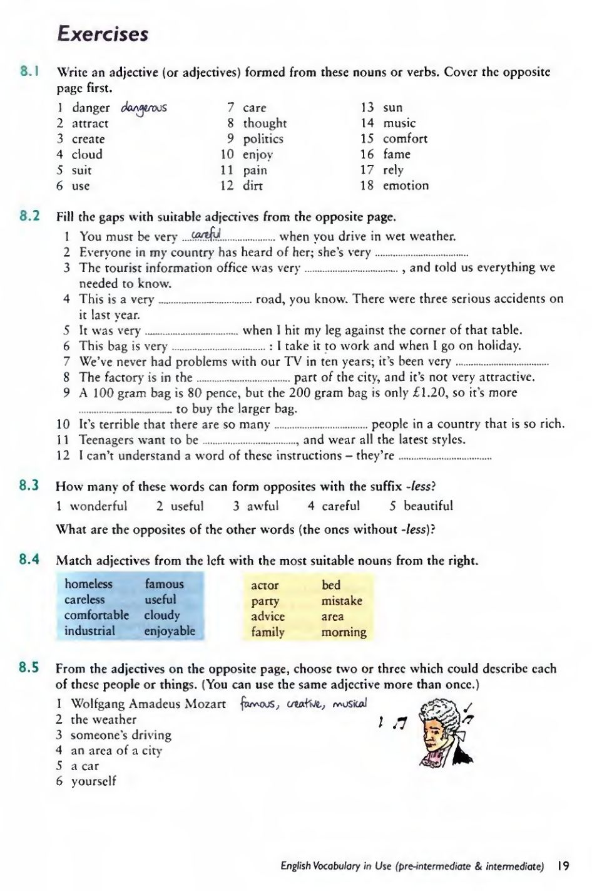

## Exercises
8.1
Write an adjective (or adjectives) formed from these nouns or verbs. Cover the opposite
page first.
1 danger dangerous 7 care 13 sun
2 attract 8 thought 14 music
3 create 9 politics 15 comfort
4 cloud 10 enjoy 16 fame
5 suit 11 pain 17 rely
6 use 12 dirt 18 emotion
8.2
Fill the gaps with suitable adjectives from the opposite page.
- 1 You must be very ...@YY when you drive in wet weather.
- 2 Everyone in my country has heard of hers she’s Very ...sscsssssessssssseesens
- 3 The tourist information office Was Very o..ccsssssssneseneseee
needed to know.
- 4 This is & VOry ecceeesesceneecteeeeseeeeee road, you know. There were three serious accidents on
it last year.
5: lpwas very. when   hit my leg against the corner of that table.
- 6 This bag is very 2. necscncssscccssseenne : I take it to work and when I go on holiday.
- 7 We've never had problems with our TV in ten years; it’s beeMm Very ....esscssssssemsseeenseee
- 8 The factory is inh the .ccescscssssssssssssceusseseees part of the city, and it’s not very attractive.
- 9 A 100 gram bag is 80 pence, but the 200 gram bag is only £1.20, so it’s more
= ... to buy the larger bag.
- 10 Ie’ s terrible that There are SO MANY o.n.ccecccccssssesesesuneeeeeiee people in a country that is so rich.
11) Teenagers Want to be o..cccsssscsssecscsseneesseeun , and wear all the latest styles.
- 12 I can’t understand a word of these instructions — they?re wccscsssssesssneessseee
8.3
How many of these words can form opposites with the suffix -/ess?
1 wonderful 2 useful 3 awful 4 careful 5 beautiful
What are the opposites of the other words (the ones without -less)?
8.4
Match adjectives from the left with the most suitable nouns from the right.
## homeless famous actor bed
## careless useful party mistake
comfortable cloudy advice area
## industrial enjoyable family morning
8.5
From the adjectives on the opposite page, choose two or three which could describe cach
of these people or things. (You can use the same adjective more than once.)
- 1 Wolfgang Amadeus Mozart famous, creative, musical
2 the weather
3 someone's driving
4 an area of a city
5 acar
6 yourself
English Vocabulary in Use (pre-intermediate & intermediate) 19

---

# Page 27

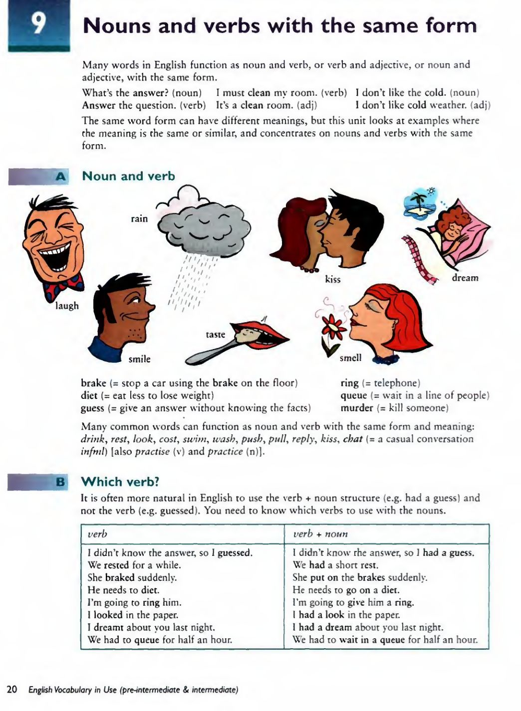

## Nouns and verbs with the same form

Many words in English function as noun and verb, or verb and adjective, or noun and adjective, with the same form.

What’s the answer? (noun) —_I must clean my room. (verb) I don’t like the cold. (noun) Answer the question. (verb) It’s a clean room. (adj) 1 don’t like cold weather. (adj) The same word form can have different meanings, but this unit looks at examples where the meaning is the same or similar, and concentrates on nouns and verbs with the same form.

kiss

### mig

#### A : ,

### taste Y

smile smell brake (= stop a car using the brake on the floor) ring (= telephone) diet (= eat less to lose weight) queue (= wait in a line of people) guess (= give an answer without knowing the facts) murder (= kill someone)

Many common words can function as noun and verb with the same form and meaning: drink, rest, look, cost, swim, wash, push, pull, reply, kiss, chat (= a casual conversation infil) [also practise (v) and practice (n)}.

ENB Which verb?

It is often more natural in English to use the verb + noun structure (e.g. had a guess) and not the verb (e.g. guessed). You need to know which verbs to use with the nouns.

I didn’t know the answer, so | guessed. I didn’t know rhe answer, so ] had a guess. We rested for a while. We had a short rest. She braked suddenly. She put on the brakes suddenly.

He needs to diet. He needs to go on a diet.

I’m going to ring him. I'm going to give him a ring.

1 looked in the paper. | had a look in the paper.

I dreamt about you last night. I had a dream about you last night.

We had to queue for half an hour. We had to wait in a queue for half an hour.

20 — English Vocabulary in Use (pre-intermediate & intermediate)

---

# Page 28

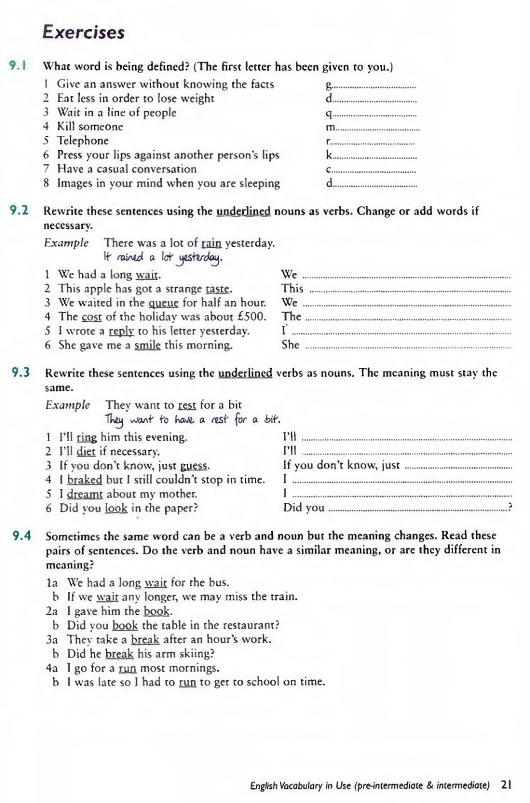

## Exercises
9.1
What word is being defined? (The first letter has been given to you.)
  Give an answer without knowing the facts [Boesessoneeassssoconresessssceseen
- 2 Eatless in order to lose weight «= heesssssearnessnstnseneneunee
- 3 Wait in a line of people Ce
- 4 Kill someone
- 5 Telephone
- 6 Press your lips against another person’s lips k
- 7 Have a casual conversation
- 8 Images in your mind when you are sleeping
¥.2
Rewrite these sentences using the underlined nouns as verbs. Change or add words if
necessary.
Example There was a lot of rain yesterday.
it rained a let yesterday.
- 1 We had a long wait.
- 2 This apple has got a strange taste.
- 3 We waited in the queue for half an hour.
- 4 The cost of the holiday was about £500.
- 5 I wrote a reply to his letter yesterday.
- 6 She gave me a smile this morning.
9.3
Rewrite these sentences using the underlined verbs as nouns. The meaning must stay the
same.
Example They want to rest for a bit
They wont to hove a est for a dit.
- 1 Ill ring him this evening.
- 2 I'll diet if necessary.
- 3 If vou don’t know, just guess.
4   braked bur! still couldn’t stop in time.
- 5 I dreamt about my mother.
- 6 Did vou look in the paper?
9.4
Sometimes the same word can be a verb and noun but the meaning changes. Read these
pairs of sentences. Do the verb and noun have a similar meaning, or are they different in
meaning?
la We had a long wair for the bus.
b If we wait any longer, we may miss the train.
2a J gave him the book.
b Did vou book the table in the restaurant?
3a They take a break after an hour’s work.
b Did he break his arm skiing?
4a 1 go for a run most mornings.
b I was late so J had to run to get to school on time.
English Vocabulary in Use (pre-intermediate & intermediate) 21

---

# Page 29

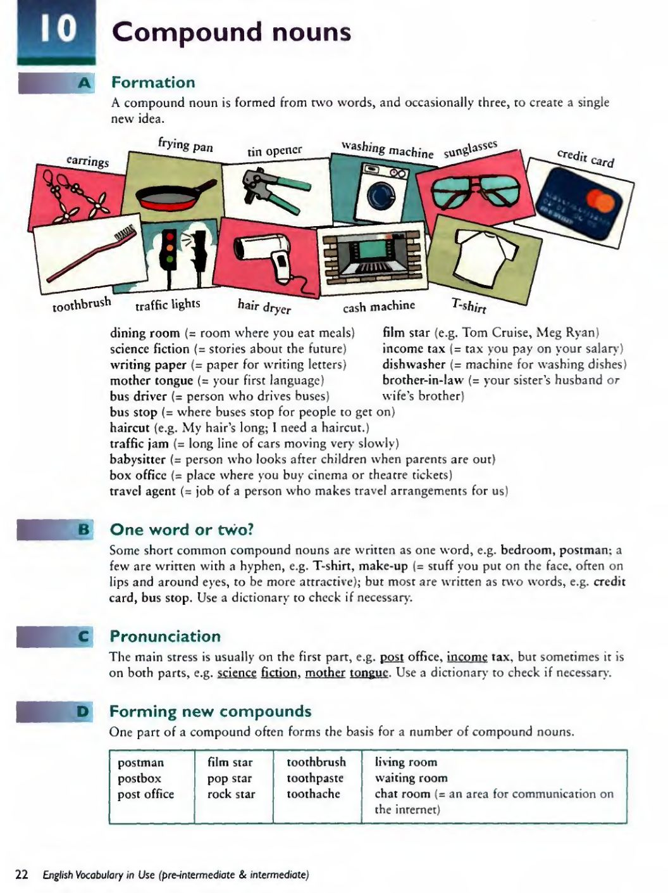

## Compound nouns

Formation

A compound noun is formed from two words, and occasionally three, to create a single new idea.

frying pan tin opener

toothbrush traffic lights hair dryer cash machine Tshirg dining room (= room where you eat meals) film star (e.g. Tom Cruise, Meg Ryan) science fiction (= stories about the future) income tax (= tax you pay on your salary) writing paper (= paper for writing letters) dishwasher (= machine for washing dishes) mother tongue (= your first language) brother-in-law (= your sister’s husband or bus driver (= person who drives buses) wife’s brother)

bus stop (= where buses stop for people to get on)

haircut (e.g. My hair’s long; I need a haircut.)

traffic jam (= long line of cars moving very slowly)

babysitter (= person who looks after children when parents are out) box office (= place where you buy cinema or theatre tickets)

travel agent (= job of a person who makes travel arrangements for us)

Hs One word or two?

Some short common compound nouns are written as one word, e.g. bedroom, postman; a few are written with a hyphen, e.g. T-shirt, make-up (= stuff you put on the face, often on lips and around eyes, to be more attractive); but most are written as nwo words, e.g. credit card, bus stop. Use a dictionary to check if necessary.

### MS Pronunciation

The main stress is usually on the first part, e.g. post office, income tax, but sometimes it is on both parts, e.g. science fiction, mother tongue. Use a dictionary to check if necessary.

### BRD Forming new compounds

One part of a compound often forms the basis for a number of compound nouns.

postman film star toothbrush living room ostbox Op star toothpaste waiting room P pop P

post office rock star toothache chat room (= an area for communication on the internet)

22 English Vocabulary in Use (pre-intermediate & intermediate)

---

# Page 30

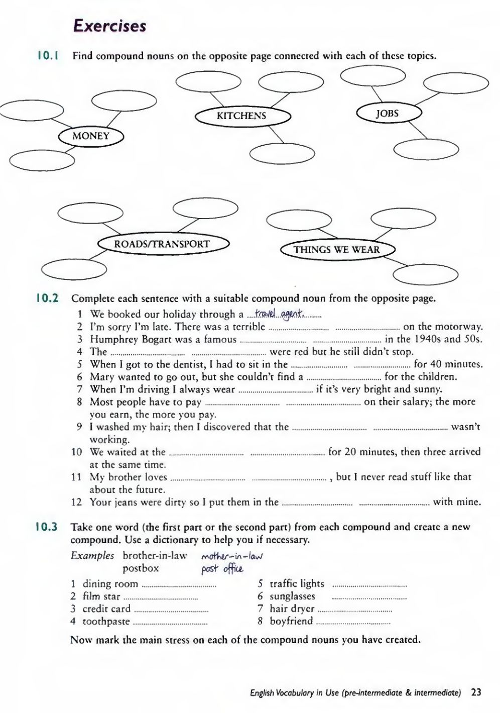

## Exercises
10.1 Find compound nouns on the opposite page connected with each of these topics.
10.2 Complete each sentence with a suitable compound noun from the opposite page.
- 1 We booked our holiday through a ....fcavel..agpat.....
- 2 I’m sorry I’m late. There was a terrible vou ON the motorway.
- 3 Humphrey Bogart was a famous onccccssssssuesssusssin stssssnnssunsesensesnsesene in the 1940s and SOs.
hy hisses en ssseet AE. sacseeaeatosesscentt oe were red but he still didn’t stop.
- 5 When I got to the dentist,   had to sit i the w..ccsccsssssssse  ssesnsessunsesenseeses for 40 minutes.
- 6 Mary wanted to go out, but she couldn’t find a w...csssssesuseeesneeee for the children.
- 7 When I’m driving I always wear .... . if it’s very bright and sunny.
- 8 Most people have to pay ccccccsasssssusssesssssnuse sasssesussessnsessnnsenennseee on their salary; the more
you earn, the more you pay.
- 9 IT washed my hair; then I discovered that the w.......scsssesssceesssecssee sesssseeeceeecssesnseeeseseeenseen wasn’t
working.
10) We waited at the voices ssnusssnnseeee £0 20 minutes, then three arrived
at the same time.
11) My brother loves cnsccccssmssssesesmmn stueneteaneane » DUCT never read stuff like that
about the future.
12) Your, jeansiwere dirty Soul ptarsthem im thetic accscsccccscsses csccssescoossnsseareoeresous with mine.
10.3 Take one word (the first part or the second part) from each compound and create a new
compound. Use a dictionary to help you if necessary.
Examples brother-in-law — mother-in-law
postbox post office
Liming rOOM w.eessssssussssnsseenseemnee 5 traffic Lights cscs
- DQ) MEAD TG (SCR sec eas eecsssesssen
- 6 SUMBIASSES — oeeceessscsssessssessseeeeenessene
3B Credit CALA occeccseccssssessnnnneene FZ hair dryer occcccscssssesseesnssseeneee
4 cOOtHPASTE ooneecccccssssnsesseseeessnnseee 8 boyfriend oo. cccccssssseseseeeeee
Now mark the main stress on each of the compound nouns you have created.
English Vocabulary in Use (pre-intermediate & intermediate) 23

---

# Page 31

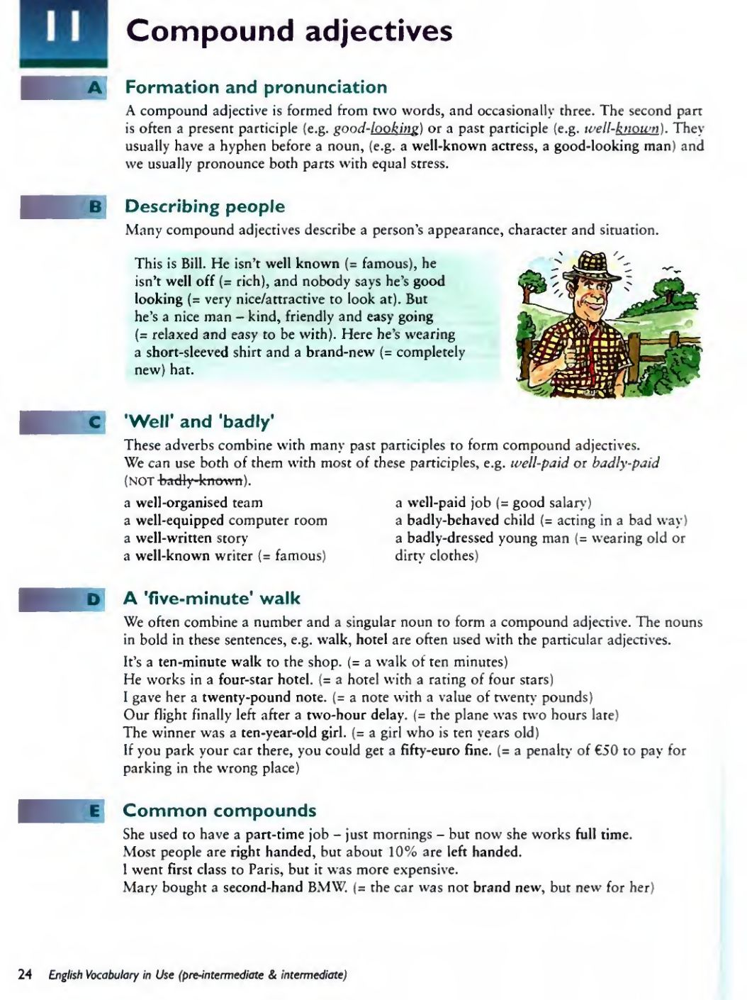

## alia Compound adjectives

HA Formation and pronunciation

A compound adjective is formed from two words, and occasionally three. The second part is often a present participle (e.g. good-looking) or a past participle (e.g. well-known). They usually have a hyphen before a noun, (e.g. a well-known actress, a good-looking man) and we usually pronounce both parts with equal stress.

## Describing people

Many compound adjectives describe a person’s appearance, character and situation.

This is Bill. He isn’t well known (= famous), he isn’t well off (= rich), and nobody says he’s good looking (= very nice/attractive to look at). But

he’s a nice man — kind, friendly and easy going

(= relaxed and easy to be with). Here he’s wearing a short-sleeved shirt and a brand-new (= completely new) hat.

"Well and ‘badly’ These adverbs combine with many past participles to form compound adjectives. We can use both of them with most of these participles, e.g. well-paid or badly-paid

(NOT badhy-known).

a well-organised team a well-paid job (= good salary)

a well-equipped computer room a badly-behaved child (= acting in a bad way) a well-written story a badly-dressed young man (= wearing old or a well-known writer (= famous) dirty clothes)

mm o A ‘five-minute’ walk

We often combine a number and a singular noun to form a compound adjective. The nouns in bold in these sentences, e.g. walk, hotel are often used with the particular adjectives.

It’s a ten-minute walk to the shop. (= a walk of ten minutes)

He works in a four-star hotel. (= a hotel with a rating of four stars)

I gave her a twenty-pound note. (= a note with a value of twenty pounds)

Our flight finally left after a two-hour delay. (= the plane was two hours late)

The winner was a ten-year-old girl. (= a girl who is ten years old)

If you park your car there, you could get a fifty-euro fine. (= a penalty of €50 to pay for parking in the wrong place)

### Mec Common compounds

She used to have a part-time job — just mornings — but now she works full time. Most people are right handed, but about 10% are left handed.

1 went first class to Paris, but it was more expensive.

Mary bought a second-hand BMW. (= the car was not brand new, but new for her)

24 — English Vocabulary in Use (pre-intermediate & intermediate)

---

# Page 32

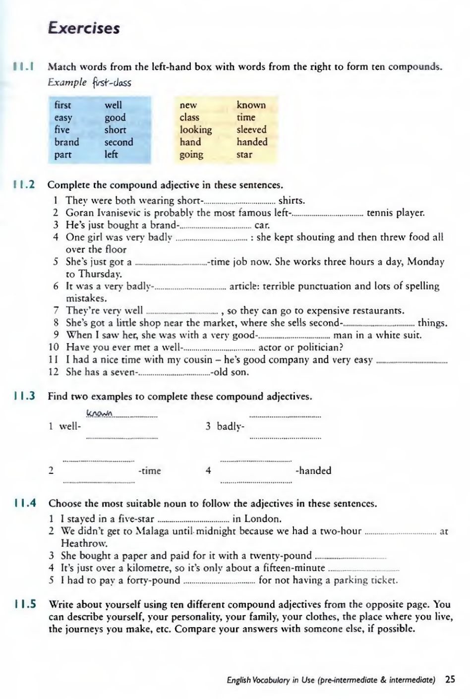

## Exercises
! 1.1 Match words from the left-hand box with words from the right to form ten compounds.
## Example first-dass
first well new known
easy good class time
## five short looking sleeved
brand second hand handed
## part left going star
!{.2 Complete the compound adjective in these sentences.
shirts.
] They were both wearing SHOrt~......ccsccccssseescusseeeen
- 2 Goran Ivanisevic is probably the most famous left-
tennis player.
- 3 He’s just bought a brand- car.
- 4 One girl was very badly ae. she kept shouting and then threw food all
over the floor
-time job now. She works three hours a day, Monday
S She's Just Zot a oeeeseceeecscsesosecsneeessesesee
to Thursday.
- 6 Ut was a very badly-....cccssssssssesssssesesee article: terrible punctuation and lots of spelling
mistakes.
- 7 They’re very well ....c.cccccsscnnsseee y SO they can go to expensive restaurants.
- 8 She’s got a little shop near the market, where she sells second=......ccssessssesssssseesseeen things.
- 9 When I saw her, she was with a very gOOd>.....csssssssssssussessseees man in a white suit.
- 10 Have you ever met a wWelle.esecseccssssscscssseesssossenn actor or politician?
11 [hada nice time with my cousin — he’s good company and Very CASY .esscssseesnseseeeeneee
2) GHA A SOVE TI H.esssccessvorscosesosens -old son.
11.3 Find two examples to complete these compound adjectives.
CE a rrr eee
1 well- 3 badly-
2 -time 4 -handed
11.4 Choose the most suitable noun to follow the adjectives in these sentences.
- 1 I stayed im a five-star on cssssssssenseeeeen in London.
- 2 We didn’t get to Malaga until. midnight because we had a two-hour 0.2... ccs AT
Heathrow.
- 3 She bought a paper and paid for it with a twenty-pound «rss
- 4 It’s just over a kilometre, so it’s only about a fifteen-minute o.oo
- 5 Thad to pay a forty-pound .....-cssessssssseesssseeteen for not having a parking ucket.
11.5 Write about yourself using ten different compound adjectives from the opposite page. You
can describe yourself, your personality, your family, your clothes, the place where you live,
the journeys you make, etc. Compare your answers with someone else, if possible.
English Vocabulary in Use (pre-intermediate & intermediate) 25

---

# Page 33

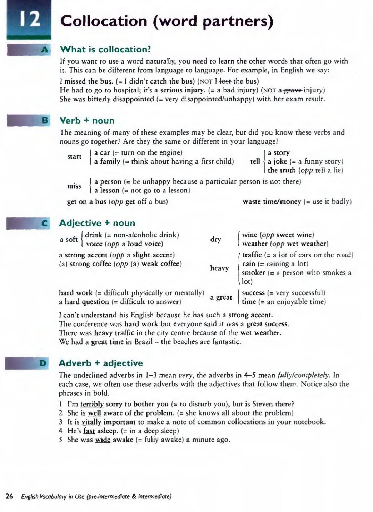

## Collocation (word partners)
What is collocation?
If you want to use a word naturally, you need to learn the other words that often go with
it. This can be different from language to language. For example, in English we say:
I missed the bus. (= 1 didn’t catch the bus) (NOT ] Jest the bus)
He had to go to hospital; it’s a serious injury. (= a bad injury) (NOT a-gra¥e injury)
She was bitterly disappointed (= very disappointed/unhappy) with her exam result.
MEE Verb + noun
The meaning of many of these examples may be clear, but did you know these verbs and
nouns go together? Are they the same or different in your language?
a car (= turn on the engine)   a story
—   a family (= think about having a first child) a joke (= a funny story)
tell
the truth (opp tell a lie)
—   a person (= be unhappy because a particular person is not there)
a lesson (= not go to a lesson)
get on a bus (opp get off a bus) waste time/money (= use it badly)
ME Adjective + noun
agate drink (= non-alcoholic drink) d   wine (opp sweet wine)
s voice (opp a loud voice) weather (opp wet weather)
a strong accent (opp a slight accent) traffic (= a lot of cars on the road)
(a) strong coffee (opp (a) weak coffee) h rain (= raining a lot)
eavy =
smoker (= a person who smokes a
lot)
hard work (= difficult physically or mentally) avenaae   success (= very successful)
a hard question (= difficult to answer) er time (= an enjoyable time)
I can’t understand his English because he has such a strong accent.
The conference was hard work but everyone said it was a great success.
There was heavy traffic in the city centre because of the wet weather.
We had a great time in Brazil - the beaches are fantastic.
## BD Adverb + adjective
The underlined adverbs in 1-3 mean very, the adverbs in 4-5 mean filly/completely. In
each case, we often use these adverbs with the adjectives that follow them. Notice also the
phrases in bold.
- 1 I’m terribly sorry to bother you (= to disturb you), but is Steven there?
- 2 She is well aware of the problem. (= she knows all about the problem)
- 3 It is vitally important to make a note of common collocations in your notebook.
- 4 He’s fast asleep. (= in a deep sleep)
- 5 She was wide awake (= fully awake) a minute ago.
26 — English Vacabulary in Use (pre-intermediate & intermediate)

---

# Page 34

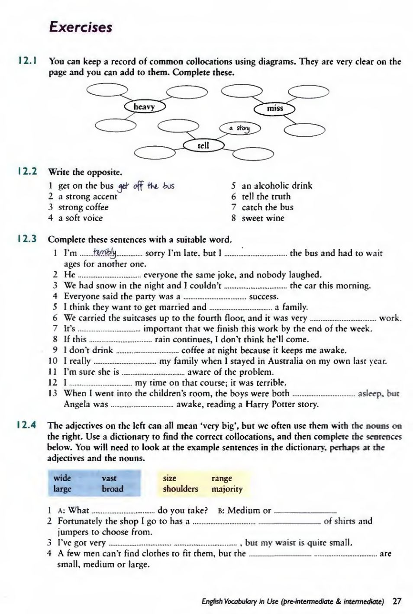

## Exercises
12.1 You can keep a record of common collocations using diagrams. They are very clear on the
page and you can add to them. Complete these.
12.2 Write the opposite.
1 get on the bus gt off the dus $ an alcoholic drink
2 a strong accent 6 tell the truth
3 strong coffee 7 catch the bus
4 a soft voice 8 sweet wine
12.3 Complete these sentences with a suitable word.
Oe i en, sorry I'm late. but D coeccsccnesnsssnsssnmenn the bus and had to wait
ages for another one.
- 2 He ee everyone the same joke, and nobody laughed.
the car this morning.
3. We had snow in the night and I couldn't ...ccsssssssseneseeennnee
- 4 Everyone said the party was a occ success.
- 5 Icthink they want to get married and .....ccccsscsssccnssssssseeuese a family.
- 6 We carried the suitcases up to the fourth floor, and it was very
- 7 Web aS important that we finish this work by the end of the week.
Ce   rr rain continues, I don’t think he’ll come.
9) Rdonitidrink, 2 no. coffee at night because it keeps me awake.
10" Pieally tn eee. my family when I stayed in Australia on my own last year.
- 11 I’m sure she is aware of the problem.
V2 TD eeeeeeeeeeeeesssseenenenee MY time on that course; it was terrible.
- 13 When Ie went into to the children’s room, the boys were both
Atigela Was)... ed awake, reading a Harry Potter story.
12.4 The adjectives on the left can all mean ‘very big’, but we often use them with the nouns on
the right. Use a dictionary to find the correct collocations, and then complete the sentences
below. You will need to look at the example sentences in the dictionary, perhaps at the
adjectives and the nouns.
## wide vast size range
## large broad shoulders —_ majority
 , 1:   do you take? 8B: Medium or
- 2 Fortunately the shop I go to has a w.csessssssssmuenseneeseeee oo __________ of shirts and
jumpers to choose from.
Bi MP ONES VE iy Arnel rasa s canvass N eDeiabacnsasanessscossos eves tnoes
, but my waist is quite small.
- 4 A few men can't find clothes to fit them, but the
small, medium or large.
English Vocabulary in Use (pre-intermediate & intermediate) 27

---

# Page 35

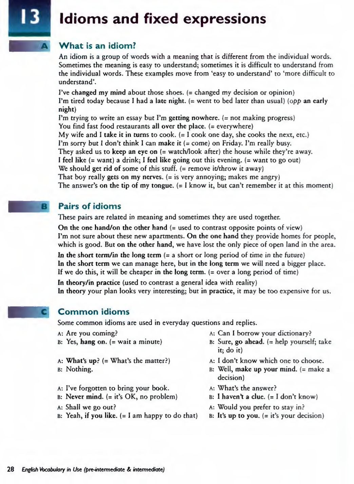

## Idioms and fixed expressions

ma What is an idiom?

An idiom is a group of words with a meaning that is different from the individual words. Sometimes the meaning is easy to understand; sometimes it is difficult to understand from the individual words. These examples move from ‘easy to understand’ to ‘more difficult to understand’.

I’ve changed my mind about those shoes. (= changed my decision or opinion)

I’m tired today because I had a late night. (= went to bed later than usual) (opp an early night)

I’m trying to write an essay but I’m getting nowhere. (= not making progress)

You find fast food restaurants all over the place. (= everywhere)

My wife and I take it in turns to cook. (= I cook one day, she cooks the next, etc.)

I’m sorry but I don’t think I can make it (= come) on Friday. I’m really busy.

They asked us to keep an eye on (= watch/look after) the house while they’re away.

I feel like (= want) a drink; I feel like going out this evening. (= want to go out)

We should get rid of some of this stuff. (= remove it/throw it away)

That boy really gets on my nerves. (= is very annoying; makes me angry)

The answer’s on the tip of my tongue. (= I know it, but can’t remember it at this moment)

m =5 Pairs of idioms

These pairs are related in meaning and sometimes they are used together.

On the one hand/on the other hand (= used to contrast opposite points of view) I’m not sure about these new apartments. On the one hand they provide homes for people, which is good. But on the other hand, we have lost the only piece of open land in the area.

In the short term/in the long term (= a short or long period of time in the future)

In the short term we can manage here, but in the long term we will need a bigger place. If we do this, it will be cheaper in the long term. (= over a long period of time)

In theory/in practice (used to contrast a general idea with reality)

In theory your plan looks very interesting; but in practice, it may be too expensive for us.

Mc Common idioms

Some common idioms are used in everyday questions and replies.

A: Are you coming? A: Can I borrow your dictionary?

B: Yes, hang on. (= wait a minute) B: Sure, go ahead. (= help yourself; take it; do it)

A: What’s up? (= What’s the matter?) A: I don’t know which one to choose.

8: Nothing. B: Well, make up your mind. (= make a decision)

A: I’ve forgotten to bring your book. A: What’s the answer?

B: Never mind. (= it’s OK, no problem) B: I haven't a clue. (= I don’t know)

A: Shall we go out? A: Would you prefer to stay in?

B: Yeah, if you like. (= Iam happy to do that) __B: It’s up to you. (= it’s your decision)

28 English Vocabulary in Use (pre-intermediate & intermediate)

---

# Page 36

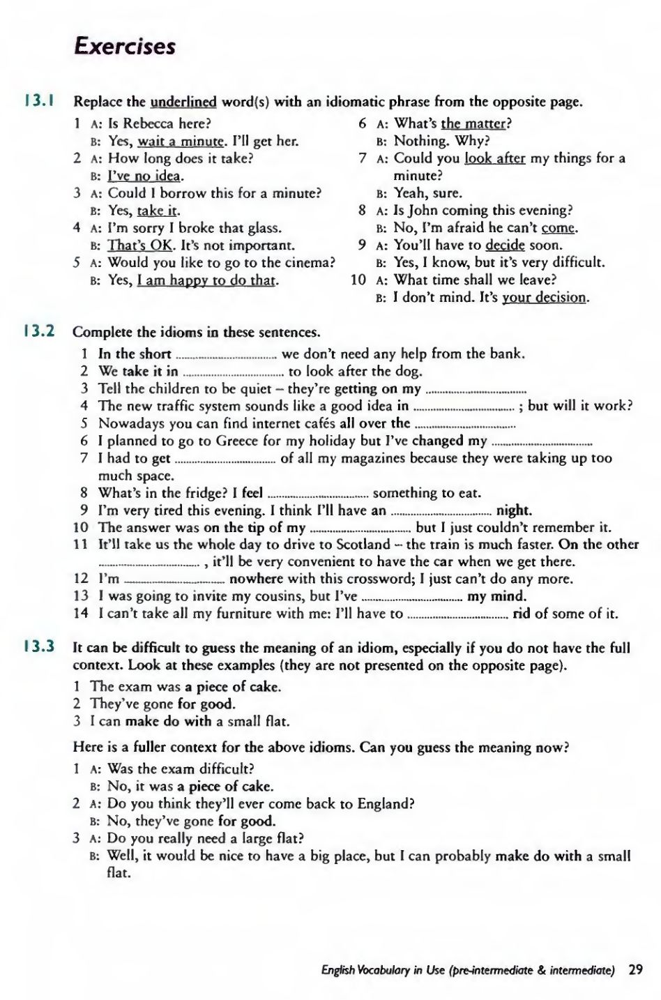

## Exercises
13.1 Replace the underlined word(s) with an idiomatic phrase from the opposite page.
- 1 a: Is Rebecca here?
- 6 A: What’s the matter?
B: Yes, wait a minute. I'll get her. B: Nothing. Why?
- 2 A: How long does it take?
- 7 A: Could you look after my things for a
B: I’ve no idea. minute?
3 a: Could   borrow this for a minute? B: Yeah, sure.
- B: Yes, take it.
- 8 A: Is John coming this evening?
4 a: I’m sorry I broke that glass. B: No, I’m afraid he can’t come.
B: That’s OK. It’s not important. 9 a: You'll have to decide soon.
- 5 A: Would you like to go to the cinema? B: Yes, I know, but it’s very difficult.
- B: Yes, lam happy to do that.
- 10 A: What time shall we leave?
B: I don’t mind. It’s your decision.
13.2 Complete the idioms in these sentences.
TU the short .0.cccccscssssssuseene WE don’t need any help from the bank.
- 2 We take it im occcccccscssssssssnseeeen to look after the dog.
- 3 Tell the children to be quiet — they’re getting OM MY ....cscccesssessneesnes
- 4 The new traffic system sounds like a good idea in ........ .. 3 but will it work?
- 5 Nowadays you can find internet cafés all Over the .....scssocssssssssensesns
- 6 I planned to go to Greece for my holiday but I’ve changed my
- 7 Thad to get ...cccsssssssssnsseenneeensee of all my magazines because they were taking up too
ores a seesecenveccececenttovevesscncetenes
- 8 What’s in the fridge? I feel something to eat.
- 9 I’m very tired this evening. I think I'll have an night.
- 10 The answer was on the tip Of My wuss but I just couldn’t remember it.
- 11 It'll rake us the whole day to drive to ae Se faster. On the other
ee, oe oS , it'll be very convenient to have the car when we get there.
2 int ... nowhere with this crossword; I just can’t do any more.
13 1] was going to invite my Cousins, but PVE wees MY Mind.
- 14 I can’t take all my furniture with me: I’ll have to rid of some of it.
13.3 It can be difficult to guess the meaning of an idiom, especially if you do not have the full
context. Look at these examples (they are not presented on the opposite page).
- 1 The exam was a piece of cake.
- 2 They’ve gone for good.
- 3 I can make do with a small flat.
Here is a fuller context for the above idioms. Can you guess the meaning now?
1 a: Was the exam difficult?
B: No, it was a piece of cake.
2 a: Do you think they’ll ever come back to England?
B: No, they’ve gone for good.
- 3 A: Do you really need a large flat?
B: Well, it would be nice to have a big place, but I can probably make do with a small
flat.
English Vocabulary in Use (pre-intermediate & intermediate) 29

---

# Page 37

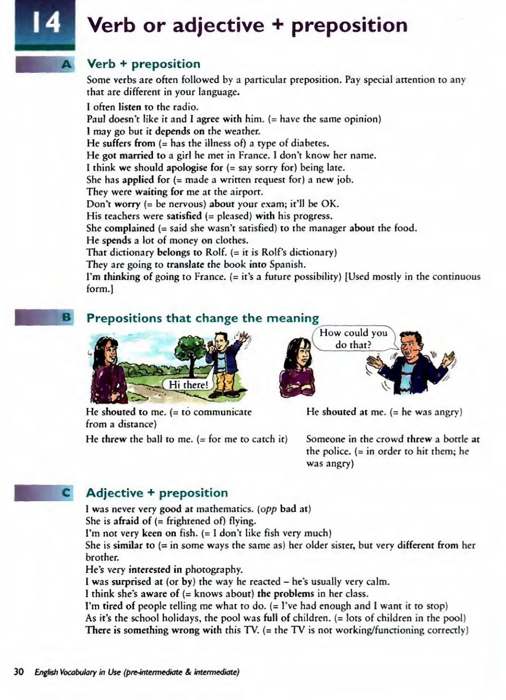

## Verb or adjective + preposition

Verb + preposition

Some verbs are often followed by a particular preposition. Pay special attention to any that are different in your language.

I often listen to the radio.

Paul doesn’t like it and I agree with him. (= have the same opinion)

1 may go but it depends on the weather.

He suffers from (= has the illness of) a type of diabetes.

He got married to a girl he met in France. I don’t know her name.

I think we should apologise for (= say sorry for) being late.

She has applied for (= made a written request for) a new job.

They were waiting for me at the airport.

Don’t worry (= be nervous) about your exam; it’l] be OK.

His teachers were satisfied (= pleased) with his progress.

She complained (= said she wasn’t satisfied) to the manager about the food. He spends a lot of money on clothes.

That dictionary belongs to Rolf. (= it is Rolf’s dictionary)

They are going to translate the book into Spanish.

I’m thinking of going to France. (= it’s a future possibility) [Used mostly in the continuous form.]}

### Prepositions that change the meaning

“How could you ) do that?

### \C dothars :

### SS)

He shouted to me. (= to communicate He shouted at me. (= he was angry) from a distance)

He threw the ball to me. (= for me to catch it) | Someone in the crowd threw a bottle at the police. (= in order to hit them; he was angry)

### Mc Adjective + preposition

] was never very good at mathematics. (opp bad at) She is afraid of (= frightened of) flying. I’m not very keen on fish. (= I don’t like fish very much) She is similar to (= in some ways the same as) her older sister, but very different from her brother. He’s very interested in photography. I was surprised at (or by) the way he reacted — he’s usually very calm. ] think she’s aware of (= knows about) the problems in her class. I’m tired of people telling me what to do. (= I’ve had enough and | want it to stop) As it’s the school holidays, the pool was full of children. (= lots of children in the pool) There is something wrong with this TV. (= the TV is not working/functioning correctly)

## 30 English Vocabulary in Use (preintermediate & intermediate)

---

# Page 38

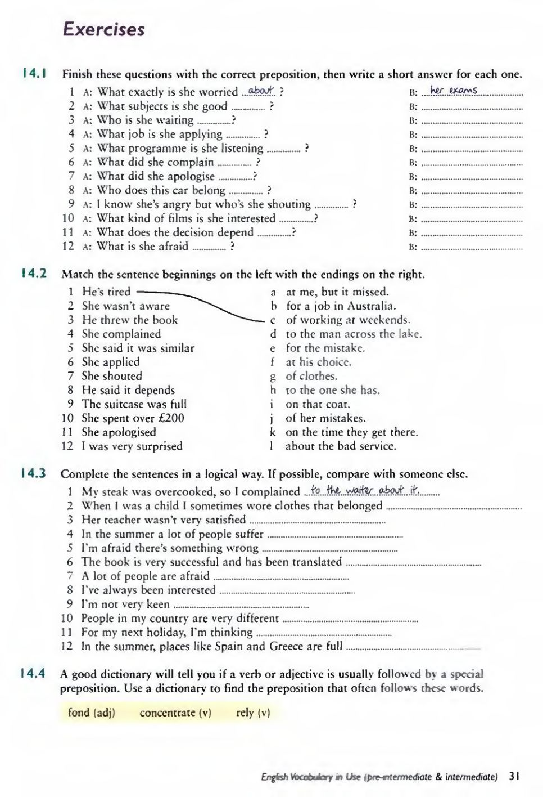

## Exercises
14.1 Finish these questions with the correct preposition, then write a short answer for each one.
- 1 A: What exactly is she worried 950%. ? Br PRL UOLOS ccecsssessee
2 a: What subjects is she good ............. ? ee eee
3 aA: Who is she waiting ?
4 a: What job is she applying ............... ?
5 a: What programme ot asaa ?
6 a: What did she complain .............. ?
7 a: What did she apologise ......
8 a: Who does this car belong ............- ?
9 a:   know she’s angry but who’s she shouting ............... ? Bo fcssrscconsseremsassareasec rinse
10 a: What kind of films is she interested ............. 2
11 a: What does the decision depen .........00002
12 a: What is she afraid .............. ? B: erin _ a_i
14.2 Match the sentence beginnings on the left with the endings on the right.
- 1 He's tired a at me, but it missed.
- 2 She wasnt aware b for a job in Australia.
- 3 He threw the book c of working ar weekends.
- 4 She complained d_ to the man across the lake.
- 5 She said it was similar e for the mistake.
- 6 She applied f at his choice.
- 7 She shouted g of clothes.
- 8 He said it depends h_ to the one she has.
- 9 The suitcase was full i on that coat.
- 10 She spent over £200 j of her mistakes.
- 11 She apologised k on the time they get there.
- 12 I was very surprised   about the bad service.
14.3 Complete the sentences in a logical way. If possible, compare with someone clse.
- 1 My steak was overcooked, so I complained ...f2...the..waiter about. i...
- 2 When I was a child I sometimes wore clothes that belonged .........ssssssseussessesestunseseesnseseseese
- 3 Her teacher wasn’t very satisfied ..........
- 4 In the summer a lot of people suffer ...
- 5 I'm afraid there’s something Wrong .......sccsscssssnsssueneensee
- 6 The book is very successful and has been translated
- 7 A lot of people are afraid
- 7 Met pope eat) enews
- 9 I'm not very keen neal =
- 10 People in my country are very different ..
- 11 For my next holiday, Pm thinking wesc
- 12 In the summer, places like Spain and Greece "an ae
14.4 A good dictionary will tell you if a verb or adjective is usually followed by a special
preposition. Use a dictionary to find the preposition that often follows these words.
fond (adj) concentrate (v) rely (v)
Engish Vocabulary in Use (pre-smtermediate & intermediate) 31

---

# Page 39

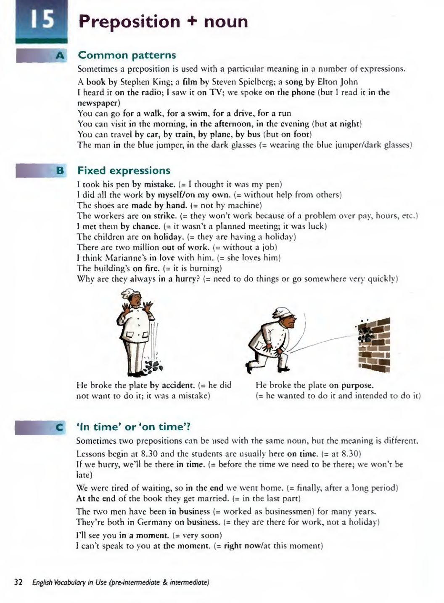

## Preposition + noun

Common patterns Sometimes a preposition is used with a particular meaning in a number of expressions.

A book by Stephen King; a film by Steven Spielberg; a song by Elton John

I heard it on the radio; I saw it on TV; we spoke on the phone (but I read it in the newspaper)

You can go for a walk, for a swim, for a drive, for a run

You can visit in the morning, in the afternoon, in the evening (but at night)

You can travel by car, by train, by plane, by bus (but on foot)

The man in the blue jumper, in the dark glasses (= wearing the blue jumper/dark glasses)

### Bm 6s Fixed expressions

I took his pen by mistake. (= I thought it was my pen)

I did all the work by myself/on my own. (= without help from others)

The shoes are made by hand. (= not by machine)

The workers are on strike. (= they won’t work because of a problem over pay, hours, etc.) I met them by chance. (= it wasn’t a planned meeting; it was luck)

The children are on holiday. (= they are having a holiday)

There are two million out of work. (= without a job)

I think Marianne’s in love with him. (= she loves him)

The building’s on fire. (= it is burning)

Why are they always in a hurry? (= need to do things or go somewhere very quickly)

He broke the plate by accident. (= he did He broke the plate on purpose. not want to do it; it was a mistake) (= he wanted to do it and intended to do it)

‘In time’ or ‘on time’? Sometimes two prepositions can be used with the same noun, but rhe meaning is different.

Lessons begin at 8.30 and the students are usually here on time. (= at 8.30)

If we hurry, we'll be there in time. (= before the time we need to be there; we won't be late)

We were tired of waiting, so in the end we went home. (= finally, after a long period) At the end of the book they get married. (= in the last part)

The two men have been in business (= worked as businessmen) for many years. They’re both in Germany on business. (= they are there for work, not a holiday)

I'll see you in a moment. (= very soon)

I can’t speak to you at the moment. (= right now/at this moment)

32 English Vocabulary in Use (pre-intermediate & intermediate)

---

# Page 40

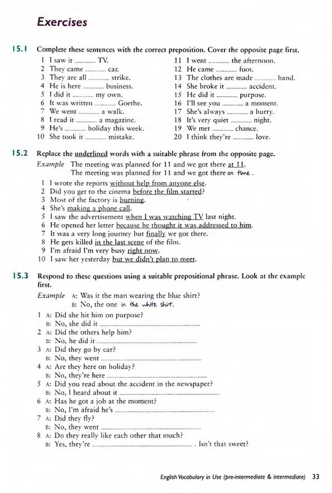

## Exercises
15.1
Complete these sentences with the correct preposition. Cover the opposite page first.
IT J saw it... TV. V1 7 went... the afternoon.
- 2 They came -..ecco0. Cal
- 12 He came ......ecc.0 foot.
- 3 They are all .............. strike.
- 13 The clothes are made ............... hand.
- 4 He is here ............... business.
- 14 She broke it ............0 accident.
- SU did it wu... my own.
- 15 He did it .............. purpose.
- 6 lt was written ............. Goethe.
- 16 I'll see you .............. a moment.
- 7 We went ..........a walk.
- 17 She’s always ............. a hurry.
- 8 Iread it.............. a magazine.
- 18 It’s very quiet ............0. night.
i (See holiday this week. LO. Welmet .......... chance.
- 10 She took it 0... mistake.
- 20 I think they’re ............... love
15.2
Replace the underlined words with a suitable phrase from the opposite page.
Example The meeting was planned for 11 and we got there at_11.
The meeting was planned for 11 and we got there on time .
- 1 I wrote the reports without help from anyone else.
- 2 Did you get to the cinema before the film started?
- 3 Most of the factory is burning.
- 4 She’s making a phone call.
- 5 I saw the advertisement when   was watching TV last night.
- 6 He opened her letter because he thought it was addressed to him.
- 7 It was a very long journey but finally we got there.
- 8 He gets killed in the last scene of the film.
- 9 I'm afraid I’m very busy right now.
- 10 I saw her yesterday we didn’t plan to meet.
15.3
Respond to these questions using a suitable prepositional phrase. Look at the example
first.
Example a: Was it the man wearing the blue shirt?
B: No, the one in the white Shit’.
1 a: Did she hit him on purpose?
Bz No, she did it csscsescssssssssssssssesscssssssssssssessssssssesesesessanesseetees
2 a: Did the others help him?
Br Noy fe did it coccecccccesecscssssssscsssssssssesesssvsecessessssecssssnseeecenseee
3 a: Did they go by car?
NC a V0 ZI (  Cae cee
4 a: Are they here on holiday?
Bz No, they?re ere ..nsccsssssscsccscssssesssessceceeensceesensceseesnanceeeent
5 a: Did you read about the accident in the newspaper?
Bz No, I heard about it cccccccccsccccssscssssessssssseseesseeessccesccecceeeecssseeceneeee
- 6 A: Has he got a job at the moment?
Bz Noy I’m afraid he’s ou. ..essssssssssssssssssssssssssssssssnecsssessessssssessseesseseee
7 a: Did they fly?
Bz No, they Welt w..ccccsssssssssssssssenssnssceeeeesensnneeeeeensnsneeeeeuuneeceee
8 a: Do they really like each other that much?
Bz Yes, theyre .....scssssscccssssrseersseesresetnssesnsresasreusnsessseeee . Isn't that sweet?
33
English Vocabulary in Use (pre-intermediate & intermediate)

---

# Page 41

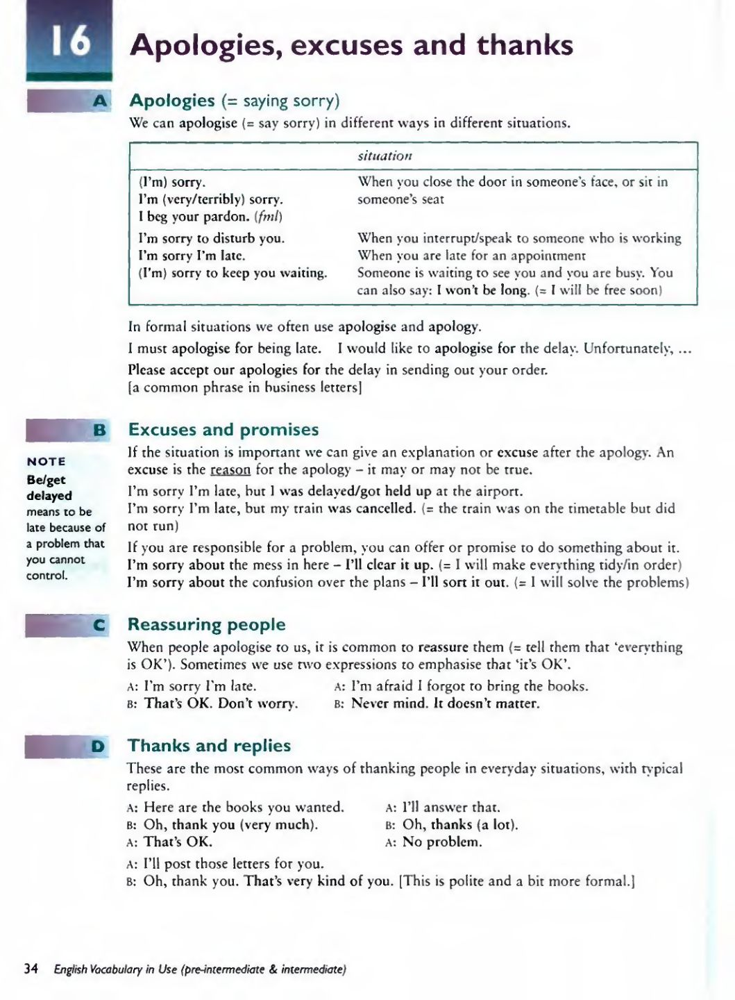

## Apologies, excuses and thanks

## Apologies (= saying sorry)

We can apologise (= say sorry) in different ways in different situations.

situation

(I’m) sorry. When you close the door in someone's face, or sit in I’m (very/terribly) sorry. someone’s seat I beg your pardon. (fr!)

I’m sorry to disturb you. When you interrupv/speak to someone who is working

I’m sorry I’m late. When you are late for an appointment

(I’m) sorry to keep you waiting. Someone is waiting to see you and you are busy. You can also say: I won't be long. (= I will be free soon)

In formal situations we often use apologise and apology. I must apologise for being late. I would like to apologise for the delay. Unfortunately, ...

Please accept our apologies for the delay in sending out your order. {a common phrase in business letters]

### By s Excuses and promises

If the situation is important we can give an explanation or excuse after the apology. An

NOTE 3 g enaae excuse is the reason for the apology — it may or may not be true. ge 5 delayed I’m sorry I’m late, but ] was delayed/got held up at the airport. means to be I’m sorry I’m late, but my train was cancelled. (= the train was on the timetable but did

late because of | not run)

a problem that If you are responsible for a problem, you can offer or promise to do something about it. Wwe gal I’m sorry about the mess in here — Ill clear it up. (= 1 will make everything tidy/in order) = I’m sorry about the confusion over the plans — I'll sort it out. (= | will solve the problems)

### ie c Reassuring people

When people apologise to us, it is common to reassure them (= tell them that ‘everything is OK’). Sometimes we use two expressions to emphasise that ‘it’s OK’.

A: I'm sorry I'm late. A: I’m afraid I forgot to bring the books. 8: That’s OK. Don’t worry. B: Never mind. It doesn’t matter.

### Hp Thanks and replies

These are the most common ways of thanking people in everyday situations, with typical

replies.

A: Here are the books you wanted. A: Pll answer that.

B: Oh, thank you (very much). B: Oh, thanks (a lot). A: That’s OK. A: No problem.

A: Pll post those letters for you. B: Oh, thank you. That’s very kind of you. [This is polite and a bit more formal.]

34 — English Vacabulary in Use (pre-intermediate & intermediate)

---

# Page 42

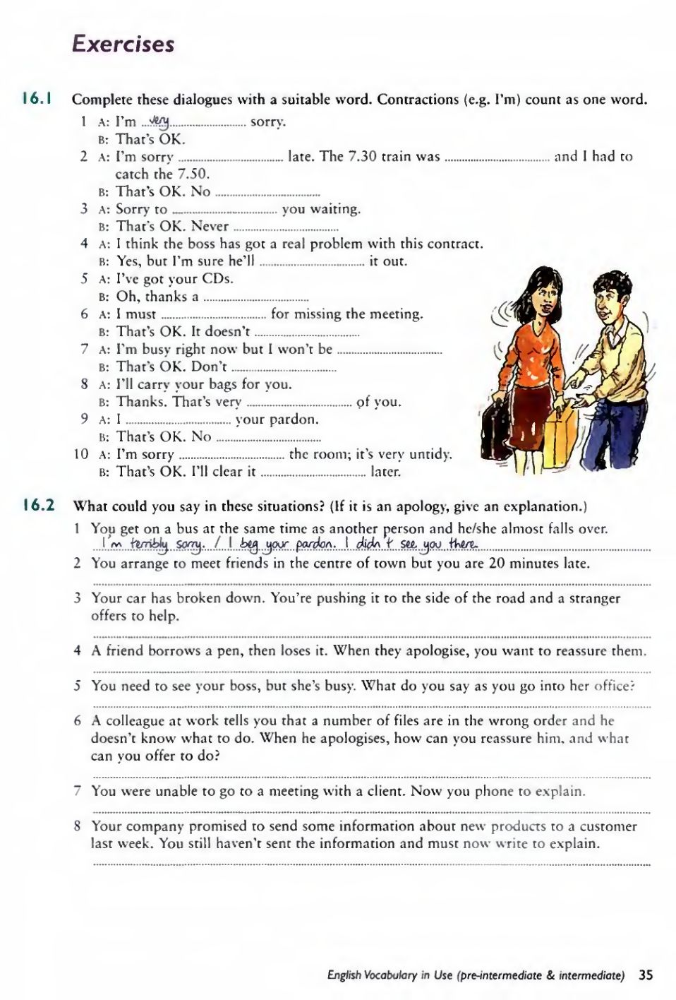

## Exercises
16.1 Complete these dialogues with a suitable word. Contractions (e.g. I’m) count as one word.
T fas Dima. ceeroeiromes SOLNY
B: That’s OK.
and I had to
2 a: I’m sorry late. The 7.30 train was
catch the 7.50.
B: That’s OK. No
- 3 Az SOLTY CO neeccsesecsseseee
B: That's OK. Never
4 a: I think the boss has got a real problem with this contract.
it out.
B: Yes, burt I’m sure he’ll
- 5 A: I’ve got your CDs.
Bz Oh, thanks a oecccssssccccssccsessssssesscseessene
(7 11 eee
B: That’s OK. It doesn’t
7 a: I'm busy right now but I won't be
B: That's OK. Don’t . eee
8 a: Vil carry your bags for y you.
8: Thanks. That's VOEY nennnnannossssocornvnroncsosses of you
- 9 A: . your pardon.
Bz TihatisiOK. Novsss..cccesseen sates
TQ A) Dp SMAPS Gy Fae acsnnascncosan the room; it’s very untidy.
Br That’s OK. PUD clear it ..ccccssssseesseeessnnsseeeen later.
16.2 What could you say in these situations? (If it is an apology, give an explanation.)
- 1 You get ona bus art the same time as another person and he/she almost falls over.
pardon.   dida t. see. you... there.
- 3 Your car has broken down. You’re pushing it to the side of the road and a stranger
offers to help.
- 4 A friend borrows a pen, then loses it. When they apologise, you want to reassure them.
- 5 You need to see your boss, but she’s busy. What do you say as you go into her office?
- 6 A colleague at work tells you that a number of files are in the wrong order and he
doesn’t know what to do. When he apologises, how can you reassure him, and what
can you offer to do?
- 8 Your company promised to send some information about new products t to a customer
last week. You still haven't sent the information and must now write to explain.
English Vocabulary in Use (pre-intermediate & intermediate) 35

---

# Page 43

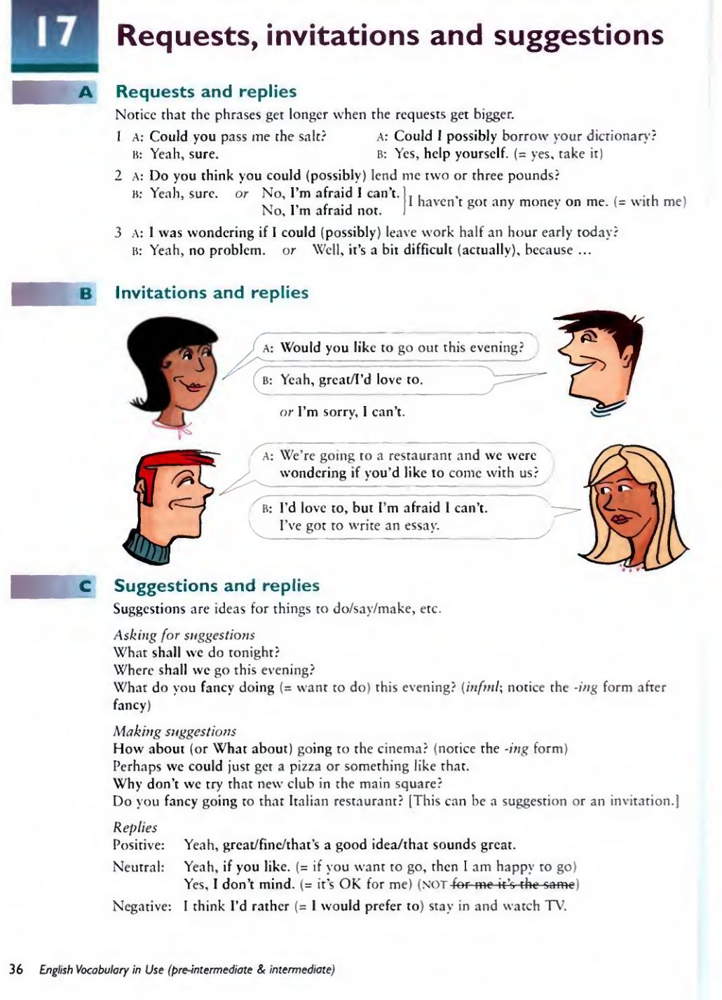

## Requests, invitations and suggestions
## Requests and replies
Notice that the phrases get longer when the requests get bigger.
1 aA: Could you pass me the salt? A: Could   possibly borrow your dictionary?
B: Yeah, sure. B: Yes, help yourself. (= yes, take it)
- 2 A: Do you think you could (possibly) lend me two or three pounds?
B: Yeah, sure. or No, I’m afraid J can’t.
- 5 I haven't got any money on me. (= with me
No, I’m afraid not. 8 y (
- 3 A: Lwas wondering if I could (possibly) leave work half an hour early today?
8: Yeah, no problem. or Well, it’s a bit difficult (actually), because ...
Invitations and replies
A: Would you like to go out this evening?
B: Yeah, great/I’d love to. ——
or I’m sorry, I] can’t.
A: We’re going to a restaurant and we were
wondcring if you'd like to come with us?
B: I'd love to, but I’m afraid I can’t.
I’ve got to write an essay.
C Suggestions and replies
Suggestions are ideas for things to do/say/make, ete.
Asking for suggestions
Whar shall we do tonight?
Where shall we go this evening?
Whar do you fancy doing (= want to do) this evening? (infmil; notice the -ing form after
fancy)
Making suggestions
How about (or What about) going to the cinema? (notice the -ing form)
Perhaps we could just get a pizza or something like that.
Why don’t we try that new club in the main square?
Do you fancy going to that Italian restaurant? [This can be a suggestion or an invitation.}
Replies
Positive: Yeah, great/fine/that’s a good idea/that sounds great.
Neutral: Yeah, if you like. (= if you want to go, then I am happy to go)
Yes, I don’t mind. (= it’s OK for me) (NOT for-meie’sthesame)
Negative: I think I’d rather (= I would prefer to) stay in and watch TV.
- 36 English Vocabulary in Use (pre-intermediate & intermediate)

---

# Page 44

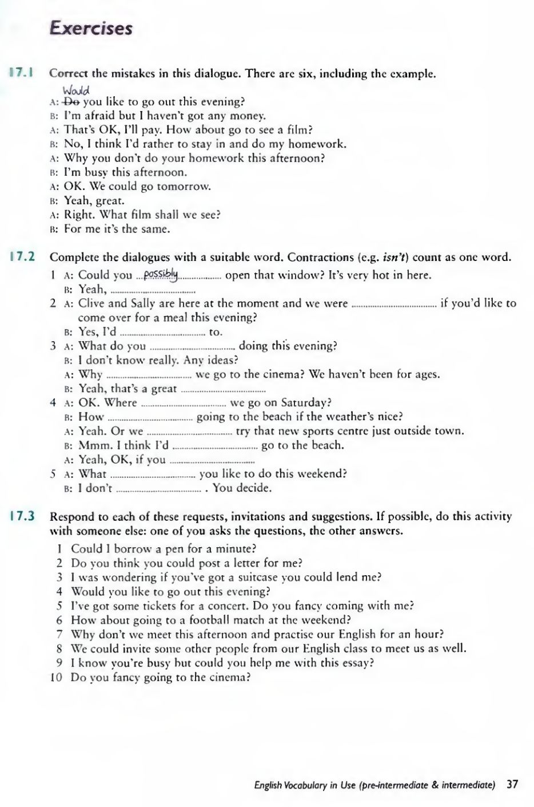

## Exercises
17.1
Correct the mistakes in this dialogue. There are six, including the example.
Would
A: Be you like to go out this evening?
B: I’m afraid but I haven't got any money.
A: That's OK, I’ll pay. How about go to see a film?
8: No, I think I'd rather to stay in and do my homework.
A: Why you don’t do your homework this afternoon?
8: I’m busy this afternoon.
A: OK. We could go tomorrow.
b: Yeah, great.
A: Right. What film shall we see?
B: For me it’s the same.
17.2
Complete the dialogues with a suitable word. Contractions (e.g. is#’t) count as one word.
- 1 A: Could you eS, open that window? It’s very hot in here.
Bs) Yeah c--—nnnseactdoccseoscooosmnerne
if you’d like to
2 a: Clive and Sally are here at the moment and We WETE eecccssscssessssssssesssunnsnnee
come over for a meal this evening?
Bs Yes, 1d cecccccccscssssoee
< tO.
doing this evening?
3 a: Whar do you
B: 1 don’t know really. Any ideas?
Air) WIRY) ssscosecnssoncssunserseonnss sve we go to the cinema? We haven’t been for ages.
BrP Wala ithat Stal @eSat es. scansteatttoones
- 4 As OR. Where onc cecccccccscssseseeeeseeeee we go on Saturday?
Se .. going to the beach if the weather’s nice?
A: Yeah. Or we try that new sports centre just outside town.
Bz Mim. T think Pd onccccscsssssssssscsesesesnseseee go to the beach.
At Yeah, OK, if yOu nec ccssscsscsesnsnseceeseeeee
Si ale) Widtesicnccierece tae you like to do this weekend?
Sa Is (0) Sr . You decide.
17.3
Respond to each of these requests, invitations and suggestions. If possible, do this activity
with someone else: one of you asks the questions, the other answers.
- 1 Could 1 borrow a pen for a minute?
- 2 Do you think you could post a letter for me?
- 3 I was wondering if you’ve got a suitcase you could lend me?
- 4 Would you like to go out this evening?
- 5 I’ve got some tickets for a concert. Do you fancy coming with me?
- 6 How about going to a football match at the weekend?
- 7 Why don’t we meet this afternoon and practise our English for an hour?
§ We could invite some other people from our English class to meet us as well.
- 9 I know you're busy but could you help me with this essay?
- 10 Do you fancy going to the cinema?
English Vocabulary in Use (pre-intermediate & intermediate) 37

---

# Page 45

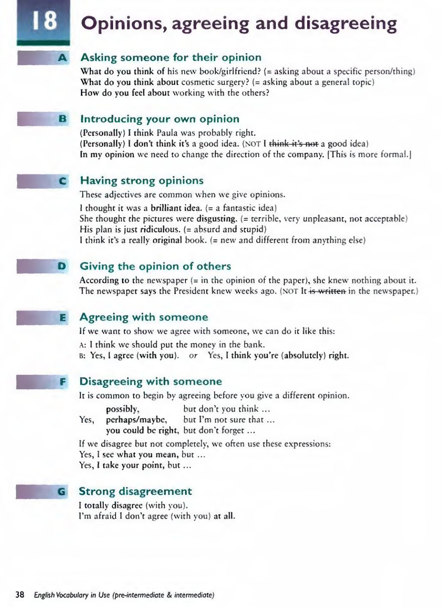

## Opinions, agreeing and disagreeing

Asking someone for their opinion

What do you think of his new book/girlfriend? (= asking about a specific person/thing) What do you think about cosmetic surgery? (= asking about a general topic)

How do you feel about working with the others?

Introducing your own opinion

(Personally) I think Paula was probably right. (Personally) | don’t think it’s a good idea. (NOT | thinkit’s-net a good idea) In my opinion we need to change the direction of the company. {This is more formal.]

### | ‘C Having strong opinions

These adjectives are common when we give opinions.

I choughe it was a brilliant idea. (= a fantastic idea)

She thought the pictures were disgusting. (= terrible, very unpleasant, not acceptable) His plan is just ridiculous. (= absurd and stupid)

I think it’s a really original book. (= new and different from anything else)

| D_ Giving the opinion of others

According to the newspaper (= in the opinion of the paper), she knew nothing about it. The newspaper says the President knew weeks ago. (NOT It +s+written in the newspaper.)

| E Agreeing with someone If we want to show we agree with someone, we can do it like this:

A: I think we should put the money in the bank. B: Yes, | agree (with you). or Yes, I think you’re (absolutely) right.

| F Disagreeing with someone It is common to begin by agreeing before you give a different opinion.

possibly, but don’t you think ... Yes, perhaps/maybe, — but I’m nor sure that ... you could be right, but don’t forget ...

If we disagree but not completely, we often use these expressions: Yes, | sec what you mean, but ... Yes, | take your point, but...

### PNG Strong disagreement

I totally disagree (with you). I’m afraid I don’t agree (with you) at all.

38 English Vocabulary in Use (pre-intermediate & intermediate)

---

# Page 46

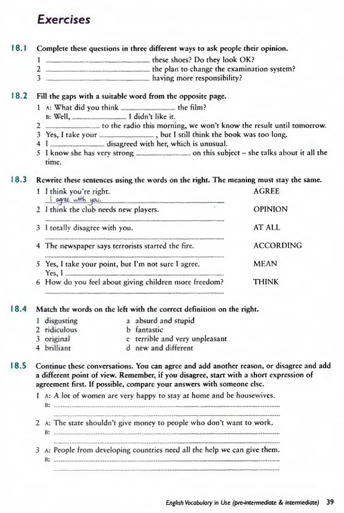

## Exercises
18.1 Complete these questions in three different ways to ask people their opinion.
De ecssessststtattnsststenneeeneneee these shoes? Do they look OK?
22 posers esecccamereeraesaos the plan to change the examination system?
BS eeeesnststssstttressenterssnennnnneee. HAVING More responsibility?
18.2 Fill the gaps with a suitable word from the opposite page.
- 1 A: What did you think — the film?
"2   ere 1 didn’t like it.
SDN sas :sSceiassis cerita .. to the radio this morning, we won’t know the result until tomorrow.
- 3 Yes, Itake your —____. , bur I still think the book was too long.
MAD INN. scsssssssssemssssseae ____. disagreed with her, which is unusual.
- 5 I know she has very strong eeeseesssteneee ..on this subject — she talks about it all the
time.
18.3 Rewrite these sentences using the words on the right. The meaning must stay the same.
- 1 I think you’re right. AGREE
- 2 I think the club needs new players. ; OPINION
- 3 I totally disagree with cae. oa AT ALL
- 4 The — says coumarins started the fire. ACCORDING
- 5 Yes, I take your point, but I’m not sure I agree. MEAN
Ng   ee SS eo
- 6 How do you feel about giving children more freedom? THINK
18.4 Match the words on the left with the correct definition on the right.
1 disgusting a absurd and stupid
2 ridiculous b fantastic
3 original ¢ terrible and very unpleasant
4 brilliant d new and different
18.5 Continue these conversations. You can agree and add another reason, or disagree and add
a different point of view. Remember, if you disagree, start with a short expression of
agreement first. If possible, compare your answers with someone else.
- 1 A: A lot of women are very happy to stay at home and be housewives.
a a
- 2 A: The state shouldn’t give money to people who don’t want to work.
BR recreate eee ips eager ccs ea acne RP sass ns asses
- 3 A: People from developing countries need all the help we can give them.
Be ....scccsscecccerccasccnrececrssccccnccsenceseceeserescrenssonnstenssetoeesesoenssnsesssseeensoneses escennenessnssoncascsssssseseessoases
English Vocabulary in Use (pre-intermediate & intermediate) 39

---

# Page 47

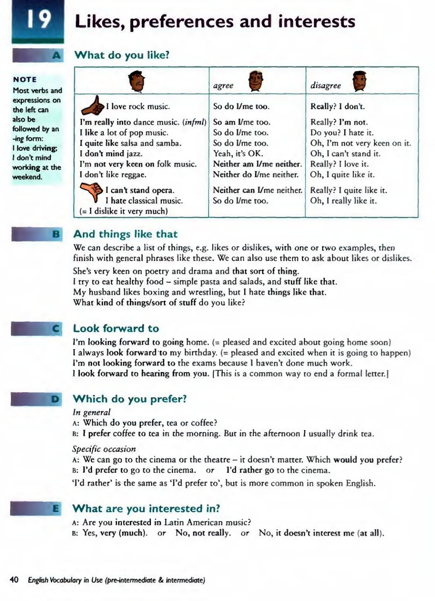

## Likes, preferences and interests

BA, What do you like?

#### NOTE

## Most verbs and ae a ae

sie lle — ac a love rock music. So do I/me too. Really? I don’t.

also be I’m really into dance music. (infml) | So am I/me too. Really? I’m not.

— = I like a lot of pop music. So do I/me too. Do you? I hate it.

jake , ivi I quite like salsa and samba. So do I/me too. Oh, I’m not very keen on it. Naat hig I don’t mind jazz. Yeah, it’s OK. Oh, I can’t stand it.

working at the I’m not very keen on folk music. | Neither am I/me neither. | Really? I love it.

wealanal I don’t like reggae. Neither do I/me neither. | Oh, I quite like it.

> I can’t stand opera. Neither can I/me neither. | Really? I quite like it. I hate classical music. So do I/me too. Oh, I really like it.

(= 1 dislike it very much)

ms And things like that

We can describe a list of things, e.g. likes or dislikes, with one or two examples, then finish with general phrases like these. We can also use them to ask about likes or dislikes. She’s very keen on poetry and drama and that sort of thing.

I try to eat healthy food — simple pasta and salads, and stuff like that.

My husband likes boxing and wrestling, but I hate things like that.

What kind of things/sort of stuff do you like?

Mc Look forward to

Pm looking forward to going home. (= pleased and excited about going home soon)

I always look forward'to my birthday. (= pleased and excited when it is going to happen) I’m not looking forward to the exams because | haven’t done much work.

1 look forward to hearing from you. [This is a common way to end a formal letter.]

Mm > Which do you prefer?

In general

A: Which do you prefer, tea or coffee?

B: I prefer coffee to tea in the morning. But in the afternoon I usually drink tea. Specific occasion

A: We can go to the cinema or the theatre — it doesn’t matter. Which would you prefer? B: I'd prefer to goto the cinema. or Id rather go to the cinema.

‘T'd rather’ is the same as ‘I’d prefer to’, but is more common in spoken English.

MEE What are you interested in?

A: Are you interested in Latin American music? B: Yes, very (much). or No, not really. or No, it doesn’t interest me (at all).

40 English Vocabulary in Use (pre-intermediate & intermediate)

---

# Page 48

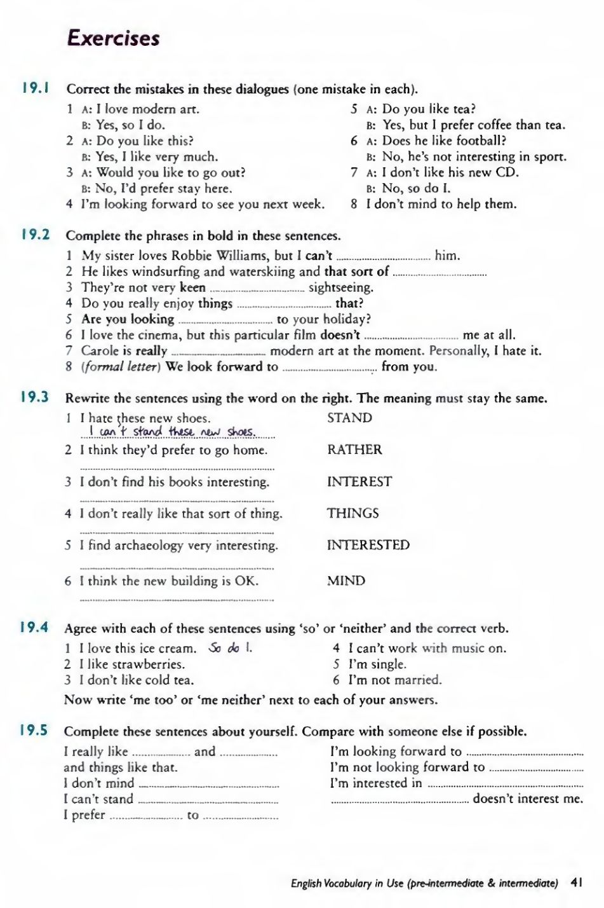

## Exercises
19.1 Correct the mistakes in these dialogues (one mistake in each).
- 1 A: I love modern art.
- 5 A: Do you like tea?
B: Yes, so I do. B: Yes, but I prefer coffee than tea.
- 2 a: Do you like this?
- 6 A: Does he like football?
B: Yes, I like very much. B: No, he’s not interesting in sport.
- 3 A: Would you like to go out? 7 a: I don’t like his new CD.
B: No, I’d prefer stay here. B: No, so do I.
- 4 I’m looking forward to see you next week.
- 8 I don’t mind to help them.
19.2 Complete the phrases in bold in these sentences.
- 1 My sister loves Robbie Williams, but Tan’ cscs: him
- 2 He likes windsurfing and waterskiing and that sort Of 0.0.20... cscccssecssee
- 3 They’re not very keen oon. Sightseeing.
- 4 Do you really enjoy thimgs ....-ccccceccccscccseessenee that?
- 5 Are you looking ... — . to your —e
- 6 I love the cinema, but this particular Film dO€SNE ......cesseeseeeenneee Mme at all,
- 7 Carole is really... modern art at the n moment. Personally, I hate it.
8 (formal letter) We look forward to .. from you.
19.3 Rewrite the sentences using the word on the right. The meaning must stay the same.
I I hate these new shoes. STAND
## dant stand these, ated Shoes...
- 2 I think they’d prefer to go home. RATHER
- 3 Idon't find his books interesting. INTEREST
- 4 I don’t really like that sort of thing. THINGS
- 5 I find archaeology very interesting. INTERESTED
- 6 I think the new building is OK. MIND
19.4 Agree with each of these sentences using ‘so’ or ‘neither’ and the correct verb.
- 1 I love this ice cream. So &  .
- 4 I can’t work with music on.
- 2 I like strawberries.
- 5 I’m single.
- 3 I don’t like cold tea.
- 6 I’m not married.
Now write ‘me too’ or ‘me neither’ next to each of your answers.
19.5 Complete these sentences about yourself. Compare with someone else if possible.
I really like ............ E11: oe I’m looking forward to ...seesssecccssseessesmnsseseecseeesoee
and things like that. I’m not looking forward to ..
bo C0) 16 at 11) 2: Dm imterested in o...ccecssssssssssussseeccecssssessesunnssesssmessstee
[Cart Sta eee ccenseaeesesssccsteececneesesessecee —=*sannnnnnneuunnnnceceutannnnnecnenncntecennnnneeee doesn’t interest me
2) << (2 ee <0
English Vocabulary in Use (pre-intermediate & intermediate) 41

---

# Page 49

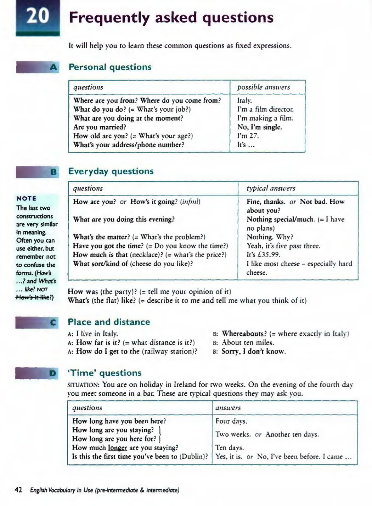

## Frequently asked questions

It will help you to learn these common questions as fixed expressions.

## Personal questions

Where are you from? Where do you come from? Italy. What do you do? (= What’s your job?) I'm a film director.

What are you doing at the moment? I'm making a film. Are you married? No, I’m single. How old are you? (= What's your age?) I'm 27.

What’s your address/phone number? [€sy...

### MB Everyday questions

questions typical answers

#### NOTE

How are you? or How’s it going? (infil) Fine, thanks. or Not bad. How peice Long about you? Cone. What are you doing this evening? Nothing special/much. (= I have are very similar in meaning. ; no plans) Often you can What's the matter? (= Whar’s the problem?) Nothing. Why? use either, but Have you got the time? (= Do you know the time?) Yeah, it’s five past three. remember not How much is that (necklace)? (= what's the price?) It’s £35.99. to confuse the What sort/kind of (cheese do you like)? I like most cheese — especially hard forms. (How's cheese. «--2 and What's «+. like! NOT How was (the party)? (= tell me your opinion of it) +Hovw's-ittike?)

What’s (the flat) like? (= describe it to me and tell me what you think of it)

Ee c Place and distance

A: I live in Italy, 8: Whereabouts? (= where exactly in Italy) A: How far is it? (= what distance is it?) B: About ten miles. A: How do I get to the (railway station)? B: Sorry, I don’t know.

### BED ‘Time’ questions

SITUATION: You are on holiday in Ireland for nwo weeks. On the evening of the fourth day you meet someone in a bar. These are typical questions they may ask you.

How long have you been here? Four days.

How long are you staying? , eal ara Two weeks. or Another ten days.

How long are you here for? How much longer are you staying? Ten days. Is this the first time you’ve been to (Dublin)? | Yes, it is. or No, I’ve been before. I came ...

42. English Vocabulary in Use (pre-intermediate & intermediate)

---

# Page 50

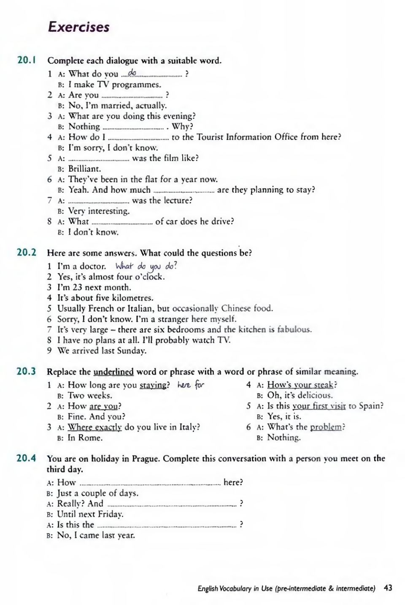

## Exercises
20.1 Complete each dialogue with a suitable word.
LAs What do vou Xo ciccccscusssnmsne ?
B: I make TV programmes.
BD, RS) INTO! YI x ccsnorssseoneesesescssoosseasoas  >
B: No, I’m married, actually.
- 3 A: Whar are you doing this evening?
Be NOMI Gace eancccee.. « Why?
FAs HOW do I ceececsesccecevneensnsenncnneenee to the Tourist Information Office from here?
B: I'm sorry, I don’t know.
IS) WA eee cece was the film like?
B: Brilliant.
- 6 A: They’ve been in the flat for a year now.
Be) Yealas Arie ow fanny cesses snssesssees are they planning to stay?
PR) a ee was the lecture?
B: Very interesting.
SA What ns eeeeeseee sees .. of car does he drive?
B:   don’t know.
20.2 Here are some answers. What could the questions be?
- 1 I'ma doctor. What do you do?
2. Yes, it’s almost four o'clock.
- 3 I’m 23 next month.
- 4 It’s about five kilometres.
- 5 Usually French or Italian, but occasionally Chinese food.
- 6 Sorry, I don’t know. I’m a stranger here myself.
- 7 It’s very large -- there are six bedrooms and the kitchen is fabulous.
- 8 Ihave no plans at all. V'll probably watch TV.
- 9 We arrived last Sunday.
20.3 Replace the underlined word or phrase with a word or phrase of similar meaning.
1 a: How long are you staying? hee for 4 a: How’s your steak?
B: Two weeks. B: Oh, it’s delicious.
- 2 a: How are you?
- 5 A: Is this your first visir to Spain?
B: Fine. And you? B: Yes, it is.
- 3 A: Where exactly do you live in Italy?
- 6 A: What's the problem?
B: In Rome. B: Nothing.
20.4 You are on holiday in Prague. Complete this conversation with a person you meet on the
third day.
At HOW. ecccssccsssssseesersssnnncessessunvscseseeneseecesnsnssecceunuecestseeneste here?
B: Just a couple of days.
At Really? And ooccceecccssscsesssscesssssenscccesensesnsnseesseeuauanecssensene ?
B: Until next Friday.
ANOW FST 00 ytd See ?
B: No, [ came last year.
English Vocabulary in Use (pre-intermediate & intermediate) 43

---

# Page 51

## Common responses

Short responses

questions short response

Are you going to the party tonight? I think so. or I don’t think so/1 doubt it. Is Tom going to meet us? Yes, I hope so. (= ] don’t know but I want it to happen)

I hope not. (NoT I -dene-hepeso)

I’m afraid so. (= Unfortunately, I am)

I’m afraid not. (= I’m sorry, but no | can’t)

Is it going to rain? Are you working this weekend? Can you come to the match?

WEB = Responding with interest and enthusiasm (= strong feeling of interest and enjoyment)

statements enthusiastic responses

She finally got her visa to travel. Really? That's great. He’s passed his driving test. Oh, that’s brilliant. We’re going camping in Greece. Oh, that sounds wonderful.

I’m going to meet some actors. Really? That sounds interesting. They’re having a baby. Oh, how fantastic. I've got a new job. Wow! How exciting.

We can respond to bad news using the same constructions but different adjectives. Really? That’s dreadful. Oh, that sounds terrible. Oh, no. How awful.

### HENNE = Responding with disappointment

I can’t go to the party this evening. Oh, what a pity/that’s a pity. Sam isn’t feeling well, so he’s staying here. Oh, what a shame/that’s a shame. (= what a pity) I think it’s going to rain for our picnic. Oh, what a nuisance/pain. [We use this

when we are angry about a situation.]}

### HD Responses of agreement

These responses all agree to do something, or they permit the speaker to choose and make the decision. The way we say these phrases makes it clear if we are happy or unhappy.

What time shall we go? Whenever you like. (= We can go when you want) What do you want to do? Whatever you like.

Where shall we put these chairs? Wherever you like.

Do you want to go out? I don’t mind. (= | am happy to go out, or stay in) Shall we take a taxi? Yeah, if you like. (= that’s OK with me)

### HE = Remember to respond!

It is important to show you are listening. These are common ways we do it.

mmm uhhuh yeah OK Iknow sure right see (=I understand)

44 — English Vocabulary in Use (pre-intermediate & intermediate)

---

# Page 52

## Exercises
21.)
Check the pronunciation of the underlined words in the Index at the back of the book.
Practise saying the phrases.
I doubt it. I’m afraid so. Oh, what a nuisance. That sounds dreadful.
Bh
Complete the last word of these dialogues. Practise them with a partner if possible.
- 1 A: Can we still get tickets?
B Whopé)._._..._.
2 a: Are you working tomorrow?
B: Yes, I’m afraid
- 3 A: Is the price going up?
B: Well, it’s already expensive, so   hope
4 a: Are you going?
B: I doubt
5 aA: Are there any left?
B: I don’t think ..........
- 6 A: Have you got any change for the coffee machine?
B: I’m afraid .......... .
21.3
Choose the best response on the right for cach of the questions or statements on the left.
- 1 Tom can’t come because he’s working. a Whenever you like.
- 2 We’re staying in a very expensive hotel, b I’m afraid so.
- 3 Do you want to watch the end of the film? c Oh, what a pity.
- 4 Does he often get angry like this? d Oh, that’s a nuisance.
- 5 We can’t get in — Joe’s got the key. e Yeah, if you like.
- 6 What time do you want to start? f Oh, that sounds great.
21.4
Replace the underlined word or phrase with another word or phrase that has the same
meaning.
- 1 A: She’s ill.
- 4 A: Is it still busy at this time of year?
B: Oh, what a pity. B: No, I don’t think so.
2 a: Do you want to go? 5 a: What do you want to do?
## B:   don’t mind. B:   don’t mind.
- 3 a: We’re going on Concorde.
- 6 A: He fell off his bike and broke his arm.
B: Oh that’s exciting. B: Oh, how awful.
21.5
Respond to these statements in a suitable way. Practise with someone else if possible.
- 1 I’m going to spend three weeks in Australia.
- 2 Alex has lost your watch.
- 3 Do you want to finish this later?
- 4 Where shall we go?
5 [ve just won £1,000.
- 6 I can’t go tomorrow.   have to work.
- 7 Peter has lost his wallet with all his credit cards.
8 1 wanted to speak to Karen, but she’s out all day.
45
English Vocabulary in Use (pre-intermediate & intermediate)

---

# Page 53

## Greetings, farewells and special

## expressions

## Greetings: ‘hello’

How do you do? or Used in formal situations when you meet someone for the

Hello. Nice to meet you. first time. The reply can also be How do you do? or Pleased/nice to mect you.

Hi/Hello. How are you? A common greeting when you meet someone you already know. (Also How’s it going? infmil) The usual reply is: Fine, thanks. And you? Or possibly: Not bad. How about you?

Good morning, good These expressions are used at different times of the day

afternoon, good evening (most people say Good morning until lunchtime). British

people do not usually say Good day, but Australians do.

### | B_ Farewells:‘goodbye’

Nice to meet you. or In formal situations, when you say goodbye to someone

Nice to have met you. you have just met for the first time.

See you later/tomorrow. If you plan to see someone you know later the same day/ the next day.

Bye. Sce you soon. You know you will see someone again, but have no plans to meet them.

Goodnight. When you say goodbye to someone late at night, or if you (or they) are going to bed.

A: Have a nice weekend. When you say goodbye to a colleague/friend on Friday

B: Yes. Same to you. afternoon. You can also reply: You too.

‘C Happy occasions and celebrations

Happy Birthday To someone on his/her birthday. You can also say Many happy returns. Happy/Merry Christmas To someone just before or on Christmas Day (25 December). Happy New Year To someone at the beginning of the year. Congratulations To someone who has just achieved something, e.g. passed an exam, got a job, etc. We can also say Well done.

### Expressions for special situations

Excuse me a To get someone’s attention, e.g. Excuse me. Is this your hat?

NOTE b When you want to get past other people (on a bus or in a crowded room). There is no c To tell others you are going to leave the room.

special phrase Sorry a To say sorry, e.g. you stand on someone’s foot.

when people b When you want someone to repeat what they said. (With this meaning, start eating. the voice must rise at the end of the word.)

In Restaurants, Checrs Used to express good wishes when you have a drink with other people. MOU Informally it can also mean ‘goodbye’ and ‘thank you’.

say: Enjoy Good luck —_To wish someone well before a difficult situation, e.g. exam or job interview. i Bless you To someone when they sneeze. They can reply: Thank you.

46 — English Vocabulary in Use (pre-intermediate & intermediate)

---

# Page 54

## Exercises
22.1 What message could you write in a card to these people?
- 1 A friend. Next week is
- 25 December. Happy Qvistmas
- 2 A friend who is 21 tomorrow.
- 3 A friend. It will be
- 1 January in three days’ time.
- 4 A very good friend who has just passed some important exams.
- 5 A friend who is going to take his driving test in three days’ time.
- 6 A friend you will visit when you return from your holiday, but you’re not sure when.
22.2 Complete the conversations in a suitable way.
This ts
Kevin Ward.
22.3 What could you say in these situations?
- 1 You are in a meeting. Someone enters the room and says you have an important
telephone call. What do you say as you leave? Exquse me.   won't be long.
- 2 Someone says something to you but you didn’t hear all of it. What do you say?
- 3 You met a new business client for the first time 15 minutes ago, and now you are
leaving. What do you say?
- 4 You are in a crowded bus. It is your stop and you want to get off. What do you say to
other passengers as you move past them?
- 5 You are staying with some English friends. What do you say to them when you leave
the room in the evening to go to bed?
- 6 You are in the street. A woman walks past you and at the same time something falls out
of her bag. She has her back to you. What do you say?
- 7 A friend tells you they have just won some money.
- 8 Another friend is going for a job interview this afternoon.
22.4 When do we use these expressions? Do you have similar ones in your language?
Hard luck. Say ‘cheese’. Watch out! Keep your fingers crossed.
English Vocabulary in Use (pre-intermediate & intermediate) 47

---

# Page 55

## Phrasal verbs (I): form and meaning

Formation

A phrasal verb is a verb + adverb or preposition, and occasionally a verb + adverb and preposition.

The price of petrol is going up (= increasing) again.

He fell over (= fell to the ground) and hurt his knee.

She’s trying to find out (= learn/discover) the name of that new hotel.

Who’s going to look after (= take care of) the children when their mother is in hospital? If you don’t understand the meaning, look it up. (= find the meaning in a dictionary)

He doesn’t get on with (= have a good relationship with) his parents. (verb + adv + prep)

### ENB Meaning

Sometimes the adverb or preposition doesn’t change the meaning, but makes it sound more natural.

1 didn’t wake up until 7 o’clock. I’m saving up for a new computer. Hurry up or we’ll be late. She stood up and went over to the door. Sit down and be quiet. He told me to lic down on the bed.

Sometimes an adverb adds a particular meaning. For example, back can mean ‘return’. I'm going to take that jacket back to the shop; it’s too small. You can look at the books but remember to put them back on the shelf.

More often, the adverb or preposition changes the meaning of the verb: ‘take off doesn’t mean the same as ‘take’, and ‘get on’ doesn’t mean the same as ‘get’. Here are some examples:

It took her a Jong time to get over (= get better/recover from) her illness.

We'll take a short break and then carry on (= continue) with the meeting.

My wife has decided to give up (= stop) smoking.

I can’t make any sandwiches — we’ve run out of bread. (= no bread is left; it is finished) I’ve told them we can’t put the meeting off. (= change the time of the meeting to a later date)

### BSC Multiple meanings

Be careful: many phrasal verbs have more than one meaning.

It was so hot I had to take off (= remove) my jacket. I’m always nervous when the plane takes off. (= leaves the ground)

I’ve got a lot of work to get through (= finish) before Friday.

I tried phoning him, but I couldn’t get through. (= make contact and talk to him)

My alarm clock didn’t go off (= ring) this morning.

The bomb could go off (= explode) at any minute. [See picture.]

The fish will go off (= go bad) if you don’t put it in the fridge.

I picked up most of the rubbish. (= took it from a place, using my old’ I have to pick Jane up (= collect her in my car) from the station.

48 English Vocabulary in Use (pre-intermediate & intermediate)

---

# Page 56

## Exercises
23.! Complete the phrasal verbs. Remember to put the verb into the correct form.
- 1 I don’t think they ever {QA oon out how the man escaped.
- 2 The children went round the school and o.icccscscccssscssssnessene up all the rubbish.
- 3 This milk smells horrible; 1] think it has off.
- 4 Trang the tourist information office but   COULdMt ....sccsecssecneceeeee .. through. It’s
engaged all che time.
S The relationship was difficult at first, but I think she oc cccccsssussssseeen on with him
quite well now.
- 6 If she’s still ill romorrow, we'll have tO cccsscccsscscsssssessneseeee off the trip to France until
later in the month.
- 7 Lagreed to 2 eee after my sister’s cat when she goes to France.
A (or on with this exercise while the others are in the library.
- 9 Our English teacher said we ShOUNd o..n.cccsscscccsesssssssesneneee through the textbook by the end
of the course.
10 {I'm afraid this photocopier has occ. ccscccecceseseennee out of paper, bur you can use the one
in my Office.
23.2 Complete these sentences in a logical way.
- 1 It will take her a long time to get over ....hes..illngss.
- 2 The plane took off
- 3 He had to look it up
- 4 I don’t really get on with
5) Sheieamelinpand) coke,.o f bisssoscssssseceesssececescesensessseneseserimsevaesn seer osseieinsesss
- 6 I've decided to give up
- 7 Who is going to look after ....
- 8 LT went to the garage to pick Up ciccccsssssssssecesessessnsesseuueeesiessteemansessees
- 9 Vm afraid we've run OUt Of wn. csessssssssesssseseeenscteuesesinsentnssssoteesnetennegseenst
LO MY rent is ZOU g Up onsen eseescsssssnssecsoseessesesnnnnnonsesnecesceeensemutuessnnecescesneeesennanes
23.3 Look at the dictionary entry for ‘go off’, and match the meanings with the sentences below.
go off 1 (LEAVE) to leave a place and go some-
where else She's gone off to the pub with Tony.
- 2 UK informal If food goes off, it is not
good t© eat any more because it is foo old.
- 3 STOe} If a light or machine goes off. it stops
working. The heating goes off at 10 o'clock.
- 4 EXPLOOR If a bomb or gun goes off. it
explodes of fires. S PAAKENOISE] ff something
that makes a noise goes off, it suddenly starts
making a noise. His car alarm goes off every
time it rains.
- 1 When the light goes off, the machine has finished.
- 2 My alarm clock went off early this morning.
- 3 I think this meat has gone off.
- 4 The bomb went off without any warning.
23.4 Write two sentences for each of these phrasal verbs to show their different meanings.
pickup takeoff gooff get through
English Vocabulary in Use (presntermeccte & maermecote) 49

---

# Page 57

## Phrasal verbs (2): grammar and style

Grammar: intransitive verbs

Some phrasal verbs are intransitive. They don’t need an object after the verb, and we cannot put another word between different parts of the verb.

He grew up in a city. (= spent his childhood/developed into an adult) (Not He grew

## HA EHP. }

Don’t wait out there. Please come in. (= enter)

I’m going to stay in (= stay at home) this evening.

We set off (= started the journey; usually a long journey) at about 7.30.

| Grammar: transitive verbs

Many phrasal verbs are transitive: they need a direct object after the verb. You can usually put the object between the different parts of the verb, or after the phrasal verb.

Put on your shoes. / Turn on the TV. ¥ Take off your coat. Y Put your shoes on. / Turn the TV on. ¥ Take your coat off. /

If the object is a pronoun, it must go in the middle. Put them on. Y (Rut-enthenm.) Turn it on. / err-en-it:) 9 Take it off. “ (Fake-ottr.)

### Mm c In dictionaries

You can use a dictionary to check the grammar. Most dictionaries show it like this: carry on, get by (= intransitive phrasal verb)

I can get by in French. (= I can manage in French, but | don’t speak it well.)

put sth<—>on, throw sth<—>away (= transitive phrasal verb)

Did you throw those books away? (= get rid of them/put them in a rubbish bin) Did you throw away those books?

get over sth, look after sb/sth (= verb + preposition + object) Maria will look after (= take care of) the children. (Maria will look after them.)

Hp Style: formal or informal?

Most phrasal verbs are more common in spoken English. In written English there is often a more formal word with the same meaning. (The other words in bold are often used with these verbs.)

make sth up = invent/create sth (from your imagination), e.g. We had to make up a story. leave sth out = omit sth (= decide not to do sth), e.g. You can leave out question 7.

sort sth out = solve sth (such as a problem), e.g. We asked the computer guy to sort it out. turn sb/sth down = reject sth (= say no to sth), e.g. 1 offered him £50, but he rumed it down.

Some phrasal verbs are used in written English if there is no other easy way to express the meaning.

wake up, e.g. | always wake up early, even at weekends.

break down (= go wrong/stop working), e.g. The car broke down on the motorway.

take off (= leave the ground), e.g. The plane couldn’r take off because of bad weather.

break into sth (= enter by force, often illegally), e.g. Thieves broke into the house and stole £500.

50 — English Vocabulary in Use (pre-intermediate & intermediate)

---

# Page 58

## Exercises
24.1 Correct any mistakes with word order in these sentences. Be careful: some are correct.
- 1 He’s putting his boots on.
- 2 I told the children I'd pick up them after school.
- 3 She grew on a farm up.
- 4 We set off very early this morning.
- 5 It’s a big problem but the man will sort out it.
- 6 I think she made that story up.
- 7 We know there were two thieves, but do you know how they broke the house into?
- 8 I said I'd look after them if necessary.
24.2 Make these texts more informal by changing the underlined verbs to phrasal verbs.
- 1 The cost of living is increasing all the time and I am now finding it quite difficult to
manage on my salary. I can probably continue for a few months, but after that I may
have to look for another job.
- 2 She told us to enter, but then we had to remove our shoes.
- 3 The teacher told half the class to invent a story to go with the picture in our books,
while the other half did Exercise 5. She said we could all omit Exercise 4 if we wanted to.
- 4 I don’t know why he rejected my offer of help because the company is in a lot of
trouble and they’ve got no one to solve the problems.
24.3 Fill the gaps to complete the phrasal verbs in these sentences.
- 1 I’m afraid the photocopier has just broken — We
- 2 I couldn’t do the second question, so I left it occ
- 3 Put your COAL occ if you're cold.
- 4 If there are problems with the computer, I usually have to Sort it see :
- 5 He told me he was 25, but I don’t believe him.   think he’s making that...
- 6 You're not going £0 thrOw .ncccsesnsesee that food, are you?
- 7 Why couldn’t the plane take wees ?
- 8 Tthimk she grew sess in a small village.
- 9 We'll get there by seven if We SOE occcsscssssuee
- 10 They offered him the job but he turned it...so
24.4 Complete these sentences in a logical way.
- 1 Could you lie down 00. Hi. R006. ecnsssnnsneeten ?
- 2 Pm not very good at making Up... ccsssssesssesssesessseseesmeseeseenses
- 3 Shievaskeecdirvie” tos euar na eases ccsesssssscsicccsesenesnis
- 4 Two men tried to break into ..cccsssssssessesscsseuseseesnssseeseneestents
- 5 We have asked an engineer to come and SOFT OUE ..eccscsssesessesseuesseseneseessnseeeesnsectenstsee
- 6 ALE YOU ZOING TO STAY 1 on reessesssssssssssonsssssssseessenssessnesssenesseees ?
- 7 Why did you leave out ....... ?
- 8 Pm afraid we broke COWN sccssscssssmuseessnseseseeesseesassessenseee
- 9 Can vou get BY crccccccsesesneee
- 10 I grew up
24.5 There are many phrasal verbs in other units. Find three phrasal verbs in each of these
units: 52, 53, 61, 79, 80.
English Vocabulary in Use (pre-intermediate & intermediate) 51

---

# Page 59

## Have and have got

Have vs have got

We can use have or have got to talk about possessions, relationships, illnesses and some other states. Have got is more common in spoken English.

I’ve got an old CD player. I haven’t got a car at the moment.

She’s got two brothers. Have you got the time? (= What time is it?) He’s got a headache. It hasn’t got a swimming pool.

1 In negative sentences, we can use haven't got or don't have. | haven’t got a car/I don’t have a car. (NOT Lhaven“ta-<as.) 2 We don’t use got in short answers, and it isn’t common in the past tense. A: Have you got any brothers or sisters? _B: No, I haven’t. (NOT No, I havene-get) I had a car when I was at college. (NOT I-had-get) 3 The verb form used in the question is usually the same in the answer. A: Do you have a car? A: Have you got a car? B: Yes, (1 do). B: Yes, (I have).

Ms Have + noun

When the same word can be a noun or a verb, e.g. wash, it is common to use have + the noun, and not the verb on its own, e.g. I’ going to have a wash. (NOT I’m going to

wash.) Have got is not used here.

I always have a quick shower when I get up. (= shower)

Let’s have a rest before we go on. (= rest/stop doing an activity and relax)

1 often have a sleep after lunch. (= sleep) {We use this expression for a short period of sleep.| This computer game is really hard. Would you like to have a try? (= try it)

J had a dream about you last night. (= dreamt)

Let me have a think before I decide. (= think about sth for a period of time)

We use be + adjective and not have + noun in these expressions:

She was lucky. I’m hungry. (= 1 want something to eat.) —_(1’m thirsty. (= ] want a drink.)

### ME Have + object

have breakfast/lunch/a meal, etc. (= eat) | ] had steak but Pau! just had a sandwich. What time do you have breakfast?

have a drink (= drink sth) Let’s have a drink hefore dinner.

have a party I’m having a party for my birthday.

have a baby (= be pregnant or give birth)| Mary is having a baby next month.

have a look (= read or examine) Could I have a look at your paper? (= read it)

The doctor had a look at my knee. (= examined ir) have a nice/great/terrible/etc. time We had a very nice time in Switzerland. have an argument (= angry discussion) | They had an argument about the holidays. have a word with sb (= speak to sb) 1 had a word with the teacher about my homework. have the bill (= receive it in a restaurant) | Could I have the bill, please? have a problem + (with) or (-ing) I’m having a problem with this exercise.

| had a problem opening the door.

52 — English Vocabulary in Use (pre-intermediate & intermediate)

---

# Page 60

## Exercises
25.1 Transform these sentences from have to have got, or have got to have.
- 1 I have a new CD player. ve got ate.
- 4 She hasn’t got much money.
- 2 I don’t have a job at the moment.
- 5 We don’t have a video at school.
- 3 Has he got any change for the machine?
- 6 A: Do you have an English dictionary?
B: Yes, I do.
25.2 Now change the form of have to have got where possible. Make any other changes that
are necessary.
- 1 Do you have a car? Howe you a tar?
- 2 Have you seen her today? You wat change the form here.
- 3 We have a small garden.
- 4 I think I have a cold.
- 5 A: Do you have a spare pen? B: No, sorry.
- 6 Someone told me she has a new boyfriend.
- 7 Let’s have Junch.
- 8 They had an exam yesterday.
- 9 Ihave a new computer.
- 10 Excuse me. Do you have the time?
25.3 Fill the gaps with a suitable word.
- 1 I'm tired. I think I'll have a ..slep......
- 2 Thad a furmy one ceeeeceeeneeees about y you u last ‘- I woke up laughing.
- 3 I’m exhausted. Can we have a —
- 4 She’s having her 21st birthday ese next week. Are you going?
- 5 I need to have a... before   decide what to do.
- 6 Did you Wave a onc ccccscssescsseeeemnsee finding the place without a map?
- 7 The weather was terrible on our holiday. We didn’t have a very ZOO ......ccssccsscsseecsseeee
B We ad oacccccccccccccccccccecesecesceeeeee ina little restaurant, then went for a walk in the afternoon.
- 9 There’s a problem with the car, so I asked the garage to Wave a crecsssscsecsemsesesneseessuees
- 10 Thad a terrible oe. csssssssssssseemnesceeee with my sister;   haven’t spoken to her for days.
25.4 What can you ask in these situations? Use have + a noun and start each question
Could! ...?
- 1 You want to pay ina restaurant. Could   howe the dill, please?
- 2 You would like to look at someone’s newspaper.
- 3 You want to speak to your teacher.
- 4 You are ina friend’s house and you are thirsty.
- 5 Someone asks you if you want to buy their CD player, but you’re not 100% sure if you
want it.
25.5 Express these sentences in a different way using have + a noun. Keep the meaning the
same and start each one with Mary ...
- 1 Mary is speaking to one of the boys. Mary is having a word with one of the boys.
- 2 Mary is pregnant.
- 3 Mary found it very difficult to work the video.
- 4 Mary examined my bad shoulder.
- 5 Mary really enjoyed herself in Ireland.
English Vocabulary in Use (pre-intermediate & intermediate) 53

---

# Page 61

a mistake (= an error) He made a few mistakes in the test.

a meal (= prepare) I don’t usually make a meal in the evening if I’m busy. I'll make lunch today.

money (= become rich) He made a lot of money when he was in America.

friends I made a lot of friends in Australia last year.

a decision Think about it before you make a decision.

a noise I can’t work when the children make a lot of noise.

progress (= become better) Her English is good now; she’s made a lot of progress.

a difference (= have an Sarah tried to help but it didn’t make any difference.

effect on a situation) The extra money makes a big difference to us.

homework ] forgot to do my homework last night. the housework (= cleaning) My mother does all the housework in our house. a subject (= study a subject) Whar subjects do you do at school? Did you do English at school? a course I did a one-week course in word processing. the shopping (= buy food) I always do the shopping at the weekend. research (= detailed study) He’s doing research in physics at Rome University. sb a favour (= do sth to help sb) Could you do me a favour? I haven't got any coffee. Could you lend me some? well (= succeed; opp badly) I did well at Spanish, but my sister did very badly. something/nothing/anything Those kids do nothing all day. I didn’t do anything last night.

### mr oc Things we take

an exam (also ‘do’) I’m going to take four exams next month.

a photo She took lots of photos on holiday.

a break (= short period of rest) OK, let’s take a break for ten minutes, then we'll continue.

a decision (also ‘make’) I’m not very good at taking decisions.

a shower (also ‘have’) I’m just going to take a shower before lunch.

a bus/train/plane/taxi (also ‘get’) We were late, so we took a taxi to the airport. periods of time (= time we need It takes me half an hour to walk to school.

to do sth) How long does it take you to do an exercise? a seat (= sit down) Please come in. Take a seat.

time off (= time away from work 1 took a few days off work and we went away. for holidays or to do sth) Could | take this afternoon off?

54 English Vocabulary in Use (pre-intermediate & intermediate)

---

# Page 62

## Exercises
26.1 Underline the correct verb(s) in italics. Be careful: in some sentences both verbs are
correct.
- 1 I couldn’t do/make my homework last night.
- 2 When do you take/do your next exam?
- 3 Did he do/make many mistakes?
- 4 I don’t often make/do the housework.
- 5 Did you make/take many photos?
- 6 I think I’ve done/made a lot of progress.
- 7 I want to do/make a course in English.
- 8 We must take/make a decision soon.
- 9 He is doing/naking research in chemistry.
- 10 They did/made a lot of noise during the party.
26.2 Replace the underlined phrase with a phrase from the opposite page. Use the verb in
brackets.
Example Vl clean the house at the weekend. (do) & the hosewore
- 1 I buy my food on Saturday morning. (do)
- 2 He is definitely improving. (make)
- 3 OK, let’s stop work and relax for 15 minutes. fale)
- 4 Could you help me and post this letter for me? (do)
- 5 Now I have a car it changes things a lot. (make)
- 6 They both want to become rich. (make)
- 7 When are they going to decide? (make)
- 8 I’m afraid she failed in both exams. (do)
- 9 Please sit down. (take)
- 10 I want to have a week’s holiday. (take)
26.3 Complete the sentences in the past tense about each of the pictures. Use verbs from the
Opposite page.
- Sally / this morning
- 2 Maria / after dinner
- 3 Simon / of me this morning
- 4 Michael / in his exams
26.4 Choose three of these things. How long does it usually take you to do them?
Write sentences, and compare with someone else if possible.
Example usually tales me about 25 minutes to get to wor
get to college/work eat lunch do your English homework
check your e-mail wash your hair put on your make-up
English Vocabulary in Use (pre-intermediate & intermediate) 55

---

# Page 63

## Give, keep, break, see

Give

I'll give you a ring this evening. (= phone you this evening) Could you give me a hand? (= help me)

Pll give you a lift home. (= take you home in my car)

In spoken English give + noun is often used instead of a verb on its own, e.g. He gave me a kiss, instead of He kissed me. Other examples are:

He gave me a push. (= pushed me)

He gave me a (big) smile. (= smiled at me)

He gave me some advice. (advised me)

He gave me a hug. [See picture.]

### ME Keep

Keep (+ noun/pronoun) + adjective (= to make sth/sb stay in a particular state)

These gloves will keep your hands warm. That raincoat will keep you dry. Running helps me to keep fit. (= stay healthy) Please keep quiet. (= remain quiet)

Keep + -ing (= to do sth again and again; often sth that you don’t want to happen) I keep losing my glasses. She keeps interrupting me. I keep getting backache.

I try to keep in touch with old school friends. (= stay in contact, e.g. phone/write to them) I’m sorry to keep you waiting.

| Cc Break

If you break a record, you do something faster or better than anyone else before, e.g. He broke the world 100 metres record with a time of 9.79 seconds.

I didn’t know | was breaking the law. (= doing something wrong/against the law) Who’s going to break the news to her family? (= give her family the news)

Ir’ll break her heart (= make her very unhappy) to see her son like this.

### EEEEID sec

A: She didn’t have your number, so she couldn’t phone. B: Oh, I see. (= I understand) A: It’s easier to carry two smaller suitcases. 8: Yes, ] see what you mean. (= I understand what you are saying.) They’re doing experiments to see (= find out)

how people react when they are under stress. = A: Do you think we need the car? A: Is that John at the door? B: P)] see (= find out) what the others think. B: Yes, I’l] see (= find out) what he wants.

J don’t see the point of practising six hours a day. (= I don’t understand the reason/I think it’s crazy.)

56 English Vocabulary in Use (pre-intermediate & intermediate)

---

# Page 64

## Exercises
27.1 Match each verb with two nouns on the right to form common phrases.
1 break in touch the law
2 give somebody a hand somebody’s heart
3 keep somebody waiting somebody a lift
27.2 Fill the gaps with verbs from the opposite page.
- 1 Sheath... me a big smile when J got to work this morning.
- 2 He said he was SOrry 0 ecccssossssnsssnsesnnsenesens us waiting.
- 3 Thar’s the second time she’s ..cccsecsesssesssesssnssesneee the record.
- 4 Before we make a decision, let’s .....cssssarmennee What Patricia says.
S He just came up to mE an wccceccscsssssssssssessnessseee mea oe hug.
6 1 don’t know what the problem is, but [ o....cccseceooe nee Betting headaches.
what the
- 7 I don’t know when the next bus is due — P ll g — and
timetable says.
- 8 A: There’s something wrong with this door. Bz Yes, bccn What you mean.
DP ave 00 ceecccsssssssesseeceesssnesensee the news when they get here.
- 5 COD I (0) seen the point of spending a lot of money on children’s clothes ~
they only last for a few months and then they’re too small.
27.3 Complete these dialogues using a verb + noun construction with the same meaning as the
underlined words and phrases.
1 a: Did you i
B: Yes, I ..4ave..ean..@..Li Kn.
2 a: Did you phone her?
Bs) YOSs Mpecertsssccceereseooossteetsareoesoont last night.
- 3 A: Have you ever committed a crime?
Bz Noy Pv mever cccsssossssssssosssssesesessnnnecessees in my life.
- 4 A: Have you stayed in contact all this time?
Bz Yes, Pve tried CO wessesssssssesessssseemssnesernsecesee as much as possible.
5 a: This is going to make her terribly unh
BeOS Tsk: TM casscscscscrsossoeseorsssasoseerrssveooes
- 6 A: Could anyone help me with this?
Bs Yeahor ll cee
27.4 Complete the sentences with a suitable adjective or -ing form.
- 1 This umbrella should keep you ...ccccssscssssssnsesseneseen
- 2 I don’t know why she keeps ..cccsccssssesssessseeneeees
- 3 I never drink coffee at night; it keeps me ....
- 4 If you do lots of exercise, it'll KEEP YOU ..escecasscssesenseeseeennee
- 5 It’s really stupid, but I keep to lock the door when I go out.
- 6 They’re making a lot of noise in there. Could you tell them to keep w...cccccsssssssssssmessenne ?
27.5 Can you translate the phrases in bold on the opposite page into your own language? If so,
do you use the same verb in your own language?
English Vocabulary in Use (pre-intermediate & intermediate) 57

---

# Page 65

## Leave, catch and let

## MMA teave

leave home/work (= depart/go out from) | | always leave home before 8 am. leave school/work/a husband/a wife She left her job last year to have a baby. (= permanently) No one really knows why she left her husband. leave sth/sb somewhere (= allow sb/sth You can leave your coats in my bedroom. to stay/remain in a place) 1 left my things at home; Ill pick them up later. leave sth somewhere (= forget sth) 1 left my books on the bus. It was so stupid. have got sth left (= the amount I] had £100 yesterday, and now I’ve only got that remains) £20 left. Have we got any coffee left, or did we drink it all? leave a message He wasn’t in, so I left a message on his answerphone. leave sb alone (= go away/don’t disturb sb) | Leave Boris alone — he’s working.

We can walk or catch a bus; J don’t mind. The police caught the man outside the bank.

My girlfriend has a cold and I chink I caught it from her.

I didn’t catch what he said. Is it platform 3 or 4? I'm sorry, I didn’t catch your name.

I had to run to catch the ball.

My mother caught me taking food out of the fridge.

### Y ft

let sb do sth (= permit sb to do sth) I let my sister borrow my car. My parents won't let me stay in the flat. let sb know (= tell sb ‘yes’ or ‘no’) I'll let you know tomorrow about the holiday. If you want to come, could you let me know? let’s ... (= introducing a suggestion) Oh, come on, let’s go out this evening.

catch a bus (= take/travel by) catch a criminal (= find and take) catch a cold/flu (= get)

not catch (= not hear what sh said)

catch a ball catch sb doing sth (= see sb when they are doing sth wrong)

Let’s try that new bar in the main square. let me see (= a phrase we use to give | A: What time shall we leave? ourselves time to think) B: Er ... let me see ... er ... how about six o'clock? let me do sth (= offering to do sth) Let me help you (with the washing up).

Let me give you a lift (to the station).

58 English Vocabulary in Use (pre-intermediate & intermediate)

---

# Page 66

## Exercises
28.1 Fill the gaps in these sentences and dialogues with a suitable verb.
- 1 We can walk to the High Street and then .....ccccsesssssssseenseesen
a bus to the cinema.
2 (on the phone) I'm afraid Paul’s out. Do you want to
a message?
- 3 Lasked Dad, but he Won't wnccscccssscccsssssssusssseeeees me borrow the car.
- 4 The teacher wiiccccccccccccsssscscsssssssseen them talking to each other in the exam, so they could be
in trouble.
- 5 I put everything in my bag for school, then ......cccccccssosssseusseeeene it on the kitchen table.
- 6 At Ts it OK if Docc ceccccsssseceecensenee my bike in front of the apartment?
B: Yes, sure.
- 7 PASM SOTTY, NCEA) <ncsscosscsososssecansssse your name. B: Michael.
§ a: What shall we do?
a) A ee eee go to the swimming pool.
28.2 Complete the phrases in bold in these sentences.
- 1 Please leave me ........... ; I'm trying to finish this essay.
- 2 I'm sorry, I didn’t quite what you said.
- 3 If vou want any more tickets, just let ME ......cccsssssuseeesesnneeen
4 a: How many people can we take in the sa
B: Ooh ... er, let me. seilausciserts .. about 30, I think.
- 5 We can’t make an omelette — we ¢ haven't t — = OQ BS cressssseesesnsnceeessnseseesesnes - You had the
last one yesterday.
- 6 Do you want me to leave a ooccceccccsssssessssssssnsenseeee on his answerphone?
- 7 YOU Wave 60 cccccssssssssssssessssssssesseeees the ball, then throw it to someone else.
ST caught 8 on essences on holiday and I've still got it. I feel terrible.
28.3 Each sentence beginning below has two possible endings. Choose the correct combinations.
- 1 She left a me use her mobile.
b her bags at the station.
- 2 She let c the bus outside the supermarket.
d the man trying to steal her handbag.
- 3 She caught e her job because it was boring.
f us go home early today because it’s my birthday.
28.4 Complete these dialogues in a suitable way.
- 1 A: I don’t know how to do this.
- 3 A: Ihave to go to the station.
- Bz OK, let
- 9 Qt OO ccacssnnsnstnsenesensne Bz Well, let c.cccccccccccossssssscsesesevasssnnsseseesenecssstscees
A: Oh, thanks. A: Oh, that’s very kind of you.
2 a: I'm just going to do the washing-up. 4 a: Do you want to come next week?
BS WO HE anssscctesnomsssenranssososossorssscransosss tsa spe cores Bz) Ion ttikmow: PMG). sssssessscassorssots
A: No, you don’t have to do that. Sit down. tomorrow.
28.5 Would you let your best friend do these things? Ask somebody else the same questions if
possible.
borrow your bike or car for the weekend _ choose clothes for you in a shop
live in your home while you’re away decide where you are both going for a holiday
English Vocabulary in Use (pre-intermediate & intermediate) 59

---

# Page 67

## Get: uses and expressions

## Meanings

Get is an informal word and is very common in spoken English. It has many meanings.

RECEIVE I got a couple of letters this morning.

You get a certificate at the end of the course. FIND/BUY I got my ticket for the match yesterday.

Where did you get those shoes? She’s trying to get a new job. BECOME Ic gets dark very early in December.

My hands are getting cold.

ARRIVE/REACH When did you get here? I can’t get there before 7 pm. Pll phone when I get home. FETCH = Could you get the books from the cupboard? ee Wait here while I get the car.

### me os Get + past participle

We use this structure in particular expressions. It is more natural than just using the verb.

get married (= marry) Rob and Sarah have just got married. get divorced (= divorce) They got divorced last year. (= the marriage ended officially)

get dressed (= dress) [ got dressed quickly and went out. get undressed (= undress) He got undressed and got into bed. get changed (= change clothes) I need to go home and get changed first. get lost (= lose your way) I got lost on my way to the station.

### BNC Get + adjective

Get (= become) combines with many adjectives that often describe a change in state.

It’s getting hot/cold I'm getting hot/cold dark (opp light) tired late better/worse

### better/worse hungry

busy ready (= preparing)

WD Phrases and phrasal verbs

I get on very well with my sister. (= have a very good relationship with my sister)

How are you getting on? (= What progress are you making? e.g. with an exercise or in general)

Is it difficult to get to know people? (= meet people and make friends)

We should get rid of these books. (= sell them/throw them away; remove them)

My alarm wakes me up at 7, but I don’t usually get up (= get out of bed) until 7.15. Those boys get on my nerves (= annoy me and make me angry). They don’t do any work.

60 — English Vocabulary in Use (pre-intermediate & intermediate)

---

# Page 68

## Exercises
29.1 Write a synonym for ‘get’ in each of these sentences.
ynony g
- 1 Where can I get something to eat round here?
- 2 I’m just going to get some paper from the office. I’ll be back in a minute.
- 3 Whar time did they get here last night?
- 4 He got very angry when I told him what you did with his CDs.
- 5 I couldn’t get a room; all the hotels were full.
- 6 I normally get about four or five letters a week.
- 7 This book is getting quite interesting.
- 8 I must get some stamps before I go home.
- 9 He sent the letter last week bur I didn’t get it until yesterday.
- 10 Do they often get here early?
29.2 Complete the dialogues using getting + a suitable adjective. Add other words if necessary.
B: Yes, it is. I’) turn on the heating.
’
2 a: Pm
B: OK, let’s have something to eat then.
B: Yes, me too. I’ll open the window.
AS UES cecccsssseseeseesesceensessunseeenseesnassnsssssnseessnsecte
B: Yes, it is.   think I’ll go to bed.
BY, Ol Ci ee ee
B: Yes, i it is. Pl put the lights on.
B: No, you’re not. You’re getting much better. You understand a lot now.
29.3 Rewrite each of these sentences using an expression with ‘get’. The meaning must stay the
same.
- 1 IT had to put on my clothes very quickly.
Thad to ..4t. assed. key. avidely...
- 2 How do you meer people and make friends i in this country?
How do you. en ot
- 3 Thavea good relationship with on boss.
- 4 We would like to throw away most of the furniture in this room,
We would Vike 00 o.cccccesssssssssseesssnsecesssnunnessessssnceceesuneeceesene
- 5 Someone told me you’re doing a new course. How’s it going?
Someone told me you’re doing a MEW COUFSE. ..ccscsessssecsssneessisesseemunsesmaseesnseetesseseeeneeseens ?
- 6 The people in my class really annoy me.
The people im my Class o...cccsscsessssnesssseessseeseeseenansenssessesuaneesine
- 7 They’re preparing to go out.
They’re
- 8 My sister told me to get out of bed.
My sister told me to
29.4 Write down examples of ‘get’ that you see or hear, then try to group your sentences
according to the different meanings. This will help you to get an idea of the ways in which
this important word is used in English.
English Vocabulary in Use (pre-intermediate & intermediate) 61

---

# Page 69

## Go: uses and expressions

BA Come vs go

With go the movement is usually away from the speaker;

NOTE with come the movement is towards the speaker. For

There is a example, you are at school and the time is 9.30 am.

similar

difference I had to go to Jimmy’s to pick up some books. Then I :

between bring went to the post office before I came to school. te

and take:

Take the Sometimes the speaker imagines they are in another place. When Thomas meets Marta in mobile phone = Spain, he invites her to stay at his home in Switzerland. He says:

with you,then = “Would you like to come and visit me in Bern?’ (He lives there, so her movement is

Peter can use

it. He can bring it back We can also imagine that the listener is in a different place. Talking to Marta, Thomas

here says: tomorrow. ‘Pll come to your flat at 7.30 pm.’ (She will be at home, so his movement is towards her.)

### i «5 Different meanings of ‘go’

¢ When you leave a place in order to do an activity, you often express it in these ways.

towards him.)

go + -ing form go (out) + fora + noun

We could go shopping. Why don’t we go (out) for a walk/drive? They all went sightseeing. They decided to go (out) for a drink.

I'd like to go swimming. She wants to go (out) for a meal.

¢ Go can describe a changing state (usually a bad one) with certain adjectives. My dad’s going grey (= his hair is going grey) and I’m going bald. (= losing my hair) The company went bankrupt last year. (= lost all its money and had to stop operating) My grandmother is going deaf. (deaf = cannot hear) Our 12-year-old dog is going blind. (blind = cannot see) He’ll go mad (= get very angry ifrl) if you wear his jacket. e When you want to say/ask if a road or form of transport takes you somewhere. Does this bus go to the National Gallery? This road goes through the mountains.

¢ Go and get means fetch. Could you go and get the glasses from the kitchen?

¢ When you talk about the usual position for something. The dictionaries go on the bottom shelf. Does this table go next to the wall?

mc Expressions with ‘go’ as noun and verb

I've never tried bungee jumping but I'd love to have a go. (= try it)

How’s it going? (infil) (= How are you? or What progress are you making? e.g. with an

#### exercise)

I'd like to see the film. Why don’t we go together? (= go somewhere with another person/people)

It’s time to go. (= time for us to leave)

62 English Vocabulary in Use (pre-intermediate & intermediate)

---

# Page 70

## Exercises
30.1 Complete the dialogue using the correct form of come, go, bring or take. (Two verbs are
possible in one of the answers.)
A: What time are you (1) ..9QQ4..cecccscsssseene to Jim’s party this evening?
B: I’m not sure because Chris is (2) here first, and then we'll
COS together.
A: Right. Do you know what's happening about the music?
Bz Yeah, I’m going t0 (4) ceccccssssossssssseesssnnsesee some CDs, and Sue is (5) cccccccsscssssssssssseenseeecssen her
guitar. But I'll probably leave quite early, so Could VOU (6) cece my CDs
back here tomorrow?
A: Yeah, sure. What time?
Bz Well, T want t0 (7) cccccssssssscssssnssesensesnseus to the shops in the morning. Could you
(3) ee...
A: Yeah, no problem.
30.2 Replace the underlined words with a different word or phrase. The meaning must stay the
same.
- 1 Excuse me. Does this road go to the bus station? fake me
- 2 Some people aren’t interested in scuba diving but I’ve always wanted to have a go.
- 3 Hi, Sue. Nice to see you again. How’s it going?
- 4 Could you go and get my handbag from the other room?
- 5 If you want, we could go with each other.
30.3 Complete these sentences with an -ing noun (e.g. riding), or for a + noun (e.g. for a walk).
a this morning and bought some books and clothes.
- 2 We didn’t have much food in the house, so we decided to BO OUE eeecccssssssnssseesesneensee
- 3 Why don’t We 20 crccccssssssessssssssmnuunnnsenee in that nice new bar near the square?
- 4 I wanted to go . because it was my first time in Rome.
- 5 My brother has just got a new sports car. We COUSd BO veecccssssssssesescseeene
- 6 The pool is at the end of the road, so We OftEM gO -ccsssessesssnscsseseecteen
30.4 Complete these sentences with a suitable word.
- 1 Don’t put the desk in the corner. It doesn’t
- 20 HOR. cseconsnenn
- 2 You can always wear a hearing aid if VOU QO occ
- 3 If business doesn’t improve they COUId gO wecccscssessseecssmeenseese
- 4 You can always dye your hair (= change the colour) if you start QOING .cescscsssssssesnsseeneen
- 5 And you can wear a wig (= false hair) if VOU 20 wns
- 6 If the dog comes into the house with wet feet, my aunt will go .. ee
- 7 Hee’S GOMG, eescscsssssesessssssssesenenssee , but he’s hoping to get a guide dogin next ryean,
- 8 You don’t need to go on your own. We Could 20 cccecccssssuunsesesuenesenne
30.5 Look up ‘go’ in a good English dictionary. Find two or three new meanings (including
phrasal verbs and idioms) that you think may be useful to you. Try to learn them. Write
down the meanings with example sentences in your notebook. Write a translation as well
if you want.
English Vocabulary in Use (pre-intermediate & intermediate) 63

---

# Page 71

## The senses

The five basic senses

These are: sight, hearing, taste, touch and smell. For each one we use a basic verb, which can he followed by an adjective or noun in these constructions.

It looks terrible. (= from what I could see) It looks like a wedding cake.

He sounds German. (= from what I heard) It sounds like a good idea.

Ic tastes strange. (= from tasting it) This tastes a bit like chicken.

It feels soft. (= from touching it) It feels like wool.

It smells wonderful. (= from smelling it) This smells like garlic.

We can also use the verbs as nouns.

I didn’t like the look of the fish. We could hear the sound of church bells. Do you really like the taste of olives? She hates the smell of petrol.

| a B See, look (at) and watch

Compare these examples of see (= able to see) with look (for) sth (= search for, try to find), look (at) sth (= pay attention to sth, usually not moving and for a short time) and watch (= pay attention to sth not moving, usually for a long time).

I can’t see a ching withour my glasses. (= I'm not able to see anything)

{can’t find my keys and I’ve looked (= searched/looked carefully) everywhere.

The police have been watching that man for wecks.

If you look at (= look carefully) the map, you can see (= are able to see) the mountains on the left.

He ran into me because he wasn't looking. (= paying attention) (the speaker seems angry] He ran into me because he didn’t see me. (= wasn’t able to see me) [the speaker is not angry]

Sometimes two verbs are possible in one context; sometimes only one.

| saw/watched a great programnie on TV last night. [For TV, we can use either verb.]

I saw a great film last night at the cinema. [For the cinema, we only use see.{

“¢_ Hear and listen (to)

Hear means to be able to hear; listen (to) means to pay attention to things you hear. Compare:

I couldn't hear what she said. (= | was physically unable co hear)

I can sometimes hear the trains from my bedroom. (= [ am able to hear without trying)

I don’t know what she said because I wasn't listening. (= | wasn’t paying attention)

I was listening to the radio (= paying attention to it), when | heard a strange noise outside. — Sometimes we can use hear (but not in the progressive form) to mean ‘listen to’.

I know he’s dead — I heard it on che radio Jast night. (= I heard it when I was listening)

Touch

Don’t touch those wires ~ theyre dangerous. You have to press that button co start che machine. I don’t feel safe up here. Could you hold my hand?

64 — English Vocabulary in Use (pre-intermediate & intermediate)

---

# Page 72

## Exercises
31.1 Complete the sentences using words from the box. Use a dictionary to help you if necessary.
banana sore brother salmon _ photograph _ silk
-new ripe doorbell horrible fresh — old socks
- 1 Those shoes look ...A@ Ws .cccsessesseuneeeee When did you buy them?
2 [don’t think I'll try these peaches ver; they don’t feel
- 3 This milk smells o...ccccscseeeceeneee » VL open another bottle.
4+ We had some fruir which tasted a bit KE occ ssesseeeeseeene
- 5 My feet are feeling very
6 [love the smell of
- 7 That painting actually looks like a
S$ I met Malcolm the other day and he really looks like his .....ccsssssseeseeseeesessee
- 9 It’s a pink fish bur it doesn’t taste like
- 10 This cheese is terrible — it smells like ....
- 11 Your telephone sounds just like a...
- 12 This dress was quite cheap but it feels like ....
31.2 Complete the sentences below the pictures using looks/tastes/feels + adjective.
- Dh Nhisinian)..n2Se ase
- 2 This pillow nc cccssssesesessseseee
- 3 This apple
31.3 Underline the correct verb in brackets. (Both verbs are correct in one case.)
- 1 J was (listening to/hearing) the radio when I (listened to/heard) a terrible noise outside.
- 2 The government is going to introduce new laws about noisy neighbours —   (listened
to/heard) it on the radio this morning.
- 3 She turned up the volume bur I still couldn’t (listen to/hear) ir.
- 4 I don’t know if this is an antique; we'll get an expert to come and (look at/see) it.
- 5 They wanted to stay and (watch/look at) the programme, but it was a bit late.
- 6 I was very angry with Tom — he just wasn’t (hearing/listening to) what I was saying.
- 7 Can you bend over and (rouch/press) your toes?
$ You have to (touch/press) the eject button if you want to get the video out.
- 9 Could you (touch/hold) this video for a moment while   move the TV?
10. It you (watch/look) carefully, you can (look/see) how the man does the trick with
those cards.
31.4 Complete these sentences about your own likes and dislikes.
T love the smell Of o.....ccccccccccccecsessescseseserecsesece: T hare the smell Of ...c.ccccccccscccsseseseescesscseeessenesese
] love the sound Of o......ccccccccsececessesecsseseceeeeeseee T hate the sound Of ....cccccccscsssccsesesesesseeesesessesene
T love the raste Of .....ccccccccecceccccssssesesecsesseeeeseees T hate the taste Of ...ccccccccccscsssscsssssesesesseceeececavee
English Vocabulary in Use (pre-intermediate & intermediate) 65

---

# Page 73

Partitives: a bag of ..., a bit of...

There are many different words used to describe a particular quantity of something.

Containers (e.g. a bag) and contents (e.g. of shopping)

## is i %

a glass of water a canofcola

a bag of shopping

. a, Boul ofausier a bottle of wine ia ( a jug of milk G

a box of chocolates

ajarof marmalade a packet of cigarettes

a carton of orange juice 2

a tin of fruit a tube of toothpaste a vase of flowers a cup of coffee

Ps une?

With uncountable nouns

Certain words make uncountable nouns countable in order to describe a specific quantity, e.g. Has anyone got a sheet of paper I can have? Other examples are:

a piece of toast a piece of cake a piece of wood a slice of ham a slice of bread (= a thin piece) a drop of milk (= a little)

We use piece with the nouns above and some abstract nouns, e.g. a piece of advice, but the most common phrase in spoken English is a bit: we use it with a wide range of nouns.

abit ofadvice abitofbread abitofluck abitoftime a bit of news

| = Cc Apair of...

Some nouns have two parts, ¢.g. trousers (two legs) and shoes (left and right). You can use pair of to specify the number, e.g. a pair of skis, two pairs of shoes. three pairs of shorts.

### ED Groups of things

#### NOTE

Gang has a negative meaning: it suggests a group of young people who a herd of cows ss a bunch of may cause IK BN flowers trouble.

### sa

### vi

a gang of yourths/

kids/teenagers

a group of people

a bunch of grapes

66 — English Vocabulary in Use (pre-intermediate & intermediate)

---

# Page 74

## Exercises
32.1 Complete the Te below the pictures.
## =e*t!
Bie of water
bd 4 of orange juice
of paint
i
of coffee
32.2 Contents come in different containers. Are these normal or unusual? If they are unusual,
change them and make them normal.
Example a glass of soup Unusual: It’s usually a bowl or wp of soup.
1 a vase of coffee 5 a bowl of milk
2 a jug of wine 6 a tube of cigarettes
3 a jar of mustard 7 a bag of salt
4 a carton of toothpaste 8 a cin of tomatoes
32.3 Complete these sentences with a suitable noun.
- 1 I gave her a big. 20A cesses of flowers from my garden.
- 2 The police are looking fOr a cusssecssssssssssemessnssee of youths who may be responsible for
the damage.
- 3 DT cut about Six cocccccsssessssesseenseeenn of ham and put them on a plate.
- 4 They own a large
Se of land on the coast.
S) Waid fea isesessesssnossriesteveeunssrere of homework last night, then went out.
- 6 The teacher told us to take a blank woes OF paper, then write our names at
the top.
Ft MR. SrA, ssccscsressssszseserroconeesseoe of people gathered outside the embassy.
of socks inside these shoes.
- 8 I need at least two
of advice.
9 lL asked him fora
of cream in my coffee.
10 [like to puta
- 11 Have you seen that O1d on. esecsssssssssusnsnenee of boots   use for gardening?
of time, so   can help you now if you like.
VAR) U2] oF.  e eer eee
32.4 Underline any words in (brackets) which are wrong in these sentences.
- 1 I asked her for a (bit/piece) of advice.
- 2 Lasked for a (piece/sheet) of cake.
- 3 There was a (group/gang) of journalists outside her house.
- 4 My lunch consisted of two (slices/pieces) of bread and a small (bunch/group) of grapes.
- 5 She hit me over the head with a small (piece/bit) of wood.
- 6 I’mina hurry, but I’ve still got a (bit/piece) of time.
We had a (piece/bit) of luck this morning: we won some moncy!
- 8 Could I have a (piece/bit/drop) of milk in my coffee?
English Vocabulary in Use (pre-intermediate & intermediate) 67

---

# Page 75

## Uncountable nouns and plural nouns

» A Uncountable nouns

Uncountable nouns, e.g. information, homework, advice:

NOTE ; : " ; .

Te, wale ¢ don’t have a plural form, e.g. information (NOT4nfermations )

many © are not used with the indefinite article, e.g. (some) homework (NOT-a homework) terouncable ¢ are used with a singular verb, e.g. my advice is ... (NOT my advice are...)

nouns singular using different © The uncountable nouns below are often countable in other languages. Look at them

nouns, e.g.a carefully, and also notice the other words in bold that are often used with them.

iece of : : : ibe Perhaps we could get some morc information about the concert off the internet. toast, a news

Pye She gave me lots of advice about the best dictionary to buy. spoken English Are we going to sell all the furniture? (= tables, chairs, armchairs, desks, etc.)

weldse’aible My knowledge (= what I know) of German is very limited. (= very little)

with many You need a lot of camping equipment. (c.g. tent, sleeping bag, things for cooking, etc.) nouns, e.g. She’s worked hard and she’s making good progress. (= she is improving/getting better) a bit of Is there any more news about the rail strike?

information, = The teacher gave us a lot of homework last night.

a bit of I always put my camera in my hand luggage. (= bags you carry with you on the plane) advice. Would you like some more toast? (= bread that is heated and brown on both sides)

Fe B_In dictionaries

Learners’ dictionaries show countable nouns with a (C) and uncountable nouns with a (U). Some nouns can be countable with one meaning and uncountable in another.

book (C) The books are on the table.

housework (U) I did a lot of housework (= cleaned the house) this morning. hair (U) My hair is getting very long. I must get it cut.

hair (C) I’m starting to get a few grey hairs now.

i‘. C Plural nouns

Plural nouns, e.g. trousers, stairs, sunglasses: ¢ have a plural form and aren't used with ‘a/an’, e.g. trousers (NOT a-treuser)

¢ usually take a plural verb, e.g. These stairs are dangerous (NOT These stairs is... * can sometimes be made singular using a pair of, e.g. a pair of sunglasses

### Sale

Herc are some other nouns that are usually plural:

I've just bought a pair of trainers.

These shorts are too long.

1 bought new pyjamas when I went into hospital.

The scissors are on the table.

] often wear sunglasses for driving.

You can weigh yourself on the scales in the bathroom. He couldn’t hear me because he was wearing headphones.

68 English Vocabulary in Use (pre-intermediate & intermediate}

---

# Page 76

## Exercises
33.1 Check the pronunciation of the underlined words in the Index. Practise saying the phrases.
my knowledge of German camping equipment buy some furniture
hand luggage a pair of pyjamas 1 want to weigh myself
33.2 Correct the mistakes in these sentences.
1   need some informations.
- 2 The teacher has a news about the school trip.
- 3 The furnitures are very old.
- 4 I’m looking for a new jeans.
- 5 Your hairs are getting very long.
- 6 Do you have a scissors?
- 7 We had a lot of homeworks yesterday.
- 8 Do you think she’s making a progress with her English?
- 9 These trousers is too small.
- 10 She gave me some good advices.
33.3. Mark these nouns countable, uncountable, or countable and uncountable. If they can be
both, write sentence examples to show the difference.
cup housework coffee spaghetti money coin work travel
33.4 Complete these dialogues using a suitable plural noun or uncountable noun from the
opposite page. Make sure the form of each word is correct. Look at the example first.
Example a: It’s too hot for jeans. B: You need a pair of shorts.
1 a:   have to cut this paper into three pieces.
Br YOU M@ed” wcesescsssesssssssessssessessessennsnsceeccesescessunmnessseeneee
2 a: I can’t see because the sun is in my eyes.
Bz YOU M€@d wan.eeeccsssssssssesssscesssseeeseneseeenssecesnsteeeeseeeeneet
3 a: [don’t know what to do when I leave school.
Br YOU MeO” woescccsccssssosssecsssssssensnsseeentnnscssseees
4 a: My room looks so empty.
Bz YOU MeO” wicceecccssssessssssssssscsessassssssnssssescsssasssseesunnneeeses
5 a: I want to find out how much I weigh.
Br YOU eed” weccsccssssssssssssssnsecsessssssseeesunssssessaussssessnnaneeees
- 6 A: 1 can’t play my music loud because my mother always complains.
B: You need
33.5 Read this short text from a radio broadcast. Find two uncountable nouns and one noun
always used in a plural form. (These words are not included on the opposite page.)
English Vocabulary in Use (pre-intermediate & intermediate) 69

---

# Page 77

## Verbs + -ing form or infinitive

Verb + -ing form Some verbs are followed by an -ing form if the next word is a verb. Here are some of them.

## enjoy finish imagine admit avoid

feel like (infml) (don’t) mind can’t stand give up deny

I’ve lived in New Zealand all my life; 1 can’t imagine living anywhere else.

Some people can’t stand (= hate) working at the weekend but I don’t mind.

(= for me it’s OK)

His doctor told him to give up smoking. (= stop smoking)

I always try to avoid going through the city centre. (= stay away from it)

At the police station, he admitted stealing her money, but denied taking the computer. (= he said ‘yes’ he took the money, but ‘no’ he didn’t take the computer)

Do you feel like going out (= want to go out) this evening?

Verb + infinitive | B some verbs are followed by an infinitive if the next word is a verb.

### decide want seem appear

### hope forget expect mean

### manage refuse promise offer

It’s a long walk so I offered to take them in the car.

I expect (= think or believe something will happen) to get the results before next week.

I meant (= planned/intended) to get the information, but | forgot (= didn’t remember) to phone.

It was hard work but we managed to finish it. (= we were able to finish it but it was difficult)

I asked her to carry thé suitcases but she refused to help. (= she said ‘no’)

They promised to phone me as soon as they arrived. (= they said they would)

| C Verb + -ing form or infinitive

Some verhs can be followed by an -ing form or infinitive and the meaning is very similar, e.g. love, like and prefer. But with some verbs there is a difference in meaning:

I remembered to buy my grandmother a birthday card. (= 1 didn’t forget to buy one) I remember making cards for her when | was small. (= it’s one of my memories from the Past)

DPD Verb + infinitive without ‘to’ Two common verbs are followed by an object + infinitive without ‘to’: make someone do something, and let someone do something.

My parents make me do my homework every night. (= They force me to do my homework.) My parents let me go out at the weekend. (= They allow/permit me to go out.)

70 English Vocabulary in Use (pre-intermediate & intermediate)

---

# Page 78

## Exercises
34.1 Underline the correct word(s). Be careful: in two sentences, both possibilities are correct.
- 1 We decided (to work/working) during our holiday.
- 2 She promised (to help/helping) us.
- 3 I don’t feel like (to go/going) for a walk at the moment.
- 4 She hopes (to spend/spending) some time in the mountains this summer.
- 5 Do you actually like (to go out/going out) when it’s raining?
- 6 I can’t imagine (to eat/eating) pasta every day of the week.
- 7 Most of the time she prefers (to work/Avorking) on her own.
- 8 I don’t remember (to go/going) to the zoo when we stayed in Madrid.
- 9 He hopes (to finish/finishing) his thesis by the end of the month.
10 1 don’t mind (to help/helping) you if I’m not busy.
34.2 Complete part (c) of each sentence in a suitable way, starting with a verb.
- 1 Most people want:
a to be rich b to get married pe scrsccrrriecercatns etcennccr ete
- 2 A lot of people can’t stand:
a getting wet b getting up early C ssessscsisensancessscaenscTUETsosenosescassssseeee
- 3 Most people enjoy:
a going to parties b lying on a beach: (Co ss sIPSTEEEESaaissannesnsassassniososiasoness
- 4 On hot days most people don’t feel like:
a working b eating big meals Cm asssisisnssesaned RT Tiasesou a sacle
- 5 Most people expect:
a to be happy b £0 find a job they will Vike ( C neeesssssssescccessnsnseecoeenssnsssseeeess
- 6 A lot of people don’t mind:
a washing up b ironing Cs scartanemsees aan aotsasaseananaasesassasene
- 7 Some parents make their teenage children:
a wear certain clothes b do housework hasan SESE eset costa
- 8 Other parents let their teenage children:
a wear what they like —b_ stay out all night ——————
Now think about each of the above statements. Are they true, and are they (or were they)
true for you?
34.3 Read the story and answer the questions below.
When Julie was 17, her father said she could go on holiday with two school friends. He
also said that he would lend her the money for the hotel, but she must pay for the flight and
her entertainment. Julie was delighted and said she would bring him back a wonderful
present, and pay him back in six months. First they had to decide where to go. They
looked at lots of brochures and finally agreed on a two-week holiday in the south of
France. They had a great time, but unfortunately Julie spent all her money and forgot to
buy a present for her father.
- 1 What did Julie’s father let her do? He lee ...h#. 90..00..holiday with, FAS cums
- 2 And what did he offer to do? FHEYO FLERE ecsscnsssornssooerssoansSotnsssenesosnssaesditbevvonemetasition
- 3 Bur what did he refuse to do? He refused w.cccssassssessuessesnsseesssssesenassessnussstnansesssnaessesanse
- 4 In return whar did Julie promise? She promised
- 5 What did the three girls decide? They decided
- 6 What did Julie forget? SIMS EO SO esses seossaseosessantsossnssossscsnsssesnroomarocenesscensssson
English Vocabulary in Use (pre-intermediate & intermediate) 71

---

# Page 79

## Verb patterns

Verb + object

## subject object

They discussed (= talked about) the film for hours. Did she answer the question?

BB Verb + object + question word

NOTE subject question word

os © told them to find it. after explain: She asked (us) why we were late. He explained He showed everyone what to do.

ne what to do.

WC Verb + object + infinitive

### subject infinitive

She asked everyone to leave.

They told us to wait outside.

The doctor advised him to stay in bed.

I wanted the others to help us.

He persuaded me to go to the party.

She warned them to be careful. (= think/pay attention)

Warn (= tell someone of a possible danger, and often tell them what they should(n’t) do) She warned the children not to swim near the boats.

Persuade (= make somebody change their mind/opinion)

John wanted to get the new car now, but I persuaded him to wait.

i. o Verb + ‘that’ clause

subject

(that) clause a f (that) it was good. Lis TO aan (that) we go together. \ (that) the film was tonight. ( Chin igariediie nor

to try rollerblading. Mention (= say or write a fact or piece of information) When I spoke to the secretary, she didn’t mention (that) our teacher was ill.

said suggested mentioned

She He

| = E Verb + (object) + preposition | asked the taxi driver for directions to the hotel. They blamed me for the accident. (= they said I was responsible for it/it was my fault) She complained (ro the manager) about the service. (= said she was not satisfied with it) The manager apologised for the noise outside the restaurant. (= the manager said sorry)

72 English Vocabulary in Use (pre-intermediate & intermediate)

---

# Page 80

## Exercises
35.1 Correct the mistakes in these sentences.
- 1 She said me the film was terrible. She said the film was teridle
- 2 He cold it’s impossible.
- 3 The teacher is going to explain you what to do.
- 4 She suggested us to go to an Italian restaurant.
- 5 Can we discuss about my report?
- 6 I want that he leaves.
- 7 You must answer to the question.
- 8 I apologised my mistake.
- 9 She advised me buy a dictionary.
- 10 I asked to the waiter for a knife.
35.2 Complete the sentences with a suitable verb. (There may be more than one answer.)
- 1 They watched the film together and then they ... ASWSSCA...occse it in small groups.
- 2 I didn’t understand the exercise but she me what to do.
- 3 She wasn’t satisfied with her room, $O She vevesessssssssnssnessnneen to the manager.
- 4 My suitcase was very heavy, SO   .sssssssscsesnsseseeee the hotel porter to carry it.
- 5 Martin knew the area was dangerous but he Cll   er me when I went
there.
- 6 I didn’t want to go at first but she
- 7 I didn’t feel well and my mother
ee me to stay at home and rest.
- 8 She lost all her money but she didn’t it when I phoned her.
9   don’t think it was my fault but they still
ee me for it.
- 10 She didn’t know the way, so !
sear Ssssccearseisissssssscans how to get there.
35.3 Complete these sentences in a logical way.
- 1 Some of them were getting hungry so I suggested
- 2 They were making a lot of noise next door and I told
- 3 Paula went to that new Greek restaurant and said ........
- 4 We read the book for homework and discussed .........
- 5 She didn’t have any money, so she wanted ....scsssssessnssensenseneenseinssiassnssesssesssaseenssnssenseest
- 6 It was only a few minutes to the beach, but I ‘still ‘couldn't t “persuade ..
- 7 She said there were strange noises outside her flat, so   advised
- 8 The team played badly but most of the newspapers blamed .........cccscccsssssnssesssssnssesansensseense
- 9 The water can make you ill and ] warned o..cssssssssesssssessesemenceeesne
- 10 If you don’t understand the instructions, someone will explain
35.4 When you learn new verbs, you may need to know the constructions that are used with
them. So look at the grammar information about a word in a good dictionary, and always
look carefully at the example sentences, then write one or two of your own. Do it for
these three examples. What patterns from the opposite page are used after these verbs?
order recommend prevent
Example ask 1 + objec + question word, 09.   asked her what to do.
2 + objet + infinitive, 0g.   asked them to hap me
3 + (obsedk) + preposition, 0.9.   asked (her) for some acbice.
English Vocabulary in Use (pre-intermediate & intermediate) 73

---

# Page 81

## Adjectives

Ey a ‘Scale’ and ‘limit’ adjectives

_— LIMIT SCALE SCALE LIMIT <—___ >

We usually terrible (very) bad OK (very) good marvellous

don't use ‘very’ awful terrific

with limit dreadful great

he, Adjectives such as ‘good’ and ‘bad’ can be anything from weak to strong, e.g. quite good

marvellous) or or very good. Adjectives at the end of the scale only have one extreme meaning and are

‘absolutely’ often used on their own, We can make them stronger with ‘absolutely’ or ‘really’, e.g.

with scale absolutely great, really awful.

adjectives (NOT

can use ‘really’ (very) small (absolutely) tiny (very) pleased (absolutely) delighted

with both big huge/enormous cold freezing

(really F tired exhausted nice delicious (food only)

te interesting fascinating frightened (= afraid of) terrified

good). surprised astonished hungry starving (infril)

### BRB Adjectives ending in -ing and -ed

A large group of adjectives can have an -ing or -ed ending. The -ing ending describes a person, thing or situation; the -ed ending describes the effect on someone of this person, thing or situation. It was such a boring party. Most people left before 11 pm — they were so bored. I think the students are depressed because the weather is very depressing at the moment.

Other examples of adjectives ending -ing and -ed are:

surprising/ed astonishing/ed tiring/ed exhausting/ed interesting/ed fascinating/ed

### frightening/ed terrifying/ed

### confusing/ed exciting/ed

### embarrassing/ed disappointing/ed

John isn’t very good at French, so I was quite surprised when he passed the exam - and I was absolutely astonished at his result. He got 98%.

I thought it was very exciting when I first got on a plane. Then we took off and flew into bad weather. I was terrified.

London has lots of streets with the same name; it’s very confusing for tourists.

Greg was very disappointed when they lost the match. Then, the next day, his girlfriend left him, so now he’s really depressed.

One of our teachers often forgets my name. It was funny at first, but now it’s a bit embarrassing.

74 English Vocabulary in Use (pre-intermediate & intermediate)

---

# Page 82

## Exercises
36.1 Write one limit adjective with a similar meaning to these scale adjectives. Cover the
opposite page before you begin.
4 surprised oe
5 interesting
36.2 Rewrite this postcard
Dear Sandy an uxhousting
using limit adjectives
: my ived on Sunday evening after aveny-Sie
where possible to Arrived 0 y
Z sae   Journey. We're very pleased with the hotel a
give a morc positive our room is big and the food is nice. Weve
Serre cae been lucky with the weather aS well — it’ been
cael Tay hot every day 50 far, s0 we've spent most of
other changes that the time on the beach. Tomorrow were — __
are necessary and planning to walk to a village a couple oF
include absolutely   kilometres along the coast. In this weather,
once or twice. I'm gure we'll be really tired by the time we a
get back, but it does sound an interesting
- place,
- 90 I'm looking forward to it. _—_
I'l write again in a couple of days and tell you
about it.
Love,
Benita
36.3 Complete the dialogues using a suitable ‘limit’ adjective in the correct form (-ing or -ed).
- 1 A: I was very interested in her talk. 4 a: Was the journey very tiring?
- B: Yes, it was absolutely _..fasinating, bebbssseee Br Yes,
- 1 WAS ccscsscsssecsssessssessseesssees
- 2 A: You weren’t frightened, were you?
- 5 A: Are you hungry?
B: Yes, it was absolutely .........sescsssssecseseees B: Yes; I’m absolutely .........s.ccsscossssecscsesssss
- 3 A: It was a surprising decision, wasn’t it?
- 6 A: 1 expect you were very pleased with
Bz YES; EVERYONE WAS .....cssscccsccssnssesssonssssess your score.
B: Yes, I was absolutely
36.4 Think of an adjective from the opposite page to describe how the people felt in these
situations.
- 1 They walked ten miles, then spent the afternoon cutting down trees. exhausted
- 2 From the description in the travel brochure, they expected a beautiful big villa by the
sea. In actual fact it was quite small, not very nice, and miles from the beach.
- 3 They wore jeans to the party but when they arrived everyone was wearing very formal
clothes.
- 4 One person told them the street was on the left, another told them to turn right, and a
third person said they had to go back to the station.
- 5 My brother has a flat and it’s usually in a terrible mess — he’s very untidy. But yesterday
when I visited him, the place was incredibly tidy. In fact everything looked new.
English Vocabulary in Use (pre-intermediate & intermediate) 75

---

# Page 83

## Prepositions: place

## DA At,on, in

at a point/place

I met her at the bus stop. She lives at 43 Danver Road.

#### NOTE

Shauiieatlin He’s at work (i.e. not at home). | They’re at a party tonight. Danver Road. on a surface The book’s on the desk. We put the picture on the wall. eur Shel lives They sat on the floor. Don’t put it on the sofa.

She lives in Poland. The key’s in the top drawer.

A country in Africa. He’s in the kitchen.

at 43 Danver in an area or space

Road.

### Fr B Opposites

### t : pur nay

up down into out of

### _- = &!

over/above under/below in front of behind

Over/above and under/below are very similar in meaning, but over and under sometimes suggest movement. For example:

When we flew over Paris we couldn't see much because we were above the clouds. Below us was the river which ran under the bridge.

### Ec Other common prepositions of place

We drove along one side of the lake, then round the top shore, past the old castle, and finally through the village.

We came over the bridge and parked next to the house, which was opposite the hotel.

Our house is between two shops and it’s near a bus

stop. You just go across the road and walk along the other side towards the church.

76 — English Vocabulary in Use (pre-intermediate & intermediate)

---

# Page 84

## Exercises
37.1 Fill the gaps with at, on or in.
- 1 T put the books ween the table.
- 2 The butter is ......... _ the fridge.
- 3 We saw them .................... the bus stop.
- 4 Timet her cee a party.
- 5 She works occ MOscow.
- 6 The dictionary iS cscs my desk.
Z UUSAE, ossssessssens ssc the bed and wrote the letter.
- 8 Deft my bookS oe school
the ground when   arrived.
- 9 There was still a lot of snow
CO os (os he a very nice area.
37.2 Complete these dialogues using the opposite preposition.
- 1 Was he standing in front of you?
- 4 Did you see her get into the car?
No, ..2¢hind mee. No, but I saw her get
- 2 Is it up the hill to his house?
- 5 Does she live in the flat above you?
  A   5 ee Ng SHE'S coesscssssesssssescscssesecessseesees
- 3 Did you climb over the fence?
NO, WE BOC coecccccscessccsstseesssssecsseee
37.3 Look at this picture and complete the description of the route you took on the first day.
We took the boat (1) the channel, then we drove (2) wees
France and
(3). Switzerland, where we spent the first night (4)...
a small town quite
(S) eee . Lucerne.
Now look at this picture and complete the description of the second day.
The next morning we walked (6)
a river which ran (7)
mountains. We had lunch (8) a small restaurant and then walked (9)
the small town of Stans before heading back.
English Vocabulary in Use (pre-intermediate & intermediate) 77

---

# Page 85

## Adverbs: frequency and degree

## Frequency (= how often)

~< > always often quite often sometimes __ occasionally seldom (fr/) never frequently hardly ever rarely

e Adverbs of frequency usually go before the main verb, but not if the main verb is ‘to be’:

I occasionally see them. They hardly ever go to the cinema now. She is often late these days. I've never tried Korean food.

¢ Sometimes, occasionally and often can go at the beginning or end of the sentence: They go to the zoo quite often. I play tennis occasionally. Sometimes my parents give me money. Occasionally | work at the weekend.

### i os Degree (= how much)

These adverbs are used with adjectives. They are more common in spoken English. Each group has a similar meaning, but read the notes below carefully.

I was a bit bored It’s quite large They were very interesting

### slightly fairly extremely

### rather incredibly

### pretty really

¢ A bit = less than quite, and quite = less than very. They are all very common. The book’s a bit boring. | The film was quite good. She tells very funny stories.

¢ A bit, pretty and really are informal and much more common in spoken English. A bit is mostly used before negative adjectives or adjectives with a negative prefix. The food was pretty good. This watch must be really expensive. The hotel was a bit disappointing. | The explanation was a bit unnecessary.

¢ Rather is like ‘quite’ and ‘fairly’, but we often use it when something is a surprise. Her cooking is rather good actually. (= better than I thought and a very nice surprise) People don’t usually like factories, but J think they’re rather interesting places.

¢ Incredibly and extremely are stronger than ‘very’. We’re extremely busy at the moment. __ I was incredibly tired at the end.

### me c Almost/nearly

It’s almost/nearly five o'clock. (= it is probably about 4.57) 1 almost/nearly lost the match. (= ] won but only just; only by a smal] amount)

### EENED Hardly

I hardly had anything to eat for lunch. (= I had almost nothing) She could hardly walk after her operation. (= it was difficult for her to walk)

78 English Vocabulary in Use (pre-intermediate & intermediate)

---

# Page 86

## Exercises
38.1 Organise these mixed-up words into correct sentences.
1 brother often us Sundays visits on my
2 me ever phones she hardly
3 have leg my broken never I
4 summer ever saw   hardly him the during
5 get occasionally 1 early up
6 lose often 1. glasses quite my
38.2 Replace the underlined adverb with a different adverb that has the same meaning.
- 1 She seldom goes to conferences now.
- 2 The cinema was fairly full.
- 3 There were almost 50 people there, you know.
4   thought it was a bit disappointing, didn’t you?
- 5 I’m afraid I’m extremely busy next week.
- 6 We frequently ask them ro turn their music down.
38.3 Respond to these sentences using ‘rather’ to show a positive surprise. (You can also add
‘actually’ at the end of the sentence; this is very common in spoken English.)
1 a: Was it a boring evening?
B: No, ir ....was..cather. interesting, .actvally......
2 a: Were rhe children very noisy?
Bz Neos thee yy cssccssccssssscscccossconsnssesossressanenssezssesessvensosseesssenate
3 a: I've heard it’s a very dirty town. Is that true?
Be ING IGU.ccccrcccerezrctt actscssones Sateen eo TET
4 a: Was the weather bad?
B: No, it
38.4 Change the underlined adverbs to make these sentences more positive.
- 1 I thought they were very good.   + they wee invedibly good.
- 2 He's been getting quite good marks in his exams.
+
- 3 It’s a pretty nice house.
Change these adverbs to make them less negative.
4+ John said the flat was very small.
- 5 They said it was fairly boring.
- 6 The clothes were very expensive.
38.5 Puta frequency adverb into each of these sentences to make a true sentence about
yourself. Make sure you put the adverb in the correct place.
- 1 I buy clothes I don't like.
- 4 Iclean my shoes.
- 2 I remember my dreams.
- 5 I speak to strangers on buses and trains.
- 3 I give money to people in the street. 6   lose things.
Now think about each of your answers to the above sentences. Do you think they are:
a fairly typical? b slightly unusual? c extremely unusual?
If possible, compare your answers with someone else.
English Vocabulary in Use (pre-intermediate & intermediate) 79

---

# Page 87

## Time and sequence

When/as soon as

I'll phone my uncle when | get home.

As soon as I get home I'll phone my uncle.

When you’ve finished this exercise you can go home. You can go home as soon as you’ve finished this exercise.

The meaning is the same, but as soon as suggests it is more immediate. When and as soon as can be followed by the present tense or the present perfect [but not will}.

| = B_ Two things happening at the same time

Pat got ready while I cooked the dinner. [Two actions that need similar periods of time.]

The accident happened while I was on my way to work. [A longer action ‘on my way to

work’ and a shorter action ‘the accident’. We can also use when or as here.]

] saw him (just) as I came out of the office. [For two short actions happening at the same time we use as, and we can add just for emphasis, e.g. He opened the door just as | rang

the bell.] QT C One thing after another

We met the others in the café, and then/afterwards we went to the match.

1 finished my homework, and after that/afterwards I played some computer games. After my visit to New York, I decided to have a rest.

We had something to eat before we went out.

We can also follow before and after with an -ing form:

After visiting New York, I... We had something to eat before going out.

| = D Asequence of actions

We had a great holiday. First of all we stayed in St Moritz. Then/After that we drove down

the coast for a few days. Finally, we went back to Switzerland to visit friends.

¢ We can use afterwards instead of ‘after that’, and especially if one thing happens soon after another, e.g. We had a couple of drinks, then afterwards we went back to the flar.

¢ If something happens after a Jot of time or problems, you can use eventually or in the end, in place of finally, e.g. The weather was bad and the traffic was awful, but eventually we got there.

| = E A sequence of reasons There are different combinations of words and phrases we can use here:

WORKER: Why can’t we buy the new photocopiers now? MANAGER: First(ly) we haven’t got enough money. Second(ly) the new models are not available yer. And third(ly) the ones we have will be OK for at least six months.

¢ In spoken English we can start with for one thing, followed by and for another (thing). A: What’s wrong with that washing machine? B: Well, for one thing it’s too big to go in the space. And for another, it’s very noisy.

e For a second or final reason, we also use anyway in spoken English. We can’t go to that club because it’s too far. Anyway, I’m not a member.

80 English Vocabulary in Use (pre-intermediate & intermediate)

---

# Page 88

## Exercises
39.1 Underline the correct word(s) in brackets. Sometimes both answers are correct.
- 1 We can have lunch (when/as soon as) we’ve finished this.
- 2 I'll give them your message as soon as I (get/will get) there.
- 3 Maria cleaned the kitchen (as/while) I did the bathroom.
- 4 We must go to that gallery before (leave/leaving).
S   had problems at the shop but (eventually/finally) they gave me back my money.
- 6 The phone rang (while/just as) I was shutting the front door.
The letter arrived (while/just as) we were having lunch.
§ We spent the morning in the park and (after that/afterwards) we went home for lunch.
39.2 Complete these sentences in a suitable way.
- 1 I'll give you the answers when you. Ye. finished. ee ee
- 2 We had a game of squash and afterwards ou...ccccsssssssssesesnsenssesnnsssunesnseesseeussesnstensesnnssenseeentse
- 3 VI meet VOU as SOOM AS csesssssssseessesessssesunesesussssesnsssssntecesassssinsssttussasesssessaseeesuasseeusnssonsnteesaessessasseesense
- 4 I must remember to lock the back door before ..eccccssssesssensessuessssessesnssssnussessnnessnnneseuesssenseeeas
- 5 He thinks he dropped the letter a ...scccscosssssessssusneensessnsssnseeenssssassusssensetenssesasssiuaseasesseecneeseesee
6   worked with a partner. I looked up half of the words While w..cccccscscssssssssssnnsesssnseesesussseeneeee
- 7 We had to wait for hours but eventually ooo... oc ccccscecscscsssscsssseeeeesssunsasseseeeeeseessnsnssssseeeeesenssnseeseeseseseeneees
S$ If we phone his home, he probably won't be there. ANYWAY, wecsccssseessussssussssssstnssesansenssenstee
- 9 Lsaw him break the window just a cecccccecsssssssssssssmessssessseesssesssnsssessssessesssssenscsasaessessnsassoesssesssseuunensesesee
- 10 I Knew she was angry a5 SOOM 8 ceccsccssssssssssssessssssnsseeseunsnesesesnsseeseesassssssssunssneeeecnsnsnseessnssseseusgunsnseeesessnsesene
39.3 Add a final sentence (starting with a suitable link word or phrase) to each of these dialogues.
I A: Why do you want to stay in this evening when we could go to Karl’s party?
B: Well, for one thing because my ex-boyfriend will be there and I really don’t want to
SOC ANAND PAN WA, cseereesesessessseszeeeersezsretsvaevsssssDSt aioe SPE Seas 07ST DE TST TE SSS STSC SSS SOS TERESI nS TSSOP se RTT
2 a: What did you do?
B: First of all we spent a few days in Paris. After that we took the train down to
Marseilles and stayed with friends. ...eccssssscsssesssssssseessnssssseesssssssseeunsesntnsecssnsesssneeeeussseeuansssentsseea
3 a: Why can’t we send one of our staff to the conference?
B: Firstly,   don’t think that the company should send anyone to the conference.
39.4 You spent a weekend at a hotel and had these problems:
© There was very little variety in the food.
© The service was very slow.
¢ When you mentioned this to the staff, they were very rude.
The manager was on holiday during your stay, so you have decided to send a letter of
complaint. Write the next part of this letter and then look at the model answer for the
whole letter on page 219.
Dear Sir,
  have just returned from a weekend break at The Royal Hotel, and I’m
afraid it was not a very enjoyable stay. Firstly, ...
i~
English Vocabulary in Use (pre-intermediate & intermediate) 81

---

# Page 89

## Addition and contrast

my a Also, as well, in addition

You can link two ideas in one sentence using and, e.g. The food is excellent and very good

NOTE value. When we put this information in two sentences, we can use these link words. In addition The restaurant has excellent food. It’s also very good value. 1 . . and what's The food is excellent in that restaurant. It’s very good value as well (or too). more are

You get very good food in that restaurant. What’s more, it’s open every day of the week.

mon ° ° ° oe 5 - ay The set menu is £15, which is excellent value. In addition, they give you a free glass of English. Wits:

### EP) B Although, despite, in spite of

When you contrast two ideas in one sentence, and the second idea is surprising or NOTE unexpected after the first, you can use these link words at the beginning or in the middle It is‘common of the sentence.

to include still She still won the game, although/though she had a bad knee.

for emphasis in A]though/though some people were getting tired, we decided to carry on for a bit longer. these sentence

conga They went for a walk despite the fact that it was raining.

Despite having no money, he still seemed very happy. They got there on time in spite of the delay. In spite of all the problems, we still enjoved the trip.

Despite/in spite of can be followed by a noun, an -ing form, or a clause beginning the fact that ...; although is only followed by a clause, e.g. Although she had ...

> C However

But contrasts two ideas in one sentence; however contrasts two ideas in two sentences. Though can be used in a similar way in spoken English, but it comes at the end of the clause.

I don’t agree with a lot of his methods. However, he is a good teacher. We didn’t like the town that much. However, the hotel was wonderful.

I didn’t like the film at all. It was better than sitting at home, though. They told us the shop was next to the station. We never found it, though.

| D Whereas, however

Whereas and however can contrast a fact or opinion about one person, place or thing, with something different about other people, places or things. The second fact is a contrast but not always a surprise. Notice that whereas contrasts two ideas in a single sentence.

Sarah is careful whereas Christopher makes lots of mistakes.

The south is hot and dry whereas the north gets a lot of rain.

Most big cats such as tigers like to live alone. Lions, however, spend a lot of time in groups.

Marcel said it was very interesting. However, most of them thought it was a fairly stupid film.

82 English Vacabulary in Use (pre-intermediate & intermediate)

---

# Page 90

## Exercises
40.1 Organise these words into two groups: words that link ideas with a similar meaning, and
words that show a contrast between ideas.
although in addition whereas as well
however also what's more despite
40.2 Underline the correct word(s) in brackets. Both answers may be correct.
1 (Although/In spite of) we left late, we still got there in time.
- 2 It was a fantastic evening (although/in spite of) the terrible food.
- 3 We have decided to go (in spite of/despite) the cost of the tickets.
- 4 They enjoyed the course, (although/whereas) it was very difficult.
- 5 I love the sea (what's more/whereas) most of my friends prefer the mountains.
- 6 We've found a lovely villa near the lake. (In addition/What’s more) it has its own
swimming pool, and we have free use of the owner's car.
- 7 We told John the car was too expensive. (However/Although), he still bought it.
- 8 Most people tried to help us. They were very friendly (too/as well).
- 9 It’s busy during the week. At the weekend, (however/whereas), it’s very quiet.
- 10 My uncle owns the factory opposite. He (also/however) runs the restaurant next door.
40.3 Combine parts from each column to form five short texts.
A B C
He went to school today although it’s not really what he wants.
He always worked hard at school in spite of   he’s the most experienced.
He’s got the right qualifications. However, the help I gave him.
He didn’t pass the exam whereas he didn’t feel very well.
He decided to take the job. What's more. most of his classmates were lazy.
40.4 Fill the gaps with a suitable link word or phrase.
Do ceeccsssssssstuuesenne the fact that they were busy, they still helped us.
- 2 Tr took me TWO hOUFs 10 dO FE ceecccssssesssssnsessinesnnnnnen the others finished in half an hour.
- 3 People say the hotel is very good. ...... souseemney 1S Quite cheap.
- 4 People say the hotel is terrible. . soumnnny IUS Quite cheap.
- 5 She managed to get there, she didn’t have a map like the others.
- 6 It’s not the best dictionary yOu CAN BUY. oo.ccccscsesssssssssuuseeeeusnee , it’s better than nothing.
- 7 She's the youngest in the group, and she’s better than most of them..........
- 8 Tcthink you can do it. It won't be easy, coccccsssmsessessesusnseeeseese
- 9 Mike is always here on time oo...
aww his brother is late at least twice a week.
- 10 The food’s not as good as it was. ...
, they’ve put their prices up.
40.5 Complete these sentences in a logical way.
- 1 I understood what she was saying although
- 2 I was able to follow what she was saying whereas
- 3 We enjoyed the holiday in spite of
- 4 If vou buy a season ticket, you can go when you like. What’s more, ....
- 5 The exam was very difficult. However, .
- 6 Although it’s a long film,
English Vocabulary in Use (pre-intermediate & intermediate) 83

---

# Page 91

Similarities, differences, comparisons,

## exceptions

Similarities

These are ways of saying that two or more things are similar, or have something the same. Peter is like his brother/similar to his brother in many ways. (= they are the same in many ways)

Tom and Mark are very similar.

We have similar taste in music/art/etc. (= we like the same music/art/etc.}

There is a similarity between them.

Maria and Rehecca both passed their exams. (= Maria passed and Rebecca passed)

But neither wants to go to university. (= Maria doesn’t want to go and Rebecca doesn’t want to go)

I really like my cousin, and we have a fot in common. (= we have many of the same interests)

### B Differences

His early films are very different from his later ones.

The two brothers are completely different. (= different in every way) Paula is quite unlike (= completely different from) her sister.

They have nothing in common. (= they have no hobbies,

interests or beliefs that are the same)

### _ ¢ Comparisons

When we compare two or more things, we study them to see how they are similar or different.

We want to compare the prices before we decide which one to buy.

If you compare this one with the others, I’m sure you'll see a difference.

House prices in the north are very low in comparison with London and the south.

Our new flat is very big compared with/to our old one. (= if you compare it with/to our

old one)

### i o Exceptions f

. ‘ D as * An ‘exception’ is when we make a general statement about i ss things or people and then say that one thing or person is . 2m

not included, or is different from the others.

### “>

### wf

The museum is open every day except/apart from Sunday(s). Everyone heard the fire alarm except/apart from the two boys in room 7. We all agreed it was a good idea with the exception of George — but he always disagrees.

It snowed everywhere except (= but not) the west coast.

‘Except’ and ‘apart from’ have a similar meaning, but ‘except’ is more common. ‘Except’ can also be followed by ‘for’.

Except for a few tourists, the streets were empty.

84 English Vocabulary in Use (pre-intermediate & intermediate)

---

# Page 92

## Exercises
41.1 Fill the gaps with the correct preposition(s).
- 1 He's similar ween my brother.
- 6 Everyone Came apart eecccesccsssenen Sean
- 2 She's different the others.
- 7 We all agreed ose the exception
- 3 It’s cheap compared o...cccccccce CHE OCMETS. ——saeccsssessssecceeee Pat.
- 4+ They have a lot .2.00...... COMMON.
- 8 MUS IMC ececinsccone comparison
- 5 There is a similarity 2.0.00... Therm, assssscssensnsenees the other one.
41.2 Read the information, then complete the sentences below with a word or phrase.
MICHEL PHILIPPE PAUL
is 21 and lives with his is 22 and lives alone. He is is 20 and lives with his
parents. He works in a at university. He is clever parents. He works ina
shoe shop. He is shy, works but lazy, and spends most bank and one day he wants
hard, and is good at sport. of his time at parties. He to be manager. He’s good
He would like to become has no plans for the future. at football.
manager of a sports shop.
- 1 Michel and Paul are very ...S10Q1 AF...
- 2 Philippe is quite .. wetmamnne the other wo.
- 3 Paul and Michel have : a vitor . eae
- 4 Paul and Philippe have almost nothing...
- 5 Paul and Michel both o..ccccccscscssssesecssensssesesesseessussseeees
- 6 Neither of therm occcccccccsssssssssesssssssssssssecssseesseesnneccees
41.3 Rewrite the sentences using the words on the right.
- 1 She's like the others.
She's ...Signilae.. £0.10. GBS scunsennenes SIMILAR
- 2 Manuela is quite unlike her brother.
Manuela is completely ...ccccccscssssscscnssssnscssnsesennssennseensnesesnneesee DIFFERENT
- 3 When you see their houses, you realise that our house is very small.
Our house is very small w..cccccccsesssssssssssesessseesssenssssscescsssannasessseneseset COMPARED
- 4 In her class, Carla was the only one who didn’t pass the exam.
[EX OS, CS Di correo eee er ete EXCEPT
- 5 The two girls have slaeni different interests.
The two girls have ... = eee COMMON
- 6 It’s free every day except ‘Saracdag.
TOS ECG cccsins.nsscsassctosccsacnvannnesossbbeesstSeeosboonostocessosene APART
- 7 Evervone liked it except William.
Evervore liked it occescsscsssssessessessecsessnssesssseeseunsnseeeeecsnanssseesee EXCEPTION
- 8 We like the same sorts of clothes.
WE nc sccsssccsccecccccsorsvossonsonnssssbevtensusswtausscessssonssscsessccs SIMILAR
41.4 Complete these sentences about yourself and your country.
- 1 In my family, TF think [am quite similar 00 wo... eescssssssssesessemesssennsssenscneseseununesteet
AD WPAN, scclesocsccecretee ws sascctrstszsscresttaemssomee compared with the rest of my family.
- 3 In comparison with Britain, My COUNTY tS ...sssssssssessesessssosessseesscesssesnsssneesssnnmnsnesssseens
4 [chink Britain is very different from my Country beCAUSE ...ccscccesssssssessssusnseessuunneesunssennuneeeeenesneeee
English Vocabulary in Use (pre-intermediate & intermediate) 85

---

# Page 93

## Reason, purpose, result, condition

Reason

] went home early because/as | was feeling a bit tired.

As I was feeling tired, I went home early. [We don’t usually start a sentence with ‘because’. I was feeling a bit tired, so 1] went home early. [This is very common in spoken English.} The reason I went home early was that | was feeling tired.

We can also use because of, but with a different construction. Compare: They go there because the weather is wonderful. [because + noun + verb} They go there because of the wonderful weather. [because of + (adjective) + noun]

Due to means the same as because of, and is often used to explain the reason for a problem:

The plane was late due to bad weather. [Due to is often used after the verb ‘to be’.)

### EEE Purpose

A ‘purpose’ is an intention or reason for doing something:

The purpose of the meeting is to plan the timetable. (= the reason for the meeting is ...)

We often introduce a purpose using so (that) or in order to:

] bought this book so (that) 1 can improve my English.

They went home early (in order) to watch the match on television. We moved house so (that) we could send our children to this school. She went into town (in order) to do some shopping.

In spoken English, we often say so (without that) and to (without in order). It is also common to use a modal verb, e.g. con or could, after so that.

### Wc Result

I left my ticket at home, so I had to buy another one. They are a very big team and therefore they can get the best players. I forgot to send the letters. As a result, no one knew about the meeting.

So is very common in spoken English, and usually links ideas in a single sentence.

Therefore is more formal, and can be used in a single sentence or to connect two sentences. As a result is more common in written English, and usually connects ideas in nwo sentences.

### mp Condition

You probably know if, but we also use other words to express conditions. Notice the tenses used.

We'll be late unless we leave now. (= if we don't leave now)

Unless the weather improves (= if the weather doesn’t improve), we won't be able to go.

I have to go now, otherwise (= because if I don’t) I’ll miss the last bus.

You'll have to turn up the music, otherwise (= because if you don’t) they won't be able to hear it.

You can borrow it as long as you bring it back by Thursday. (= but you must bring it back) You can wear what you like as long as you look smart. (= but you must look smart)

86 — English Vocabulary in Use (pre-intermediate & intermediate)

---

# Page 94

## Exercises
42.1 Combine the two sentences into one sentence using ‘so’, ‘so that’ or ‘because’. More than
one answer is possible in some sentences.
- 1 I didn’t phone you. It was very late.   didn’t phone you becouse it was very late.
- 2 I turned up the radio in the lounge. I could hear it in the kitchen.
- 3 The restaurant was full. We went to the bar next door.
4 [stayed at home. I was expecting a phone call.
- 5 It’s a very large city. You have to use public transport a lot.
- 6 I learned to drive. My mother didn’t have to take me everywhere.
42.2 Rewrite these sentences using ‘because of’. Make any changes that are necessary.
8
- 1 He couldn't play because his arm was broken. He colda’t play decause of his broken arm.
- 2 She got the job because her qualifications are excellent.
- 3 The weather was terrible, so we couldn't eat outside.
- 4 She didn’t go to schoo! because she had a bad cold.
- 5 The light was very bad, so the referee had to stop the game.
- 6 The traffic was very heavy; I was half an hour late.
42.3 Fill the gaps with ‘unless’, ‘otherwise’ or ‘as long as’.
1 [must write that letter mow, ...cccssssssssesssosseeeeeunene lll forget to do it.
- 2 Tecan meet you for dimmer On Friday ....cssssesssssemeereennsee I have to work late at the office.
- 3 We agreed to buy my daughter a dg .c.ccecccssesesssemeeseeee she takes it for a walk every day.
A coecoossunssemessnnnsennee there’s a problem, I won’t disturb you.
- 5 You can borrow my dictionary ...ccccscssssessscsesseneees you bring it back on Monday.
- 6 You'd better tidy your rOOM, wrcsssssnseeeneeeneesens your mother will get very angry.
42.4 Read this memo from a manager to the staff. Fill each gap
with a suitable link word/phrase.
## SUOESS IESE SEES SESE SESE SESS OCCT NEOTEL
To: All staff
From: The Manager
Date: 9th August
Subject: Temporary roadworks =
F the factory.
home
From next Monday, there will be roadworks on all major approach roads to "y
Fr eee this will create long delays, could   please ask staff to leave
- one arrives on time. The
a few minutes early in the moming (2) «smn a eon
## roadworks also mean that you won't be a
it may be a good idea to leave your cars at home (4)
impossible for you to use public transport.
Thank you for your cooperation in this matter.
42.5 These sentences are all about learning English. Complete them in a logical way.
- 1 I want to improve my English because .....
- 2 I bought myself a personal stereo so thar   ...
- 3 I usually study English at the weekend as I ...
- 4 I always write words down in my notebook, otherwise
- 5 I don’t get many opportunities to practise my English, and therefore
- 6 My brother has got a number of American friends. As a result, .....ccccesssssesssesnesnseneneesnten
English Vocabulary in Use (pre-intermediate & intermediate) 87

---

# Page 95

## The physical world

The world and parts of the solar system

Why do people want to go into space? (= the area outside the earth where the stars and planets are)

I'd love to travel round the world. You find oil in many parts of the world.

It’s the coldest place on earth. The hottest place in the world. (NoT-6f the world) There’s a five-hour time difference between Britain and New York,

Rio de Janeiro is only three hours behind London.

They’re nine hours ahead of us in Sydney.

a B Physical features

I travelled through the continent of Asia. Few people have climbed Mount Everest.

NOTE 5 ; < 3 . z

j China is an enormous country. Elba is an island just off the coast of Italy. Sometimes we 5 need the definite We flew over the Atlantic Ocean. article the, e.g. We've got a small house near Lake Como. the Red Sea; The Nile is the longest river in Africa. sometimes no We went diving in the Red Sea. article is used,

We travelled into the Sahara Desert.

e.g. Mount ; = : & Parts of the Amazon rainforest are disappearing.

Everest.

### HC = Natural disasters

A disaster is when something terrible happens. There is physical damage and people often die.

earthquake hurricane flood volcano/volcanic eruption

The carthquake destroyed many homes. (= many homes are so badly damaged, they don’t exist)

They say the hurricane could hit Florida today. (= reach Florida today with great force) The floods have been terrible — hundreds of people have drowned. (= died from being under water)

There are many active volcanoes in the world, such as Mount Etna.

88 English Vocabulary in Use (pre-intermediate & intermediate)

---

# Page 96

## Exercises
43.1 Fill the gaps with the correct word.
- 1 Would you like to go round the ..W0dA econ if you had the chance?
- 2 Neil Armstrong was the first man to walk OM the c.ccccssssessssesseeeeneen
- 3 Ona clear night you can see lots OF ussecssssssesesssennenee
- 4 Australia is in the cccccssccssssscssssusseseeenne hemisphere.
of Britain?
- 5 If you think of time, is VOUT COUMELY cesses BILAL OF vccssssesseeunsnseeceseeenen
- 6 Is China the largest COUMEFY ccc
43.2 Complete the sentences.
- 1 The Nile is a es:
Q The Atbarntic is ..sccsssssscssecescenseceesscervsssssenceenscnsenee
BF  GCOCO BS: eanneenesecssecesescscessseersescnnresncnenessceneses
Ay TIME YSALTAT AUS A. ssesscassssnscesesovessccssssornansenreseoentaners
- 5 The Amazon is
- 6 The Mediterramean i ......cscssssssssessessssseseessssesssesceesenunuenee
- 7 EPICA LS) ws scscsccnnesccsssstaeensSssesncansesorasransczvavee
§ Grete land i Corsica aT ya. .ecessscssssceesnsmescsosessersersnessnseosne
- 9 Everest is the highest occurences
- 10 Michigan and Eyrie are two of the Great .o.ccccccccscsssesmseseemnsessnnseesnneeeenssen
43.3 Fill the gaps in the text with the definite article (the) if necessary.
My journey took ME ACOSS (1) ..esssccscsssssereees Atlantic Ocean from (2) wren Europe to
ee South America.   travelled through (4) .................. Amazon rainforest and
down through the interior Of (5) oc... Brazil. From there   headed north again, through
Bolivia, round (6) .............0 Lake Titicaca and up to Cuzco. Then   Crossed (7) .........scsessssseee
Andes and finally arrived in Lima. For the last part of the joumey   flew to (8)
JAMAICA I (9) -..sesesccceensssercees West Indies.
43.4 What type of disaster is being described in each of these sentences?
- 1 Ir lifted a car off the ground, and then we saw it disappear down the street.
- 2 It was about two metres deep and we watched as our furniture just floated away.
- 3 The walls began to move visibly, and large cracks opened up in the ground.
- 4 The heat was incredible and we watched as the red hot lava came down the mountain.
43.5 Complete the sentences below using the correct form of the verbs in the box.
destroy hit dive drown climb fly
in the floods when their boat capsized.
- 1 Two children
the village — there is nothing left.
- 2 The earthquake
- 3 It’s a fantastic place (0 gO occccsssssssmeeecsennneese because the water is so clear.
- 4 The plane vocccceccccssssesccsseesesnn over the Alps on the way back from Geneva.
- 5 They say the hurricane May once .. the islands later today.
- 6 They’re going to * santti = of the mountain.
} going
English Vocabulary in Use (pre-intermediate & intermediate) 89

---

# Page 97

## Weather

Weather conditions Notice that it is very common to form adjectives by adding *-y’.

adjective

adjective

It was very cloudy in the morning, but then the sun came out (= appeared) in the afternoon. The accident happened in thick fog (= bad fog) on the motorway.

### EB Rain

For light rain (= raining a bit) we can use drizzle, e.g. It was cloudy with a bit of drizzle. For heavy rain (= raining a lot) we often use pour, e.g. It’s pouring (with rain) outside. Rain for a short period of time is a shower, e.g. We had several showers today - some quite heavy.

### Mc Temperature thermometer

ae boiling hot warm not very warm cold freezing (= very hot) (also chilly) (= very cold)

A: How hot does it get in the summer? B: It can reach about 35°. (= 35 degrees) A: How cold does it get in the winter?

B: It often goes below 0. (= zero)

### EEN Wind

a breeze a wind a strong wind a gale a hurricane

A breeze is gentle and pleasant; a hurricane is over 100 km per hour and can be dangerous.

It was a hot day but there was a gentle breeze. Her hair was blowing in the wind. The trees were damaged in the gale last night. | The hurricane destroyed many buildings.

| —E Thunderstorms

A period of very hot weather is sometimes called a heatwave, and it often ends with a thunderstorm. First it becomes very humid

(= when the air feels wet), then you get thunder and lightning, and finally very heavy rain. Afterwards, it is often cooler and feels fresher.

90 English Vocabulary in Use (pre-intermediate & intermediate)

---

# Page 98

## Exercises
44.1 Identify the weather conditions in these pictures.
44.2 Fill the gaps with a suitable word.
- 1 We had really thick .....ccssssscsenecsescssseene
- 2 When it’s hor, you still get a lovely ....csssssssssessssnesssssree
- 3 I hope we don’t get any more thunder and .
- 4 We had a heavy of rain this morning, but it only lasted a few minutes.
- 5 The hurricane completely .....-sccsssssscsssenseeses the village. There’s nothing left.
- 6 It’s quite hot when che Sun .u......-.ccssssccsseeeesseenensee out.
Z What's the onccceeeccscessccssseseeenssee today? It feels much colder than yesterday.
- 8 They said it was ten degrees below ....cccseessessssessemnesen in New York yesterday. That’s too
cold for me.
44.3 True or False? (If a sentence is false, change it to make it true.)
- 1 When it’s foggy you need sunglasses. false (When it’s foggy you can’t see vey wal.)
- 2 It gets quite chilly in the desert in the evening.
- 3 Thunder makes a noise.
- 4 Lightning can kill people.
- 5 A shower is a type of wind.
- 6 If it is humid, the air will be very dry.
- 7 Heavy rain means that it is pouring with rain.
- 8 It often pours with rain in the desert.
44.4 Complete this text with suitable words.
An important influence on Japanese weather is the wind. During the summer it
QQ... from the Pacific, CAUSING (2) -........sccossssseeserssseese and humid weather,
but in winter, the north-westerly (3) -.......-..cccccssecsesseneees from Siberia are very cold and it
@) =. heavily on the mountains in the north-west. The south-eastem parts
receive cold dry air. Between June and mid-July, there is a period of very wet weather when
the rice fields get the water they need. After that, there is less heavy rain, but the air is still
a . Autumn, however, is drier and usually very pleasant.
Write a paragraph about the weather in your own country, or a specific part of your
country, ¢.g. your own region. Try to use as many words as possible from the opposite page.
English Vocabulary in Use (pre-intermediate & intermediate) 91

---

# Page 99

## Animals and insects

my a Pets and farm animals Many people keep pets (= own and Jook

NOTE after domestic animals that live with people)

The word in Britain.

‘sheep’ is the The most common are dogs and cats, but

singular and people also keep mice (singular = a mouse),

pluralform. A rabbits and goldfish.

ee Farm animals include: sheep, pigs, cows, balsas

horses, chickens and goats. mouse pig

EB Wild animals

You will find these animals in a zoo or in the wild. (= living free, e.g. in parts of Africa)

leopard

### ol py giraffe

monkey zebra

gorilla elephant

Some animals that live in the wild are in danger of extinction (= they may not exist much longer), so it is important that we protect them. (= make sure they stay safe)

### | = C_ insects

### on FOR

### o”* mosquito butterfly spider

In the water, in the air and on the ground Here are some creatures (= living things, e.g. animals and birds) that swim, fly or move

along the ground (e.g. a snake).

snail

snake

92 English Vocabulary in Use (pre-intermediate & intermediate)

---

# Page 100

## Exercises
45.1 Look at the underlined letters in cach pair of words. Is the pronunciation the same or
different? Use the pronunciation guide in the Index to help you.
Examples whale water (different)
cat camel (same)
1 lion tiger 6 monkey mosquito
2 leopard mosquito 7 camel snake
3 bear eagle 8 leopard shark
4 gorilla giraffe 9 monkey __ butterfly
5 spider wild 10 mouse cow
45.2 Fill the gaps with a suitable word.
- 1 I’ve only ever seen
ee, animals on television, or in a zoo.
- 2 Some animals are in. ccssesecsssseseeeeeesee of extinction.
- 3 I don’t just hate spiders and mosquitoes — I hate all. sscsscsesessusssenseee
- 4 We used 00 on ncessecssssecssesccceeeneee animals on our farm.
- 5 Snakes can move along the really fast if they want.
them, so
- 6 Some animals are disappearing — it’s very important that WE wu...sccessscssssessssessee
they continue to exist.
45.3 Arrange these words into three groups: farm animals, wild animals, and insects.
## monkey horse goat fly
## lion zebra elephant pig
## mosquito tiger bee sheep
camel ant leopard bear
45.4 Complete the sentences with a suitable word.
- 1 They’ve got lots of pets: two dogs, four cats, ANd a o...ecsucsssssseeeens
- 2 Their farm animals include cows, sheep and ......ccssscssenseenesne
- 3 The children love to see the ‘big cats’ at the zoo such as lions, tigers and
- 4 I hate most insects, but particularly mosquitoes ANd ccs
- 5 We saw some really large animals at the safari park: elephants, giraffes and
45.5 Start each sentence with a suitable creature from the opposite page.
can fly at a great height.
can swim very long distances.
can understand lots of human commands.
.. can run very fast.
.. can travel through the desert for long distances without water.
. can be 30 metres in length.
can eat leaves from tall trees.
change their skin several times a year.
. can pick things up with their trunk.
provide us with wool.
English Vocabulary in Use (pre-intermediate & intermediate) 93

---

# Page 101

## Countries, nationality and language

HEA Who speaks what where?

## country nationality language

Argentina Argentinian Spanish

Brazil Brazilian Portuguese

## Britain British English

China Chinese Mandarin (also Cantonese} Egypt Egyptian Arabic

France French French

Germany German German

Greece Greek Greek

### Israel Israeli Hebrew

Italy Italian Italian

Japan Japanese Japanese

Korea Korean Korean

Mexico Mexican Spanish

Poland Polish Polish

Russia Russian Russian

Saudi Arabia Saudi Arabian Arabic

Spain Spanish Spanish

Switzerland Swiss Swiss-German, French, Italian The United States (USA) American English

### Turkey Turkish Turkish

1 come from Argentina, so I am Argentinian and my first language is Spanish. The capital is Buenos Aires, which has a population of more than 10 million people.

### BB Regions

There are some names for regions of the world that we often use.

Europe (e.g. Britain, Spain, etc.) the Mediterranean (e.g. Italy, Spain, etc.) the Far East (e.g. China, Japan, etc.) the Middle East (e.g. Egypt, Iran, etc.) the Caribbean (e.g. Jamaica, Trinidad, etc.) South/Latin America (e.g. Brazil, Chile, etc.)

WE The people

When we are talking about people from a particular country, nationalities ending in ‘-i° or ‘-(i)an’ can be made plural with an ‘s’, but most others are formed with che definite article (and no ‘s’). (The) Thais/Israelis -_ The British _

Brazilians/Russians “The French il

My > Talking about people in general These are common ways of talking about people ‘in general’.

The British are generally ... I think most French people are ... Russians tend to be very ... In general, Polish people are quite ...

94 — English Vocabulary in Use (pre-intermediate & intermediate)

---

# Page 102

## Exercises
46.  Answer these questions without looking at the opposite page.
- 1 Write down three countries whose first language is English.
- 2 Whar language is spoken in Brazil]?
- 3 Write down three languages spoken in Switzerland.
- 4 Whar language is spoken in Saudi Arabia?
- 5 What nationality are people from Poland?
- 6 What language is spoken in Mexico?
- 7 Where do people speak Hebrew?
- 8 Where do people speak Mandarin?
46.2 What regions of the world are these countries in?
- 1 Germany Euope
- 3 Jamaica
- 5 Japan
- 2 Saudi Arabia
- 4 Corsica and Sardinia
- 6 Argentina
46.3 Underline the main stress on the words in the box, and practise saying them.
Brazilian Japan Japanese Egyptian
Arabic fralian Austria _ Korea
Chinese Germany Saudi Arabia Egypt
46.4 Complete these sentences with the name of the people from the country on the right.
Examples I’ve worked a lot with Germans/Gaerman people. GERMANY
I’ve spent lots of time with the frend/French people. FRANCE
- 1 We do a lot of business With .....cesssssesssesneeeeee JAPAN
2 1 used to know a lot of .......... = ISRAEL
3 ] have always found ........ .. very friendly. BRAZIL
- 4 People often say Chat ......esesssesenseneeeseen are reserved. BRITAIN
a are very organised. SWITZERLAND
- 6 Dimet a lot Of ceeeecccsscsssssssmeeseceseneees on my trip to Moscow. RUSSIA
46.5 Complete these sentences.
- 1 Athens is the capital of
- 4 Moscow is the capital of 0.0.0.0.
- 5 Warsaw is the capital of ...
- 2 Ankara is the capital of
- 6 Madrid is the capital of
- 3 Seoul is the capital OF wo...
46.6 Answer these questions about yourself. If possible, ask somebody from a different country.
- 1 Where do you come from?
- 2 What’s the total population?
.
- 3 What’s your first language?
- 4 What’s the capital city?
46.7 Write this sentence in three more different ways to make it more of a generalisation.
‘British people are polite.”   think most British people at polite.
English Vocabulary in Use (pre-intermediate & intermediate) 95

---

# Page 103

## The body and what it can do

= A Parts of the body

forehead

eyebrow

shoulder

chin

chest

heel

The outer part of the body is covered in skin, e.g. Too much sun is bad for your skin.

### EB Physical actions

People breathe through the nose or mouth, and breathe in and out 12-15 times a minute. People smile when they’re happy, and sometimes smile at people to be polite.

Funny things make people laugh — for example, when someone tells a joke.

People sometimes cry if they’re unhappy or receive bad news.

They yawn when they’re tired or bored.

People in some countries nod their head to mean ‘yes’, and shake their head for ‘no’.

| € Common expressions

shake hands with somebody bite your nails fold your arms blow your nose comb your hair

96 English Vocabulary in Use (pre-intermediate & intermediate)

---

# Page 104

## Exercises
## (C/E L[Blolwi a
47.1 Find 13 more words describing
- [HT /
- 1  Ale[N/R
parts of the body, either across or
down, in this word square.
## pioletely {aly
47.3 Match the verbs on the left with 1 shake your arms
a part of the body on the right to 2 bite your nose
form common expressions. 3 comb your nails
4 fold your head
5 blow hands
6 nod your hair
47.4 What do these actions often mean? (There may be several possible answers.)
- 1 People often smile when wo HPO PARRY ensnanonessnennan us
- 2 They often breathe quickly after .
AS) pba he bea rea WEN C0 ascscsocscesccrsnsassoorsesnnasescooesiansssasoeussasisssvussusess vee
AN TUG Y HAY, DICE ER NT NGS Yor. ancsncnccrasezsneresesssncereoanicccnesoasszeetnersaen
- 5 They blow their nose
- 6 They shake their head
- 7 And nod their head on eccceccsssssssssssssssccessesesssesssessnssssesseessunee
- 8 They cry
- 9 They yawn when
English Vocabulary in Use (pre-intermediate & intermediate) 97

---

# Page 105

## Describing people’s appearance

General descriptions

Positive: beautiful is generally used to describe women; handsome is used to describe men: good-looking and attractive are used for both. Pretty is another positive word to describe a woman (often a girl), meaning ‘attractive and nice to look at’.

Negative: ugly is a very negative word; plain is negative but more polite.

B_ Height and build

: medium height medium height and short and fat tall and slim and build very muscular

Another word for slim is thin, but with a more negative meaning, e.g. John is lovely and slim, but his brother is very thin. It is not very polite to say someone is fat; overweight is a bit less rude.

### Gic Hair

blond(e) _ fair brown — dark black straight wavy curly hair

### mr o Special features

The man on the left has very pale skin

= light skin). He also has broad shoulders,

with a scar on his forehead. The other man has

dark skin. He also has a beard and moustache. (

### E Asking questions about a person’s appearance

Q: What does she look like? A: She’s tallish, with short fair hair. Q: How tall is she? A: About | metre 65. Q: How much does she weigh? A: I don’t know - roughly 50 kilos, | guess.

We can use about and roughly to mean ‘more or less’ when talking about height (= how tall someone is), weight (= how heavy is someone) or age. The suffix ‘-ish’ can be used at the end of some adjectives to mean ‘quite’ and at the end of some numbers to mean ‘more or less’.

She’s got longish hair. He’s twentyish. She's roughly 40.

98 English Vocabulary in Use (pre-intermediate & intermediate)

---

# Page 106

## Exercises
48.1 Complete these sentences in a suitable way. (More than one answer may be possible.)
1] He’s got very muscular ...2MS2..cccccsscsseeenee
- 2 She's gor blonde ......cccceescssssessssnseesenee
- 3 He's got very pale . I as
- 4 They've both got curly VS
- 5 I would Say he was medium .....secsssssssecssseeseeens
- 6 Her brother has got very broad ... : s
- 7 Last time I saw him he had grown: a a beard and . eS
- 8 Both men were very ZOOd~ o......ccccscsecsscsssscsssnnneeee
48.2 Replace the underlined word with a word which is more suitable or more polite.
- 1 He told me he met a handsome girl in the disco last night. beautiful
- 2 She’s beautiful but her younger sister is really quite ugly.
- 3 I think Peter is getting a bit fat, don’t you?
- 4 I think she’s hoping to meet a few beautiful men at the tennis club.
- 5 Paul is very thin.
48.3 You want to know about the following: someone’s general appearance; their height; their
weight. What do you need to ask? Complete these questions.
  ?
DIO NW Peanncsssnsccsczecesssocsscsacnsecensccceesost00Tscursvssccnseeencnssseestocsstcecessenes ?
BS HOW Much erecccccccccccssssssssssneesesesescscsseesnsssmeanseccessnessennunsneeee ?
48.4 Make these sentences less exact. Do it in a different way each time.
- 1 She’s 20. She’s 20, mow or less.
- 2 I’m 75 kilos.
- 3 She’s 1 metre 70.
- 4 They’re both 30.
48.5 Now answer these questions.
  How tall are you?
- 2 How would vou describe your build?
- 3 How much do you weigh?
- 4 What kind of hair have you got?
- 5 What colour is it?
- 6 Would you like it to be different? If so, what else would you like to change about your
appearance?
Do you think you have any special features?
- 8 Are there any special features you would like to have?
- 9 Do you like beards?
- 10 Can you think of a famous woman you would describe as beautiful, and a famous
man you would describe as good-looking?
If possible, ask another person these questions.
English Vacabulary in Use (pre-intermediate & intermediate) 99

---

# Page 107

## Describing character

## BEA = Opposites

## positive negative

#### NOTE

Sympathetic warm and friendly cold and unfriendly doesn’t mean kind (= cares about others) unkind

‘nice’ in nice, pleasant horrible, unpleasant

English. We use

; ; generous (= happy to give/share) mean (= never gives to others) it to describe a

optimistic (= thinks positively) pessimistic (= thinks negatively)

fae easy-going (= relaxed, calm) tense (= nervous; worries a lot; not calm) other people's sensitive (= thinks about people’s feelings) insensitive

feelings/ honest (= always tells the truth) dishonest

problems, e.g. good fun (= enjoyable to be with) boring

She was very broad-minded narrow-minded (= unable to accept new ideas) sympathetic

when | My parents are great and don’t mind what I wear - they're very broad-minded.

ees the When I tried on the dress, the shop assistant said it would look better on a younger Promene person. I know she was trying to be honest, but it was a bit insensitive of her.

WB What's he/she like?

He’s very self-confident. (= feels he can do things, and is relaxed in social situations) When you first meet her she seems shy. (= finds it difficult to talk to people and make conversation)

She doesn’t show her feelings. (= you don’t know what she is thinking or feeling)

He’s gor a great sense of humour. (= laughs a Jot and sees the funny side of life)

a € Describing character in work situations

positive negative

lazy (= never does any work) punctual (= always on time) not very punctual; always lace

reliable unreliable (= you cannot trust/depend on someone like this) clever stupid

flexible inflexible (= a fixed way of thinking and unable to change) ambitious not ambitious (= no desire to be successful/get a berter job) has lots of common sense has no common sense; an idiot (= a stupid person)

(= thinks in a practical way;

doesn’t do stupid things)

### Hp First impressions

We use impression to talk about the effect that a person has on another person.

hard-working

She made a very good impression at her interview. (= had a positive effect on the interviewer My first impression of him was a bit negative. She comes across as (= appears to be) quite serious.

100 English Vocabulary in Use (pre-intermediate & intermediate)

---

# Page 108

## Exercises
49.1 Organise these words into pairs of opposites and put them in the columns below.
## mean clever nice lazy relaxed
## hard-working tense generous unpleasant stupid
positive negative
49.2 Which prefix forms the opposite of these words? (You need three different prefixes.)
## uahappy flexible friendly honest
reliable sensitive kind pleasant
49.3 How would you describe the person in each of these descriptions?
- 1 She’s always here on time. punctual
- 2 He never bought me a drink in ten years.
- 3 She often promises to do things but half the time she forgets.
- 4 I don’t think he’s done any work since he’s been here.
- 5 She finds ir difficule to meet people and talk co strangers.
- 6 He can work in any of the departments — on his own or part of a team.
One of her qualities is that she is so aware of what other people think or feel.
- 8 I know Mike wants to be head of the department and then go on to a bigger company.
49.4 Fill the gaps with a suitable word.
- 1 At work, James
across as serious and a bit boring, but outside of work
he’s completely different; he’s really good
- 2 It’s important to ... a good impression on your first day in a new job.
- 3 I’m sure he can find the place; he just needs to use his COMMON ......ccssssssssseeeeseee
- 4 Meeting new people doesn’t worry her; she’s a very self- young woman.
- 5 It’s hard to know what Sam thinks — he doesn’t really his feelings.
- 6 Do you think wesc impressions are very important? I do.
- 7 I always have a laugh with my cousin — he’s got a great sense OF v..ecssssesunssseensene
SP SHOdSISO csccstteemiecenstsaanteoente -minded: she cannot accept any ideas different from her own.
49.5 What nouns can be formed from these adjectives? Use a dictionary to help you.
kind kindness optimistic punctual lazy confident ambitious
49.6 Choose three words from the opposite page which describe you. Is there one quality you
do not have but would like to have? What, in your opinion, is the worst quality described
on the opposite page? If possible, compare your answers with a friend.
English Vocabulary in Use (pre-intermediate & intermediote) 101

---

# Page 109

## Human feelings and actions

## Feelings/emotions

love (opp hate) - happiness (opp sadness) happy (opp sad) anger angry

fear afraid (of)/frightened (of)

pride proud (of)

jealousy jealous (of)

embarrassment embarrassed/embarrassing (see Unit 36)

Pride can be a positive feeling when you (or people you know) have done something well. I’m not a great photographer, but I’m proud of my pictures because | taught myself. He was very proud when his wife became the first president of the organisation.

Jealousy is a negative feeling of anger/unhappiness, often if someone you love shows a lot

of interest in others, or if someone has something you want and don’t have.

My boyfriend gets very jealous when [ talk to other boys. He’s jealous of his sister because she’s more intelligent.

Upset is a common adjective, and means unhappy, sad, and sometimes angry.

He was upset when they didn’t invite him. She gets upset if you shout at her.

~B_ How do you feel?

I felt very sad when I lefr university and all my friends. It was a great feeling when I finished all my exams. She had mixed feelings (= not sure what to think or feel) about leaving her job.

### DE Ways of speaking, looking and walking

whisper (= speak very quietly) shout (= speak in a very loud voice) glance (at) (= look at sb/sth very quickly) — stare (at) (= look at sb/sth for a long time) stroll (= walk in a slow casual way) march (= walk quickly and with a clear reason)

These words can also function as nouns with no change in form. I heard a shout from inside. We had a stroll on the beach.

| Things we do with our hands point (at something

### yy /someone)

### , (

### ) press

eae (a burton)

### ‘diag (goodbye)

102 English Vocabulary in Use (pre-intermediate & intermediate)

knock (on/at ad

push (something)

---

# Page 110

## Exercises
50.1 What nouns can be formed from these adjectives?
1 sad sadness 3 angry 5 happy
2 proud 4 jealous 6 embarrassed
50.2 Find the logical ending on the right for each of the sentence beginnings on the left.
- 1 He was very proud when a someone stole his money.
- 2 He was very jealous <= == b his father appeared on TV.
- 3 He was very embarrassed when c_ he heard his aunt had died.
- 4 He was very angry when d he saw the man had a knife.
- 5 He was very sad when e he sent her a birthday card on the wrong day.
- 6 He was very frightened when f his best friend went out with a girl he liked.
50.3 What are these people doing? Describe thcir actions using words from the opposite page.
50.4 Replace the underlined words with a single verb that has the same meaning.
- 1 She stopped working and looked quickly at the clock.
- 2 As we were in the library, he spoke very quietly in my ear.
- 3 We walked casually along the beach and then stopped for a drink.
- 4 He made us all walk quickly up the hill.
- 5 The man kept looking at Susan, but she didn’t seem to notice.
- 6 He kepr calking in a very loud voice.
50.5 Fill the gaps with the missing preposition.
- 1 DT knocked wesc the door.
- 4 Why is he pointing 0.0... the clock?
- 2 She glanced ose her watch. 5S He’s very proud wuss
- 3 She's jealous cece her sister.
- 6 What are they afraid uu... ?
50.6 Answer the questions. If possible, ask someone else the same questions.
- 1 How would you feel if you forgot your mother’s birthday or your father’s birthday?
- 2 How do you feel when you are in a car that is going very fast?
- 3 How do you feel when other people ask you to do things that you don’t want to do?
- 4 If you made a stupid mistake in English, how would you feel?
- 5 Is there any one thing that you are very proud of?
- 6 Are there any common situations where you sometimes feel embarrassed?
- 7 How do you feel about going home after a wonderful holiday?
- 8 Have you left school? If so, did you have mixed feelings when you left? If you haven't
left school, do you think you’ll have mixed feelings when you leave?
English Vocabulary in Use (pre-intermediate & intermediate) 103

---

# Page 111

## Family and friends

By a Relatives (= members of your family)

## a i a ee

uae Your parents’ parents grandfather(s) grandmother(s) uncla’s Your parents’ brother and sister uncle(s) aunt(s)

daughter’ (NOT Your aunt’s/uncle’s children cousin(s) cousin(s)

The father and mother of the person you marry father-in-law mother-in-law mry-unete) or The brother and sister of the person you marry brother-in-law _ sister-in-law ‘Anna's sister’ Your brother’s/sister’s children nephew(s) niece(s)

—_ If the person you marry dies, you are a ... widower widow of Anna). If your mother or father remarries, you have a ... stepfather stepmother

### | _B_ Talking about family and friends

I’ve got two brothers and a sister. My brothers are twins (= two children born to one mother at the same time), and they are three years younger than me. I’m the oldest and I take after my father (= | am similar to him in appearance and/or character). My sister takes after my father in some ways, but she looks like my mother (= her appearance is similar to my mother’s). We’re a close family (= we have a good relationship/see each other a lot). My best friend Pete is an only child (= without brothers or sisters); he spends a lot of time with us and he’s almost one of the family.

| C Family names

Your parents give you a first name, e.g. James and Sarah are common first names in Britain. Your family name, usually called your surname, is the one that all the family have, e.g. Smith and Jones. Your full name is all the names you have, e.g. Sarah Jane Smith.

### ED Changing times

In some parts of the world, couples may live together but do not get married. In this relationship they often call each other their partner. Where the child or children live(s) with just one parent, especially after the parents have separated (= they don’t live together any more), these are sometimes called single-parent familics.

### mm ic Friends

an old friend (= someone you have known for a long time)

a close friend (= a good friend/someone you like and trust)

your best friend (= the one friend you feel closest to)

classmates (= other people in your class)

flatmates (= people you share a house/flat with, who are not your family) colleagues (= people you work with; they may or may not be friends)

MEF ex.

We use this for a relationship that we had in the past but do not have now:

The children stay with my ex-husband at the weekend. I saw an ex-girlfriend of mine at the disco last night.

104 English Vocabulary in Use (pre-intermediate & intermediate)

---

# Page 112

## Exercises
51.1 Look at the family tree and complete the sentences below.
Albert + Mary Dodds
John + Susan Jill + Paul Barry + Sheila
  (died 2000)
Eve Ana Timothy Tom
TD Jodarn is Jills cc cccccccsssssssesenssseceee
- 2 Timothy is Jills .ccccccccsssssnseeesnsseeeen
- 3 Eve and Ana are Timothy’s
- 4 Eve is Sheila’s
- 6 Barry is Eve’s
- 7 Susan is Timothy’s .
- 8 As Paul died in 2000, fill is 1SYaNeeeta. etree
- 9 Tom is Mary’s
- 10 The only two people who are not related are
51.2 Fill the gaps with the correct word.
- 1 Did you say Dis wcccecessssssssssseeeessenneees name was Boris?
- 2 He looks like his mother but definitely takes ....ccccccssuscssremsee his father in character.
- 3 There is an increasing number of single-.....ccsscsesssesreeeeree families in Britain.
Ay Mostioiiiays..... as at work are married, and I don’t see them socially.
- 5 I've known him for years; he’s ar o..ccccscssssssscseunsssessseesena friend.
- 6 They're not married any longer, but she still sees her... ssesssscsscseeseseeeen -husband.
S!.3 Answer these questions about yourself.
- 1 What’s your first name?
- 2 What's your surname?
- 3 Are you an only child?
- 4 Are you part of a very close family?
- 5 Do you look like your father or mother?
- 6 In character, who do you take after?
- 7 Do you know any twins?
- 8 Who is your best friend?
- 9 Do you work? If so, how many of your work colleagues are also your friends?
- 10 Do you have any ex-boyfriends or girlfriends who are still close friends?
51.4 Draw your own family tree. Are there any relationships you cannot describe in English?
English Vocabulary in Use (pre-intermediate & intermediate) 105

---

# Page 113

## Ages and stages

## MEA Growing up and growing old

#### NOTE

The period 0-1 approximately a baby

between 1-2 a toddler

13 and 17 2-12 approximately a child - this period is your childhood approximately 13-17 approximately | a teenager (14 = early teens)

eee 18 + an adult

anriitie r 20-29 in your twenties (24-26 = mid-twenties) boyigiel is an 30-39 in your thirties (38 = late thirties) winloscent: 40+ people are middle-aged

60 or 65 retirement (= when people stop work; they are retired) 75 + old age (you can describe people as elderly)

ERB Childhood and adolescence

Sam (on the right) was born in Scotland but when he was two, his father got a new job in Los Angeles, and he grew up in California. He went to university at 19 where ...

Romance

... he met Anthea. He went out with her

(= she was his girlfriend; he was her boyfriend) for three years, but towards the end they had lots of rows (= arguments) and finally they split up (= separated/ended their relationship). In his

### Marriage

... got married within six months. One

year later she got pregnant and they had their first child, a boy. But the marriage was not a success. Sam left two years afterwards and they got divorced (= the marriage ended officially). Four years later, Marie remarried (= got married again), and as you can see in the picture, she is now expecting a second baby (= she’s pregnant).

106 — English Vocabulary in Use (pre-intermediate & intermediate)

mid-twenties he met Marie. They fell in love and ...

---

# Page 114

## Exercises
52.1 What stage of life are these people at?
- 3 Susan is 25, so she ts i her ooccccccscssssesccssssssssssseseeee
- 4 Caroline is 48 this year so she is NOW it heF .....csesssssssssesessnsseeeen
- 5 Ron is 33 and his wife is 32, so they are both in their .c.ccccssecsssesseeneeseens
- 6 Joan is 75 this year, sO she is Quite wn...
Jason was born six weeks ago, SO he’s a cvcccssssssessssssnnneessneee
- 8 Leyla is 13 this year, so she'll soon be a uncon
- 9 Ravi is 18 this vear, so legally he becomes am w...ccccccccsssssuussssseenneeeee
10 15 is often a difficult age for boys going through «cscs
52.2 Are these sentences true or false about the people on the opposite page? If false, write the
correct answer below. Try to answer the questions first without looking at the opposite
page.
- 1 Sam was born in Ireland. True/False
Sam..was...bacn...in.. Scotland. ee eee
- 2 He grew up in the south of Ireland. True/False
- 3 He went out with Anthea for two years. True/False
- 4 They split up because Sam went to live in Japan. True/False
- 5 Sam fell in love with Marie. True/False
- 6 They had a baby a year after they got married. True/False
- 7 Marie is now expecting her third child. True/False
- 8 Marie left Sam. True/False
52.3 Find the logical ending for each of the sentence beginnings on the left and construct
Rebecca’s life.
- 1 Rebecca was born a was a boy at her secondary school.
- 2 She grew up b in her early thirties.
- 3 Her first boyfriend c ona farm with lots of animals.
- 4 She went out with him d when she was in her late twenties.
- 5 She went to university e ina small local hospital in 1972.
- 6 She fell in love f for six months.
- 7 They got married g just after the baby was born.
- 8 She had a baby h with another student doing medicine.
- 9 Her father retired i when she left school.
How many of the sentence beginnings on the left can you complete about your own life?
Complete the ones you can.
English Vocabulary in Use (pre-intermediate & intermediate) 107

---

# Page 115

## Daily routines

## Sleep

During the week | usually wake up at 6.30 am. I sometimes lie in bed (= stay in bed) for 5-10 minutes but then I have to get up (= get out of bed and put on clothes).

Most evenings I go to bed about 11.30 pm, and usually go to sleep/fall asleep very quickly. If I have a late night (= go to bed very late; opp an early night), it’s easy to oversleep (= sleep too long) the next morning, then | may be late for work.

If I can, I have a sleep (= for a short period, e.g. half an hour) in the afternoon. At weekends I often have a lic-in (= stay in bed until later, e.g. 9.30 am).

### | - B Food

NOTE In the week | have breakfast at 7.00 am, lunch at 1.00, and dinner around 7 pm. | also Usually there have one or two snacks (= food eaten between meals, e.g. a cake or biscuits) during the isino definite day. As I live alone/on my own (= without other people), | have to make my own

article (the) breakfast and dinner (= prepare breakfast and dinner for myself), but during the week I with breakfast, don’t bother (= don’t make an effort) to cook very much. I also have to feed (= give food funch or to) my cats twice a day.

dinner.

SS C Keeping clean

In the summer I have a shower in the morning, but in the winter I often have a bath instead (= in place of a shower). Sometimes I have a shave at the same time, or I shave when I have a wash and clean/brush my teeth after breakfast. I wash my hair two or three times a week.

English often uses a verb + noun construction, where other languages may use a verb or reflexive verb, e.g. | had a wash (NoT-++washed or Hwashed-myseH)}; I had a rest (NOT Lrested or Lrested- myself).

### | -= D Work

In the morning I leave home about 8.15 am and get to work (= arrive at work) by 9 am. I have a lunch break (= period when I stop work for lunch) from 1-2 pm, and usually a couple of short breaks (= periods to relax) during the day. I leave work around 5.30 and get home about 6.15.

### | E Spare time (= free time)

In the week I usually stay in (= stay at home) and watch TV or read in the evening. At the weekend I go out (= leave the house for social reasons, e.g. go to a cinema Or disco), but I also have friends for dinner (= invite friends to my house and cook dinner for them), or friends come round (= visit me at the house) ro play cards, e.g. poker or bridge.

| F Housework

I do the shopping (= buy the food and household goods) on Saturday. Fortunately/Luckily (= it is lucky for me) I have a cleaner (= a person who cleans) and she does most of the housework: she does my washing (= washes my clothes), she does the washing-up

(= washes the dishes) and most of the ironing.

108 English Vocabulary in Use (preintermediate & intermediate)

---

# Page 116

## Exercises
53.1 How many expressions with ‘have + noun’ from the opposite page can you remember?
53.2 Match the verbs on the left with the correct word on the right to form common partnerships.
1 do a rest
2 fall my teeth
3 have the dog
4 play asleep
5 go cards
6 clean the ironing
7 feed early
8 get up to bed
53.3 Complete this dialogue with a suitable word or phrase from the opposite page.
A: Don’t (1)... 20. cscsenene CO COOK a meal this evening.
B: Why not?
instead.
At We COU (2) ceecccccsccscscssssssesescecessesenes
B: Yeah. Where?
A: Well, I'd like to go to that Korean restaurant. We could ask Karen and Mike to come.
B: That’s miles away. No, I think Id rather (3) cccscsssssesssssseesesenseen and have an
C9 nn night.
At But it’s Friday. You can have a (5) ccccsssssesseenssseeeeseens tomorrow if we have a late night.
B: Yes, I know, but I’m tired. Look, why don’t you ask Karen and Mike to
(OD) casas siscasresrscsseassztersseacs for a meal? I can order some pizzas from the takeaway and we’ll
have a nice evening here, We Can (7) cccccsessssssssenssseeneeees cards or watch a few videos.
A: Sorry, but if you don’t want to come with me, PH g0 (8) cence
53.4 Correct the mistakes in these sentences.
- 1 Whar time do you have the breakfast?
- 4 I live by my own.
- 2 In the morning   always let home at 8 o'clock. 5 [ usually wash the hair every day.
- 3 I didn’t shave me this morning.
- 6 I went to bed and slept very quickly.
53.5 Complete the phrasal verb in these sentences.
- 1 Tusually wake oo... around 7.30, and then get cue about 8.
- 2 During the week I usually stay 0... , but at the weekend I always go
- 3 Sometimes friends COME oecssecssseessen to the house and we play cards.
53.6 Find three facts from the opposite page which are similar to your routine, and three that
are different. Complete the table below.
different
similar
English Vacabulary in Use (pre-intermediate & intermediate) 109

---

# Page 117

## The place where you live

## Ba Location

I live on the outskirts of town. (= on the edge of town, near the country)

NOTE alles A 6

~ ae I live in the suburbs. (= areas where people live outside the centre of town) L- A. omen | live in a residential area. (= a nice area of houses/flats, with no factories)

u e . 5

efittase I live quite close to the station. (= near the station)

live right next I live right in the centre. (= exactly in the centre)

to the park.

### GENE Houses | -*

garage

front garden

I live in a block of flats. My brother

lives on the ground floor, and I have

a flat on the third floor. Unfortunately there is no lift, so I have to climb (= go up/ walk up) three flights of stairs to reach my flat. Buc I have a balcony with a great view of the park opposite the building. Steps are outside a house or inside

a public building. Stairs connect floors

inside a house or building and are often

covered with a carpet.

Describing the place where you live

My parents own their house (= they bought it/it belongs to them), but J rent a flat near my university (= I don’t own it; I pay money every week to the owner). The rooms are tiny

(= very small, opp huge/enormous), but they’re light (opp dark) because they’re on the top floor and get lots of sun. The flats on the ground floor are dark and also noisy (opp quiet) because they’re nearer the traffic. Some rooms are draughty (= cold air comes in through windows and under doors), and are expensive to heat (= keep warm); but I’ve got central heating (= system of heating every room in a building) and the flat is in good condition.

110 English Vocabulory in Use (pre-intermediate & intermediate)

---

# Page 118

## Exercises
54.1 What can you remember about the house and block of flats on the opposite page? Answer
these questions without looking.
- 1 Does the house have a garage?
- 2 Does it have a fence at the front?
- 3 Is the gate open or shut?
- 4 Does each flat have a balcony?
- 5 Does the brother live on the first floor?
- 6 Do the flats have a view of a school and offices?
54.2 Complete these sentences with a suitable word.
- 1 I walked up to the house and rang the .....sccsesssssseennneennn
ZAMS) (To   SS eer ee the second floor.
- 3 We had 00 iccceccccscssscsssnssennnceeeen six flights of stairs to get to her flat because the
pasa sssca sansa STE wasn’t working.
- 4 DP ve got a great ocecccccssssnsessuussennneen from my balcony.
- 5 You have co walk up SOME w.cccccccsscssssnseeeneese
to reach the entrance to the building.
- 6 Do you own the flat or dO YOu cocccsssssscusssesssnseseeeeee it?
- 7 I’m living in the house now but it actually
Becca octet cs to my brother. He bought it
TWO years ago. It Was in Very bad voces then, but he spent a lot of money on it.
- 8 It costs a lot of MONEY C0 cscs
a house when you live in a cold climate.
Central wcccccscsnesmenmnne IS Usually quite expensive.
54.3 Write down four more positive things and four more negative things about a house or flat.
When you have finished, compare your answers with section D opposite.
positive negative
Now think about your answers again. Which positive features are the most important for
you? Which negative features do you dislike the most?
54.4 What about your home? Answer these questions.
- 1 Do you live in a house or flat?
- 2 If you live in a flat, what floor is it on?
- 3 Ifyou live in a house, do you have a garden?
- 4 Does the house/flat belong to you (or your family), or do you rent it?
- 5 Do you have your own garage or personal parking space?
- 6 Would you describe your house/flat as dark or light?
- 7 Is it noisy or quiet?
- 8 Do you have central heating?
- 9 Is it near the centre, in the suburbs, or on the outskirts?
- 10 Is it in a quiet residential area?
English Vocabulary in Use (pre-intermediate & intermediate)  }  

---

# Page 119

## Around the home (1)

Rooms

The living room or lounge (= where you sit, relax and watch TV); the dining room; the kitchen; the bedroom(s); and the bathroom(s). Some people have a study (= room with a desk where you work) and a spare room (= room you don’t use every day, and where guests can sleep). The entrance area in a house or flat is called the hall.

armchair

### | = B The living room blinds

video recorder curtains

stereo/sound system

While the cat was asleep in the armchair, I sat on the sofa and had a look ar the paper. Then I turned on the TV to watch the news.

### oe}

a C The kitchen cupboard

washing machine

a Soe food processor I put the meat in the oven, then | made myself a coffee and put rhe milk back in the fridge. After that, | put some cups and saucers in the dishwasher.

112. English Vocabulary in Use (pre-intermediate & intermediate)

---

# Page 120

## Exercises
55.1 Complete the descriptions. (There may be more than one possible answer.)
- 1 The bedroom, that’s where you ....!lPr.cccucccsensnen
- 2 The kitchen, that’s where you do the ........
- 3 The bathroom, that’s where vou have a ceccccccccsccsscsssesssssecceecsseeee AVG seccsssesssssesesseseecessceesectece
- 4 The living room, that’s where you
- 5 The dining room, that’s where you ...
- 6 A spare room, that’s often where
- 7 Astudy, that’s usually where you .....cssssssesecseeunneeen
55.2 You arc in the kitchen. Where would you put:
1 biscuits and a packet of spaghetti? in a wpboard 5 dirty cups and saucers?
2 milk? 6 clean cups and saucers?
3 meat that you are going to cook? 7 frozen food that you want to
4 dirty clothes? keep?
55.3 Here are some things you may find in the living room or kitchen but the letters are
jumbled. What are they, and which room do you wily find them in?
Example sekd des (living room)
skin nacitusr rapcet shadriswhe teklet
faos yeon digref hiamcrar acepasnu
55.4 Complete these sentences with the correct adverb or preposition.
- 1 Shall I put the plates wee the cupboard?
- 2 I took the ham... .. of the fridge, made a sandwich, then put the rest of it
_in the fridge.
- 3 We tend   to sit in the same places — Me ........0 the sofa and my husband occ:
the armchair.
4   didn’t have anything to do, so I turned
- 5 You normally cook the meat wu... the oven for 45 minutes.
the table.
- 6 LT took a few things wesc of the cupboard and put them occ
55.5 You have just moved into a new flat. For the first six months you can only have six of the
following. Which would you choose, and why? Compare with somcone else if possible.
Example \ wodd crtainly choose a cooker -   can’t eat wold food all the time.
sofa carpets dishwasher TV
cooker curtains fridge desk
CD player bed dining table washing machine
kettle saucepans food processor armchair
55.6 Write down:
e three things in the lounge or kitchen you can turn on/off
¢ three things in the kitchen you wash regularly
¢ two things in the lounge or kitchen you can sit on
¢ two things you can use to boil water
English Vocabulary in Use (pre-intermediate & intermediate) 113

---

# Page 121

## Around the home (2)

The bedroom Ca

chest of drawers

wardrobe

bedside table ee!

é =k . RY

### a -— Mi fea bed

I put on my pyjamas, got into bed, and read a book for half an hour. Then I set the alarm clock, switched off the light and went to sleep.

| 7 B The bathroom ae

mirror

towel rail

. az J didn’t have time for a bath, but J had a wash, cleaned my teeth, and then ] went to work.

_€ Housework My room is very tidy (= everything in order), but my brother is very untidy — he leaves his clothes all over the floor (= everywhere) and never makes his bed. The room is a complete mess. (= very untidy) I do the washing-up (= wash the dishes) every evening, and I normally do some washing and ironing (= wash and iron clothes) at the weekend. I hoover the carpets once a week.

### am f

iron hoover/vacuum cleaner

114 — English Vocabulary in Use (pre-intermediate & intermediate)

---

# Page 122

## Exercises
56.1 Find the correct ending on the right for each of the sentence beginnings on the left, then
put the sentences in the most logical order.
- 1 I cleaned the light
- 2 I went into bed
- 3 Iset a wash
4+ I switched off my teeth
- 5 Thad to sleep
- 6 I puton the alarm clock
- 7 I got my pyjamas
56.2 The pictures show six things the man did this morning. Complete the sentences below.
56.3 How often do you do the things in 56.2? Complete these sentences about yourself.
- 1 T often/sometimes/never ...cccccscssscssseemeenen
56.4 Test your memory. Cover the opposite page and answer these questions about the pictures.
- 1 Does the alarm clock show 11.30?
- 2 Does the bed have one pillow or rwo?
- 3 Is the wardrobe open?
- 4 How many drawers does the chest of drawers have?
- 5 Js the woman in the bathroom holding a towel?
- 6 Is the shower above the bath?
56.5 How well do you know your own home? Answer these questions as quickly as possible.
- 1 Have you got a mirror above the washbasin in the bathroom?
- 2 Have you got a rowel rail on the same wall as the washbasin?
- 3 Is the toilet next to the bath/shower?
- 4 Have you got a wardrobe and chest of drawers in your bedroom?
- 5 Have you got a lamp on your bedside table?
- 6 Have you got an alarm clock?
English Vacabulary in Use (pre-intermediate & intermediate) 115

---

# Page 123

## Everyday problems

There’s something wrong with ... We use these expressions when there is a problem with machines and other things we use.

There’s something wrong with the TV. (= there is a problem with it)

The light isn’t working. (= not functioning/there is no light)

The light’s not working properly. (= it is functioning but not very well)

The telephone is out of order. (= not in use/not functioning)

You often see a notice saying out of order on a public machine or piece of equipment that isn’t working, e.g. pay phone, public toilet, etc. At home we usually say it isn’t working.

zE B Inthe home

Paul had a lot of problems yesterday. \

= © and it broke. G 7 -

f

—.

He dropped a cup

His shirt now has a large ~ stain on it [see picture], and it is ruined. (= he can’t

He got another ~ cup, made some ~& coffee, and then spilt it.

Then he decided to make some toast. He burnt the first piece (if you burn something, you damage it with heat or-fire), then he realised he’d run out of bread (= the bread was finished/there was no more bread). He left home hungry and in a bad mood. (= angry and unhappy; opp in a good mood)

'¢ Out and about

NOTE After Paul went out, things got worse You'ean sy." (= his situation became worse/there were forgot my more problems). He was late, and he book’, but if missed the bus (= the bus came and went you say where before he gor co the bus stop), so he had this happened, | to walk. That made him even later. He

you must use started running, but he fell over and cut the verb ‘leave’, himself (see picture). Later, when he got e.g. | left my to school, he realised he’d lost some

homework on the bus. (NOT +orgot-my -books-on-the -bus;}

money and left his English book at home. (= forgotten his books)

116 English Vocabulary in Use (pre-intermediate & intermediate)

---

# Page 124

## Exercises
57.1 Complete the past tense and past participle of these verbs.
infinitive
past tense past participle
leave
break
fall
spill
forget
lose
burn
cut
57.2 Match the sentence beginnings on the left with the correct endings on the right.
- 1 I lost my credit card a when] lit that cigarette.
- 2 I’m afraid I’ve run out b and had to wait ages for another.
- 3 I'm afraid I left ¢ and it has stained the carpet.
- 4 I dropped my radio on the floor d and all my money.
- 5 I spilt my coffee e to bring my money.
- 6 I missed the bus f my money at home.
- 7 I burnt myself g and now it doesn’t work properly.
- 8 I forgot h of coffee. Would you like tea?
57.3 This is what happened when Anna had a party at her house. Write a description of the
57.4 Write a logical explanation for each question, using vocabulary fie the opposite page.
- 1 Why can’t we watch TV? If isn’t working.
- 2 How did you break that wine glass?
- 3 How did you cut your knee like that?
- 4 Vmcold. What's wrong with the central heating?
- 5 What happened to the money I gave you?
- 6 Where’s your homework?
- 7 What’s wrong with this radio?
- 8 Why can’t you use the public phone in the station?
57.5 Answer the questions using ‘often/occasionally/hardly ever/never’. How often do you:
drop things? break things? burn things?
spill things? lose things? forget things?
fall over? leave things somewhere? run out of things?
English Vocabulary in Use (pre-intermediate & intermediate) 117

---

# Page 125

In the UK the currency (= type of money used) is sterling; in America it is the dollar; in much of Europe it’s the euro.

notes coins

e.g. ten pounds, twenty euros e.g. fifty pence, a pound a ten-pound note a 50p coin, a one-pound coin

### Mm 8 Common verbs

spend £££ on (sth) | Last week I spent £100 on food, and £20 on books.

pay £££ (for sth) I paid £200 for my new desk. (= it cost me £200)

cost My new desk cost (me) £200. (= I paid £200 for it)

charge They charged me (= told me to pay) £10 to repair my watch.

lend and borrow Could you lend me some money? or Could I borrow some money?

waste £££ (on sth) | Parents often think that children waste their money (= use it badly) on sweets and other things they don’t need.

save (up) (for sth) | I’m saving (up) (= keeping some of my money when | receive it) for my holiday — I’m hoping to go to Greece.

### BOE = Adjectives

These are all used to describe the price of something (= the amount of money you have to pay for sth), e.g. This watch was cheap; the hotel was reasonable; my suit was quite expensive, etc.

### free cheap reasonable quite very incredibly

### expensive expensive expensive

### - £ i £ £ £

### | a Talking money

1 can’t afford (= don’t have enough money) to go on holiday this year. A: How much is that watch worth? (= What is its value?) B: It’s worth abour £50.

The cost of living (= how much people pay for things) is high in Sweden and Norway, but people still have a good standard of living. (= the level of money and comfort people have) His car cost a fortune (= was very expensive), but he can afford it; he’s well-off. (= rich)

118 English Vocabulary in Use (preintermediate & intermediate)

---

# Page 126

## Exercises
58.1 Fill the gaps using the past tense of verbs from the box. Be careful, most of them are
irregular.
## buy spend lose pay cost
## sell win waste find give
- 1 My car was five years old, so I it and a new one.
- 2 I was very sad when   my watch because it was a present from my
wife and it her a lot of money. Fortunately, SOMEbOY ....sccccsscesssuessneeseneeee
it a few days later and took it to a police station.
over £2,000 for my computer, but it isn’t worth very much now.
- 4 My father
ee ee. me £50 last week but [ o...cccsccemsenee MOSt OF it on
Friday when I went to the concert.
£1 million in a game show on television. It was
- 5 Last week somebody .....cccccsesosescsenesseeeeseees
quite exciting.
- 6 Wem abba ih) Uh cseessssvovesscseeseorersessin
my money on those computer games — I don’t think I’ve
played them more than once.
58.2 Complete the sentences without using the underlined words and phrases. Don’t change the
meaning.
Example You want to tell a friend that your uncle is very rich.
My uncle is very well-off.
i You want to know the value of your friend’s gold ring. You ask:
How much is your ou... Es
- 2 A friend wants to got to a restaurant cobue you don’t have enough money. ‘Your say:
I'm afraid 1 ..
- 3 You want to Bacnewist vy some ened Krom a   aed, You ae
Could you .. a ee
- 4 You want to iene how raed 4 a ay a) for ews diane the a
How mutch .........00 =p
5S You want to explain to to someone ¢ that 2 a   disco i is is inctedibly expensive ‘Yours say:
That disco ... . a.
58.3 How quickly can you answer these questions, YES or NO? Write down answers to all of
them, then go back and check. If possible, ask someone else the same questions.
- 1 Is the currency in America called the dollar?
- 2 Isa five-pound note worth less than a 50p coin?
- 3 If you lend something to someone, do they borrow it?
- 4 If you waste money, do you use it well?
- 5 Is the ‘euro’ a currency?
- 6 If you ‘can’t afford’ something, do you have enough money for it?
- 7 Does ‘cost of living’ mean the same as ‘standard of living’?
- 8 If someone tells you a hotel is reasonable, is it very expensive?
58.4 Write down the approximate price of six things in your country, ¢.g. a daily newspaper, a
short bus journey, a cup of coffee in a bar/café, a ticket for the cincma, a takeaway burger,
a pair of jeans, etc. Do you think the price is expensive, reasonable, cheap? Compare with
someone else if possible.
English Vocabulary in Use (pre-intermediate & intermediate) 119

---

# Page 127

## Health: illness

## fi

A: | don’t feel well. She’s sneezing. She's coughing. She’s got a sore throat. B: What’s the matter?

A: I’ve got a sore throat and | keep sneezing.

B: Oh, you’ve probably got a cold or flu. You should go to bed.

A: Yes, I think I will.

Common problems nal

She’s blowing her nose. She’s got a temperature.

How do you know? (the symptoms)

I’ve got a cold. I've got flu. (= like a cold but more serious) I've got diarrhoea.

I feel sick.

I've got a hangover.

cause of illness

a virus a virus

sneezing, a sore throat, a cough

same as for a cold + high temperature, e.g. 40°

] keep going to the toilet.

] want to vomit. (= be sick)

headache, feel sick

often food, or a virus many, e.g. food, illness too much alcohol

For these illnesses, you can go to a doctor or a chemist (= pharmacy). The doctor may give you a prescription (= paper with an order for medicine) that you get from the chemist.

### Ws Aches and pains

We use the noun ache for toothache, stomachache, backache, earache and a headache. For other parts of the body we use pain. With both nouns, we often use the verb get. I’ve got a terrible headache. (= a bad headache) I often get backache.

I woke up with a terrible pain in my chest. ] get a pain in my leg when | run.

Ache is also a verb, describing a pain which continues for a long time but is not strong. By the end of the day, my feet were aching.

Hurt is common as a verb, used to describe a pain which is stronger or more sudden. My throat hurts when I speak. Where does it hurt? (= Where is the pain?)

The most common adjective is painful.

A: Did it hurt when you had the fillings? (= when the dentist fills a hole/cavity in the tooth)

B: It was quite painful when she gave me the injection.

### BEC = Serious illnesses

Smoking is a major cause of lung cancer.

He had a heart attack and died almost immediately. Hepatitis is a disease affecting the liver.

Many people suffer from (= have the illness of) asthma. (= chest illness causing breathing problems)

lungs

stomach

120 English Vocabulary in Use (pre-intermediate & intermediate)

---

# Page 128

## Exercises
59.1 Write down the main symptom or symptoms for these conditions.
- 1 A cold: sneezing, .
ae J
- 3 A hangover:
- 4 Diarrhoea: ..sesesssssssscsmssossessernnntSscogseesssescsesseesitionssesdigerenes
59.2 Look at the underlined letters in these pairs of words. Is the pronunciation the same or
different? Look at the examples first and use the pronunciation guide in the Index to help
you.
Examples ache pain same
cold stomach differant
1 disease diarrhoea 4 virus illness
2 chemist ache 5 flu virus
3 lung suffer 6 cough enough
59.3 Complete the sentences with ‘a’ or nothing (-).
- 1 I think I’m getting
- 4 PVE BOt eeeecsccccsssseeeee terrible headache.
- 2) Many SBOE ccs...
- 5 He’s got... diarrhoea.
- SPV E   BO theca setae
- 6 She’S GOt weeesseesnseeseene cancer.
59.4 Look at the pictures and write what happened in the space below. Try to use at least three
or four words or phrases from the opposite page.
59.5 Fill the gaps with a suitable word.
Be MORE ss cssssssccscnescornennsss well. I think I'll go to bed early.
2 hit my hand on the desk and now it really ...ccsscssesessseeesenesen
- 3 Do you Off EM caccecccsssnssssnenssnnnsene backache?
- 4 They say she died of a heart ...ccccccossssesssessseeeseeee
- 5 She had some apples that weren’t ready to eat; NOW she’s Zot StTOMACH.......ccccesusssseseeseenee
- 6 Pve got this terrible ..........cssssessesssesse in my neck from sleeping in the wrong position.
- 7 Hee died off wscssssssssesssersessneees cancer but he never smoked a cigarette in his life.
- 8 I went to the doctor, and she gave ME a vncssussssusseeennen for some antibiotics.
- 9 There are different forms of hepatitis; one is a MOTE SETIOUS .....c.sscssssnnsemeeeenesee than the
other.
TO My Back wessssssssssseesssseceeennssee from sitting at that computer all day.
English Vocabulary in Use (pre-intermediate & intermediate) 121

---

# Page 129

## Health: injuries

Common injuries An injury is damage to part of your body. These are common injuries.

NOTE What's the problem? How did it happen?

So he 1 She cut her finger using a knife it’s bleeding put a plaster on it bandage can 2 He twisted his ankle | running for a bus he can’t walk put a bandage on it all be used as 3 She’s got a bruise she hit her ankle when | it’s swollen ice pack

nouns or verbs she fell over black and blue

with the same 4 He broke his arm he fell off his bike he can’t use it a sling

form. 5 She burnt her hand on the kettle it’s very painful | put cream on it

The verb hurt is often used to describe the pain from injuries. It has different structures: I hurt my back in the garden. She hurt herself when she fell over. I hit my leg against the table and it really hurts. (= it’s a bad pain)

### BB Hospital treatment

John fell out of the window and hit his head on the ground. His wife called an ambulance but John was stil] unconscious when it arrived. He was rushed to hospital (= taken to hospital very quickly) and when he came round (= became conscious), he didn’t know where he was.

Two players jumped for the ball and bumped into cach other (= hit each other but it was an accident). One cut his head and had to go to hospital. He needed ten stitches.

ENS Wounds and injuries

Wound and injury describe damage to the body, but a wound is usually caused by a weapon (e.g. gun or knife) and happens in fights and wars. The verbs are wound and injure.

He was seriously (= badly) injured in a car crash. Two of the soldiers were wounded.

Someone shot him (with a gun).

He got into a fight and he was beaten up.

[22 English Vocabulary in Use (pre-intermediate & intermediate)

---

# Page 130

## Exercises
60.1 Check the pronunciation of these words in the Index (especially the underlined letters).
Practise saying them.
## injury blood bandage unconscious
## wound swollen bruise weapon
60.2 Complete the table. Use a dictionary to help you.
noun verb noun verb
60.3
Now compare your story with the story about John on the opposite page.
60.4 Match the wounds/injuries on the left with the results on the right.
- 1 He hit his head on the door. a_ It’s swollen and it hurts when he walks.
- 2 He bruised his leg. b He was beaten up quite badly.
- 3 He broke his leg. c It’s very painful.
- 4 He cut his finger. d He’s got a big bruise on it.
- 5 He burnt himself. e It’s still bleeding.
- 6 He got into a fight. f He won't be able to walk for six weeks.
60.5 Answer these questions about yourself. If the answer is ‘yes’, when did it happen? How?
How did you feel? If possible, ask another person the same questions.
- 1 Have you ever broken your arm or leg?
- 2 Have you ever needed stitches?
- 3 Have you ever been unconscious?
- 4 Have you ever been in an ambulance?
- 5 Have you ever got into a fight?
English Vocabulary in Use (pre-intermediate & intermediate) 123

---

# Page 131

## Clothes

MENA Pockets, buttons, collar, sleeves

For ‘buttons’ and ‘zips’, we usually use the verbs do up and undo. Do up your jacket before you go out. I can’t undo these buttons — my hands are too cold.

me 68 Verbs and phrases used with clothes

The following text shows common verbs and phrases in an everyday context.

Mone I got up at 7.30, had a shower, got dressed (= put on my clothes), and had breakfast. See Unit 24for jt was a cold morning so | put on my coat and left home about 8.20. When I got to nborenatips work | took my coat off and hung it up behind the door. It was hot in the office, so about word ; :

dodar sai I took my jacket off as well. During my lunch break I had a look round the shops.

phrasal vefbe ] saw a nice jacket in one place and tried it on, but it didn’t fit me — it was too smal! e.g. put on, "and they didn’t have the right size. When I got home I took off my suit and changed into hang up, etc. jeans and a T-shirt.

Mm c ‘Too’ + adjective and adjective + ‘enough’ The man on the right is wearing a suit but it doesn’t fit him very well — the jacket is too small (= not big enough), and the trousers are too short. (= not long enough)

124 — English Vocabulary in Use (pre-intermediate & intermediate)

---

# Page 132

## Exercises
61.1 Finish this sentence with five more different items of clothing.
I need a pair of wee L OVSYES ssssessssnesn
61.2 Put these sentences in a logical order. The first one has been done for you.
a He took off his jeans.
b He put his shoes back on.
c He tried on the trousers.
d He went into the changing room. 1
e He took them off.
f He paid for the trousers.
g He took off his shoes.
h He went back to the sales assistant.
i He put his jeans on again.
61.3 What’s different? Find five things in the first picture that aren’t in the second picture.
61.4 Fill the gaps with suitable words. (More than one ans
- 1 She decided to Wear a -reesesssssssseseesssenese ANCA. «ssscnsepeasasheceiancdbaiss sat
2, Wertied! O10, oossccsssseesesoosesssesossoons
short.
- 3 It was hot, so I took off my jacket and oo. esssssssssscnsseenes
TIDY P scsscsssonss baseTnasaserts
- 4 It was very embarrassing because ] COUlAN’t o..esccsssessessseeennee
up the zip on my jeans.
5 1 wanted to buy the jacket, but unfortunately the one I tried on wasn’t big
assis ssasseassssass Sossbyeaie and they didn’t have it in a bigger
- 6 I tried on a jumper, but the medium size was
UMS tA A asssensscesserngs se
61.5 Write down:
- 1 Five things usually worn by women only
- 2 Five things worn by men and women
- 3 Five more items of clothing you have at home
English Vocabulary in Use (pre-intermediate & intermediate) 125

---

# Page 133

## Shops and shopping

## Shop and shopping

Where’s the shop assistant? (= person who works in a shop; also called sales assistant) The shoes were in the shop window. (= the window at the front of the shop)

We went to the new shopping centre. (= a place with many shops, outside or indoors)

I just went window shopping. (= looking round the shops without buying anything)

Did you make a shopping list? (= a list of things to buy)

I went shopping yesterday. (= I bought things, e.g. clothes, CDs, a present for my sister)

1 did the shopping yesterday. (= | bought food and things for the house)

You have to shop around for the best prices. (= go to different shops to find the best price)

WB Types of shop and what they sell

Most other : : . 2

shops are just department store almost everything (furniture, clothes, electrical appliances, e.g. TV and “+ shop’.e.g. washing machine, toys, e.g. dolls, games, jewellery, e.g. rings, earrings) shoe shop or supermarket most things, but especially food and houschold goods, e.g. cleaning, record shop. products and kitchen equipment, etc. In some, you bny meat at a meat Some countries counter and fish at a fish counter. (= place where people serve you) have stalls/ newsagent(’s) newspapers, cigarettes, stationery, e.g. writing paper, envelopes

shops in the butcher(’s) meat

street for chemist(’s) medicine, baby products, shampoo, soap, toothpaste, etc.

abies el off-licence specialist shop for wine, beer and soft drinks

kiosks.

BNE in acclothes shop

ASSISTANT: Can I help you? CUSTOMER: Yes, I’m looking for (= | want) a blue jumper. or No, I’m just looking, thanks. (= I don’t need help) or I’m being served, thanks. (= another assistant is already serving/helping me)

ASSISTANT: What size are you? (e.g. large? small? medium? 14? 16?)

CustoMER: Where’s the | changing room? (= the room where you try on clothes) fitting room?

ASSISTANT: _ It’s down there on the right.

CUSTOMER: Yes, I'll take this one/these. (= Yes, | want to buy this one/these.)

CUSTOMER: No, I’ll leave it thanks. (= No, I don’t want to buy it/them.)

CUSTOMER: Excuse me. Where do I pay for these?

ASSISTANT: Over at the cash desk (also till).

CUSTOMER: And can I pay by credit card?

126 — English Vocabulary in Use (preintermediate & intermediate)

---

# Page 134

## Exercises
62.1 What ‘general’ word on the opposite page describes each group of items below.
1 . lamb, beef, pork
2 . shoes, trousers, jacket
3 . potatoes, beans, onions
4 . sofa, armchair, table
5 . television, washing machine, food processor
6... . Ting, earrings, necklace
7 . teddy bear, plastic gun, Lego
8. . writing paper, envelopes
62.2 Where would you buy these things? Choose from the shops below.
## PG
butcher newsagent chemist supermarket department store
Write down two more things you could buy in each shop.
62.3 What word or phrase is being defined in these sentences?
- 1 A shop where you buy meat.
- 2 A place with many shops, either outside or indoors.
- 3 A person who works in a shop.
- 4 The place where you can try on clothes in a shop.
- 5 The place where you pay for things in a shop.
- 6 To look round the shops without planning to buy anything.
- 7 Ashop where you buy wine, beer and soft drinks.
§ A shop where you buy medicines, baby products, shampoo, etc.
62.4 Complete this shopping dialogue with a suitable word or phrase.
ASSISTANT A: Can I help vou?
CUSTOMER: Yes, D'rm (1) cscecssssssscsscccsssssssssscccseece a blouse like this, but in blue.
ASSISTANT A: IT see. And what (2) ccccccccccccccssscsssssssscscsssseee are you?
CUSTOMER: Er, 12 usually.
ASSISTANT A: OK, I'll just go and see if we've got any.
CUSTOMER:   Fine.
ASSISTANT B: Can ] help you?
CUSTOMER: No, it’s OK, I’m (3)
ASSISTANT A: Here we are. The last one in stock.
CUSTOMER: Great. Can I try it on?
ASSISTANT A: Yes, of course. The (4)
How was it?
CUSTOMER: = Yeah, firme. PIE (5) c.ccccccsssssssescssssecsssscsesess
English Vocabulary in Use (pre-intermediate & intermediate) 127

---

# Page 135

orange

## raspberry cherries Sst \

## straw o E

peach

You normally peel oranges and bananas (= remove the skin) before you eat them.

### B Vegetables

### So i> G

potato green beans __ peas onion garlic carrot SS aubergine courgette red pepper cabbage broccoli leeks celery cauliflower

I peeled the potatoes and chopped the carrots. (= cut into small pieces)

Salad

A salad is usually a mixture of uncooked vegetables. In Britain it often contains lettuce, but may also contain tomato, cucumber, and other things. We often put salad dressing (usually a mixture of oil and vinegar, or oil and lemon juice) on salad.

### Q2Oss

lettuce tomato cucumber vinegar oil

| = D Meat (animals), fish and seafood

### evi

prawn oyster mussels lobster

#### NOTE

A person who does not eat meat is a vegetarian.

128 — English Vocabulary in Use (pre-intermediate & intermediate)

---

# Page 136

## Exercises
63.1 Write down at least one vegetable and fruit:
vegetable
1 beginning with the letter ‘p’
2 beginning with the letter ‘b’
3 beginning with the letter ‘m’
4 beginning with the letter ‘c’
5 beginning with the letter ‘a’
63.2 Match words in the two boxes where the underlined letters are pronounced the same.
Example banana melon
lettuce onion tomato amelon-
orange +anena- pork chicken
aubergine salmon calf lamb
## raspberry prawn broccoli mushroom
63.3 Which is the odd one out in each group, and why?
1 pork veal salmon beef Salmon is a fish, the others are ment.
2 lettuce leek tomato cucumber
3 peach onion mushroom ___courgette
4 chicken lamb beef crab
5 grape cherry aubergine melon
63.4 Do you eat the skin (= the outside) of these fruits always, sometimes or never? Make three
lists.
apple orange banana cherries melon
## strawberries pear pineapple peach grapes
63.5 What do we call:
1 the meat from a cow?
2 the meat from a calf?
3 the meat from a pig?
4 the main vegetable in a green salad?
5 the two things we often put on salad? Oil and
63.6 Using words from the opposite page, complete these sentences about yourself and your
country. If possible, compare your answers with someone else.
- 1 In my country is/are more common than
- 2 IM MY COUNTY oneecceccessssesseecseeeeeeeeeueeess is/are more expensive than ..
- 3 In my country a mixed salad usually CONTAINS ....ssssesscessssennssccseeeennnceeeetenten
- 4 In my Country we don’t QrOW ...ecscccscssssessesseeeee
- 5 Ard we don’t Often Cat ccecsssossssecsessnssseessnsseeennseeeenneseee
- 6 Personally, I prefer ....ccssssssssssssssseesnesneeeen
English Vocabulary in Use (pre-intermediate & intermediate) 129

---

# Page 137

## Cooking and restaurants fry boil

## yy A Ways of cooking food grill

NOTE boil: in water, €.g. potatoes or rice

Food aun fry: in oil or butter above the heat, e.g. sausages nenieciadeals grill: under the heat, e.g. toast or meat

eau roast: in the oven using oil, e.g. meat

bake: in the oven without oil, e.g. cakes

EB How would you like your steak? roast/bake

Rare (= cooked quickly and red inside); medium-rare (= cooked longer but still red in the middle); medium (= cooked more and pink); or well-done. (= cooked longer and not pink)

HN = What does it taste like?

Taste the sauce (= try a bit to see if it’s good) and add salt if necessary. You can really taste the garlic in this. It’s very tasty. (= lots of flavour; a positive word)

HPD Describing food and drink

salty: lots of salt hot/spicy: lots of spices, e.g. curry, chilli

sweet: lots of sugar (opp bitter, e.g. very strong coffee, or sour, e.g. lemons)

fresh: recently produced or picked, e.g. fresh bread, fresh fruit

fattening: food which makes you put on weight/get fat, e.g. cream, cakes, etc. healthy: good for your health/fitness, e.g. salad or fruit

chilled (= very cold), e.g. white wine is usually chilled

still: describes water without gas; sparkling is water with gas (also called fizzy water)

HEE A vypical menu

### Cc a Menu >>

### ———— Slarters

Spaghetti uxth courgelle and bacon

salt and pepper

3 lalo say oe ‘es ne Vhavm goals cheese with penuch salad Main Courses pe

### Fan freed. salmon wilh spinach Pp

Breast f: ‘chicken ina while wine sauce with mushrooms

### Real fillet of pork unlh apple sauce

Gjrilled. leak (na fpr sauce

### Desserts toothpicks

/ fos wells fresh cream choclate Tirawherries wit é' be app wrn with (co cream election of ‘cheeses with home-made bread vinegar oil

130 English Vocabulary in Use (pre-intermediate & intermediate)

---

# Page 138

## Exercises
64.1 Do you often eat the following food in your country? If so, do you eat it in the same way?
Example \n Britain, we often eat ‘fish’ but aot usually “ow fish’.
raw fish fried rice
fried eggs baked potatoes
roast beef raw spinach
roast peppers boiled eggs
grilled cheese baked bananas
64.2 Look at the menu on the opposite page again, and answer these questions.
- 1 Which starter doesn’t contain vegetables? Guilled spicy prawns
- 2 Which dish contains pasta?
- 3 Which main course may be rare or well-done?
- 4 Which main course is definitely cooked in the oven?
- 5 Which main course will probably be quite spicy?
- 6 Which main course contains alcohol?
- 7 Which dessert(s) will be quite sweet?
- 8 If you don’t want to put on weight, which would probably be the best dish for the main
course?
64.3 Choose an adjective from the opposite page which could describe these things.
## adjective adjective
honey i... bacon Wee. Bae
lefoni® (rae nant fillet-steeak ce t ete ie hs
bread ee mineral water ies = bee
cakes a ee ee coffee cca «erecta
64.4 Answer these questions about the food you like, and cating in your country. If possible,
ask another person the same questions.
- 1 Do you eat steak? If so, how do you like it cooked?
- 2 Do you like hot spicy food?
- 3 In restaurants, do you normally drink still or sparkling water?
- 4 Do waiters normally leave fresh bread on the table?
- 5 Do you normally eat a starter, main course and dessert when you eat out?
- 6 How many of these do you normally find on the table in a café or restaurant in your
country?
salt YES/NO pepper YES/NO oil YES/NO
vinegar YES/NO toothpicks YES/NO napkins YES/NO
- 7 Generally, do you add more salt to your food when you eat in cafés or restaurants?
- 8 Do you think that food in your country is generally quite fattening?
English Vocabulary in Use (pre-intermediate & intermediate) 131

---

# Page 139

## City life

## Buildings and places

Here are some of the things you will find in most towns and cities.

commercial centre (= area with lots of banks and company offices) | shopping centre (= place with many shops, either indoors or outdoors) {jij car parks (= places to leave many cars)

factories (= buildings where you make/manufacture things, e.g. cars) skyscrapers/high-rise buildings (= buildings with many floors) libraries (= places where you can borrow books)

suburbs (= areas outside the centre of town where people live)

| = B People on the move

For many people, the worst time of day is the rush hour (= the time when people travel to and from work, e.g. 7-9 in the morning). At this time of day the public transport system (= trains and buses) has to cope with (= manage something which is difficult) the people who live in the city, and also commuters (= people who live in the country but travel into the city for work). The roads get congested (= busy and full of cars) and people are always in a hurry (= want to get to another place very quickly). For many, this is very stressful.

(= makes you nervous and anxious)

| a Going out (= going to places for social reasons)

I live and work in the suburbs, but I usually go into town (= the town centre) two or three times a week, In the evening, it is pretty lively (= lots of people and lots of things happening), and there’s plenty to do (= lots of possibilities, e.g. bars, discos, etc.). One problem is that there’s nowhere to park in the centre, so I usually get/take a bus into rown and take/get a taxi home if I’m late.

There are many common phrases using this construction: there’s plenty to do; there’s nothing to do; there’s plenty to see; there’s nowhere to go; there’s nowhere to park, etc.

### | D Advantages and disadvantages

‘The best thing about living in a city is that:’ There’s good nightlife. (= places to go at night, e.g. bars, discos, cinemas) There’s a wide range of shops. (= many shops selling different things) You can get whatever you want. (= buy everything and anything you want) There are lots of cultural activities. (e.g. museums, concerts, films) It’s cosmopolitan. (= full of people from many different countries and cultures) There are more job opportunities. (= easier to find work) ‘The worst thing about living in a city is that:’ It’s very crowded. (= full of people) People are more aggressive. (= seem angry and very unfriendly) It can be noisy (opp quiet) and dangerous. (opp safe) The streets are often dirty (opp clean) and it’s polluted. (= dirty air) There’s traffic congestion (= too many cars) and parking is difficulr. There’s a high crime rate. (= number of crimes) You have a higher cost of living. (e.g. houses are more expensive, so is transport)

132 English Vocabulary in Use (pre-intermediate & intermediate)

---

# Page 140

## Exercises

65.1 Combine words from the left and right to form common compound words and phrases.

1 rush a_ building 2 traffic b life

3 night c rate

4 cost d hour

5 crime e park

6 shopping f of living 7 high-rise g congestion 8 car h centre

65.2 Complete the dialogues in a suitable way. Each gap is one word.

1 a: The town is full of people from different countries and cultures. B: Yes, it’s very .....@sopelitan....... 2 A: There are cinemas, theatres, museums, art galleries and everything. Bz, VES; JEKmow, thi@rerare NOUS OF scssas:sscosusessscensssssenurissisnnssescosussnsggsesossane 3B Be TROT C'S A censsencssssmsscsscsermessseoss ee of shops. Bz Oh ves. YOu Cam BUY .o.cccscsecssssesssssseeueeecsees you want. 4 a: There’s plenty to do in the evening. ‘ Bz YOS, Che c.ccssscssscccssessssesseeessseeseene is great. 5 A: There’s a better chance of finding work. B: Yes, there Are MOTE JOD w.eseecsssscsssesseeeeseeeseeees 6 Az The transport system has tO ccccsssssesessssessnneeeene country but work in town. B: Yes, I know, there are tOO MANY eeccccsscscsssssssesnsssemnene

65.3 Complete this table of opposites.

towns and cities villages in the countryside

PE ssoeecttbncaaocn quiet and peaceful

Beat scscnceeteresenteemeticers clean air

asessatkigssesuaceoSSESTiaccsee safe

oossassssSsteeSsassaonscSeeiis not much traffic

ee __._Sloeen nothing to do in the evening

Put a tick Y beside cach answer you agree with, and a X beside each answer you don’t.

65.4 Think of your journcy to school, college or work. How many of these do you see or pass?

acarpark afactory amuseum commuters skyscrapers a library suburbs a railway station _lots of traffic a shopping centre

65.5 Do you live in a big town or city? If so, answer questions 1a-b. If not, answer 2a-b. la For me, the best thing about living in a big town/city is that ......sscsssssussseeneeesmesesesseeneeeen Ib The worst thing about living in a big town/city is that ......cccssssssscessssessneeescesinsessnneseeneesten 2a For me, the best thing about not living in a big town/city is that .

2b The worst thing about not living in a big town/city is that

English Vocabulary in Use (pre-intermediate & intermediate) 133

---

# Page 141

## Life in the country Tad

## i!

| a Surrounded by nature ; = leaves

I grew up (= spent my childhood) in a rural

area (= an area in the country; opp an urban branches SOF

area). It was quite a remote area (= an area far

from towns), and we lived in an old cottage | 4 ee plants

(= a type of house, often small, you find in the

country). My sister and I played a lot in the

woods (= an area of trees like a small forest),

## ' | Yi

grass Nw “flowers

not far from the nearest village (= a place i. smaller than a town). I loved being in the ye—— (7 — Qo country. (Not Hevedtebein the nature. ) ( ANS >

### soil | Ty

f roots

|= B Working in the country A lot of land in the country/countryside (both words are used) is used for agriculture/ farming. Some farms grow crops (e.g. wheat, apples and potatoes) and some keep animals (e.g. cows, sheep and pigs). When I was younger, I worked on a farm during my school holidays.

river

tractor

### | € Advantages and disadvantages

‘The best thing about living in the country is that:’

MaaE You get peace and quiet. (a common phrase to describe a place that is quiet and calm) The phrase You get fresh air. (= air outside a building or town which is clean)

eka You’re surrounded by lovely scenery and you can walk in the countryside.

exists/you find) The pace of life (= the amount of activity in life) is slower and more relaxed.

is very ‘The worst thing about living in the country is that:’

common (opp There isn’t much nightlife.

you don’t Public transport (= buses and trains) is hopeless. (= terrible)

get). You don’t get many shops.

There isn’t much privacy (= private life) because everyone knows what you are doing.

134 English Vocabulary in Use (pre-intermediate & intermediate)

---

# Page 142

## Exercises
66.1 You find these things in nature and they all grow, but the words are jumbled. What are
they?
1 seret tres 4 tnpsal
2 sargs 5 toros
3 velase 6 woserlf
66.2 Fill the gaps with the correct adverb or preposition.
- 1 Have you ever lived ..................... the country?
- 2 I grew in a small village.
- 3 Have you ever worked 0... a farm?
- 4 It’s wonderful to be surrounded o.oo .. Nature.
S Vlove the pace ....cecccssseeee life in a small village.
- 6 The best thing «000... the countryside is that people are very friendly.
66.3 Study the picture in 66B on the opposite page for one minute, then cover it and complete
this text.
Welopened thie (1) ...s1vvcscssecsrrsossseorees , said ‘hello’ to the man on the (2) ...c.csssscssecssccoosecssssssnenees i
and then followed the (3) cccccssovesssssccscsssesssesees wow ACLOSS THE (4) ceecceecccssccccecsssssnsnnecseceee and down into
BRACI(S)  ssccascocecesnssessorcovessssonene . We stopped and had a picnic by the river. Afterwards we walked
Up i ChrOUgh CHENG), ...-ece-cseeessesssssseeseeeseer53 ANd CAME CO a (7) ceeccssecessssccesserecenssseneeesees where we stopped
and bought some bread.
66.4 Fill the gaps with a suitable word.
- 1 Another word for the ‘country’ iS Che ..sscssssssssseeenseeneen
- 2 Another word for ‘farming? is 0s
- 3 Wheat, rice and potatoes are all examples Of ...ccccuscssessesseemessee that farmers grow.
- 4 The opposite of an ‘urban area’ is a...
- 5 A place smaller than a town is called a
- 6 An area where trees grow, smaller than a forest, is Called a o.s.csessssssssseesenseee
- 7 VA is often quite small, and it’s the type of house you find in the
country.
- 8 Buses and trains are examples of public
66.5 Fill the gaps with a suitable word.
The best (1)
ssnr spss Sisco svcsrarenessoe about living in the country is that:
¢ there’s peace and (2).
¢ you get (3)... air
©: FOU ATEN(F) , ererscsocosscoressnvnarovovnsibeeses by nature
© che (S) cecccssssssecscessesessssssensssssses of life is slower and more relaxed
51 ((:) er thing about living in the country is that:
© there are no cinemas and discos, so there ism’t MUCH (7) -....escsscsssusnenssereseeeeee
¢ everyone knows what you are doing, so there isn’t MUCH (8) a...
Can you add more things to cach list?
English Vocabulary in Use (pre-intermediate & intermediate) 135

---

# Page 143

## WAN On the road

## My A Road features = lights

## cies T +

a bend in the road (this road bends to the right)

|

### pedestrian crossing fit\ A

(= where people can cross the road)

road signs (school, roadworks)

### my .b An accident

There was an accident on one of the main roads into town this morning. A lorry [see picture] broke down (= stopped because of a problem) in the middle of the road. It was eight o’clock, a busy time, and with the lorry blocking the road (= stopping things from moving in the road), there was soon a long tailback (= long line of cars that cannot move). One man in a Mercedes pulled out (= moved out to the centre of the road) to go round the lorry, but another car was coming in the opposite direction. The driver braked (= put his foot on the brake to stop the car), but he couldn’t prevent the accident (= stop it happening) — the Mercedes crashed into the front of his car. The driver of the Mercedes was OK, but the other driver was badly injured and both cars were badly damaged.

### Mec Giving directions

Go along here, turn right into the main |

road, then take the first turning on your [aN left. Keep going (= continue in this | [Bank direction), then turn left again when you ‘ get to (= reach/arrive at) the bank.

mw oD Common words and phrases

Cars and buses use the road; pedestrians (= people who walk) use the pavement.

Cars mustn’t park on the pavement.

The speed limit on motorways in Great Britain is 70 mph (120kph). The police use speed cameras to catch people who are speeding/breaking the speed limit. (= going too fast) Most petrol stations (= places where you buy petrol) in Great Britain are self-service.

(= there are no people to put the petrol in your car; you serve yourself and then pay) The other car was going very slowly, so I decided to overtake it. (= pass it on the outside)

136 English Vocabulary in Use (pre-intermediate & intermediate)

---

# Page 144

## Exercises
67.1 Complete the text using the map on the right.
Go (1) ....10a4..this, ad. and turn left at the
(2) + Then you
(6) re sassessteneesee ANC MALDON ROAD
(ice ae right when you
FS Yi csccsisinessss CO the (6) ncccsssscsssssssssssssssssenseese :
## ——   School    
AGAIN INO (8) oeeceeeesseereonenenneeeee ROG, and the
bank is (9) sams. the left just
(0)   cee peepee the cinema. } t le
67.2 Fill the gaps with the correct word.
- 1 Tt Was quite & SCLFIOUS occcescoccssccsssnecssnsseeen ; both drivers were taken to hospital.
- 2 Almost all the petrol stations round here are self-
- 3 One driver was badly ..cccecsemsseesseseueneeeae in the crash, and both cars were badly
- 4 There were four or five cars involved in the accident and it the road
for about half an hour. When I got there, the 2 snsneeen was already about two
miles long, and drivers were getting very frustrated.
- 5 The bicycle hit me just as I stepped off the .....0.. ns... tO Cross the road.
- 6 My car on the motorway and IJ had to phone a
garage to come and fix it.
- 7 I was doing about 120kph and then this car me doing about 160.
- 8 I couldn’t stop quickly enough, and [ ou... into the back of the car in front.
- 9 Cars, motorbikes and bikes can’t go down there — it’s Only FOF w.esssosesssessseerseeesnee
67.3 Many road signs are international. Do you know or can you guess what these mean?
## Ny 6)
AP Webua Gamnit fescercrmessesecseczsvesorreresn ones 2 /SOi pli ASC) ccseseccccocscctccosecoess sce SNOU CAS cccescsescscasczascesnaressecosseceese
## A\ it P]
- 4 There is only OMe ........sceseeeeseeeee GMEMEN Oli scaccrcrsttsscesrtreretecesecsesncesentoe GICAL, .cccssevsesssescosvessones seeesstosssaoesenoese
AMER ORIG   natcentietasscssscteasctespssceveseens SSIS W leuccrstvseticses osodiemsscvessteatatventass SOWIE Chl Leset cota l soteascacsttetcesacenscataseset case
*mph = miles per hour (50 mph = 80 kph approximately)
67.4 Answer these questions about your own country. If possible, compare with someone else.
- 1 Do you have a speed limit on motorways? If so, what is it?
- 2 How many lanes do motorways usually have?
- 3 Do drivers usually stop for pedestrians at pedestrian crossings?
- 4 Are most petrol stations self-service, or do people serve you?
- 5 Do many people park their cars on the pavement?
- 6 Do you have speed cameras at the side of the road?
English Vocabulary in Use (pre-intermediate & intermediate) 137

---

# Page 145

## Transport

Vehicles Vehicle is the general word for all types of road transport.

A: How did you get here?

B: I came by bus. bicycle A: And the others?

B: Sue and John came by car.

A: And Paul?

B: He missed the bus, so he had to get a taxi.

| "B Get a bus, take a taxi wa lorry

#### NOTE

We can say: driver driver pilot driver cyclist

| go to work drive drive fly drive ride drive

on my bike (£) fare fare air fare fare - -

(= bicycle),or! —— get/catch/take | get/catch/take | get/take gevtake go on (my) | go in (my)

cycle to work. get on/off get on/off get on/off get in/out (of) | get on/off | get in/out

### journey journey flightjourney | - ride journey

bus station railway station | airport taxi rank - -

| ‘Cc Trains These are things train passengers (= people who travel by train) often say or ask:

Single to Edinburgh, please. (= a ticket to Edinburgh) Return to Bath, please. (= a ticket to Bath and back) Does this train go to (= take me to) Oxford?

Do I have to change? (= change to another train)

Is it a fast train or a stopping train?

A: Which platform for Liverpool? B: Number three. A: And when is the train due to arrive? (= timetabled to arrive)

### HED Buses

Sometimes buses are punctual (= arrive at the correct time), but not always. Where I live, buses should run (= travel/operate) every ten minutes, but sometimes I wait at the bus stop for half an hour in a queue (= line of people), and then three buses come rogether, and they’re all full up. (= full of people) Other times the bus is early and I miss it. (= 1 don’t catch it)

### MEE Tax

Taxis show what you have to pay on the meter. When you want the driver to stop, you can say this: Could you drop me here? (= Could you stop here?) People often give taxi drivers a tip (= extra money as well as the fare). For example, if the fare is £8.40, you can give the driver £9.

138 English Vocabulary in Use (pre-intermediate & intermediate)

---

# Page 146

## Exercises
68.1
Underline the correct word in brackets in these sentences.
- 1 You mustn’t (ride/drive) a motorbike without a crash helmet in the UK.
- 2 She told him to (get in/get on) the car and fasten his seat belt.
- 3 The bus (fare/ticket) is cheaper than the train.
- 4 Trains to the airport (travel/run) every half hour.
- 5 The pilot couldn’t (drive/fly) the plane in such bad weather.
- 6 Have a look at the train (schedule/timetable) to see when the next one is due.
- 7 We were late, so we had to (get/catch) a taxi.
- 8 They left a bit late and (lost/missed) the bus.
68.2
Write down two different words that can combine with each of the words below.
Example miss the Sus the train
1 fare 3 station 5 getin
2 get on 4 driver 6 journey
68.3
68.4
Fill the gaps with the correct word.
- 1 Our train leaves from
A, ein seven in ten minutes.
EDA ARV eANCSCd AUN CMC fussssssissseen oo svesssservisss averse imascSSbeS veiassones for ten minutes, and then two buses
arrived at the same time.
- 3 I couldn’t get on the first bus because it WaS wessossssseeesessne
- 4 After we took off, the vcccccscssssssmmesneecseeeee told us a bit about the plane and the journey.
- 5 Buses are not very vee « Sometimes they come every five minutes, then
other times you have to wait for 40 minutes.
- 6 When I got to the bus stop there was a Omg u...csssssssusseessnnsesen of people.
- 7 The flight was fine but we had a terrible ....sssscssssessese from the airport to our hotel.
- 8 LT think the mext traim is w.ccccsccsssescssesesesenesee to arrive in about ten minutes.
68.5
Are these statements true or false in your country?
- 1 Trains are more punctual than buses.
- 2 Train fares are more expensive than bus fares.
- 3 Train journeys are more interesting than bus journeys.
- 4 Railway stations are nicer places than bus stations.
- 5 In city centres, taxis are quicker than going in your own car.
English Vocabulary in Use (pre-intermediate & intermediate)   39

---

# Page 147

## Work: duties, pay and conditions

BA What do you do?

People may ask you about your job. They can ask and you can answer in different ways:

#### NOTE

You can also What do you do? I’m a banker/an engineer/a builder. (I’m + ‘a(n)’ + job)

say: | haven’t What's your job? I work in a bank/marketing. (work in + place or type of got a job. work)

(NOT | haven't What do you do for a living? | I work for UnionBank/Fiat. (work for + name of company) got e-werl) (= I’m employed by Union Bank/Fiat, etc.)

I’m self-employed. (= I work for myself.)

ERB What does that involve?

When people ask you to explain your job, they want to know your responsibilities (= your Meme duties/what you have to do), or something about your daily routine (= what you do every We oe ng day). They can ask like this: What does that involve? (= What do you do in your job?) respons forfin charge General duties/responsibilities of for partof ‘I’m in charge of/responsible for security in the factory. (= the place where a product is something,e.g. | made) a department I deal with/handle customer complaints. (= take all necessary action when customers are or some ofthe unhappy)

workers; and : _ . : .

\ necin I run the coffee bar in the museum. (= I am in control of it/I manage it)

of all of Daily duties/routines

something,e.g. ] have to go to/attend (fml) a lot of meetings.

a company, a I visit/see/meet clients. (= people I do business with, who pay for my service)

shop,a course, | advise clients. (= give them help and my opinion) = My job involves travelling. [Notice the -ing form after involve.]

### BNE Working hours

For many people in Britain, working hours are 8.30-9.00am to 5.00-5.30 pm, so people often talk about a nine-to-five job (= regular working hours). Some people do flexitime (= they can start work earlier or finish later); and some do shiftwork (= work at different times, e.g. during the day one week, at night the next). Some people work/do overtime. (= work extra hours for more money)

Bo Pay and conditions

Most workers are paid (= receive money) every month. This is called a salary. We can also use the verbs earn/make, e.g. 1 earn/make $60,000 a year. (= My salary is $60,000 a year.)

Some people are paid for the hours they work. The lowest amount for one hour’s work is called the minimum wage. This amount is decided by the government.

With most jobs you get 4-6 weeks’ paid holiday; you also get sick pay. (= pay when you are ill)

The total amount of money you receive in a year is called your income. This could be your salary from one job, or the salary from two different jobs. You have to pay part of your income to the government; this is called income tax.

140 English Vocabulary in Use (pre-intermediate & intermediate)

---

# Page 148

## Exercises
69.1 Match words on the left and right to form compound nouns or phrases.
1 nine-to- a time
2 working b tax
3. flexi- c wage
4 income d five
5 minimum e hours
69.2 Match the verbs on the left with the nouns on the right. Use each verb once only.
1 earn a overtime
2 work b meetings
3 deal with c ashop
4 attend d complaints
5 run e £2,000 a month
69.3 Rewrite these sentences starting with the words given. The meaning must stay the same.
Example I\'m a banker.
I work in banking.
- 1 What do you do?
- 2 I’m employed by the government.
To WOrk o..cccssssssssssssscsssssssanesseessessssssscensesssnsnenesesesnase
- 3 I earn $50,000.
## ING passes saa psas ssn engstamarestezoeeasntso
- 4 I get £20,000 from my teaching job and another £10,000 from writing.
1 bo)     nn ore ee eee
- 5 In my job I look after all the computers in the building.
My job involves a. sesssssssssssssessecssssnnsssssseeseenssaseeseenesnssesseees
- 6 I’m responsible for one of the departments.
PW SSS SS
69.4 This is part of a conversation with a teacher about her job. Write the missing questions.
- AZ ssssssssssussssiiustsestiurtiuenieisecnnanee
- 2 Bt T start at nine and finish at four.
vue 2? Bt Yes, a bit. On certain courses I work until 5.30.
uu. ? Bt 12 weeks. That’s one of the good things.
- ..
- 2 Bz Yes, we do, but we have to have a doctor’s note.
69.5 What about working conditions in your country?
- 1 What are normal working hours for most office jobs in your country?
- 2 How much income tax do most people pay, e.g. 10% or 20% of what they earn?
- 3 Do workers normally get paid holidays? If so, how many days do they usually get?
- 4 Is there a minimum wage decided by the government? If so, how much is it?
- 5 What jobs often involve shiftwork in your country? (Give at least two examples.)
69.6 Think about your own job or the job of someone you know well. How many of the things
on the opposite page are true in your country? How is the work different? Can you
explain your/their responsibilities and daily duties in English?
English Vocabulary in Use (pre-intermediate & intermediate) 141

---

# Page 149

Manual jobs

These are jobs where you work with your hands, and these are all skilled. (= need a lor of training)

### bricklayer carpenter plumber electrician mechanic

(builds walls (makes things _—_ (installs and (installs and repairs (repairs cars) with bricks) using wood) repairs water electrical things)

Pipes, etc.)

Professional people

job definition

+ architect | designs buildings lawyer represents people with legal problems engineer | plans the building of roads, bridges, machines, etc. accountant controls the financial siruation of people and companies university lecturer teaches in a university stockbroker (on the stock market) | buys and sells stocks and shares (e.g. on Wall Street) sales/personnel manager | responsible for sales or personnel staff

| C The medical profession

Doctors, nurses and surgeons (= specialist doctors who operate on people) work in hospitals. GPs (= general practitioners — doctors who treat people with general problems), dentists and vets (= animal doctors) work in places we call surgeries. All of these people treat (= give medical help, e.g. advice, medicines) and look after (= care for/take care of) people or animals.

The armed forces and the emergency services

My cousin joined/went into the army when he was 18.

soldier sailor pilot police officer/ firefighter/fireman (in the army) (inthe navy) (inthe air — policeman/policewoman (in the fire brigade) force) (in the police force)

142 English Vocabulary in Use (pre-intermediate & intermediate)

---

# Page 150

## Exercises
70.1 Write down one job from the opposite page that would probably be impossible for these
people.
- 1 Someone who didn’t go to university doctor
- 2 Someone with very bad eyesight (= cannot see very well)
- 3 Someone who is always seasick on a boat
- 4 Someone who understands nothing about cars
- 5 Someone who will not work in the evening or at weekends
- 6 Someone who is afraid of dogs
- 7 Someone who is afraid of heights and high places
- 8 Someone who is terrible at numbers and maths
- 9 Someone who doesn’t like to see blood (= the red liquid in your body)
- 10 Someone who is a pacifist (= is anti-war)
70.2 Complete these definitions.
- 1 A university lecturer ....£0Q0D8S...i0...8.. YAMS ereneerneneen
DZ Aid BEC C CC nce sens cctcnerseeetnsenveemorsscennnstnsons
- 6 An engineer
- 7 A bricklayer ....
§ A stockbroker
- 9 A mechanic
NNO) ALS te CoM ass sca gscenssscoe cones sss scsemsepcsscststsoossssssxnt vases
70.3 Respond to the statements below, as in the example.
Example a: She’s a police officer.
B: Really? When did she Join the police fore?
- 1 A: She’s a soldier.
BS casasrceeseecsseeeesesecsecscsoecasaaalsootaa eeacaranisssceserstceeneoee ?
- 2 A: He’s a sailor.
BD: pi, ee ?
- 3 A: He’s a fighter pilot.
  ae ?
- 4 A: He’s a fireman.
Be eee cseeescdesezssscsiessecessoeeiteasScoseonsnesensnscssbibaistsone ?
70.4 You have just bought a piece of land and you are planning to build a house on it. Write
down at least six people from the opposite page that you may need to help you. What
would you need their help for?
Example A briddayer to build the walls
70.5 Write a list of friends, relatives and neighbours who have jobs. What does each person do?
Example My unde Jim’s an engineer. tis wife is an accountant.
English Vacabulary in Use (pre-intermediate & intermediate) 143

---

# Page 151

## The career ladder

## Getting a job

When Paula left school, she applied for (= wrote an official request for) a job in a local company. They gave her a job as a trainee (= a very junior person in a company). She didn’t earn much (= didn’t get much money/she had a low salary), but they gave her in- house training (= the company gave her help and advice to become better), and she went on/did several training courses.

### HEB Moving up

Paula worked hard and her prospects (= future possibilities in the job) looked good. Her manager/boss (inf) was very pleased with her progress and she soon got a good pay rise (= more money every week/month). After two years she was promoted (= was given a higher position with more money and responsibility). After five years she was in charge of (= the boss of) a department with five employees (= workers) under her. (= under her control)

employer (= person who employs); employee (= worker) trainer (= person who gives training); trainee (= person who receives training)

Bc Leaving the company

By the time Paula was 30, she decided she wanted a fresh challenge (= a new exciting situation) and a career change (= to work in a different kind of job). She wanted to work abroad (= work in another country), so she resigned (= officially told the company she was leaving her job; also quit infrl) and started looking for another job. After a month she got a job with an international company which involved (= included) a lot of foreign travel. She was very excited about this and at first she really enjoyed it, but ...

### Mm o Hard times

After six months, Paula started to dislike

NOTE the travelling and living in hotels. She Paula didn’t didn’t do well in the job either. After a have a job year the company dismissed/sacked her for nine (= told her to leave), and Paula found life months. (NOT difficult. She was unemployed/out of

She didn’t work (= without a job) for nine months

have e-werle) until she got a part-time job (= working only part of the day or week) in the kitchen of a restaurant.

| —E Happier times

Paula loved the restaurant. She enjoyed learning to cook, and two years later she took over (= took control of) the restaurant. After a year, she opened a second one, and after 20 years she had 10 restaurants. Last year Paula retired (= stopped working completely) at the age of 50, a rich woman.

144 — English Vocabulary in Use (pre-intermediate & intermediate)

---

# Page 152

## Exercises
71.1 Write a synonym (= word with a similar meaning) for each of these phrases.
1 sack someone = ...AiSOISS. cose someone
2 out of work =..........
3: VCR Vie) & COMPA = aisaserssccssscnssserrsseenes
4 be given a better position in a company = be
5 future possibilities in a JOD = cscs
- 6 stop working (often at
- 60 OF 65) = ccccsssssssesunsseesssussssee
7 workers in & COMPANY = eeecccccssssssssssssscecssssneees
8 take control of something (e.g. a COMPANY) = u....-scsssnesesssseesneeenee
71.2. Find the logical answer on the right for each of the questions on the left.
- 1 Why did they sack her? a Because she was 60.
- 2 Why did they promote her? b Because she was late for work every day.
- 3 Why did she apply for the job? c Because she needed more training.
- 4 Why did she retire? d Because she was out of work.
- 5 Why did she resign? e Because she was the best person in the department.
- 6 Why did she go on the course? f Because she didn’t like her boss.
71.3 Complete these sentences with a suitable word.
- 1 He’s not happy in his own country. He wants to work .........
2 1 don’t want a full-time job. I'd prefer to work
- 3 She’d like to go on another training
- 4 I’m bored in my job. I need a fresh
- 5 Atche end of this year we should get a good pay
- 6 She's got more than a hundred workers under ......-:ccossessesssenesseeeen
7 1 didn’t know he was the new manager. When did he take on. ?
- 8 I know it’s not a great job. How much does She weccscscssssssnecseanseee 2
71.4 Complete the table. Use a dictionary to help you.
general noun
manage
promote
employ
resign
retire
train
71.5 Have you got a job in a company? If so, answer these questions as quickly as you can. If
possible, ask another person the same questions.
- 1 Are you responsible for anything or anyone?
- 2 Have you had much training from the company?
- 3 Have you been on any training courses?
- 4 Have you been promoted from the time you started your job?
- 5 Do you normally get a good pay rise at the end of each year?
- 6 What do you think about your future prospects in the company?
English Vocabulary in Use (pre-intermediate & intermediate) 145

---

# Page 153

## In the office

Office equipment calendar

keyboard monitor filing cabinet

computer drawers

wastepaper basket

briefcase

calculator diary desk

bb B Office work

Brian works for a company which produces (= makes/ manufactures fr!) furniture. He works in an office, opposite the factory where the furniture is made. This is how he spends his day:

He works at a computer most of the time, where he types {see picture] letters and reports, and sends lots of e-mails.

He sends invoices (= paper showing products sold and >

the money to pay) to customers, and does quite a lot of QS paperwork, e.g. filing reports (= putting them in a file/ y filing cabinet), etc.

He has to make appointments for his boss and put them in the diary. He also arranges meetings for managers from different departments and types the agenda (= list of things to discuss at a meeting). Sometimes he has to attend (= go to fr/) meetings and take the minutes. (= write down everything that is said during the meeting)

### BS Office problems

Like most people who work in an office, Brian has his problems. This is how he explains them.

Occasionally he shows people round the factory.

The photocopier is broken.

The printer isn’t working.

We've run out of paper. (= the paper is finished) The computer's down (= not working) at the moment. One of my colleagues (= people you work with) is off (= not at work) today and we've got loads of work (= a lot of work infml) to do.

146 — English Vocabulary in Use (pre-intermediate & intermediate)

---

# Page 154

## Exercises
72.1 Find the best noun in the box to complete each of the sentences.
## e-mail awerk letter minutes visitors
## appointment computer meeting reports drawer
- 1 Te got loads of WOM esses to do today.
2 . to see their managing director next week.
- 3 Tes PONS AF IN ThE COP coeeesssensesesseseeeeesseenne of my desk.
- 4 Could we arrange the for next Thursday?
BY (iS eeeeierecrerreceeeeere was down this morning, so I couldn’t do anything.
- 6 Tsemt Wer am wc ccscsescesssseeeseeene yesterday but she hasn’t replied.
- 7 Have you filed CHOSE renee eerenenenen yet?
- 8 Could you type a for me to send to the bank?
- 9 I’m busy tomorrow.   have to ShOW SOME u.cccsessssessesseenuencensee round the factory.
- 10 Who took the wncccccccccccscssssessnsceeeeen of yesterday’s meeting?
72.2 Complete the compound noun in each sentence.
- 1 I rold him to put the details on the MOtice.....cccsscsossenesseseen
- 2 He put most of the stuff in the filing
- 3 I’m sure I put those reports in my brief..... —
- 4 It’s a very boring job and I spend most dint my time doing Beme ral PAPET.....scccsreersssesrrsesscernee
- 5 I threw all that stuff in the wastepaper ou...
72.3 Rewrite these sentences. Replace the underlined words with the correct form of the word
on the right. Add any other words that are necessary, but the meaning must stay the same.
- 1 My secretary isn’t here today. is off OFF
- 2 The photocopier is broken. WORK
- 3 We are very busy today. LOADS
- 4 There’s a problem with the computer. DOWN
- 5 We don’t have any more paper for the photocopier. RUN OUT
72.4 What words from the opposite page are being defined here?
- 1 People you work with. cll
- 2 Something you put on a wall which tells you the date.
- 3 A book where you often write down all your appointments and things you have to do.
- 4 A piece of paper which shows the products a customer bought and the money to pay.
- 5 A building where things (e.g. cars or computers) are made.
- 6 A list of things to discuss at a meeting.
72.5 Have you got a job? If so, are these statements true for you at work? If you haven’t got a
job, answer the questions about someone you know well. Compare your answers with a
partner if possible.
I work at a computer a lot of the time. I have to do a Jot of paperwork.
T use e-mail a fot. I show people round my workplace.
I arrange meetings. [ attend quite a lot of meetings.
English Vocabulary in Use (pre-intermediate & intermediate) 147

---

# Page 155

## ,£*) Business and finance

Banks and business

Companies often borrow money from banks to finance (= pay for) investments (= things they need to buy to help the company in future, e.g. machines). This money is called a loan, and companies have to pay interest on it, e.g. if you borrow £1,000 for a year, and the interest rate is 10%, then you have to pay back £1,000 + £100 in interest.

Profit and loss

The main aim/objective of a company (= most important thing for a company to do) is to make a profit (= receive more money than it spends; opp make a loss). If a company does not make a profit or a loss, it breaks even. For example:

Most new companies are happy if they break even in their first year of business.

Companies receive money from selling their products (this money is called the turnover), and they spend money (called the expenditure) on these things: raw materials (= materials in their natural state, e.g. coal and oil are important raw materials used to make plastics), and overheads (= things a company must always spend money on, e.g. rent, electricity, etc.). For many companies, labour costs (= money paid to workers) are very expensive.

Wc Rise and fall

These verbs describe trends (= movements) in sales, prices, profit and loss, etc.

#### NOTE

Rise, increase

and fali are

### also used as t _* . A

a rise/go up/increase e.g. rise slowly go up steadily rise sharply arise of 10% (also gradually)

(‘of introduces i —, Sy,

¥ ences fall/go down/drop e.g. fall slowly fall steadily drop sharply million; an

increase

in sales (‘in’

introduces Notice the different uses of prepositions with these verbs:

the thing that — by + size of change Pre-tax profits rose by 11% (to £120 million).

is changing); from + previous level Prices dropped from $594 to $386.

a fallin profits. +5 4 new level

| Businesses and the economy

Most companies want:

to grow/expand (= get bigger) and be successful (= do well and make a lot of profit);

low inflation, so prices do not go up; low interest rates to borrow money; economic and political stability (= no quick changes in the economic/political situation); a healthy/strong economy (= an economy in good condition; opp an economy in recession); tax cuts (= tax reductions/lower taxes), so they can keep more of their profit.

148 — English Vocabulary in Use (pre-intermediate & intermediate)

---

# Page 156

## Exercises
73.1 What single word or phrase is being defined in each of these sentences?
- 1 Money you borrow from a bank for your business.
- 2 What you must pay the bank if you borrow money.
- 3 The continuous increase in the price of things.
- 4 Total amount of money a company receives from selling its products.
- 5 When a company does not make a profit or a loss.
- 6 Money that a company spends on rent, electricity, paper, etc.
73.2 Complete the missing preposition in these sentences.
- 1 Sales rose 10% last year.
- 2 The stock market value fell 0... 7.  ) eee 225 in rhe space of two days.
- 3 There was a rise ..n...ccsessesese 5% in the value of the shares.
- 4 The shares were £2.50 last week, but the value has just gone up 20D .......ccsne £2270.
the profit.
- 5 There has been a steady increase -.cccssseees
- 6 We had to pay over £5,000 ones
interest.
73.3 Replace the underlined word(s) with another word or phrase that has the same meaning.
After last year when sales (1) dropped by 5%, I am pleased to say there has been a (2) slow
rise in sales in the first quarter of this year, and we are optimistic that the company will
continue to (3) do well in the next quarter. In the longer term, our (4) objective for the
company is to (5) grow by at least 10% over the next two years, and of course, to make
sure that our profit (6) increases by a similar amount.
73.4 Look at the graph and complete the sentences on the left. Each gap is one word.
- 1 In 1998 sales
- 2 In the following year they TEO,090
sageaeee Saas sas sns svc Stags TORT 140,000
- 3 In 2000 there Was a w.eeeescsscssssunseeeseien 120,000
eT in sales. 100,000
- 4 In 2001 business improved and there —_gg.o90
was a
1998 1999 2000 2001 2002
73.5 Complete the compound words or common phrases. There may be more than one answer.
- TL profit AM cccscessnssnseenseeenneee
- 4 LAW. ccescscrsesensssuerernsernees
7) eae eee rate SF a healthy ccccccccccccsesssssssmeneeee
3) EGAN esas csccssssoossornitseetoneey 6 cesssssssesrtsnnneesisneereonee Stability
73.6 Can you answer these questions about your own country?
- 1 What is the inflation rate at the moment?
- 2 If you borrow money from the bank, what is the interest rate approximately?
5
- 3 What is the state of the economy at the moment? Is it strong? Is it in recession?
English Vocabulary in Use (pre-intermediate & intermediate) 149

---

# Page 157

## Sport: ball games

Ball games basketball volleyball

## tennis aw

### rugby baseball hockey

football ‘B Equipment (= what you need to play the games)

table tennis & For most ball games you need boots or training shoes. (also trainers itfr1/) You need a racket for tennis, a bat for baseball/table tennis; a stick for hockey; and clubs for golf [see picture].

In tennis and volleyball and there is a net across the middle of the court. There is also a net around each goal in football.

ME Things you can do with a ball

### parol’ i &

throw it head it pass it hit it catch it kick it GD Places and people Places :

The playing area for football and rugby is called a pitch. Around the pitch there is an area for spectators/the crowd (= people who watch the game). The total area is the stadium. The playing area for tennis, volleyball and basketball is a court; for golf it is a course. Officials

Football and rugby have a referee; tennis and baseball have an umpire. In football the referee uses a whistle to control the game.

### BRE Winning and losing

Spain beat Switzerland 3-2, (= Switzerland lost to Spain 3-2) In other words: Spain won

NOTE the match. (= Switzerland lost the match) Spain were the winners. (= Switzerland were the We write 2~2, _ losers) but say two- If two teams/players have the same score (= number of goals or points) at full-time (= the

all. end of the game), it is a draw. We can also use draw as a verb, e.g. We drew 2-2.

When a game is in progress, we use lead to describe the position of the teams or player with the most goals/points, and latest to describe the score: At half-time, Brazil are leading Chile 2-1. (= the latest score is 2-1 to Brazil)

150 English Vocabulary in Use (pre-intermediate & intermediate)

---

# Page 158

## Exercises
74.1 Complete the table with the correct forms.
past participle
74.2 Write down six things you can do with a ball. Cover the opposite page first.
74.3 Write down:
- 1 Five games where you can hit the ball (with various kinds of equipment)
- 2 Four games where you can pass the ball (with hands or feet)
- 3 Three games where you can catch the ball
- 4 Two games where you can kick the ball
- 5 One game where you can head the ball
74.4 Complete these sentences with a suitable word.
LT think the fimal oi. ccsscssssssssseee
was 3-1.
Holland 2-1, so they are in the semi-final.
- 2 The Czech Republic
1-1 with AC Milan last night.
- 3 Bayern Munich o...csscccsssssuscesssseneeseees
in Brazil is the biggest in the world. It holds over
- 4 The Maracana
100,000 people.
- 5 Many of the ... —_ . ran onto the pitch after the game.
- 6 Paris St Germain will play the Lean Sear eee of the game berween Barcelona and
Roma.
- 7 United scored first and they are still... 1-O with five minutes to go until
half-time.
- 8 With 20 minutes to go, the score we have is 2-1 to Real Madrid.
74.5 Organise these words and put them in the correct columns below.
## football racket course pitch tennis boots
## golf net court clubs training shoes whistle
## i a
English Vocabulary in Use (pre-intermediate & intermediate) 151

---

# Page 159

## Sport and leisure

## Sports

## Sport equipment

athletics track vest, shorts, running shoes motor racing circuit crash helmet swimming pool swimming costume (women); trunks (men) boxing ring vest, shorts, gloves, boots B 2 ice hockey rink sticks, skates, puck —ad skiing ski slopes skis, sticks, ski suit, ski boots DAS =

Outdoor leisure activities

### |

hiking camping rock climbing jogging

I often go camping in the summer. __I do a bit offa lot of rock climbing in Wales. I really enjoy hiking. Jogging keeps me fit. (= keeps my body healthy)

What do you do?

Notice the common verb + noun combinations here, e.g. do exercise or play a game.

Do you do much sport?

I go skiing in the winter.

I play a lot of ice hockey.

1 go to the gym (= gymnasium) twice a week,

where I do aerobics and a bit of weight training.

Is it expensive to join (= become a member of) a sports club? I plan to take up (= start) golf when [ get older.

I had to give up (= stop) athletics after I injured my back. Swimming is good for you. (= helps people to stay healthy) You need to do/take more exercise if you want to get fit. (= become fit/get in good condition)

A: Which team do you support? (= like and follow)

B: Real Madrid. I’ve supported them all my life.

me oo Do you take it seriously?

A: I take sport very seriously (= sport is very important to me) and when | play team games I’m very competitive (= I try hard and always want to win). What about you?

B: No. I’m the complete opposite (= I’m completely different: opp I’m exactly the same). I only play for fun. (= for pleasure/enjoyment)

152 — English Vocabulary in Use (pre-intermediate & intermediate)

---

# Page 160

## Exercises
75.1 Organise these words and put them in the correct columns below.
swimming costume motor racing crash helmet trunks circuit
pool skates ice hockey rink puck sticks
## ae ae
## Swinming
75.2 Fill the gaps with the correct verb.
- 5 Us Do) 0) ene much exercise?
2) Vlonly) Se volleyball in the summer.
- 3 If possible, Pd Ke C0 ocnsessscsessnnenscnnee a fitness club.
4 a: I love football.
B: Do you? Which team do Vou .....ccscssssssussssseeesee >
A: Liverpool.
last year. He said he was too old.
- 5 My Dad played football but he .n.....cescsssseesscenneseee
- 6 We used 00 vrccecsssnnscsessnsenecennee camping in the mountains.
- 7 Why don’t you w.cssccsssscsssssessneenesesen hiking or swimming, or something? You need more
exercise.
- 8 If you want to
sass ees fit, you need to run three or four miles every other day.
75.3 Complete these sentences with a suitable word.
- 1 Do you still do a lot of weight .....£RIMIQg......-n ?
- 2 Tenjoy jogging and it keeps me .....sscccssscsssseenseesee
- 3 Liz doesn’t have much opportunity NOW CO ZO LOCK ..ceseeeseeeeesseeessceenee
- 4 Nigel loves dangerous sports; I’m the complete .........cs-sccsssueee
- 5 He has played for several good teams and he takes it Very .....ccssssssssssessssseees
- 6 TL used to play a lot Of 1CO oecccssesnnssseesusessenee
- 7 We still like watching motor
- 8 I played for years, then I injured my ankle and 1 had to give occu
- 9 In the summer J go jogging in the park. In the winter I exercise indoors and go to the
- 10 I love swimming, and it’s really good for
75.4 Answer these questions. If possible, discuss your answers with someone else.
- 1 What sport do you do?
- 2 Do you take sport seriously or do you do it just for fun?
- 3 Are you very competitive?
- 4 Are you good at any sports?
- 5 Have you taken up a new sport recently?
- 6 Have you ever had to give up a sport for any reason?
English Vocabulary in Use (pre-intermediate & intermediate) 153

---

# Page 161

## 1-3) Cinema and theatre

Bm a Inside a theatre yo

#### NOTE

The people in the theatre are called the

## audience. ~J a et on

### mm 5s Plays and musicals

At the theatre you can see plays, e.g. Hamlet, written by Shakespeare; or musicals, e.g. Phantom of the Opera, written by Andrew Lloyd Webber. You usually book (= reserve) tickets in advance (= some time before you see the play). When you see the play (or film), it is called a performance, e.g. The evening performance usually starts at 8 pm.

### | 2 Cc Cinema

Films are shown on a screen. In your country, films made in English may have subtitles

(= a written translation at the bottom of the screen), or they are dubbed. (= the English is replaced by actors speaking the words in your own language)

The person who makes the film is the director, e.g. Steven Spielberg, and the people in the film are actors. Famous actors are often called film stars (or stars), e.g. Julia Roberts.

HED) Types of film

war film, e.g. Apocalypse Now; Platoon action film, e.g. Indiana Jones

romance (= a love story/about a relationship) _ horror film, e.g. Dracsla

thriller (= interesting and exciting; often comedy (= funny film; makes you laugh) about crime) romantic comedy (= love story and funny)

disaster movie, e.g. Titanic

### BM «Cc Describing plays and films

Journalists who write about films and plays are called critics, and their articles are called reviews. These are some common words they use.

brilliant/superb acting (= fantastic acting) an awful/dreadful film (= terrible)

very moving (= has a big effect on our a slow film (= boring)

emotions; often sad) a gripping story (= exciting/interesting) violent scenes (= scenes including fighting good fun (= enjoyable bur not serious) and death) a complex plot (= story with many ideas)

### HF Telling the story

The film is set (= happens) in the 1920s. It’s about (= the subject/story is) a young man from a poor background (= family history and situation), who meets a girl and they fall in love. But her family don’t accept him, so they run away (= go to another place to be away from the parents). At first (= in the beginning) everything is fine, but then things go wrong (= problems appear in their situation) and she has to leave him or they will be unhappy.

154 — English Vocabulary in Use (pre-intermediate & intermediate)

---

# Page 162

## Exercises _—L— a
## BQOQQOO0o) feocacoe
76.1
Look at the picture and answer the questions. SaSea 5
- 1 Did you sit in the stalls or circle? EQDOODROoDO BOOUCOCE
- 2 Which row were you in? FOOQROH0OO BOoOoo00r
- 3 Were you next to an aisle? G G
- 4 Did you have a good view of the stage? H ——_—_— H
76.2
Match the words on the left with the best definition on the right.
1 violent a very exciting
2 moving b terrible
3 complex c fantastic
4 gripping d lots of fighting
5 funny e very enjoyable
6 good fun f lots of different ideas
7 dreadful g sad and emotional
8 superb h it makes you laugh
76.3
What word or phrase is being defined?
- 1 A play or film, and part of the story is sung to music.
- 2 The people who watch a play ar the theatre.
- 3 The person who makes a film.
- 4 Journalists who write articles about films and plays.
- 5 The name of the articles they write.
- 6 The translation of the words of a film across the bottom of the screen.
- 7 To reserve tickets before the performance.
- 8 The most important actors in a film.
76.4
Complete these sentences describing parts of the story of different books and films.
Vo The Fi) is eee csseeessseeseeeesectene in the 1940s, during the Second World War.
- 2 At the beginning, Paul meets Jennifer in a bookshop and they fall im cscs
3B Thee filtny 88 ccs ccsessnssstccesccesscne two women who drive across America.
- 4 The main character is voung, clever and comes from a Very FiCh .sessccsssessseuseeneeeees
- 5 The couple are too young to marry, and their parents are very unhappy about the
relationship, SO Chey CUM on. cccsssecsesscsssesseeene
- 6 In this film the husband loses money gambling, but... first his wife
knows nothing about it.
- 7 At the beginning, the company is successful, but then things start ZOiUMg ........ccssecssseesesee
S There’s a love story in it, and it’s very funny. I suppose you'd Call it & oo sesessessssssuseenneee
76.5
Test your general knowledge of cinema. What kinds of films are these?
- 1 Pearl Harbor
- 4 Frankenstein
- 2 Four Weddings and a Funeral
- 5 Silence of the Lambs
- 3 Die Hard
- 6 Basic Instinct
Have you seen any of these films? If so, what words or phrases would you use to describe
them?
English Vocabulary in Use (pre-intermediate & intermediate) 155

---

# Page 163

## Music

Types of music

Classical music, e.g. Beethoven, Mozart (NOT ¢fassie music)

Opera (= a play in which the words are sung), e.g. La Boheme by Puccini, Carmen by Bizet

Rock and pop music, e.g. U2, Madonna, Robbie Williams, Alicia Keys

Jazz, e.g. Duke Ellington, Miles Davis

There are many types of rock and pop music. Some are popular for long periods, others have a short history. Examples in the last 25 years are: punk, reggae, rap, garage and hip-hop.

| = B Musical instruments and musicians

### ell saxophonist

aad cellist pianist

saxophone

= s 4 drummer tes e violin violinist” ” guitarist eal drums

### Myc People

Rock and pop music are usually performed (= played to an audience) by a group/band, e.g. Bon Jovi or Travis. Most groups have a lead singer, a lead guitarist (guitar with six strings), a bass guitarist (four strings) and a drummer.

Solo artists (= people who perform alone, e.g. Robbie Williams or Madonna) play with a backing group, and some of them are songwriters. (= they write their music/songs)

Classical music is written by a composer, e.g. Bach, and performed by an orchestra (= a large group of musicians including violins and cellos) with a conductor (= person at the front who directs the musicians). Some music also has a choir. (= a large group of singers)

### HD A hit record

A hit record is a song that is very popular and bought by many people, e.g. ‘Bohemian Rhapsody’ was a hit single for Queen, and ‘Angel’ was a hit single for Robbie Williams. Groups and solo artists also produce albums (= make a collection of songs, usually 8-12, on one CD). ‘Sergeant Pepper’ by the Beatles is one of the most famous albums ever made.

These are also common phrases we use to talk about popular music.

Craig David’s new album is out next week. (= you can buy his new album next week) They plan to release a new record (= put it in the shops for people to buy) for Christmas. Have you heard the latest album by Stereophonics? (= the most recen/newest album) Kylie Minogue’s new single is number one. (= the most popular record in the shops this week)

Which is your favourite track on the album? (= the song on the album you like the most) Has your taste in music (= the type of music you like) changed in the last ten years?

156 English Vocabulary in Use (preintermediate & intermediate)

---

# Page 164

## Exercises
77.1 What do you call the people who play the following instruments?
1 piano _ pianist 3 guitar 5 drums
2 violin 4 cello
77.2 Fill the gaps with the correct word.
- 1 Dojyou playialmuGical, oe ccesecccmoooer ?
- 2 As Do you LiKe: «...1:..scscseronsessessscorsee music?
B: Yes, very much.
A: Who's your FAVOUFItE oe ccceeseseseeseneeeseenee 2
B: It’s hard to say, but I love Bach.
e001 as he i: ee for years. We performed in churches all over the country.
A Tied Sw GD iS cae scnen saa sneesereese next week. I’m sure it'll go CO NUMER... ssesssssssseenssenssen
- 5 Their first single was very popular, but they haven't ..........cccsssssseuseseee an album yet.
- 6 LT think their oc cccccsssssssenne album is brilliant, and much better than their last one.
77.3. Now use the context and your own knowledge to fill the gaps with a suitable word.
- 1 He used to be conductor of the Berlin Philharmonic ....cccsscsssecssuuseeesees
- 2 Robbie Williams was in a -..ccsesessssecssneennseen called Take That before he became a
- 3 Elton John PIANO, AN WFICES AN ooeccsccosssesseseesseseseesennee all his own songs.
- 4 I think ‘Hey Jude’ or ‘I want to hold your hand’ is the Beatles’ biggest selling hit
ee er , but ‘Sergeant Pepper’ is probably their MOst FAMOUS uu... +
That or ‘Abbey Road’.
S Thaven’t been to the eecccscccscsssssssunssssesenne since ] saw The Marriage of Figaro last year.
asa asa SETTER guitarist of the Rolling Stones for over
30 years.
- 7 Duke Ellington is one of the greatest
8 ‘Waterloo’ was one of Abba’s most famous hit .......ccssessssseeeenseeee
- 9 Eric Clapton sings on his albums, but he first became famous as a
- 10 Before he became a solo artist, Sting Was the ......ccsssesesesesnnesmnee singer with Police.
77.4 Complete this story of Craig David’s early years.
Craig David was bom and grew up in and Stevie Wonder. His first (3)
  Southampton, on the south coast of England. was ‘Human’, a version of the song that was
  Asa teenager he used to write his own Ee C.) ee for the ‘Human League’.
P(A) cecceccsssosneennusseeneee ON @ dictaphone, and his After that David became better known, and
} (2) Reagent in music at that time ranged his first album Was (5)... in
from Terence Trent D’Arby to Michael Jackson summer 2000.
77.5 Answer these questions. If possible, ask someone else the same questions.
- 1 What sort of music do you like best?
- 2 Who’s your favourite singer/group/composer?
- 3 What was the last record or album you bought?
- 4 Has your musical taste changed in the last few years?
English Vocabulary in Use (pre-intermediate & intermediate) 157

---

# Page 165

## Newspapers 3 eae

## Y¥THE

—_———

THE BROADER Vitw a

## Tootere are Leas —————— Bastlyy m

ra Nancy: So what's she By a Background trying to tell Sven now 2,

Most newspapers are daily (= they come out/are published every day). Some are national, some are local. Magazines are weekly or monthly (= published every week/month).

Some newspapers are tabloids (= small in size). These are usually the popular press (= short articles and lots of pictures), and they often have a larger circulation

(= number of readers). The more serious newspapers are bigger in size. People often refer to newspapers as the press.

### Bm UB Contents

Reports (= pieces of writing about news items, e.g. a report in The Times)

Articles (= pieces of writing about an important subject, e.g. an article about drugs) Headlines (= title in large letters above the report/article, e.g. a front-page headline) Reviews (= articles giving an opinion of new films, books, etc., e.g. a review of ...) Adverts (= words and pictures about a product, to make people buy it, e.g. an ad for ...)

### MC = People

Editor (= person in control of the daily production) Reporters/journalists (= people who report news and write articles) Photographers (= people who take the pictures in the papers)

### BD Headlines

Certain words (usually short) are common in newspaper headlines. Verb grammar is also different in headlines: the present simple can be used for present or past events; an infinitive often refers to the future. Articles (the/a) and the verb be are often not included.

Government in new row over schools Bush backs new law (= Bush has backed a new law)

British Rail chairman to quit (= the chairman is going to quit) Bad weather hits farmers

UN in bid to end war

Government and IRA in new talks

Bank of England cuts rate again

Zidane could be key player

row (= an argument) back (= support)

quit (= leave a job) hit (= have a bad effect on) bid (= try/attempt)

talks (= discussions)

cut (= reduce/make less) key (= very important)

BNE ‘It said in the paper that ...’

When we refer to something written in a newspaper we use these phrases:

It said in The Times that they’ve found the missing girl. (NOT 4¢sa¥ritten in ...) According to The Guardian, the missing girl was found last night.

158 English Vocabulary in Use (pre-intermediate & intermediate)

---

# Page 166

## Exercises
78.1 These words can be difficult to pronounce. Check the pronunciation in the Index and
practise saying them. Remember, you must stress the second syllable of ‘advertisement’
and ‘photographer’.
## publish article ad'vertisement
journalist pho'tographer row (= argument)
78.2 Fill the gaps with the correct preposition.
- 1 There was a report this new law.
onset The Independent ..ccccecsnene
- 2 Have vou read any reviews onsen his new film?
Le nen a type of mobile phone, I think.
asi ae the paper.
the paper.
- 5 High unemployment won't last according .......scssen
78.3 Fill the gaps with a suitable word.
1 a: Is the paper ...pyblisved every day?
Bz NO, iC cescccccsesccsssssessseseeeees-s-e. OUT ONCE a Week.
- 2 There are more than ten national .....cccccsccsssesnecheee newspapers in Brita.
- 3 T haven't read ‘Hello’ magazine. Is it a Weekly OF a weccsesesssssnseeneeenee :
- 4 The manager was interviewed for the paper by their best KNOWD ......cssscssessessesseen
- 5 Do you understand this ? ‘200 WOMEN GIVEN WRONG
DIAGNOSIS’
- 6 The picture on the front page was taken by one of their youngest ...cscccsussssusseeuseesusee
- 7 There was a fantastic w..cccssscsssessesssneseeee in the paper yesterday about ‘Space’. Did you
read it?
Sn of his latest film. It doesn’t sound very good.
ceca sapetneerer coniiegess in the paper which promise that you can learn a
language in ten hours with this method. It’s nonsense.
ee ere to The Times, the government is starting to panic.
78.4 Rewrite these headlines in your own words. Don’t repeat the underlined words. Remember
that small words like articles (the/a) and pronouns (his/mry) are often not included in
headlines, but they will need to be in your answers.
- 1 MINISTER TO QUIT
- 5 Government to cut spending on new hospitals
- A minister is going to leave his/her Job
- 6 Bad weather hits rail service
- 2 Japan and US start fresh talks
- 7 MINISTERS IN NEW ROW OVER TAX
- 3 GERMANY BACKS US PLAN
- 8 New bid to cut teenage smoking
4+ POLICE DISCOVER KEY WITNESS
78.5 Think about newspapers in your own country. Answer these questions.
- 1 How many daily national newspapers are there?
- 2 How many are tabloids?
- 3 How many newspapers only come out on Sunday in your country?
- 4 Which newspaper has the largest circulation?
- 5 Can you name two or three famous journalists who write for daily newspapers?
English Vocabulary in Use (pre-intermediate & intermediate) 159

---

# Page 167

## Television

## Using a television/telly/TV

plug it in

## : remote g

turn it on (opp turn ict off)

You can also turn it up (= increase the volume; opp turn it down) and turn over (= change to a different channel; e.g. from J] ro 3). You can use switch on, switch off, or switch over

in place of turn. (NOT-switehitupidewn)

rr B_ Types of programme

Soap opera: a programme often on two or three times a week, which follows the lives of a group/community of people. The stories are often exciting, dramatic and hard to believe. Quiz show or Game show: individuals or teams (called contestants) answer questions or play different games against each other. The winner gets a prize, e.g. money or a holiday. Chat show: a programme where a presenter talks to famous people about their lives. Documentary: a film with factual information, often about a problem in society.

Series: a number of programmes about the same situation or the same characters in different situations. This may be a comedy series (= programmes that try to be funny), or a drama series. (= programmes with interesting characters and exciting situations)

Current affairs: programmes about a social or political problem. Current means happening ‘now/at the present time’.

» C TVin Great Britain

At the moment there are five ‘terrestrial’ channels (or stations) on TV (BBC 1, BBC 2, ITV1, Channel 4 and Channel 5).

If you pay extra, you can have a satellite dish and receive satellite TV; or pay to have cable TV (TV sent through wire cables underground). There are many channels available.

### EOD $= Talking TV

What's on TV tonight? (= what programmes are showing on TV tonight?)

Is there anything on TV tonight?

What time’s the film on? (= what time is the film showing?)

I quite like television commercials. (= the advertisements between programmes)

Are they showing the game live (= as it happens) or just recorded highlights? (= parts of the game after it has been played, e.g. later in the day/evening)

‘Friends’ is on tonight, but it’s a repeat (= the programme has been on TV before). I've seen it.

What's your favourite programme? (= the programme you like mosv/best)

160 English Vocabulary in Use (pre-intermediate & intermediate)

---

# Page 168

## Exercises
79.1 You are watching TV with a friend. What could you say in each of the situations below?
- 1 You want to watch a programme on TV. NE. YOr, $060.0 TM. 02 see
- 2 You can’t hear the programme very well. Could you.... =?
- 3 You want to watch a different programme. Could you... ww?
- 4 Now it’s too loud for you.  ] EOD assssssnsssesessoresssusssrnsssengnsnessnassnrssnts ?
- 5 You don’t want to watch any more. GT] dot, aan scsercssnes sens sensttsestissnnnssunenethtoconse 7
79.2 Here are the evening programmes on three British TV channels. Find one example of: a
aveupeleny a quiz show; a game show; a drama series; a current affairs programme.
RI ee PRIA IOI pen ~_—~ ——
* 2.00 Telly Addicts 7.00 The Kryptos Factor 7.08 Channel 4 ews
Noel Edmonds hosts the quiz in which teams Four mew contestants compete for a place in Presented by Jon Snow and Cathy Smith.
have their television knowledge put to the the November final. including Weether
\ test. Owrector Torty Prescott: Producer Wayne Game SUBTHO 20000005: 0nceescoceeeseseens 829535
IAT i En     7.55 The Siot
Anne Robinson presents the stones that 7.30 Coronation Street The daily soapbox offering viewers the
affect consumers. With Alice Beer and i's tarewell time at the Rovers. chance to air their opinions,
feponers Chris Choi and Jonathan Martiang. Episode written by Stephen Mailatran. For ee scocssessscceneencos STOOD
- 8.00 EastEnders ee ee 1b.
- 08 New saree
- Kathy tries
- 10 Come to terms with Ted's a, - - Oesperately Seeking Something
reveiadons. Michele recetves a letter that 8.00 Bruce's Price is Right A four-part series in which Pete McCarthy }
« Could change her ife. For cast see sais Game show testing knowledge ol the price of explores the strange universe ot altemative  
’ Srereo Suoesed . =" ..$500 consumer goods. beliefs
- 8.30
- 2 Point
- 4 Children pan say lage iepeinigie TM Tn
The Deep There's something fishy going on ‘ : Continuing the six-part senes which uses
when Bill and Ben are asked to look alter 8.30 World in Action natural history tilming techniques to observe
their neighbour's house. in a classroom fitted with cameras. World in the first two years Of a baby’s fife,
Action reveals what 's realty going on in
9.00 Nine O'Clock News . owded schools 9.00 Cutting Edge
With Peter Sissons. cae - rade led The Trouble with Money
Subtitled . Strange though it seems to some,
) Regionel News Hea 00 ay series Not everyone enjoys winning the
» Weather Rob McElwee ...... lottery. This documentary explores the
ene, of this three-part thriller, a prostitute is
Brotherly Love (part 1). In the first joys and pitfatis of getting rich quick,
found raped and murdered, opening old .
wounds et the station.
There is also one comedy series, and two soap operas. Can you guess what they are?
79.3 Complete these dialogues in a suitable way.
DAs Wha e's 2. cccscssssscccseseessseese TV tonight?
B: Oh, the usual s0ap o.com and stuff like chat.
2 a: Did you see the game live?
B: No, they just showed the recorded .
- 3 As Ally MeBeall iS) .sscsssssssssscsoocssoccernsess tonight.
B: Yes, it’s a good programme, but I’ve seen it before: it’s a
79.4 Answer these questions about TV in your own country.
- 1 How many channels approximately can you watch?
- 2 Do you watch a lot of satellite TV and/or cable TV?
- 3 In total, how much TV do you watch every week?
- 4 What are your favourite programmes on TV at the moment? When are they on?
- 5 Do you enjoy watching the commercials?
English Vocabulary in Use (pre-intermediate & intermediate) 161

---

# Page 169

## On the phone

42

## = F 008 wpa

telephone directory answerphone phone number mobile phone phone box

mm a Phone and telephone

phone card

### | a B_ Starting a phone conversation

The first conversation is informal between friends; the second is a formal business call. Hn hs m MARY: Hello? re cane RUTH: Is that Mary? (NOT Areyou Mary? or de Mary?) = Rooms nr oMARY: Yeah, RUTH: Hi. It’s Ruth. (NOT Lem-Reuth or Hereis-Ruth)

home, they

usually just say = RECEPTIONIST: Good morning. Chalfont Electronics.

‘hello’ and PAUL SCHOLES: Oh, good morning. Could I speak to Jane Gordon, please? occasionally RECEPTIONIST: Yes. Who’s calling, please?

they give their = pau SCHOLES: My name is Paul Scholes from ‘Bexel Plastics’. (= a typical formal number. Usually introduction)

ee RECEPTIONIST: Right, Mr Scholes. I’m putting you through (= I’m connecting you) gi

w+ pause... name.

JANE GORDON: Hello? PAUL SCHOLES: Mrs Gordon? JANE GORDON: Speaking. (= yes, this is Mrs Gordon)

### ie c Telephone problems

4.20 pm You phone your sister Susan, but it’s engaged (= the phone line is busy). In other words, Susan is already on the phone (= using the phone) talking to someone else.

4.30 pm You phone again but a stranger answers and says: ‘I think you’ve got the wrong number.’ (= you have dialled another number, e.g. 637424 and not 627424)

4.35 pm You get through to (= make contact with) your sister's number, but she’s out (= not at home). Her husband answers and says: ‘Susan won’t be back (= will not return) for an hour’, so you leave a message: ‘Could you ask Susan to ring me when she gets back (= returns)?’ The husband agrees to give Susan the message: ‘I’ll tell her you called.’

6.00 pm Susan phones you back but you're out. She leaves a message on the answerphone. Her message is: ‘Jean, this is Susan. [I’m just returning your call. I'll give you a ring (= phone you) tomorrow. Bye.’

### BD Useful vocabulary

To phone another city/country, you need the (dialling) code, e.g. the code for Cambridge is 01223.

Phone calls in a town are local calls; calls to another country are international calls.

Text messages are short written messages you can send from one mobile phone to another.

162 English Vocabulary in Use (pre-intermediate & intermediate)

---

# Page 170

## Exercises
80.1 Write four more words or expressions that include ‘phone’.
80.2 Complete these phone conversations with suitable words or phrases.
A: Hello?
Alicia James?
B: Good morning. Could } (1) ccccccccccccsesenssssmennseee
A: (2)
B: Oh, good morning, Mrs James. My name is ...
A: Good morning. Boulding Limited. Can I help you?
Bs YOS. (3) csceccccsscssscosssuvcessosesessoove Paul Mathews and I’m trying to contact Mr Patterson. He left
ICA) Sessscscasstltaasc tN, on my answerphone yesterday afternoon.
A: Tsee. Well, P'm afraid Mr Parterson’s (5) .eccccsssscssssesuecssceene at the moment. Can I ask him
CO Phone YOU (6) cecccssssosssscssssensseneennee later?
B: Yes, please. I shall be here uncil lunchtime. My (7) .occsssssseeecsmenes IS 748 7267,
A: Hello?
Bz Hi. (8) coeccessscssssccssssccccssccceceee Sandra?
A: No, sorry. Sandra’s not (9) at the moment.
B: Oh. Do you know when she'll (10) -...cccccssssenseesseeeee back?
A: No, I've no idea.
B: OK. Well, in that case, could 1 (VL) coccccccscceecsssssseeeeenseeee G4 (VQ) coccscssessnssescontssnrscconeees for her?
A: Yes, of course.
B: Could you ask her 10 (13) cecccccccccsssssssssessussenees ME F (14) corcccsccsscesesnuenseceeeenes this evening?
A: Sure. What's your name?
B: Catherine. I'm a colleague from work. She’s got my (15)
A: Right. ll tell her.
A: Hello?
B: (16) ceccseccssscssseeeseee Carlos?
A: Yeah, speaking.
B: Hi, Carlos. (17) Serena.
A: Oh, hello. I was expecting you to ring yesterday.
B: I did -I tried. I rang about six times last night but I couldinn’t get (18) ...csssssssssseneenee :
Tt Was (19) cocessssccsessmeeee all the time.
A: Oh, yes, I’m sorry about chat. I was (20) the phone to my brother for
about an hour and then someone rang me about the table tennis next week.
80.3 Answer these questions. If possible, discuss your answers with someone else.
- 1 Have you got a mobile phone? How often do you use it? What do you use it for? Do
you send many text messages?
- 2 In your country, what is the emergency number for the police?
- 3 From your country, what's the dialling code for the United Kingdom?
- 4 How much does it cost to make a local call?
- 5 What’s the phone number of your English school?
English Vocabulary in Use (pre-intermediate & intermediate) 163

---

# Page 171

## Computers and the Internet

Hardware and software

laptop laser printer

floppy disks/

### floppies praise

There is hardware (= the machines), and software (= the programs needed to work the machines). These programs are stored (= kept) on disks: hard disk (inside the tower), floppy disks, CD-ROMs or DVDs.

### ENB Operating a computer

### od st w# eF 4s BS B

open anew open an save the print cut copy paste document __ existing data in this document document

You can print it out later. Have you saved it in a new file?

BC The Internet

The Internet/the Net is a system connecting (= linking) millions of computers worldwide (= around the world). In order to get online (= become connected) you must connect your computer to a phone line using a modem. You also nced an Internct Service Provider (ISP), e.g. aol, freeserve. On the Internet, there are different search engines you can use such as ‘Yahoo’ or ‘Excite’ to find what you are looking for.

When you go online (= use the Internet), you can browse (= look at) different websites and download stuff from the Internet. (= move data from one computer to another)

### | D E-mail

I sent you an e-mail yesterday. What's your e-mail address? Did you check your e-mail today? (= look to sec if you received any e-mails) You can e-mail me at pd@freeserve.co.uk. (spoken as: pd at freeserve dot co dot uk)

### | aan E Important vocabulary

Some computers and programs are more user-friendly (= easy to use) than others. If your computer has a virus (= a software problem), it may crash (= stop working). Because of this you should make a back-up copy. (= a second copy on a floppy disk)

164 — English Vacabulary in Use (pre-intermediate & intermediate)

---

# Page 172

## Exercises
81.1 Complete the words and phrases below with words from the box.
Provider copy -computer disk sites
## board address printer user top
6 e-mail
7 laser
9 back-up ..
81.2 Can you remember what these symbols mean?
81.3 Fill each gap with a suitable word.
- 1 I wrote a report on the computer this morning, then 1 ........ccccssssssesseessen out two copies —
one for me and one for my boss. Then, without any warning, the computer
a, a , and I’m afraid I lost the whole document.
- 2 If you want co get online, you have CO .csesessssssmsssseninsee your computer to a phone line
using a modem.
3! YOURCAM Wsssssscscossssossssosssssesssomee a lot of information from the Internet onto your own
computer, but it can take a lot of time.
- 4 There was a warning on the news this morning about a New COMPUCEL ....cc..cccssesnnecnnesesen
that attacks e-mail. If you open a message called ‘April Showers’, it destroys all your
e-mail contacts.
FS At Have yOu wcccsssnssssessnsescesenneee your e-mail today?
B: No, I haven't.
Ar Welly V cccccccsssssssessessesnnsnscesn you an e-mail this morning. You’d better have a look.
- 6 LT spend ages Just ..cccccccssccsccsssnsseeseene different websites.
- 7 Te may depend On the voecceccccsessssescseesenneeeen engine you are using.
- 8 My new e-mail address is: jamebriggs .....cccsssosssssseeesseeene Eo)   er
81.4 Answer these questions. If possible, ask someone else the same questions.
] Do you have a computer at home? If so, what is it (e.g. PC, Mac, etc.)?
- 2 Do you use computers at school/college/university or work?
- 3 What do you use them for?
- 4 What software are you familiar with?
- 5 Do you use e-mail? If so, what's your e-mail address?
- 6 Do you use the Internet? If so, what are some of your favourite websites?
English Vocabulary in Use (pre-intermediate & intermediate) 165

---

# Page 173

## Education: school

The state system (= free education) Age of 3. most go to nursery school

5 everyone starts primary school

1! pupils (= the name for students at this age) go to secondary school

16 go to a college for vocational (= job) training, e.g. hotel management, secretarial courses; or stay at school for two more years; leave school and get a job

18 leave school and go to university; go to a college for further education/training,

e.g. teaching, business studies; get a job

You go to school and go to university (NOT go to the-school/university). Other examples are: go to church (= to pray), go into hospital (= as a patient because you are ill), go to bed (= to sleep), go to prison (= as a criminal). There are also public/independent/private schools and parents pay to send their children to these schools. The school fees are expensive. About 7-10% of the population go to private schools in the UK.

### 'B_ Subjects (= topics you study)

Some words look plural, but in fact they are singular and need a

Sciences

English maths (= mathematics)

French, German, Spanish physics singular verb, e.g. Maths history chemistry isn’t my favourite subject. geography biology Other examples are:

art, music information technology (= about physics, politics and

computers and communication) bos a

### Bc Timetable

The school day is divided into 6-7 lessons in different subjects, with a break (= period of rest between work) in the morning and afternoon. There is also a one-hour lunch break. The school year is usually divided into three terms (= periods of study). Each term is about 13 weeks, and each week pupils do (= study) about ten subjects. At the end of the school year they do/take an exam in each subject. After the holidays, pupils go back (= return) to school.

| Success and failure

I passed my exam. I failed my exam. I did very well. I did very badly.

I got nine out of ten for my homework. (= 9/10) ] got three out of ten for my homework. I got a very high mark. (e.g. 18/20) I got a very low mark. (e.g. 5/20)

] got a good grade. (e.g. B+) I didn't get a very good grade. (e.g. D-) I'm good at English. I'm hopeless at (= very bad at) maths.

166 — English Vocabulary in Use (pre-intermediate & intermediate)

---

# Page 174

## Exercises
82.1 Here are some school subjects but the letters are mixed up. What are the subjects?
82.2 How much can you remember? Answer these questions without looking at the opposite
page.
- 1 At what age do English children go to nursery school?
- 2 When do they start primary school?
- 3 When do they go to secondary school?
- 4 Ac what age can children leave school?
- 5 What can they do if they pass all their exams at the age of 18?
82.3 Complete this text about the timetable of a typical secondary school in Britain.
The school day is normally (1) into six or seven (2)
with (9) ) during the morning, at lunch and in the afternoon. Over the
Whole WEEK, (4) ooncececcccccssssessseesessunssne usually do about ten different (5) once . The
school year normally has three (6) .......scccsecsssseeseeeue , with exams at the end of the year.
82.4 Complete these sentences with a suitable phrase.
- 1 When she was a child she went ....12.. SH 00. cssson in a small village.
- 2 He didn’t go to school last term. He was very ill and he had to go cssecssssssesssssscssesenene
- 3 I was very tired, so after I finished my homework I WeNE wesesssssssssseseeecensnee
- 4 When I left school I Went ...csssssssesesseeesesee and studied medicine.
- 5 It was a religious school, so We had £0 80 -cecsesssssseessssseseseeeeee quite a lot.
- 6 The police caught him and he Went .....-cscsssssseesnsese for six months.
82.5 Write the opposites.
- 1 I passed my exam.
- 2 Idid very well.
- 3 I'm very good at English.
- 4 I gota very high mark.
82.6 What about you and your country? Answer these questions.
- 1 Did you go to nursery school?
- 2 Do most children start primary school at the age of five?
- 3 Is the secondary school system similar or different to the English system?
- 4 How many subjects do/did you study at secondary school?
- 5 Do/Did you study any subjects which are not included on the opposite page?
- 6 What is/was your favourite subject?
- 7 How many lessons do/did you have every day?
- 8 Is/Was your school a state school or private school?
- 9 At what age can you Jeave school?
- 10 How many terms are there in a school year?
English Vocabulary in Use (pre-intermediate & intermediate) 167

---

# Page 175

## Education: university

## Subjects

You can normally do/study these subjects at university but not always at school. (The underlining shows the syllable you must stress in each word.)

## medicine law philosophy

## engineering psychology sociology

architecture Politics business studies agriculture history of art economics

### WRB Studying at (a British) university

If you want to go to (= enter fm) university, you must first pass examinations that most students take at the age of 18 (called ‘A’ levels). Students usually take three or four ‘A’ levels (examinations in three or four subjects), and they must do well to get a place at university.

If you get a place, most students have to pay part of their tuition fees (= money for teaching). Some students also get a government grant (= money to pay for living expenses, e.g. food and somewhere to live), but most students need a loan (= money you borrow from a bank) to cover the cost of (= pay for) university life. Students at university are called undergraduates while they are studying for their first degree.

Most university courses last (= continue for) three years, some courses last four years, and one or two courses, e.g. medicine, are five years. During this period students can say they are doing a degree, and when they finish and pass their exams, they can say they have a degree. This can be a BA (= bachelor of arts) or a BSc (= bachelor of science). For

example:

He hopes to get a place at Oxford. She’s at university in Glasgow.

She’s doing a degree in physics. I’ve got a degree in German from York University. She’s got a BA in French. He’s got a BSc in computer science.

### mec Postgraduate courses

When you complete your first degree, you are a graduate. Some students then go on (= continue) to do a second course or degree, called a postgraduate course/degree (or postgrad course). These students are then postgraduates and they often study for:

an MA (Master of Arts), e.g. I’m doing a Masters in English or

an MSc (Master of Science), e.g. She did a Masters in biology or

a PhD (Doctor of Philosophy) [minimum three years], e.g. He’s got a PhD in computer science.

When people study one subject in great detail (often to find new information), we say they are doing research, e.g. My sister is doing research into/on the effects of stress at work.

Eo School vs university

School has teachers and lessons; at university you have lecturers and lectures. The head of department (also called a ‘faculty’, but less common in spoken English) at a university is usually called a professor. (An ordinary teacher or lecturer is not a professor.)

168 — English Vocabulary in Use (pre-intermediate & intermediate)

---

# Page 176

## Exercises
83.1 Read these sentences spoken by university students. What is each person studying?
- 1 I’m concentrating on Le Corbusier and Frank Lloyd Wright. asthitutue
- 2 We have to know every bone in a person’s body.
- 3 The way we use fertilisers is much more precise than 20 years ago.
- 4 We're going to concentrate on Freud and Jung this term.
- 5 I’ve been reading some books on time management.
- 6 Expressionism was really a reaction to the work of the Impressionists.
- 7 We’ve spent a lot of time on American foreign policy.
- 8 You must know this case; it’s one of the most famous in legal history.
Now mark the stress on each of your answers, check with the pronunciation in the Index,
and practise saying the subjects.
83.2 What do you call:
1 the money some students receive if they get a place at university?
2 the qualification you get at the end of university?
3 the name we give students during this period at university?
4 teachers at university? :
5 students when they have completed their first degree?
6 students studying for a second, higher degree?
7 the study of one subject in great depth and detail, often to get new information?
8 the talks/lessons that students go to while they are at university?
83.3 Replace the underlined verbs with less formal verbs that have the same meaning in the
context.
- 1 Is it very difficult to obtain a place at university?
- 2 You have to pass exams before you can enter university.
- 3 He's studying physics, I think.
- 4 Did she receive a grant for her course?
- 5 The course continues for three years.
83.4 Fill the gaps with a suitable word.
university in York.
- 1 My brother is 20. He’s still ....
- 2 She’s got a degree
ww. ECONOMICS.
various types of nervous disorder.
BB ET SRS sds ssoceuenens svraresssossoee
degree now.
- 4 She’s already got a BA. She’s doing a
- 5 Who is the professor in YOUF wc
83.5 Answer these questions. If possible, compare your answers with someone else from your
own country and/or someone from a different country.
- 1 Do you need to pass examinations before you can go to university?
- 2 Do some students get a grant to study at university?
- 3 Is the tuition free if you go to university?
- 4 Do most degree courses last three years?
- 5 What is your equivalent of the British BA or BSc?
- 6 Do you have similar postgraduate degrees in your country?
English Vocabulary in Use (pre-intermediate & intermediate) 169

---

# Page 177

## 84. Law and order

————_

## my a The police

When someone commits a crime (= breaks the law and does something illegal/against the law/wrong), the police do a number of things.

They investigate the crime. (= try to find out what happened and who is responsible)

If they catch (= find) the person they believe is responsible for the crime, they will arrest them. (= take them to the police station because they think the person has committed the crime)

At the police station, they question them. (= ask them questions)

If they are sure that the person committed the crime, the person is charged with the crime. (= the police make an official statement that they believe the person committed the crime) For a serious crime (e.g. murder), the person must then go to court for trial. {see section B}

BE B Incourt

barrister

### @

### aint itt

In court, the defendant must try to prove (= provide facts to show something is true) that they did not commit the crime. In other words, they must try to prove that they are innocent (opp guilty). Twelve members of the public (called the jury) listen to the evidence (= information about the crime, for and against) and then make their decision. People who see a crime are witnesses, and they usually give evidence at a trial.

Pr C Punishment (= what a person must suffer if they do something wrong)

If someone is guilty of a crime, the judge will give the sentence (= the punishment). If a person is guilty of murder, the sentence may be 10-20 years in prison. The person then becomes a prisoner.

For crimes that are not serious (called minor offences, e.g. illegal parking), the punishment is usually a fine. (= money you have to pay)

170 English Vocabulary in Use (pre-intermediate & intermediate)

---

# Page 178

## Exercises
84.1 Put this story in the correct order. The first event has been given.
a_ they found both men guilty.
b and charged them with the robbery.
¢ £10,000 was stolen from a bank in the High Street. 1
d After the jury had listened to all the evidence
e The judge gave the men a prison sentence of five years.
f The trial took place nwo months later.
g and they finally arrested two men.
h They questioned them ar the police station
i The police interviewed a number of witnesses about the crime
84.2 Answer the questions.
- 1 Who investigate(s) crimes? the police
- 2 Who sentence(s) people?
- 3 Who live(s) in prison?
- 4 Who decide(s) if someone is innocent or guilty?
- 5 Who defend(s) people and present(s) evidence?
- 6 Who commit(s) crimes?
84.3 Fill the gaps with the correct word.
LA FHA WE WOU OME acca canecscscecectsessnee the law?
B: No, never.
2 aA: Does anyone know why she ooo the crime?
B: I think she needed the money.
3 a: Is it legal to ride a motorbike without a licence?
SNC   oe the law.
@! Pe Beira CNS, caress csassss to drive a car without insurance.
- 5 If you drive through a red light, you will have to pay a css
- 6 The defendant must try C0 cesses he or she is innocent.
- 7 The jury must decide if the defendant is inNOCENE OF o.com
- 8 Before they reach a decision, the jury must look at the wns carefully.
- 9 If someone is guilty of murder, the .....cccssssssscsnseeee will be at least ten years in prison.
- 10 He has been in trouble before, but it was ONly a MINOF wccceuesssesseeeseneeee
84.4 Read the text, then write your answers to the questions below, based on your knowledge
of the law in your own country. If possible, discuss your answers with someone else.
Veer OC Oneness eeees>s
PV eer
——
  Two 15-year-old boys broke into a house when the owner was out, and took money and
jewellery worth about £900. The owner reported the crime when she got home at 6pm.
a ee etl
- 1 Will the police investigate this crime?
- 2 How will they investigate? What will they do?
- 3 Do you think the police will catch the nwo boys?
- 4 If they do, what crime will they be charged with?
- 5 Can boys of this age go to prison?
- 6 What do you think the sentence would be? Do you think this is the correct sentence?
English Vocabulary in Use (pre-intermediate & intermediate) 171

---

# Page 179

## Crime

The law

If you do something illegal/against the law (= wrong), you have committed a crime. Most people commit a crime at some time in their lives, e.g. driving above the speed limit or parking illegally, etc. If you break the law (= do something wrong/illegal) and commit a crime, you could get into trouble (= be in a bad situation) with the police.

## BB crimes

crime criminal verb (= person)

theft (= general word for stealing) thief steal (also take) robbery (= steal from people or places, e.g. banks) robber rob

burglary (= break into a shop/house and steal things) burglar break in shoplifting (= steal from shops when they’re open) shoplifter shoplift murder (= kill someone by intention) murderer murder manslaughter (= kill someone but without intention) - -

Hie c Scene of the crime

Two men robbed a jeweller’s in west London early this morning. They broke in (= forced their way into the building, e.g. they broke a window) around 7am and took/stole rings and necklaces valued at over £10,000. Several witnesses (= people who see a crime) saw them leave the shop and get away/escape (= go away from a dangerous situation) in a blue car. The police believe both men are armed (= have guns) and extremely dangerous.

### BP > Crime prevention

What can governments do to prevent crime (= stop crime happening) or reduce it (= make it less)? These things happen in some countries.

The police carry guns. (= have guns)

The police are allowed to (= are permitted to/can) stop anyone in the street and ask them questions.

Criminals receive tough (= hard) punishments, e.g. go to prison for long periods.

There is capital punishment (= death, e.g. by injection or electric chair) for some crimes.

What can people do to protect themselves (= keep themselves safe) and their property (= home and land)? They can do these things.

Avoid (= keep away from) dark streets late at night (e.g. midnight).

Avoid wearing (= try not to wear) expensive rings or watches. [Note the -ing form after ‘avoid’.] ——

Have a burglar alarm.

Put money and valuables (= things worth

a lot of money) in a safe.

Leave lights on at home when they go out. Lock doors and windows when they go out.

safe burglar alarm lock

172 English Vocabulary in Use (pre-intermediate & intermediate)

---

# Page 180

## Exercises
85.1 Complete this table.
bank robbery
murder
85.2 Respond to these statements or questions confirming the crime in each one.
- 1 A: He broke into the house, didn’r he?
B: Yes, he’s been charged with ... YI O4s..ccucn
2 a: He killed his wife?
B: Yes, he’s been charged With ....ccssssesacennsuee
3 a: She stole clothes from that department store, didn’t she?
B: Yes, and she’s been charged .....csscssosssssssenssseseeeses
4 a: The man on the motorbike didn’t mean to kill the boy.
Bz: No, but he’s been o.csccssssssssscecssesseeeeseen
5 a: He took the money from her bag?
B: Yes, but they caught him and he’s
85.3 Find the best noun on the right to follow cach verb on the left.
1 lock a agun
2 commit Nb a house
3 go c the door
4 carry d acrime
5 break into e the law
6 break f to prison
85.4 How safe and secure are you? Answer these questions with YES or NO.
- 1 Do you often walk in areas which are not very safe? YES =1 NO=0
- 2 Do you often walk on your own in these areas late at night? YES =2 NO=0
- 3 Do you wear an expensive watch or expensive jewellery? YES=1 NO=0
- 4 Do you lock doors and windows before you leave the house? YES=0 NO=2
- 5 Do you have a burglar alarm? YES=0 NO=
- 6 Do you leave lights on when you go out? YES =0 NO=1
- 7 Is there someone who protects the building when you are out? YES=0 NO=2
- 8 Do you have a safe in your home? YES=0 NO=
Add up your score. Less than 3 = very safe; 3-5 = quite safe; 6-8 = you could take more
care; more than 8 = you are a dangerous person to know!
85.5 Fill the gaps in these questions with a suitable word. What's your opinion?
- 1 Do you think the police should
uM ataeeorigeetttcs guns?
- 2 Do you think the police should be ..
ssssanstTMesssees to stop people without a reason?
- 3 Do you agree with capital ....
.. for certain crimes such as murder?
- 4 Do you think tougher punishments will help to
ny crime?
English Vocabulary in Use (pre-intermediate & intermediate) 173

---

# Page 181

## Politics

Types of government

Monarchy: a state ruled by a king or queen (= the king or queen has power and contro)). Some countries, e.g. the UK, have a monarchy, but the monarch is not the ruler.

Republic: a state governed by representatives (= men or women chosen by the people) and a president, e.g. the USA or France. People who believe in this system are republicans. Democracy: a system of government in which leaders are chosen by the people, e.g. France or the United Kingdom. People who believe in this system are democrats.

Dictatorship: a system of government in which one person rules the country (= one person has total power). This person is called a dictator.

| = B Political beliefs

noun politics person politician adjective

political

### conservatism conservative conservative

### socialism socialist socialist

social democracy social democrat democratic liberalism liberal liberal communist communist

communism

People who believe in social] democracy are social democrats. It is a democratic government, with liberal beliefs.

| C Political positions

The government is very reactionary (= they don’t want any changes). The opposition (= the main political party which is not in government) is more radical (= they want to make changes to the system). The Prime Minister is quite right-wing (= conservative/ capitalist), and the leader of the opposition is more left-wing (= socialist).

Elections

In a democracy, people vote for (= they choose in a formal way) the political party (e.g. social democrats) they want to form the government. They do this in an election (= when everyone votes). Quite often elections take place/are held (= happen) every five years.

42% voted for the socialists in the election. (= The socialist party got 42% of the votes.) They elected a new president last year. (= The new president was elected last year.) The election takes place next week, and the Liberals hope to form the next government.

### E Government

Political systems are different all over the world (= in every part of the world). In the UK, when a political party wins a majority (= 51% or more) of seats (= official places in parliament) in an election, they are in power (= the government of the country), and their leader (= person in control of the party) becomes Prime Minister.

The government must have policies (= programmes of action) to run (= manage and control) the country. This means, for example, an economic policy (for the economy), and a foreign policy (for actions by the country in other parts of the world).

174 — English Vocabulary in Use (pre-intermediate & intermediate)

---

# Page 182

## Exercises
86.1 What kind of political system is being described?
- 1 The country is ruled by a king or queen.
- 2 The country is governed by men and women who are chosen by the people.
- 3 The country is ruled by one person.
86.2 Complete the tables. Use a dictionary to help you if necessary.
general noun
general noun person
## socialism MISE believe  )
democracy,   ...... 0st CUS A eesrecturtbsscensczstscmense
politics sesssossisoeas eal ae es GOMER) isssrccctetcesscsoocesversnnences
COMSETVATISI — fs sccssseeesecccnnnnsenscerertes “ VOTE = aaeeseensansssssscecnsenntnsecscs
86.3 Rewrite the sentences using the words on the right. The meaning must stay the same.
Make any necessary changes.
Example It’s in every part of the world. ALL
It’s all over the wodd.
I Elections take place every five years. HELD
Elections
- 2 The government is socialist. WING
The BOVermMent iS o.ccccccccssssssssssesuesssesessnsnnsnvensssonsnsnncseenneeeseeeee
- 3 Pma democrat. BELIEVE
- 4 Who controls the country at the moment? POWER
WHO sceseossscseorsseensrasessorevsezmsnissenerecocvenisenvensces
86.4 Fill the gaps in this text about the political system in the United Kingdom.
In the UK (1) take place every five years. The (2) Minister
may decide to have one after four years. but five years is the maximum. The country is divided
into 652 areas and people in CACH area CAN OMMy (3) -reresessseessssesessseeesneessseee for one person from one
POMIICAl (4) ..ceeeersercesccscesmeeseeee « THE Person with the MOSt (5S) vce IS the winner, and
that person becomes one of the 652 members of parliament.
The political party With & (6) ....cssceccseeessseecsseecesee of the seats in parliament then forms the
GOVEFNMENE, ANC the (7) weccesccssessesrseccsseeesseeeese of that party becomes Prime Minister. His or her job
is then to decide on a number Of Gifferent (8) ....ccsscsseesscseessseeeeeneee to run the country.
86.5 Answer these questions about your own country. If possible, ask someone else.
- 1 Which are the main political parties in your country?
- 2 Which party is in power at the moment?
- 3 When were they elected?
- 4 Did you vote in this election?
- 5 Who is the leader of this party?
- 6 Is this person the President or Prime Minister of your country?
- 7 Do you think you are left-wing, right-wing, or in the centre?
- 8 Do you think your political beliefs have changed/will change during your life?
English Vocabulary in Use (pre-intermediate & intermediate) 175

---

# Page 183

## Bureaucracy

What is it?

Bureaucracy is the rules used by officials (or bureaucrats) to control an organisation or country. It is often used in a negative way to mean unnecessary rules, e.g. filling in (= completing) forms, and waiting for documents. (= pieces of paper with official information)

## Important documents (e.g. passport)

identity card (= card with your name, date of birth and photo to show who you are. The United Kingdom is one of the few countries where people do not have identity cards.) driving licence (= the official document which permits you to drive on public roads)

visa (= document which gives you permission to enter, pass through or leave a country)

Officials often check (= look at and examine) your documents, e.g. customs officials check your passport or identity card, and the police may check your driving licence.

We also use the word certificates for official pieces of paper stating certain facts: a birth certificate gives the important facts about your birth, exam certificates state you have passed certain exams, and a marriage certificate states you have married.

Some documents are for a fixed period of time, e.g. a visa may be for six months. At the end of that period, the visa runs out (izfmil)/expires (fml) (= it finishes/comes to an end). If you want to stay in the country, you must renew it (= get a new one for a further period of time). You can normally renew a visa, a passport, a membership card for a club, etc.

### WENEIC) Forms

There are situations where you need to fill in (= complete) forms.

landing card: a form you may have to fill in when you enter another country

enrolment form (sometimes called a registration form): a form you often have to fill in when you join a school or course

application form: a form where you write details about yourself, often when applying for a job

With many forms, you will need to sign them (= write your signature) and print your full name underneath. (= under it)

### BD Language of forms

Forms often contain formal expressions. In spoken English, this may be different.

Signature___svbia. Gonzoles Name (in capitals) SULLA GONZALES

#### NOTE

iniwpittenvand written spoken

_—_ Enghish, date of birth When were you born?

5 dias place of birth Where were you born? surname <

(= your last country of origin Where do you come from? name or family marital status Are you single or married? name). date of arrival When did you arrive?

date of departure When are you leaving? (or When did you leave?)

176 — English Vocabulary in Use (pre-intermediate & intermediate)

---

# Page 184

## Exercises
87.1 Check the pronunciation of these phrases in the Index (you will find them at the
underlined words). Repeat them until you can say them fluently.
identity card = important document — exam certificate —_—_registration form
87.2 Write down a word that can be used before these nouns, but not including words in 87.1.
wicvvessosoevecns CASG = esannnnnegeggesncnnecvoratne licence
Serr eR certificate seossuassssssussesssseneeseeeee LOFM
87.3 Complete these sentences with a suitable word.
- 1 Will you need to. 90... cencscnene a Visa if you go to the United States?
- 2 I was surprised that nobody my passport when we arrived in France.
Sk O01) (eA 0)   in this form for me, please?
- 4 They sent the form back to me because I fOrgot C0 cesses it at the bottom.
5 az Do Phave to put my on ccccsssceeseeseneeen at the bottom of this form?
B: Yes, please - and then print your full name underneath.
- 6 A: Tonly had a visa for six months and it ......ccccscccsccscsssesseseeeee next week.
B: ATE YOU ZOING 10 oo..ecceecsseecsesseeseeenee it?
A: Yes, if I can. { don’t think it'll be a problem.
- 7 Write your first name here and VOUT ......ccssecsssssssesesee underneath.
- 8 I want to do a course, so I wrote to the school and asked them to send a(n)
scars SSE form.
87.4 How many of these documents do you have?
passport identity card
driving licence birth certificate
exam certificates marriage certificate
87.5 Rewrite these sentences in more informal English.
- 1 What's your date of birth? waltlhen were, you baer? E sssstssssenirs
- 2 What's your country Of Ori gitn? o.....ccssssssssecensneeesssctsaseesseeeesueeemnestene ?
- 3 What's vour marital status? o..c.cccccecccsssssssssscssececsssessesssuuunsesnsnnnenseneseee ?
?
- 4 What was your date of arrival?
5 ‘Wihenlsiyouridate ofide pate re? cccscicccnssscnscoonsscoceen:cssssescteremmeettoomnsere 2
87.6 I asked some British people about problems they had had with bureaucracy. What about
you? Have you had any problems? If so, write them down and compare them with the
replies in the Answer key on page 236.
English Vocabulary in Use (pre-intermediate & intermediate) 177

---

# Page 185

## Global problems

The environment (= air, water and land around us)

Many people believe we are destroying the environment. (If you ‘destroy’ something, you damage it so badly it does not exist any more.) For example:

Cars and factories pollute the air. (= make the air dirty)

We continue to cut down rainforests and increase the dangers of global warming. (= an increase in temperature because of increased carbon dioxide around the earth)

How can the planet (earth) survive? (= continue to exist)

¢ We must save/conserve (= use less and use well) natural resources (¢.g. water, oil and gas). We mustn’t waste them. (= use them badly)

¢ We must protect animals and plants. (= keep them safe from human damage)

¢ We mustn’t throw away bottles and cans. We must recycle them. (= use them again)

Many of the verbs above form common nouns:

### destroy destruction pollute pollution

### survive survival protect protection

### waste waste recycle recycling

E.. B Natural disasters

A disaster is when something terrible happens and people often die. A natural disaster is caused by nature. For example:

famine (= situation where people die because there isn’t enough food)

drought (= no rain for a long period of time; this often causes famine)

floods (= too much rain in a short period of time, causing damage to houses and land) earthquakes (= violent movement of the earth; buildings are often destroyed)

My War and peace

A war is a long period of fighting between two or more countries. Some countries have been at war (= fighting a war) for years. There are also civil wars (= fighting berween nvo or more groups in the same country). These are some of the most violent — soldiers (= the people in the army) are killed, but many civilians (= people not in the army or navy, etc.) also die. Wars often end with a peace settlement. (= both sides agree to stop fighting)

D_ Terrorism This is violent action for political reasons. People who do

NOTE this are terrorists. A common terrorist crime is planting Assassinate = bombs (= putting bombs in public places) often to

to killafamous _ kill/assassinate important people. Terrorists also hijack person, often planes and buses (= take control of them by force). The for a political people on board then become prisoners (called hostages). Leap The terrorists may agree to release the hostages (= permit

the hostages to go free) if governments agree to their demands (= what they ask for), perhaps giving them money or releasing other terrorists from prison.

178 — English Vocabulary in Use (pre-intermediate & intermediate)

---

# Page 186

## Exercises
88.1 Many words in this unit are difficult to pronounce. Check the pronunciation in the Index
at the back of the book and practise saying the words.
pollution survive resources disaster civilian terrorists
## famine drought flood earthquake soldiers hostage
88.2 Complete the tables.
waste protect
## pollution destroy
damage survive
88.3 If we want to look after the environment, there are certain things we shouldn’t do and
certain things we should do. Complete these sentences with suitable verbs.
We shouldn't:
1 ....tyvRw..awiay...... paper. bortles and cans; we should
them.
a sevvsesseeee Water and energy; We SHOUI ou... eceessessssuesesee
them from human damage.
5
seca TT scart rainforests; We SHOUN ...ecssssssssssenesceeee
88.4 Match words from the left and right to form compound words or phrases.
1 peace a resources
2 civil b settlement
3 natural c warming
4 global d war
88.5 Complete these definitions with a word or phrase.
- 1 Global warming is an increase in temperature caused by an increase in
- 2 A disaster is when something 0.0... sssceseesseen
- 3 A famine is a long period of time when people may die because there isn’t enough
- 4 A flood is the result Of C00 MUCH wu... sssssseesssseennene
- 5 A drought occurs when there is a long period without
- 6 A war is a long period Of ...eeocseccsunssmseesue
A civil war is a war between two or more groups FLOM ......sseseeeseenenneen
- 8 To assassinate means to
- 9 Soldiers are people who fight in an
- 10 Civilians are people WhO are MOT ouccceccsssessssesesseeeeee
88.6 Complete these sentences with a suitable word.
- 1 Terrorists have hijacked a
- 2 Two men attempted to assassinate the ...
- 3 One of the terrorists planted a -sccccssccessssssnnesesneee
- 4 The terrorists have agreed to release all the ...........
- 5 During the fighting a number of Civilians WELE o..csesessesneenenne
- 6 The two sides have agreed to a peace
English Vocabulary in Use (pre-intermediate & intermediate) 179

---

# Page 187

## Air travel

## Departures

When you arrive at the airport, you can look at the departures board which shows the flight numbers (e.g. BA735), departure times (e.g. 0840) and destinations (e.g. Venice). At the check-in desk they weigh your luggage. Usually you can take about 20 kilos. If it is more, you may have to pay excess baggage (= you pay extra). They also check your ticket and give you a boarding card for the plane with your seat number on it. Then you go through passport control where an official checks your passport, and into the departure lounge. Here, you can also buy things in the duty free, e.g. perfume or alcohol. About half an hour before take-off, you go to a gate number, e.g. gate 14, where you wait before you get on the plane. When you board (= get on) the plane, you find your seat. If you have hand luggage, you can put it under your seat or in the overhead locker above your seat. If there are no delays (= when you have to wait until a later time for some reason), the plane moves towards the runway. (= the area where planes take off and \and)

Delay can be used as a noun and verb. It is a common word at airports.

There’s a two-hour delay on our flight. Why is rhe flight delayed?

What's the reason for the delay? We were delayed at Athens airport. 4 B_ The flight

The captain (= the pilot) or cabin crew (= people () (| a () Q a NOTE who look after passengers) may say these things:

The cabin crew a

Please fasten your seat belt and put vour seat in are both men y alee

the upright position.

(stewards) °M , a alaenen May we remind passengers (= to passengers:

(stewardesses). please remember) that there is no smoking now

They are also until you are inside the terminal building. (= the

called flight part of the airport where passengers arrive and depart)

attendants: ¢ The cabin crew are now coming round with landing cards. (= cards you have to fill in

when you enter certain countries)

_ C Arrival

When the plane lands (= arrives on the ground), you have

NOTE to wait for it to stop. When the doors are open, you get

You hire off the plane and walk through the terminal building and something fora —_ go to the baggage reclaim (= place where you collect your a luggage). You go through customs (GREEN = nothing to

declare; RED = goods to declare). At most airports, you

something fi . ething for can hire a car. (= rent a car)

a long period, e.g.a flat. For a car you can use both. luggage trolley

180 — English Vocabulary in Use (pre-intermediate & intermediate)

---

# Page 188

## Exercises
89.1 Complete the words or phrases below using words from the box.
## control number desk card baggage
lounge luggage reclaim locker
LD boa rdINY neceeccssssssseseeeseeenee cS oT   ar
2 excess ........ S overhead wovcccsssssescsesuesnee
I 11001  ) 6 departure wncccccscccsssssesnnseseenee
89.2 What do you call these?
- 1 The place where you go when you arrive at the airport with your luggage.
- 2 The card they give you with the seat number on it.
- 3 What you have to pay if your luggage is very heavy.
- 4 The bags you carry onto the plane with you.
- 5 The place above your head where you can put these bags.
- 6 The part of the airport where the plane accelerates and takes off.
- 7 The people who look after you on the plane.
- 8 Another verb used to say ‘rent’ a car.
89.3 Complete these sentences with a suitable word.
- 1 There was a mechanical problem, and we ended up With a tWO-HOUF .....cccsscsssscssescemensenee
- 2 Several passengers had to fill in landing ......cssccsseseeseesnseee
- 3 I went through passport control and sat in the departure
- 4 If you have nothing to declare, you follow the green sign when you go through
- 5 A woman at the check-in desk weighed my
- 6 I looked for our flight number on the departures .......cscccesseessenneen
89.4 Fill the gaps in this letter.
## Dear Tom,
Ve Just arrived in Rome but I'm still recovering from a really temible flignt. We
i \ oe two hous late buause of bad weather, and then over the channel
we had more bad weather, The (2) ccccccccssscscsssssorssesseeee FOIA US $0 (3) ceeccssssssscsssseessscsesssesesee
our Seat belts, whith waried me a bit, and for half an hour we (4) cesses
Hvowgn a terible stom.   was almost sik, but the wabin (5) E-sssaveaseesseoe onsite ts were
really nice. was still maining and very windy when we (6) Res, ie sssissi eee in Rome
and   was cralhy lad to (7) noennsrnennnnnnnnn the plane and get into the airport
building.   caally hope the retun (8)
89.5 Answer these questions. If you don’t fly very much, try to ask someone who does.
- 1 What is the most interesting part of the flight, and what is the most boring part?
- 2 Where do you often have delays, and why?
- 3 What do you usually do during the flight?
- 4 Do you always eat the food they give vou? Do you ever drink alcohol on the flight?
English Vocabulary in Use (pre-intermediate & intermediate) 181

---

# Page 189

## Hotels and restaurants

Types of hotel accommodation

a single room room for one person with a single bed a double room = room for two people with one large bed a twin room room for two people with two single beds

full board includes breakfast, lunch and dinner half board includes breakfast and dinner B&B just bed (= the room) and breakfast

r B Visiting a hotel or restaurant

At busy times, e.g. the weekend, you may need to book (= reserve) a room in a hotel or a table in a restaurant in advance (= before you go). When you arrive at a hotel you check in at reception (= tell the receptionist you have arrived); at a restaurant you ask for a table (e.g. Could we have a table for two? or I booked a table for two. The name is Carter.)

In restaurants you can tip the waiter/waitress (= give money for good service) if service is not included; in a hotel you may also give the porter (= person who carries luggage) a tip. At the end of a meal in a restaurant or the end of your stay in a hotel, you pay the bill.

| C Inarestaurant

You can see the food available on the menu, and choose wine (and other drinks) from the wince list. There are usually three parts to a meal: a starter (e.g. soup), a main course (e.g. meat or fish) and a dessert (e.g. fruit or ice cream). A drink before the meal is often called an aperitif.

spoon wine glass

ED Useful words and expressions

In a hotel

GUEST: Are you fully booked (= completely full) next week? Do you have any rooms available (= free rooms) this weekend? Is breakfast/dinner included? (= Does rhe price include breakfasvdinner?) Where’s the lift? (= the machine which takes you up or down a floor) Excuse me. How do I get to (the underground station) from here? There’s something wrong with (= there’s a problem with) the heating in my room. What time do we have to check out? (= leave the room on our last day)

In a restaurant WAITER: Arc you ready to order? (= Have you decided what you want?) Would you like to try the wine? (= taste the wine to see if it is OK) Is everything all right with your meal? CUSTOMER: Are you fully booked? What’s vichysoisse exactly? I'll have the (soup) to start. (= as a starter) Excuse me. Where’s the toilet?

182. English Vocabulary in Use (pre-intermediate & intermediate)

---

# Page 190

## Exercises
90.1 Put the sentences in each column in a logical order.
Hotel Restaurant
a I paid my bill. a I had the starter.
b I checked in at reception. b I paid the bill.
¢   left the hotel. c I left the restaurant.
d I went up to my room. d I looked at the menu.
e I spent the night in the hotel. e I gave the waiter a tip.
f I had an early morning call. f I booked atable. 1
g 1 booked the hotel. 1 g lhad a dessert.
h I went out to a local restaurant for dinner. h 1 ordered my meal.
i   arrived at the hotel. i] arrived at the restaurant.
j I got up and had breakfast. j I had my main course.
k I tipped the porter who took my bag to the room. k 1 looked at the wine list.
90.2 Finish these questions or statements with a suitable word.
HOTEL GUEST
- 1 I'm leaving in a few minutes. Could I pay my esses ?
- 2 Is that just bed and breakfast or full .................. So ?
- 3 Could T book a twin wcccecccceesssssssessnseee 2
- 4 I'm interested in next weekend. Do you still have rOOMMS ....ccssssssessseesseeeuee ?
5 [Your room is on the tenth floor] Excuse me. Where’s the w...cccsccsssssusssseeseses ?
WAITER
- 6 Right, madam. Are you ready (0 wescessssssssssseessseesen ?
- 7 Would you like to try the wcccscssccssscsessscssnsee ?
- 8 Is everything all right With your ....cccscssscssesssuenee ?
RESTAURANT CUSTOMER
9) hill = the soup to start.
- 10 Excuse me. Is S€rviCe cccccccsccssesessessssssseeeseeee ?
90.3 What would you ask the hotel receptionist in these situations?
- 1 You think a hotel is busy next weekend, but you're not sure. What could you ask?
- 2 You want to stay in a hotel for two nights next weekend with your husband/wife. You
phone the hotel. What do you say?
90.4 You are staying in quite a good hotel (e.g. two-star or three-star) in your country. Would
you expect to have the following? Compare your answers with someone else if possible.
- 1 Colour television
- 4 Mini-bar (= fridge with drinks)
- 2 Satellite TV
- 5 Tea- and coffee-making facilities
- 3 Hair dryer
- 6 Air-conditioning
English Vocabulary in Use (pre-intermediate & intermediate) 183

---

# Page 191

## A sightseeing holiday in the city

## | A Famous places

1 palace 2 market 3 temple 4 statue 5 castle 6 cathedral

Many people go on a sightseeing tour of a town (usually in a bus); they can also go on a tour of a castle, cathedral, etc. When you are sightseeing, it helps to buy a guidebook (= a book of information for tourists) and a map of the town you are visiting.

| B Tourist activities

go sightseeing do a bit of/a lot of sightseeing

We went sightseeing almost every day. I didn’t do a lot of sightseeing in Warsaw.

have a look round (= visit somewhere We had a quick look round the shops. casually) I wanted to have a look round the art galleries. take pictures (= photos) 1 took hundreds of pictures on holiday.

spend money I spent lots of money — too much.

get lost (= lose one’s way) We got lost almost every day in London.

have a greavnice/terrible time They had a lovely time in Venice.

go out (= leave home/your hotel to go to On holiday we went out every night.

a social event, e.g. restaurant or disco)

### a C Describing ‘places’

The word place can describe a building, an area, a town, or country:

Bruges is a lovely place (= town) and we found a really nice place (= hotel) to stay.

The town is full of interesting places. (= areas/buildings)

Venice is beautiful but it’s always packed (= very crowded) with tourists.

New York is very cosmopolitan. (= full of people from different countries and cultures) St Petersburg has lots of historic monuments. (= important places built a long time ago) Many beautiful cities are now very touristy. (= a negative word: ‘too much tourism’) Sao Paolo is a really lively place (= full of life and activity) and the nightlife is fantastic. To ask if it is ‘a good idea’ to visit a place, use be worth + -ing or noun.

A: If 1 go to Scotland, is it worth spending a few days in Edinburgh?

B: Yes, definitely - and Glasgow is worth a visit as well.

184 English Vocabulary in Use (pre-intermediate & intermediate)

---

# Page 192

## Exercises

91.1 Complete this postcard. You may need a word or phrase in each space.

Hi erryone, (7). ee with lots of litte stalls, Ie been in Paris for oer a week now and I’m =a

## hating 0 gta (1) rarcnnnsnnennnon wa the fist

fir clays | did quite a lot Of (2) ernnenmmnemnenen “ine the hot the first night but usually | - the Eiffel Tower, Note Dame, and all the usual | ne for dinner - the restaurants tourist attractions. Most plas are absolutely a eee wets (3) Resse with towists, a 25 wr0s. I’m afraid I've (9) EE

### ——

lot of money, but it’s a grat pla. ol be shops. able to see for yousuf when | get back - |e fe |S Sos cael of token lots of (10) = A | hope you're all well. (ll white again next on ony wioy botle to the hol, but it didn’t weil.

mvattr becuse | disiowed a really fascinating Low, Emena

91.2 Which of these places do you usually visit or go to when you are on holiday?

museums art galleries churches and cathedrals tourist shops

### concerts discos/nightclubs castles/palaces/temples the cinema

markets restaurants bars the theatre

91.3 Agree with the information in the questions without repeating the samc words and phrases. Use words and phrases from the opposite page. Example a: You've got quite a few pictures, haven’t you? B: Yes, I took lots of photos. 1 a: It’s a fabulous city, isn’t it? B: Yes, it’s a. 2 a: There’s a big m mix x of people it in 1 London, i isn’t there? Bs) YO@SS (ERIS VERY occcsteescwssonncssovositeeattosonstesoorooveserocensce 3 A: It was very crowded, wasn’t it? BS) YGSRHIE RAG) Bi nscse:, cp fencsteanttenecsctsnsaineeseote 4 A: There’s a lot to do in the evenings, isn’t there? SC) (nh | ee is very good. 5 a: Did you enjoy yourselves? Bz Yes, We had a occccsccssscccssssssssesssssnscseesseceneseceeeesaneses 6 A: Kyoto is a good place to go to, isn’t it? B: Yes, Kyoto is defimitely oo... .ccsescsssessseessmnsnesseseneeceeeseneeseer

91.4 Think of a place in your country (a different place for each number) which is:

1 cosmopolitan 4 famous for its historic monuments 2 lively 5 worth visiting 3 very touristy 6 not worth visiting

English Vocabulary in Use (pre-intermediate & intermediate) 185

---

# Page 193

## Holidays by the sea

Places to stay

When people go on holiday they stay in various places (= a number of different places): some go to hotels; some rent an apartment (a holiday flat); some prefer to go camping and sleep in a tent.

On the beach

Many people spend their holiday in seaside resorts (= towns by the sea for tourists, e.g. Malaga, St Tropez, Okinawa) where they can go to the beach every day.

towel Be coe Cio

You sometimes get a gentle breeze (= a light pleasant wind) from the sea, which helps ro cool you down on hor days, but it can also burn you [see section D}.

MC $ Seaside activities P I like to go for a walk along the cliffs. On sandy beaches, I often play volleyball. 1 sometimes go windsurfing/snorkclling/diving.

I don’t swim much but I like to have a paddle. (= just put my feet in the sea)

My sister likes to have a swim in the sea,

but not if it is very rough (opp calm).

| a D_ Inthe sun

Many people go to the beach to sunbathe (= lie in the sun) and get a suntan (= when the body goes an attractive brown colour from the sun; we can also say, be brown). This can be dangerous, and you should always put on suntan lotion (= cream or oil to stop your skin burning). This will also help you to get a tan and protect your skin (= keep your skin safe). If you don’t protect your skin, you may get sunburn (= the skin becomes red and very painful). For total protection, use sunblock.

diving snorkelling windsurfing

186 — English Vocabulary in Use (pre-intermediate & intermediate}

---

# Page 194

## Exercises
92.1 Write down four more words beginning with ‘sun’.
SUT SIAL eesssnees SUM ecessemnccccecseesenseese SU Mececccsssseneseceeneeeneee
92.2 Match a word from the left with a word from the right to form six phrases.
1 beach a breeze
2 suntan b umbrella
3 seaside c sea
4 gentle d lotion
5 sandy e resort
6 rough f beach
92.3
Identify these seaside activities.
92.4 Can you find 11 words (including one phrasal verb)
from the opposite page in this word square? All the
answers are vertical or horizontal.
92.5 Fill the gaps with a suitable verb (one word only). If possible, discuss your answers with
someone else,
- 1 How often do you w..ccccccccscssssssssessseessee on holiday?
- 2 Where did vou o..ccccccccccssssssseseseee your last holiday?
- 3 Do you or your family OfteM ....scssescsenesesee an apartment for your holidays?
- 4 D0 YOu CVEF oe ees eessesssesssssesceeees camping?
S DO YOu €NjOy oeeceecccccccssnsssssseseneneee on a beach?
- 6 Dolvon semen a suntan easily?
English Vocabulary in Use (pre-intermediate & intermediate) 187

---

# Page 195

## Time

Prepositions: at, on, in

at a specific cime at 8 o’clock, at 3.30, at midnight ona day on Monday, on July 14, on the second day in a period in the morning, in April, in the summer, in 1998

important exceptions are: at Christmas, at Easter, at the weekend, at night.

### MENNINB Prepositions often confused

I'll stay until she phones; I’l] be here until 4.30. (= lll leave after she phones/after 4.30)

Pll be in the office by 8.15 (= not later than 8.15); I'll be back home by 6.30. (= not later than 6.30)

I’ve worked in this office for six months. [For + a period of time, e.g. a week, a month} I’ve worked here since May. [Since + a point in time in the past, e.g. last Friday, 3 March]

I worked on a farm during the summer/the holidays. [This tells you ‘when’.} I worked on a farm for two years. [This tells you ‘how long’.] (NOF-during-two-years) I’m going back to Brazil in ten days’ time. (= ten days from now) (NOT after-ten-days)

WOE) Approximate periods of time: past, present and future

Past

I’ve known the two girls for ages. (= for a long time)

] haven’t been to the dentist recently/lately. (e.g. in the last few months)

Il saw Tom recently. (e.g. a few weeks ago/not long ago)

I used to go skiing, but that was a long time ago. (e.g. S~10 years ago)

My sister went to the zoo the other day. (= a few days ago, perhaps a week) Present

I don’t see my sister much these days. (= a period including the past and now)

Future This dictionary will be OK for the time being. (= for now/the near future - but not long) I’m sure I’ll go to America one day. (= in the future but I don’t know when)

### my op Counting time

There are 60 seconds in a minute, 60 minutes in an hour, 24 hours in a day, 7 days ina week, 2 weeks in a fortnight, 52 weeks in a year, 10 years in a decade, 100 years in a century.

| aS ‘Take’ and ‘last’

We use take to say how long we need to do something.

Ir takes me (= I need) half an hour to get to school.

We can walk, but it'll take (= we'll need) a long rime.

We use last ro talk about rhe duration of something, from the beginning to the end

The cookery course lasted for ten weeks. (= it continued for ren weeks) How long does the film last? (= How long is it from the beginning to rhe end?)

The battery in my camera didn’t last long. (= didn’t continue to function for a long time)

188 English Vocabulary in Use (pre-intermediate & intermediate)

---

# Page 196

## Exercises
93.1 Complete the text with at, on or in.
There’s one bus from London which gets here (1) .........-..... ten o’clock (2) cece the
morning and then another which gets in (3) ............... . four O'CLOCK (4) veces .. the
afternoon. That’s (5)... WeEKdays, DUT (6) creseersseeessee the weekend the timetable
is different. (7) ccescoosesoo-- .. Saturday there are still two buses but the second one arrives
(oe five thirty; (9) ............ Sunday there is just the one bus (10) «00.0002... two
o’clock. And (11).................. the winter, the service doesn’t run at all (12) ou... Sundays
93.2 Underline the correct answer in (brackets).
- 1 The teacher told us to finish our homework (by/until) Monday.
- 2 We can’t leave (by/until) the others get back.
- 3 I’ve been in the army (for/since) I was 18.
- 4 They’ve worked here (for/since/during) six months.
- 5 I visit my uncle every week (for/since/during) the winter.
6 1 was at university (for/since/during) three years.
- 7 She’s going back to France (in/after) three months’ time.
- 8 I'll see you (in/afrer) ren days’ time.
93.3 Replace the underlined words with more ‘approximate’ time expressions.
- 1 I went to Egypt with my parents but that was ten years ago. A long Hiewt ago
- 2 I went to the library three cag ajo.
- 3 I haven't been to the cinema fi tthe
- 4 I haven't been to a concert for = or four —
- 5 This computer wil! be OK for me now _and in the next year.
93.4 General Knowledge Quiz. Can you complete these sentences with the correct number?
- 1 The Olympic Games usually lasts abOUut .....ccsssssssseenseene weeks
- 2 Pablo Picasso was born in the ......csccccsoesenneeneath Century, and died in the
csdbasensyoeeencerveee tC th century.
- 3 President Kennedy died im ......cccscssssesssnsnncee SBN ACISY OVC cnscsteocecesesennscorcuse years ago.
- 4 It takes approximately... Hours to fly from London to New York.
- 5 The best athletes can run 100 metres in less that .....ccscsssssssssmessensee seconds.
93.5 Complete these sentences about yourself and your country.
- 1 On weekdays   usually get up at o.e.escccsssccesemneeeees and Jeave home at ..n..csssssessessueneeeeeee
- 2 Talways clean my teeth in...
- 3 I don’t go to school/college/WOrk OM occcsessssssesssseeeneenseee
- 4 Tusually have a holiday in 0.
S Thave been in my present school/college/job fOr ...cccsecsssseneseseuesee
- 6 Ihave been studying English since wc
7 [haven’t spoken English sittce ......cc:cccscssssseeee
- 8 Te takes me oececccecscessssssssesnsseee to get to school/college/work.
- 9 You can’t get a driving licence UNti] o....ecsssscssseseenseee
- 10 It cains quite a lot during, ...ccsscsessesseeee
English Vocabulary in Use (pre-intermediate & intermediate) 189

---

# Page 197

## Numbers

Cardinal numbers

379 = three hundred and seventy-nine 2,860 = two thousand eight hundred and sixty 5,084 = five thousand and eighty-four 470,000 = four hundred and seventy thousand

2,000,000 = two million 3,000,000,000 = three billion

There is no plural ‘s’ after hundred, thousand, million and billion when they are part of a number. When we are talking more generally, they can be plural, e.g. thousands of people; millions of insects.

mm s Ordinal numbers and dates One problem with dates is that we write them and say them in a different way.

We write 4 January (or 4th January), but say the fourth of January or January the fourth. We write 21 May (or 21st May), but say the twenty-first of May or May the twenty-first. 1997 = nineteen ninety-seven 2003 = two thousand and three

mm c Fractions and decimals

14 = one and a quarter 1.25 = one point two five

14 = one and a half 1.5 = one point five

13 = one and three quarters —_—‘1.75 = one point seven five

### HD Percentages

26% is spoken as twenty-six per cent. More than 50% of something is the majority of it; less than 50% is the minority.

### WM ec Arithmetic

There are four basic processes. Notice how they are said when we are working out (= calculating) the answer.

+ = addition e.g. 6 + 4 = 10 (six plus/and four equals/is ten) — = subtraction e.g. 6 - 4 = 2 (six minus four equals/is rwo)

x = multiplication e.g. 6 x 4 = 24 (six times/multiplied by four equals/is pwenry-four) + = division e.g. 8 + 2 = 4 (eight divided by nwo equals/is four)

Some people are not very good at mental arithmetic (= arithmetic in your mind without paper) and often get stuck (= have a problem) if they have to work something out. The easiest way is to use a calculator. (= small electronic machine for working our numbers)

### MEF Saying ‘0’

This can be spoken in different ways in different contexts.

telephone number: 603 724 = six oh three, seven two four mathematics: 0.7 = nought point seven; 6.02 = six point oh two or six point nought two temperature: —10 degrees = ten degrees below zero or minus ten degrees

190 — English Vocabulary in Use (preintermediate & intermediate)

---

# Page 198

## Exercises
94.1 How do you say these numbers in English? Write your answers after each one.
10 602 8477 (phone number)
11) -S° centigrade ....cccccccccccesenee
Wes DSWD 7G. s.ccseestscecsssceexcsscaeessescseaensecsseosavassso SDSS scenes NSSSSaSSOSOOT vcs SSSTEESESS SDT ONOOENSSSES TSS
Now repeat them until you can say them fluently.
94.2 Correct the mistakes in these sentences.
- 1 After the game I heard that the crowd was over twenty thousands.
- 2 We arrived on the four August.
- 3 There were two hundred twenty alrogether.
- 4 My birthday is the thirty-one August.
- 5 My phone number is seven twenty three, six nought nine.
94.3 Fill the gaps with a suitable word.
WTO Wa... ccsetetececssssssccsseces were in favour of the new plan; about 80%, I think.
2) A\small 22............0 were not happy with the idea, but it was only 5%.
- 3 I’m not very good at mental arithmetic. I always have tO USE @ essence
- 4 When I tried to add all the numbers together, I Could’ oc esscssseneeeeeue it out.
5 ican do simple mental arithmetic, but [ get ......csesessseeeeeee if the numbers are very big.
94.4 Can you do these mental arithmetic problems? If you find it difficult, use paper or a
calculator.
P23 and 36 iS cecccecssnssennnseenseeens
2 24 times BS onecccsssssneeesenneeeeee
3 80 minus 20 is ......
4 65 divided by 13 is cecccccccccsesssssssensesee
- 5 Add 10 and 6, multiply by 8, then subtract 40 and divide by 11. What have you got?
- 6 Divide 33 by 11, multiply by 7, add 10, and subtract 16. What’s your answer?
94.5 Answer these questions. Write your answers in words.
- 1 When were you born?
- 2 How much do you weigh?
- 3 Whar is the number of the flat or house where you live?
- 4 What is the approximate population of your town?
- 5 What is the approximate population of your country?
- 6 What is the normal temperature of a healthy person?
- 7 How many kilometres are there in a mile?
English Vocabulary in Use (pre-intermediate & intermediate) 191

---

# Page 199

## Distance, size and dimension

Distance These are common ways of asking about distance, with typical replies.

A: How far is it? B: The nearest one (= the shortest distance from here) is about five miles.

A: Is it far? B: No. It’s just round the corner. (= very near)

A: Is ita long way? B: No, not far (= quite near) — about ten minutes’ walk.

A: Is it very far? B: Yes, quite a long way. or Yes, too far to walk.

We can use far in a question or a negative, but not in a positive statement on its own (it’s a long way NOT it's-far). But we can say: ‘It's too far to walk’

Fr B Size and dimension

widt

shallow end length height

We can ask and answer about dimensions like this:

questions ansivers

What's the length of the room? or How long is the room? | It’s 5 metres (long). What's the width of the path? How wide is the path? | It’s 60 cm (wide). What’s the height of the wall? How high is the wall? It’s two metres (high). What’s the depth of the pool? How deep is the pool? It’s 3 metres (deep).

» C_ Size in people and things

We use different words to describe the size of people and things. For example: zens a tall girl (opp a short girl) fat people (opp thin people) We usually use long book (= many pages) (opp a short book)

tall to describe 4 deep lake (= many metres) (opp a shallow lake) people, trees

and buildings;

and high to

describe walls,

mountains, etc.

a thick book (opp a thin book) a wide road (opp a narrow road)

We can use big or large to describe size in English, but not great, which usually means ‘fantastic’ in spoken English. Burt we can use great big to say that something is very big, e.g. There was a great big dog in the garden, so I stayed outside.

192 English Vocabulary in Use (pre-intermediate & intermediate)

---

# Page 200

## Exercises
95.1 Think about the building you are in now, and answer these questions using expressions
from the opposite page.
- 1 How far is it to the nearest shop?
- 2 How far is it to a bank?
- 3 Is it very far to the nearest bus stop?
- 4 Is it very far to a post office?
- 5 Is it a long way to the nearest swimming pool?
- 6 Is it a long way to the next big town?
- 7 How far is the nearest railway station?
- 8 Is it far to the centre of town?
{f possible, ask someone else the same questions and compare your answers.
95.2 Write down at least six different questions you could ask about the distance, size or
dimensions of: the lake, the mountain, the football pitch and the person.
Example How big is the lake?
## O/\\
95.3 Disagree with the speaker in the dialogues below. Look at the example first.
Example a: Is it a long film?
B: No, it’s quite Short.
1 a: Is he very fat?
B: No, he’s quite
- 2 A: The water's deep, isn’t it?
Bs Ns R085 sssssssccasscsccesass eases Sea sasStssssrsssossaasccassstcssstesestssees
- 3 A: Is the road very wide at that point?
Biss IN iS cisssccssccttib ss ess zsatedbbestb tans cstsualbercecattvetetetettacccoorscvsssssones
- 4 A: He’s quite tall, isn’t he?
- 5 A: They only live in a small place, don’t they?
B: No, it’s
- 6 A: It’s a fairly boring place, isn’t it?
Boo IN Dionne cons scsscaccozceesoscsocccnsnnc0lt ASIII easotuuaa olbsc os este ottINee
English Vocabulary in Use (pre-intermediate & intermediate) 193

---

# Page 201

## Shapes, colours and patterns

## aie es

a square (n) a rectangle (n) a circle (n) a semi-circle square (adj) rectangular (adj) round (adj) a triangle a point (n) a star a diamond triangular (adj) —_ pointed (adj) The room was almost square. We haven't got a round table. We sat in a semi-circle. It was like a triangle. An unusual star-shaped candle. The end was pointed.

### | 7 B Colours turquoise

You will already know most of the common colours. pink 3S; beige Here are some that are less common. C)

### purple ®

### grey gS

| 7 ee Shades of colour (= degrees and variation of colour)

#### NOTE

With some colours, we use pale, not light, e.g. pale yellow,

pale pink.

She bought a dark green skirt. He's wearing light blue jeans. The shirt is pale yellow.

### i o Patterns (also called ‘designs’)

These are common on clothes and furniture.

striped shirt tartan skirt

check dress

a —E Use of the suffix -ish

When we want to say that a shape is ‘almost round’ or a colour is ‘a sort of green’, we can also express this idea with the suffix -is/.

She had a roundish face. He wore a greenish tie. The wall was a yellowish colour.

194 — English Vocabulary in Use (pre-intermediate & intermediate)

---

# Page 202

## Exercises
96.1 Complete the table.
adjective
square
rectangle
circle
point
96.2 Complete these sentences with the correct colour.
- 1 You mix black and white 0 get o.com
- 2 You mix red and white (0 get ..nccccccccscseeeeen
- 3 You mix brown and yellow 10 get o.cccccccccccccssseseessseeeee
- 4 You mix red and blue to get ..cceccccceccseesnee
- 5 You mix blue and green 00 get ...c-ceccccseeeeneneen
96.3 Describe these pictures using the correct adjective(s) and noun.
96.4 What object is being described in each of these sentences?
- 1 It’s got a point at one end and that’s the end you write with.
- 2 It’s rectangular and often green. There are white lines on it, and people play on it.
- 3 It’s a reddish-orange vegetable, quite long and usually pointed at one end.
+ For some of the month it’s completely round; at other times, it’s closer to a semi-circle.
- 5 It can look grey, pale blue, dark blue, or a greenish blue. It really depends where it is
and whether the sun is shining on it.
- 6 It’s roundish, and white, beige or brown in colour. You eat the inside when it’s cooked.
- 7 The bottom part is triangular, and at the top there is another bit in the shape of a semi-
circle. You put things on che triangular part and hang them using the semi-circular part.
- 8 It lives in the sea. It’s quite small and greyish, but goes pink when you cook it. Then
you eat it.
96.5 What are you wearing? Write a description, including the exact colour of everything.
If there is a colour or design you cannot describe, use a bilingual dictionary.
English Vocabulary in Use (pre-intermediate & intermediate) 195

---

# Page 203

## Notices and warnings

Information

OUT OF ORDER NO VACANCIES SOLD OUT

for a machine that is in the window of aB&B_ _ outside a cinema or concert not working, ¢.g. public (cheap hotel), it means hall - there are no tickets left; phone or washing machine the hotel is full they have all been sold

| = B_ Do this!

Please queue other side

#### KEEP OFF

### THE GRASS

S

### ¢—SILENCE

aX in prog y

PLEASE QUEUE OTHER SIDE KEEP RIGHT

(= wait in a line on the other side of (= stay on the right side, and continue on

this notice) e.g. in a bank or post office the righr side) e.g. in airports, on the underground

| ¢ Don’t do this!

### His D Be careful!

With these notices, something bad may happen if you do not pay attenrion ro them.

### (MIND YOUR HEAD FRAGILE FRAGILE Sanaa

### | MIND THE STEP 4 PICKPOGKETS

MIND YOUR HEAD MIND THE STEP FRAGILE BEWARE OF

(= be careful you (= be careful you (= be careful, this PICKPOCKETS

don’t hit your head) = don'r hit the step and_ will break easily) (= be careful, rhere are e.g. in front of alow fall) e.g. in front of a people here who will door step steal things from your

bag or pocket wirhout you knowing)

196 English Vocabulary in Use (pre-intermediate & intermediate)

---

# Page 204

## Exercises
97.1 Complete these notices and warnings in possible ways, without looking at the opposite
page.
## Js dh (O10   AU) 2 ear =
MIND THE ..........
97.2 Where could you see these notices or warnings?
- 1  NOthing to Geclhare) ..2t.96 pot cee ccsssesemnennnetntnetesnntnennnatntnnnesntnsiennsnsnenn
- 2 LNO VACANCIES J ccssnntnnnuniuinnnnninntinnnnnnnsiniennnnsinenenn
- 3   Beware of PICKPOCKETS J onc ccssmnnmnmnnnnunnenenmanninnneninninnstiiateneinenunesinsesne
- 4   Please QUEUE OTHEF SIDE J on ccssssssesnssssseeeesesnsssseeseessssssesseesensssssseessssssssseeessnsssseseeesenanscessomsseesesees
a
6 [SOLD QUT) nnn smnnmnnnssnunntsnnenmestamnnsemennnannennnent
- 8  KEEP OFF THE GRASS) ons nmunmmumnunininmennanninniinne
97.3 What notice(s) might you see in cach of these places?
- 1 A zoo
2) A Waiting area in a DUSY AMEPOFT oo... ecccccsssssssesunssnsseeeesunsnncessesunssessseeesunsseeseesnnassneeeseusuangeceeeesunenseseecnennestes
- 3 The door of a hotel room at 9 o'clock in che MOrMiMg ......cccsssssssuessesusseeesenseeeeissesessusseeeeeeecesenneneeee
- 4 In front of garage GOOrs ...esessesssssssssessssesnseesnsesseeinssestianeesinssseqnnnssseeenanseesinaseesiineseeseinessesnnnsceennceeecunaseeess
- 5 Above the window of 2 train ccecccssssssssssusesnsesnsssunessneesneesseesissessesenssisssenetiogeesneensnesinesnsesngesnseeneeeee
- 6 Imside a theatre o.n.ecccsssssssssssseensseesnsssoessunssneennnssseneseseesnanserseimeessessesssesnasceesnsseeeearssesseeesesunsseeesnseeesueeseeennseeeee
- 7 On the underground
S.A doors Orme sincovall Ow COO UT sssasessesstsoccoessissscosrssveresocsssscnesonieseests ross sesansoossvesssiessscsesesoneveeessisesisosestaaies
97.4 Now write some different notices of your own. Think of six possible notices you could put
in one of these places:
©, Bi SINC OO iss ssssstssscssccensestatsesesss SSeS C=C tas ASSO GSS SSES TGS SSS ASSOC ST SATS SSS TSE TTT UN MOEET
© a university ..............
¢ a language school
© a place where people work, e.g. bank, factory, hospital
Where would you put these notices? If possible, do this activity with another person or
show it to another person.
97.5 Look for other notices (in English or your first language). Can you understand the English
notices? Can you translate the ones in your own language. Try to find six more notices in
the next week.
English Vocabulary in Use (pre-intermediate & intermediate) 197

---

# Page 205

## Vague language

Vague means ‘not clear or precise or exact’. For example, we can say: I have a vague idea where it is. (= | know more or less but not exactly) In spoken English, we use a lot of vague words when we are not being very precise.

## MA Thing(s)

¢ To refer to actions, ideas and facts: The main thing (= fact) about John is that he always stays calm. That was a terrible thing (= action) to do.

¢ To refer to countable objects (often the speaker and listener know what the object is): What's that thing (bicycle) doing in the house? Put those things (cups and saucers) in the cupboard.

¢ To refer to a general situation: How are things at school? Things (= life in general) are going really well.

### DB stuff

We can use stuff with uncountable nouns (or a group of countable nouns) when we don’t need to give the exact word. Often the listener knows what the speaker is talking about. Just leave that stuff (= different items of clothes) on the floor. I'll clear it up.

I play guitar bur not much classical stuff. (= music)

| a A sort of ...

We often use this phrase when we cannot find the exact word to describe something. The walls are a sort of yellow. (= not exactly yellow, but more or less) It’s a sort of horror film. (= not exactly a horror film, but more or less)

MD = And things like that/and that sort of thing

We use these phrases so that we don’t need to continue the examples. 1 don’t eat chilli and garlic and things like that. She wears a lot of Armani and Versace and that sort of thing.

### mr ec Sometime/any time

It'll be ready sometime next week. (= next week but I don’t know when) You can collect it any time after 10. (= at 10.30 or 12.30, or 3.00 in the afternoon, etc.)

### RENE A bi

It usually means ‘a little’, but it can also mean ‘quite a lot’ in spoken English.

Could you speak up a bit? (= a little) | can’t hear you very well. I thought the hotel was a bit (= quite) expensive, actually,

### Mi« Approximately

These words are used with numbers and all mean approximately. Ir’ll rake you about/around 40 minutes. It’s roughly ten miles. We're expecting 100 people, more or less. We interviewed 20 or so, I think.

198 English Vocabulary in Use (pre-intermediate & intermediate)

---

# Page 206

## Exercises
98.1 What could thing(s) and stuff refer to in these sentences?
- 1 I never wear that stuff; it’s got such a strong smell. _perfume/aftershave
- 2 This thing has got stuck in the lock.
- 3 I bought a couple of bottles when I was in Scotland. It’s great stuff.
- 4 We don’t need these things on a picnic. We can eat the food with our fingers.
- 5 What’s that white stuff called that you mix with water to make bread?
- 6 There was a great thing on television last night about elephants.
- 7 I couldn’t get any more stuff in my suitcase.
- 8 It’s a wonderful thing and keeps my young children occupied for ages.
- 9 I don’t know why I  bought that thing - it’s too heavy for me to carry even when it’s
empty.
10. It’s good stuff. My hair feels really soft, and it didn’t cost a lot.
98.2 Adda word or phrase in the spaces to make this conversation less precise and more
natural.
A: How many people were at the conference?
Bt (LD) ceeccccsccssececsseeeecsseneeee 400.
A: Was it good?
Bt Er, 1 (2) ..cssssescas
A: You don’t seem very sure.
B: Well, there were some good (3)
long.
A: And did you go to John’s talk?
B: Naturally.
A: How did it go?
B: Well, he was (5) cccccccscssssssssssssseessssessee
nervous at the beginning, but it went really well.
A: What was it about exactly?
B: Oh you know, changes in the family, (6)
A: How many people were in the audience?
B? 7 50((7) Beveeccne ee
A: That's good, isn’t it?
disappointed — he wanted at least 100.
Bz T think John was (8) cccccsscsssseesseseesesne
98.3 Reply to each of these questions with a suitable ‘vague’ response.
1 a: Did you get everything you wanted?
B: Yeah, .....0@..00..l0Ss....
2 a: Did you say the walls were blue?
Bz Yeah, ccccccccccsssessseeeeeesseeees ee
3 a: Will there be 20 chairs in the room?
Sm (    rrr
4 a: Is ita very serious film?
Br Yeabry cecssecsssssscsssveseessssenesseve
5 a: Are you tired?
a (<:)   cr
6 a: Can I collect it tomorrow?
i (<r
English Vocabulary in Use (pre-intermediate & intermediate) 199

---

# Page 207

## Formal and informal English

Formal English

Formal English is more common in writing than speaking, and is used in notices, business letters and legal English. You will hear some examples in spoken English, e.g. airport announcements.

Notice in café: Only food purchased (= bought) here may be eaten on the premises.

Police statement: | apprehended (= caught) the accused outside the supermarket.

Theatre announcement: The play will commence (= start) in two minutes.

Business meeting: The meeting will resume (= start again) this afternoon at 2pm.

Lawyer in court: My client had a broken ankle, thus (= so) he couldn’t drive the car. Business letter: | regret to inform you (= I’m sorry to say) that we are unable to ... (= can’t) Notice: lf you require (= need) further assistance (= more help), please contact ...

Airport announcement: Will passengers for Miami please procecd to (= go to) gate 36.

### EP B informal English

Informal language is more common in spoken English. For example:

¢ most uses of get are informal (see Unit 29)

¢ many phrasal verbs are informal (see Units 23 and 24)

© many idioms are informal (see Unit 13)

¢ most shortened words are informal (see Unit 100)

Informa] language is nor suitable for formal written English, but in spoken English (and most e-mails or letters to friends) it will help you generally co sound more natural.

I had to go and pick up (= collect) the kids (= children) from school.

I reckon (= think) we'll get (= receive/obtain) the money pretty (= quite) soon. I’m just going to the loo. (= toilet)

Do you fancy going out? (= Would you like to go out?)

I managed to fix up (= arrange/make) an appointment for 7.30.

My flat is very handy for the shops. (= near the shops and very convenient)

] thought the book was terrific. (= marvellous)

Most of the students are bright (= intelligent) but Paul is really thick. (= stupid) What's up? (= What’s the matter?)

We must get in touch with them (= contact them) very soon.

When we get to (= reach/arrive) the hotel, I'll have a word with (= speak to) them. ] offered him ten quid (= pounds), but the guy (= man) wasn’t interested.

A: Here’s the book I promised you.

B: Oh, cheers. (= thank you. It can also mean ‘goodbye’.)

Did you bring your bike? (= bicycle)

### | = c Slang

This is a form of very informal language. It includes words used by particular groups of people, e.g. young people often refer to ‘drugs’ as dope, and also words which many people think are impolite and unacceptable in most situations. You should probably not use these words, but some of them are quite common. For example, the word piss is a slang word meaning to urinate/go to the toilet, and it is also used in a number of other slang expressions with different meanings.

Piss off! (= go away) He was pissed. (= drunk) It’s pissing with rain. (= raining heavily)

200 — English Vocabulary in Use (pre-intermediate & intermediate)

---

# Page 208

## Exercises
99.1 Put the words on the left into the correct column on the right.
informal
handy oo oc
purchase resume
thus terrific
quid COMMIENCE = Pe rcecccrssernrecets
apprehend PeCKOM ees
guy cheers
99.2 Find a synonym in the box for each of the words in 99.1.
so buy puthsse convenient catch
start man start again pounds
thanks think marvellous toilet
99.3 Replace the underlined words and phrases in these sentences with more informal language.
- 1 Where did you purchase that book?
- 2 I’m just going to the toilet.
- 3 The woman on the desk told us to proceed to gate 12.
- 4 What’s the matter?
- 5 Would you like to go out for a meal?
- 6 When are you going to collect your bicycle?
- 7 My flat is five minutes from where I work, thus it’s very convenient.
- 8 The man in the market wanted twenty pounds for this ring.
- 9 Most of the children are very clever.
10 1 think it'll] commence quite soon.
99.4 Now rewrite the underlined parts of this letter in more suitable formal English.
Dear Mr Collins,
We're really sorry to say that we can't lend you the sum of £500 that you
need, but it may be possible to provide you with a loan for some of the
money.
If you would like to contact the branch and have a word with Mrs Jenkins, she
will fix up an appointment with the assistant manager. He will be happy to
discuss the matter with you.
Yours sincerely,
99.5 Dictionaries will tell you if a word is formal or informal/spoken. Use your dictionary to
find out if these underlined words are formal or informal/spoken. What do they mean?
I thought the film was a drag. Patrons only. It was too much hassle to go.
Someone has pinched my pen. He’s a nice bloke. Smoking isn’t permitted.
English Vocabulary in Use (pre-intermediate & intermediate) 20!

---

# Page 209

## Abbreviations and abbreviated words

Letters or words? Most abbreviations are spoken as individual letters: BBC _ British Broadcasting Corporation | MP Member of Parliamenc

UN United Nations PM Prime Minister EU European Union ID Identification, e.g. Do you have an ID card?

USA United Stares of America PC Personal compurer WWW World Wide Web CV Curriculum vitae {SP Internet Service Provider CD Compact Disc

A few abbreviations are spoken as words, e.g. AIDS ecidz (= Acquired {mmune Deficiency Syndrome), and occasionally they can be spoken as individual letters or a word, e.g. VAT ‘vet! or [V-A-T] Value Added Tax (= a tax on goods/products in EU countries)

If you don’t understand an abbreviation, you can ask about its meaning like this: A: What does V-A-T stand for? A: What does EU stand for? B: Value Added Tax. B: European Union.

HEB Written forms only

Some abbreviations are written forms only; they are stil] pronounced as full words.

Mr /mista St Mark (Saine Mark) Mrs /mists/ (= a married woman) Dean St (Dean Street) Ms /moz/ (= a woman who may be single or married) — Dr (Doctor)

_ € Abbreviations as part of the language

Some abbreviations (from Latin) are used as part of the language.

#### NOTE

We write ‘etc’. abbreviation pronunciation

and’eg'. bue fic et cetera and so on et cetera

when we speak . A we usually say rp E-G for example exempli gratia ‘ondnionvand i.e. LE that’s to say/in other words id est

‘for example’.

Ey > Shortened words

Some common English words can be shortened, especially in spoken English. In some cases, the shorter form is more common and the full form sounds very formal/strange, e.g. refrigerator, influenza, gymnasium and veterinary surgeon.

phone (telephone) fridge (refrigerator) bike (bicycle)

maths (mathematics) exam (examination) TV/telly (television) board (blackboard) plane (aeroplane) a paper (newspaper) case (suitcase) photo (photograph) vet (veterinary surgeon) ad/advert (advertisement) flu (influenza) (= illness like a cold bur more serious)

lab (laboratory) (= special room where scientists work) gym (gymnasium) (= large room with equipment for physical exercise) sales rep (sales representative)

202 English Vocabulary in Use (pre-intermediate & intermediate)

---

# Page 210

## Exercises
100.1 Whar do these letters stand for? Complete each one.
- 1 BBC = British Broadcasting ...ccsssesscssssssmnnee SPM & Prime veceecsccssscnsssssnnssesseee
- 2 MP = Member of ....cesossesuee
- 6 UN = United ...
- 3 WWW = World Wide onncccccccccscnssceen
- 7 PC & Persomall wecccsccscsssssensessesenese
ACD H erreericcscccsssssssstsssssnssnnee Disc STD = ceeessssssssocosssscsessccssssees
100.2 Rewrite this note, making it more informal by using short forms where possible.
Michasl
Peter had a mathematics examination this afternoon and then he had to take
his biagle to the repair shop, so he'll probably be a bit late howe. You can
watth desion while you're whiting for him, and please help yowsdf to
‘ anything in the eefrigprattor. If there’s a problem (for example, Dator Brown
rings about the influenza vaccination), may telephone number is next to the
photographs on the dining room table.   should be home mysdf by about five.
## Margaret (Peter's mother)
100.3 What abbreviations in written English are often used for these words or phrases?
1 for example 4 in other words
- 2 and so on
- 5 Mister
- 3 Street
- 6 Doctor
100.4 Complete these sentences with suitable words or abbreviations from the opposite page.
- 1 She didn’t want to walk, so she went on her... Pie ssa
- 2 If you go to Mediterranean islands, .....cscssssseeseeeeenee Sardinia or Corsica, it’s a good
idea to hire a car.
- 3 If you want to apply for the job, you need to send YOur eeesscssssseesseunneeee with a letter of
application.
- 4 Lasked the teacher to write the Word OM the wcccssssssmsseseesnsesen
- 5 In that shop on the corner you can get books, pens, WritiNg Pape#y ....ccscssessesusnneeesen
- 6 She was away from college last week because she had uses . I think she’s
better now, though.
- 7 When I sold my records,   put at cscs in the paper and had three replies
the same day.
- 8 It was a warm day, so I put the milk and butter im the ....ssssssssesesesssssee
- 9 If the tickets are Very EXPENSIVE, -cseseesssscsseseusseeeesesne more than £50, don’t buy any.
- 10 What does EU wccccsccsssescssenseenne for?
100.5 Here are some more abbreviations. What does each one stand for, and where will you sce
them?
## PTO RSVP ASAP CCice
English Vocabulary in Use (pre-intermediate & intermediate) 203

---

# Page 211

## Answer key
Unit  
1.1 Suggested answers:
- 1 It is better to plan regular self-study.
- 2 No, study the units that interest you.
- 3 Yes.
- 4 Yes, it usually is necessary.
- 5 It is probably better to revise for short periods but do it often.
1.3 revision/revise; pronunciation/pronounce; choice/choose; interest/interest
- 1.4
- 1 Did you do 2 for half an hour 3 the left-hand page
- 4 I spent twenty minutes 5 the whole page
- 1.5
- 2 True
- 3 False (it means doing certain things in the same way)
- 4 True
- 5 False (‘at least 50’ means a minimum of 50)
- 6 True
- 7 True
- 8 False (‘revision’ means studying something a second or third time)
- 9 True
- 10 False (‘a blank piece of paper’ has no writing on it)
Unit 2
2.1 Possible answers:
CLOTHES   RAILWAYS/TRAVEL   WORDS WITH ‘un-’ PREFIX
put on platform unfriendly
gloves train unhappy
size get on unable
jumper   late unkind
wear passenger
tie .
2.2 1 on 2 black 3 put on 4 make 5 gave 6 finger
2.35 1b 25¢ 3b 4c Sia 6a 7b 8 b
2.4 The answers here will depend on your first language: a translation may or may not be
suitable for all of the words. Example sentences are a good idea for most words, and
there is usually something else that is also useful to know. Here are some suggestions:
concentrate: the main stress is on the first syllable, and it is followed by the
preposition ‘on’. The noun is ‘concentration’.
beard: a picture is the best way to show meaning; it is pronounced biod; also useful
to know ‘moustache’.
nearly: synonym = almost. Usually goes before the main verb except the verb ‘to be’,
e.g. we nearly lost the game; it is nearly 4 o'clock.
empty: opposite = full. Also useful to learn ‘half-empty’ (= ‘half-full’) but seems more
negative.
rescue: synonym = save; noun and verb.
knife: a picture is the best way to show meaning; the letter ‘k’ is silent; also important
to know the plural form ‘knives’, and the words ‘fork’ and ‘spoon’.
204 — English Vocabulary in Use (pre-intermediate & intermediate)

---

# Page 212

2S
Possible answers:
take: a picture, a bath, a decision, a bus
make: a mistake, a decision, a mess, a noise, friends, money, coffee
do: homework, research, someone a favour, an exam, sport, the shopping, the washing-up
Unit 3
3.1
1 bilingual 2 pronunciation 3 uncountable 4 opposites 5 guess; look it up
3.2
- 2 Wrong (‘homesick’ means you are unhappy living away from home and want to return)
- 3 Right
- 4 Right
- 5 Wrong (the opposite of ‘polite’ is ‘impolite’)
- 6 Wrong (the past tense of ‘begin’ is ‘began’)
- 7 Right
- 8 Right
- 9 Right
- 10 Wrong (‘depend’ is followed by the preposition ‘on’)
33
k in knife; b in comb; t in castle;   in salmon; p in receipt
3.4
1 very small
2 lu:z like ‘choose’
3 wina game
4 chose/chosen
5 choice
- 6 It’s an adjective.
7 be and feel, e.g. She’s homesick; He feels homesick.
8 law and order
3.5
1 = def. 3 2 =def.1 3 = def. 2 4 =def.1
Unit 4
4.1
2 in Seville; preposition 6 of money; preposition
3 got/took/caught a train; verb 7 wonderful location; noun
4 a beautiful city; indefinite article 8 to Spain; preposition
5 expensive/good hotel; adjective 9 never stays; adverb
4.2
uncountable noun: traffic
plural noun: shorts; jeans
a phrasal verb: get in; put on
idiom: get a move on
4.3
1 transitive 2 transitive 3 intransitive 4 transitive
5 intransitive 6 intransitive
4.4
Syllables and main stress (underlined):
One syllable: noun
Two syllables: English; decide; before, adverb
Three syllables: informal; adjective; opposite; understand
Four syllables: education; preposition
Five syllables: pronunciation
Answer key 205

---

# Page 213

4.5 1 adjectives 4 un- (unhappy; unlucky) 2 happily; luckily; dangerously; cheaply 5 dangerous/safe; cheap/expensive 3 happy/content/cheerful; lucky/fortunate

Unit 5

5.1 1 notebook 2 file 3 briefcase 4 socket 5 plug 6 tape recorder/cassette recorder

5.2 2 acassette/tape 7 rub things out/erase them 3 an OHT 8 (phoro)copy things 4 notes/papers 9 because you want it louder 5 notes/books/pens, etc 10 because there aren’t enough books/you've forgotten your book 6 a plug

5y3 2d 3e 4a Sf 62 7h 8b

5.4 1 Whar does ‘swap’ mean? 2 How do you pronounce it? 3 How do you spell it?

Unit 6 6.1 2 incorrect 5 impatient 9 impolite 13 unlock 3. illegible 6 irregular 10 invisible 14 unpack 4 impossible 7 unfriendly 11 unemployed 15 disagree 8 informal 12 dishonest 16 dislike 6.2 2 unlock the door 3 disappear 4 get undressed 6.3 2 it’s very untidy 3 he got undressed 4 it’s completely illegible 5 she’s very impatient 6 inadequate 7 unpleasant

8 dishonest

6.4 2 misunderstood/misread/misheard 3 unpacked 4 disappeared

5 redo/rewrite 6 overslept 7 unlock 8 disliked 9 redo/retake 10 overdoing 11 reopen 12 overcharged Unit 7

7.1 education; improvement; jogging; government; spelling; hesitation; arrangement stupidity; happiness; weakness; similarity; activity; sadness; popularity

7.2 2 election 3 education 4 government 5 weakness 6 stupidity 7 management 8 improvement 7.3 2 translator 3 actor 4 psychologist 5 economist 6 footballer 7.4 pop singer bus driver shop manager child psychologist film director ballet dancer computer operator professional footballer 7.5 2 murders someone 6 drives a lorry 3 manages a bank 7 writes articles in newspapers and magazines 4 acts on TV 8 paints pictures

5 translates books and articles, ere.

206 — English Vocabulary in Use (pre-intermediate & intermediate)

---

# Page 214

Unit 8
8.1
2 attractive 3 creative 4 cloudy 5 (un)suitable
6 useful/useless 7 careful/careless 8 thoughtful 9 political
10 enjoyable 11 painful 12 dirty 13 sunny
14 musical 15 (un)comfortable 16 famous 17 (un)reliable
18 emotional
8.2
2 famous 3 helpful 4 dangerous 5 painful
6 useful 7 reliable 8 industrial 9 economical
10 homeless 11 fashionable 12 incomprehensible
8.3
1 opp awful/terrible 2 opp useless 3 opp wonderful/great
4 opp careless 5 opp ugly
8.4
homeless family famous actor
careless mistake useful advice
comfortable bed cloudy morning
industrial area enjoyable party
8.5
Possible answers:
2 cloudy, sunny, foggy
3 careful. careless, dangerous, reliable
4 famous, dirty, attractive, industrial
5 comfortable, fashionable, reliable, unreliable, economical
Unit 9
9.1
1 guess 2 diet 3 queue 4 murder
5 ring 6 kiss 7 chat 8 dream
92
- 1 We waited a long time.
- 2 This apple tastes strange.
- 3 We queued for half an hour.
- 4 The holiday cost about £500.
5   replied to his letter yesterday.
- 6 She smiled at me this morning.
9.3
- 1 I'll give him a ring this evening.
- 2 T'll go on a diet if necessary.
- 3 If you don’t know, just have a guess.
- 4 J put on the brakes but I still couldn't stop in time.
- 5 Thad a dream about my mother.
- 6 Did you have a look in the paper?
9.4
1 same meaning
2 completely different (the verb ‘to book’ = ‘to reserve’)
3 completely different (‘a break’ is a rest; ‘to break a leg’ = to fracture a leg)
4 similar (but not exactly the same because ‘a run’ here is not just the action of running;
it is an activity that the person chooses to do)
Answer key 207

---

# Page 215

Unit 10

10.1 Possible answers: Money: credit card, cash machine, income tax, box office (where you buy tickets) Kitchens: dishwasher, washing machine, frying pan, tin opener Jobs: bus driver, postman, babysitter, pop star, film star, rock star Roads/transport: traffic lights, traffic jam, bus stop, bus driver, travel agent Things we wear: T-shirt, sunglasses, earrings, make-up

10.2 92 traffic jam 3 film star 4 traffic lights 5 waiting room 6 babysitter 7 sunglasses 8 income tax 9 hair dryer 10 bus stop 11 science fiction 12 washing machine

10.3 Possible answers:

1 living room, waiting room, chat room, bedroom, bathroom, classroom 2 pop star, rock star, film actor, film director

3 birthday card, postcard, Christmas card, phone card, credit limit

4 toothbrush, toothache, roothpick

5 traffic jam, traffic warden, street lights

6 sunshine, suntan, sunshade, sunburn

7 haircut, hairdresser, hairstyle, tumble drver

8 girlfriend, pen friend, school friend

Unit 11 11.1 easy-going good-looking five-star short-sleeved brand-new second-hand part-time left-handed well-known 11.2 1 sleeved 2 handed 3 new 4 behaved S part 6 written 7 off/paid 8 hand 9 looking 10 known 11 going 12 year

11.3 Possible answers:

1 well-paid; well-organised; well-written, well-equipped, etc.

2 part-time; full-time

3 badly-written; badly-dressed; badly-behaved; badly-organised, etc. 4 right-handed; left-handed

11.4 1 hotel 2 delay 3 note 4 walk 5 fine

Unit 12

12.1 heavy traffic; heavy rain; heavy smoker miss a bus; miss a person; miss a lesson tell a joke; tell a lie; tell the truth

12.2 2 a slight accent 3 weak coffee 4 a loud voice 5 a soft drink 6 tell a lie 7 miss the bus 8 dry wine

208 — English Vocabulary in Use (pre-intermediate & intermediate)

---

# Page 216

12.3, 1 missed 2 told 3 start 4 great

5 start 6 hard 7 vitally 8 heavy 9 strong 10 missed 11 well 12 wasted 13 fast; wide 12.4 1 size;large 2 widerange = 3 broadshoulders = 4: vast majority Unit 13 13.1 i hang on 6 up

## 2 Ihaven’t a clue 7 keep an eye on

3 go ahead 8 make it 4 Never mind 9 make up your mind 5 if you like 10 up to you 13.2. 1 term 2 rurns 3 nerves 4 theory 5 place/world 6 mind 7 rid 8 like 9 early 10 tongue 11 hand 12 getting 13 changed 14 get 13.3 1 easy 2 for ever (they are not coming back) 3 manage Unit 14 14.1 The correct prepositions and sample replies: 2 at B: French and German. 3 for B: Her brother, [ think. 4 for B: Assistant manager. 5 to B: I think it’s a comedy programme. 6 about B: She said the vegetables were cold. 7 for B: The fact that she was late twice last week. 8 to B: The man over there. 9 at B: One of the students in her class. 10 in B: Thrillers, I think. 11 on B: How much ict costs, I expect. 12 of B: The fact that she can’t get out; she’s claustrophobic.

14.2 2) 3a 4l Sh 6b 7d 8k 9g 10i lle 12f

14.3 Possible answers:

2 to my brother/sister/mother 3 with her homework/her results 4 from hay fever/sunburn 5 with this TV 6 into five languages/French 7 of flying/heights/spiders 8 in art/music 9 on sport/English food 10 from British people 11 of going to Greece 12 of tourists/holidaymakers

14.4 fond of; concentrate on; rely on

Answer key 209

---

# Page 217

Unit 15
15.1 1 on 2 by 3 on 4 on 5 on 6 by 7 for
8 in 9 on 10 by 11 in 12 on 13 by 14 by
15 on 16 in 17 in 18 at 19 by 20 in
15.2 1 by myself/on my own 2 in time 3 on fire 4 on the phone
5 on TV 6 by mistake/accident 7 intheend — 8 at the end
9 at the moment 10 by chance
15.3 1 by accident 2 by himself/on his own 3 on foot (or ‘by bus, by taxi, by train’)
4 on business 5 on the radio 6 out of work
7 by train (or ‘by car, by bus’) 8 in love
Unit 16
- 16.1
- 2 I’m; cancelled; problem 3 keep; mind 4 sort 5 lot
6 apologise; matter 7 long; worry 8 kind 9 beg; problem
10 about; up
16.2 Possible answers:
- 2 I'm sorry I’m late, but I missed the bus.
- 3 Oh, thank you. That’s very kind of you.
- 4 Don’t worry. It doesn’t matter.
- 5 I’m very sorry to disturb you, but ...
- 6 Never mind. Don’t worry. I’ll sort it out.
- 7 I must apologise for not coming to the meeting yesterday. Unfortunately, ...
- 8 Please accept our apologies for the delay in sending the information we promised you.
Unfortunately, we had a fire at the factory last month, and this ...
Unit 17
17.1 a: Would you like to go out this evening?
B: I’m afraid I haven’t got any money. (omit ‘but’)
A: That’s OK, I’ll pay. How about going to see a film?
B: No, I think I’d rather stay in and do my homework. (omit ‘to’ after ‘rather’)
A: Why don’t you do your homework this afternoon?
B: I’m busy this afternoon.
A: OK. We could go tomorrow.
B: Yeah, great.
A: Right. What film shall we see?
B:   don’t mind.
17.2 1. sure/no problem
2 wondering; love
3 fancy; don’t; idea
4 shall; about; could; rather; like
5 would; mind
17.3 Possible answers:
- 1 Yeah, sure.
- 2 Yes, of course.
- 3 I’m afraid not.
- 4 Yes, I'd love to.
210 — English Vocabulary in Use (pre-intermediate & intermediate)

---

# Page 218

- 5 I'd love to, but I’m afraid I can’t.
- 6 Yeah, great.
- 7 Yes, that’s a good idea.
- 8 Yes, if you like.
- 9 Well, it’s a bit difficult actually because [ promised to help ...
- 10 Yeah, I don’t mind/if you like.
Unit 18
- 18.1
- 1 What do you think of ... ?
- 2 What do you think about... ?
- 3 How do you feel about ... ?
18.2 1 of; personally (‘actually’ would also be correct here)
2 according
3 point
4 totally (‘completely’ would also be possible here)
5 opinions/views
18.3 Possible answers:
- 2 In my opinion the club needs new players.
- 3 I don’t agree with vou at all.
- 4 According to the newspaper terrorists started the fire.
- 5 Yes, 1 see what you mean.
- 6 What do you think about giving ... ?
18.4 Ic 2a 3d 4b
18.5 Possible answers:
I Yeah, possibly, but chat doesn’t mean all women want to be housewives. Some want to
have careers.
- 2 Yes, I agree to some extent, but how do you know if people don’t want to work? They
may want to work bur there are no jobs.
- 3 Yes, I agree with you, but of course we have to decide what the best way to help them is.
Unit 19
- 19.1 1 a: {love modern art.
- 5 A: Do you like tea?
B: Yes, so do I. B: Yes, but I prefer coffee to tea.
- 2 a: Do you like this?
- 6 A: Does he like football?
B: Yes, I like it very much. B: No, he’s not interested in sport.
- 3 a: Would you like to go out?
- 7 A: 1 don’t like his new CD.
B: No, I'd prefer to stay here. B: No, neither do I.
- 4 I'm looking forward to seeing you next week.
- 8 I don’t mind helping them.
19.2 1 stand 2 thing/stuff 3 on 4 like
5 forward 6 interest 7 into 8 hearing
- 19.3.
- 2 Ithink they'd rather go home.
- 3 His books don’t interest me.
- 4 I don’t really like things like that.
- 5 I'm very interested in archaeology.
- 6 I don’t mind the new building.
## Answer key 211

---

# Page 219

- 19.4
- 2 Sodo I/me too.
- 3 Neither do I/me neither.
- 4 Neither can I/me neither.
- 5 So am I/me too.
- 6 Neither am I/me neither.
Unit 20
- 20.1 2 single 3 special/much 4 get
- 5 What
- 6 longer
- 7 How 8 sort/kind
- 20.2
- 2 Have you got the time?
- 3 How old are you?
- 4 How far is it?
- 5 What sort/type/kind of food do you eat?
- 6 Excuse me. How do I get to (the national museum)?
- 7 What’s their new flat like?
- 8 What are you doing this evening?
- 9 How long have you been here? / When did you get here?
- 20.3
- 2 How’s it going? (Also ‘How are things going?’)
- 3 Whereabouts do you live ...
- 4 What's your steak like? 5... the first time you've been to ...
6 matter
20.4 a: How long have you been here?
B: Just a couple of days.
A: Really? And how long are you staying / how long are you here for / how much longer
are you here for?
B: Until next Friday.
A: Is this the first time you’ve been to Spain?
B: No, I came last year.
Unit 21
22 i so 2 so 3 not 4 it 5 so 6 not
BS 26 3e 4b 5d 6a
- 21.4 1 shame
- 2 If you like 3 how 4 doubt it
- 5 Whatever you like/want 6 that sounds awful/terrible
21.5 Possible answers:
- 1 How exciting/That sounds wonderful.
- 2 Oh, what a nuisance/pain.
- 3 If you like/I don’t mind.
- 4 I don’t mind/Wherever you like.
- 5 Oh, that’s brilliant/How exciting.
- 6 Oh, what a shame/pity.
- 7 Really? That’s dreadful/Oh, how awful.
- 8 Oh, what a nuisance/pain.
Unit 22
- 22.1
- 2 Happy (21st) Birthday (or Many happy returns)
- 3 Happy New Year
- 4 Congratulations (on passing your exams)/Well done
- 5 Good luck (in your driving test)
- 6 See you soon
- 212 English Vocabulary in Use (pre-intermediate & intermediate)

---

# Page 220

- 22.2
- 1 How do you do?; How do you do?/Pleased/nice to meet you.
- 2 Have a nice weekend; Yes, you too/same to you.
- 3 Bless you!
- 4 Cheers; cheers
- 22.3
- 2 Sorry? (with rising intonation)
- 3 Goodbye. Nice to meet you/Nice to have met you.
- 4 Excuse me.
- 5 Goodnight. (See you in the morning/tomorrow.)
- 6 Excuse me. (You would probably add something like ‘I think you’ve dropped
something.’)
- 7 Congratulations.
- 8 Good luck.
22.4 We use ‘hard luck’ ro someone who has just failed in something, e.g. failed an exam.
We ask people to ‘say cheese’ when we are about to take a photo of them.
We say ‘watch our’ as a warning, e.g. to warn someone crossing a road that a cyclist is
right behind them and could hit rhem if they aren't careful.
We say ‘keep your fingers crossed’ when we wish and hope that a situation will have a
happy or good result, e.g. ‘I’m taking my driving test tomorrow, so keep your fingers
crossed’. (= Let’s hope I pass.)
Unit 23
23.1 2 picked 3 gone 4 get 5 gets 6 put
7 look 8 carry/get 9 get 10 run
23.2 Possible answers:
2 an hour late/for Paris/from Heathrow
3 in a dictionary
4 my boss/my parents/the neighbours/my teacher, etc.
5 her coat/her jacket/her gloves, etc.
6 smoking/chocolate, etc.
7 the cat/the children, etc.
8 the car
9 paper, coffee, bread, etc.
10 by ten pounds/next week, etc.
23.3 1 def. 3 2 def. 5 3 def. 2 4 def. 4
23.4 Look at the examples on page 48.
Unit 24
24.1 1 correct
2... Pd pick them up after school.
- 3 She grew up on a farm.
4 correct
5... will sort it out.
6 correct
7 ... broke into the house?
8 correct
## Answer key 213

---

# Page 221

24.2 1 going up; get by; carry on
2 come in/go in; take off
3 make up; leave out
4 turned down; sort out
24.3 1 down 2 out 3 on 4 out 5 up
6 away/out 7 off 8 up 9 offfout 10 down
24.4 Possible answers:
2 excuses/stories
3 the TV/the light/the fire
4 my flat/my house
5 the problem/the mess/the central heating
6 tonight/on Saturday evening
7 the second question/the final part
8 just outside London/on the motorway, etc.
9 in English/on your salary
10 in a small town/by the sea
24.5 Possible answers:
US2: grow up; go out (with sb); split up
US3: wake up; get up; stay in; go out
U61: do up; take sth off; put sth on
U79: plug sth in; turn sth off/on/over; switch sth on/off/over
U80: put sh through; get through; phone sb back; be back; get back
Unit 25
- 25.1
- 2 Ihaven’t got a job at the moment.
- 3 Does he have any change for the machine?
- 4 She doesn’t have much money.
- 5 We haven't got a video at school.
6 a: Have you got an English dictionary? B: Yes, I have.
- 25.2
- 3 We've got a small garden.
- 4 I think I’ve gor a cold.
- 5 A: Have you got a spare pen?
6 ... she’s got a new boyfriend.
7 cannot change
8 cannot change
- 9 I’ve got a new computer.
- 10 Have you got the time?
25.3 2 dream 3 rest/break 4 party 5 think 6 problem
7 time 8 lunch 9 look 10 argument/row
- 25.4
- 2 Could I have a look at your paper?
- 3 Could I have a word with you?
- 4 Could I have a drink/something to drink?
- 5 Could I have a think about it?
- 25.5
- 2 Mary is having a baby/going to have a baby.
- 3 Mary had a problem working the video/with the video.
214 — English Vocabulary in Use (pre-intermediate & intermediate)

---

# Page 222

- 4 Mary had a look at my bad shoulder.
- 5 Mary had a great time in Ireland.
Unit 26
26.1! 1 do 2 take/do 3 make 4 do 5 take
6 made 7 do 8 take/make 9 doing 10 made
26.2 1 do my/the shopping 2 making progress 3 take a break 4 do me a favour
5 makes a (big) difference 6 make (a lot of) money 7 make a decision
8 did badly 9 take a seat 10 take a week off/take a week’s holiday
- 26.3
- 1 Sally did the shopping this morning.
- 2 Maria did her homework after dinner.
- 3 Simon took a picture/photo of me this morning.
- 4 Michael did well in his exams.
Unit 27
27.1 1. break somebody's heart; the law
2 give somebody a hand; somebody a lift
3 keep in touch; somebody waiting
27.2 2 keep 3 broken 4 see 5 gave
6 keep 7 see 8 see 9 break 10 see
27.3 2 gave her a ring
3 broken the law
4 keep in touch
5 break her heart
6 give you a hand
27.4 1 dry 2 laughing 3 awake 4 fit/healthy 5 forgetting 6 quiet
Unit 28
28.1 1. catch (also take/get) 2 leave 3 lec 4 caught
5 left 6 leave 7 catch 8 let’s
28.2 1 alone 2 catch 3 know 4 see
5 left 6 message 7 catch 8 cold
28.3 1b and e; 2a and f; 3c and d
28.4 Possible answers:
2 me help you/me do it 3 me give you a lift 4 you know
Unit 29
29.1 = 1 buy/find 2 fetch 3 arrive 4 became 5 find
6 receive 7 becoming 8 buy 9 receive 10 arrive
- 29.2
- 2 I'm getting hungry.
- 3 I'm getting hot.
- 4 It’s getting late.
- 5 It’s getting dark.
- 6 I'm getting worse at English.
29.3 2 get to know people in this country 3 get on (very) well with my boss
- 4 get rid of most of the furniture in this room
- 5 How are you getting on?
6 really get on my nerves 7 getting ready to go out 8 get up
Answer key 215

---

# Page 223

Unit 30
30.1 2 coming 3 go 4 take 5 taking (‘bringing’ is also possible here if the
speaker already imagines him/herself at the party) 6 bring, 7 go 8 come
30.2 2 try 3 are you 4 fetch 5 together
30.3 1 shopping 2 for a meal/for something to eat 3 fora drink
4 sightseeing 5 for a drive 6 for a swim or swimming
30.4 2 deaf 3 bankrupt 4 grey 5 bald
6 mad 7 blind 8 together
Unit 31
31.1 2 ripe 3 horrible 4 banana 5 sore 6 fresh
7 photograph 8 brother 9 salmon 10 old socks 11 doorbell
12 silk
31.2 1 looks sad 2 feels soft 3 tastes horrible/bad
31.3 1 listening to; heard 2 heard 3 hear 4 look at 5 watch
6 listening to 7 touch 8 press 9 hold 10 watch or look; see
Unit 32
32.1 1 carton 2 cup 3 bowl 4 box
5 bottle 6 glass 7 tin 8 jar
32.2 1 acup or jar of coffee 2 is possible; also a bottle or glass of wine 3 is normal
4 a tube of toothpaste 5 is possible; also a bottle/carton or glass of milk
6 a packet of cigarettes 7 is possible; also a packet of salt
8 is normal; also a bag of tomatoes (if they are fresh)
32.3 2 gang 3 slices/pieces 4 piece 5 bivlor 6 sheet/piece/bit
7 group (also crowd) 8 pairs 9 piece/bit 10. bivdrop/{lot)
11 pair 12 bit
32.4 1 both correct 2 sheet is wrong 3 gang is wrong
4 both correct; group is wrong 5 both correct 6 piece is wrong
7 both correct (but ‘bit? would be more likely) 8 piece is wrong
Unit 33
- 33.2
- 1 Ineed some information.
- 2 The teacher has (some) news about rhe school trip.
- 3 The furniture is very old.
- 4 I’m looking for a new pair of jeans. or I’m looking for (some) new jeans.
- 5 Your hair is getting very long.
- 6 Do you have any scissors? or Do you have a pair of scissors?
- 7 We had a lot of homework yesterday.
- 8 Do you think she’s making progress with her English?
- 9 These trousers are too small.
- 10 She gave me some good advice.
- 216 English Vocabulary in Use (pre-intermediate & intermediate)

---

# Page 224

33.3 Countable: cup; coin
Uncountable: housework; spaghetti; money; travel
Countable and uncountable:
coffee Ue.g. I love coffee.
C e.g. I sat down and ordered a coffee. (= cup of coffee)
work Ue.g. Most people enjoy their work.
C e.g. The Mona Lisa is a famous work of art.
33.4 1 some scissors/a pair of scissors
2 some sunglasses/a pair of sunglasses
3 some advice/a bit of advice
4 some furniture
5 some scales
6 some headphones/a pair of headphones
33.5 Uncountable nouns: traffic, weather
Plural noun: roadworks
Unit 34
34.1 1 to work 2 to help 3 going 4 to spend 5 to go out/going out
6 eating 7 to work/working 8 going 9 to finish 10 helping
34.2 Possible ways to complete part (c):
1 to have a successful career; to be happy; to have children
2 doing housework; waiting at bus stops; going to the dentist
3 getting up late; walking in the country; spending money
4 walking long distances; doing sport; drinking coffee
5 to live until they are 75; to have some disappointments; to meet a person they will love
6 making their bed; cooking their dinner; cleaning their room
7 come home at a certain time; tidy their own rooms; get up at a certain time
8 get up when they like; do what they like; have parties at their home
- 34.3
- 2 He offered to lend her the money for the hotel/offered to pay for the hotel.
- 3 He refused to pay for the flight and her entertainment.
- 4 She promised to bring him back a present and pay him back in six months.
- 5 They decided to go to the south of France for two weeks.
- 6 She forgot to bring him back a present.
Unit 35
- 35.1
- 2 He told me it’s impossible/He said it’s impossible.
- 3 The teacher is going to explain what to do.
- 4 She suggested that we go to ... /She suggested going to ...
- 5 Can we discuss my report?
- 6 I want him to leave.
- 7 You must answer the question.
- 8 I apologised for my mistake.
- 9 She advised me to buy a dictionary.
- 10 I asked the waiter for a knife.
35.2 2 showed/told 3 complained 4 asked 5 tell (also warn) 6 persuaded
7 advised/told 8 mention 9 blamed 10 explained
Answer key 217

---

# Page 225

35.3 Possible answers:

1 that we go for a meal/stop for lunch

2 them to be quiet/to turn down the music 3 it was great

4 it in class

5 me to pay/me to lend her some

6 him to go/to walk there

7 her to lock her door/ring the police

8 the manager (for the defeat)

9 them not to drink it 10 how it works

#### 35.4 ORDER

1 + object, e.g. He ordered a meal. 2 + object + infinitive, e.g. He ordered us to leave. 3 +2 objects, e.g. He ordered me a steak.

#### RECOMMEND

1 + object, e.g. She recommended the school. 2 + ‘thar’ clause, e.g. She recommended that we stay in a hotel. 3 + preposition, e.g. What would you recommend for young children?

#### PREVENT

1 + object, e.g. I couldn’t prevent the accident. 2 + object + preposition, e.g. They prevented us from leaving.

Unit 36

36.1 2 tiny 3 exhausted 4 astonished 5 fascinating 6 marvellous, terrific, great 7 freezing 8 enormous/huge 9 starving 10 terrified

36.2 Possible answer:

We're delighted with the hotel - our room is (absolutely) huge and the food is (absolutely) delicious. We’ve been lucky with the weather as well — it’s been hot every day so far, so we've spent most of the time on the beach.

Tomorrow we’re planning to walk to a village a couple of kilometres along the coast. In this weather, I’m sure we'll be really exhausted by the time we get back, but it does sound a(n) (absolutely) fascinating place, so I’m looking forward to it.

Pll write again in a couple of days and tell you about it. 36.3 2 terrifying 3 astonished 4 exhausted 5 starving 6 delighted

36.4 2 disappointed 3 embarrassed 4 confused 5 astonished

Unit 37 37.1 1 on 2 in 3 at 4 ar 5 in 60n 7on Sat 9on 10 in 37.2 2 down the hill 3 under the fence/under it 4 out of the car/out of it

5 (in the flat) below me 37.3 1 across 2 through/across 3 into 4 in 5 near

6 along 7 between 8 avin 9 through/around

218 English Vocabulary in Use (pre-intermediate & intermediate}

---

# Page 226

Unit 38
- 38.1
- 1 My brother often visits us on Sundays.
- 2 She hardly ever phones me.
- 3 Ihave never broken my leg.
- 4 I hardly ever saw him during the summer.
- 5 L occasionally get up early. (‘occasionally’ could also begin or end the sentence)
- 6 I quite often lose my glasses. (‘quite often’ could also end the sentence)
38.2 1 hardly ever/rarely 2 quite/pretty 3 nearly 4 slightly
5 incredibly/really 6 often
- 38.3
- 2 No, they were rather quiet (actually).
- 3 No, it’s rather clean (actually).
- 4 No, it was rather good (actually).
- 38.4
- 2 He’s been getting very/really good marks in his exams.
- 3 It’s a very/really nice house.
- 4 John said the flat was fairly/quite/rather small.
- 5 They said it was a bit/slightly boring.
- 6 The clothes were quite/fairly/rather expensive.
Unit 39 .
39.1 1 both 2 get 3 while 4 leaving
5 both 6 just as 7 while 8 both
39.2 Possible answers:
2 we went for a swim
- 3 Ihave finished here/I finish here
4 leaving/I go out
5 he was leaving the house
- 6 John/Maria looked up the other half
7 the others arrived
- 8 I don’t think I have his number
- 9 I was coming round the corner
- 10 I saw her face
39.3 Possible answers:
- 1 And for another, I’ve got lots of work to do.
- 2 Then finally we came back through the Loire valley and stayed in Tours for a couple of
days.
- 3 Secondly,/Anyway, we can’t really afford it.
39.4 Possible answer:
Dear Sir,
I have just returned from a weekend break at The Royal Hotel, and I’m afraid it was not a
very enjoyable stay. Firstly, there was very little variety in the food and sometimes no
choice at all. Secondly, the service was very slow most of the time and we had to wait half
an hour between courses. And finally, when we complained to the head waiter about these
delays, he was very rude and the service did not improve. =
## Answer key 219

---

# Page 227

I sincerely hope that action will be taken to improve the restaurant, and I shall expect a
letter of apology and explanation for the very poor standard of service in a hotel with
such a fine reputation.
Yours faithfully,
Unit 40
40.1 in addition; as well; also; what’s more
although; whereas; however; despite
- 40.2
- 1 Although 2 in spite of 3 both 4 although 5 whereas
- 6 both
- 7 However 8 both 9 however 10 also
40.3 He went to school today although he didn’t feel very well.
He always worked hard at school whereas most of his classmates were lazy.
He’s got the right qualifications. What’s more, he’s the most experienced.
He didn’t pass the exam in spite of the help I gave him.
He decided to take the job. However, it’s not really what he wants.
- 40.4
- 1 Despite/In spite of 2 whereas
- 3 In addition/What’s more
- 4 However
- 5 although
- 6 However 7 as well/too 8 though 9 whereas
- 10 What’s more/In addition
40.5 Possible answers:
1 she spoke very quickly
2 the others couldn’t
3 the bad weather
4 it’s much cheaper
- 5 Ithink they'll probably pass
- 6 I wasn’t bored at all
Unit 41
4.1 1 to 2 from 3 with/to 4 in
5 between 6 from 7 with; of 8 in; with
41.2 2 unlike/different from 3 in common 4 in common
5 live at home/have jobs/like sport 6 is lazy/went to university
- 41.3
- 2 Manuela is completely different from her brother.
- 3 Our house is very small compared with/to their houses.
- 4 Everyone in the class passed the exam except Carla.
- 5 The two girls have nothing in common.
- 6 It’s free every day apart from Saturday.
- 7 Everyone liked it with the exception of William.
- 8 We have similar taste in clothes/We like similar clothes.
Unit 42
- 42.1
- 2 Turned up the radio in the lounge so (that) I could hear it in the kitchen.
- 3 The restaurant was full, so we went to the bar next door.
- 4 I stayed at home because I was expecting a phone call.
- 5 It’s a very large city, so you have to use public transport a lot.
- 6 I learned to drive so (that) my mother didn’t have to take me everywhere.
220 — English Vocabulary in Use (pre-intermediate & intermediate)

---

# Page 228

- 42.2
- 2 She got the job because of her excellent qualifications.
- 3 We couldn't eat outside because of the terrible weather.
- 4 She didn’t go to school because of her bad cold.
- 5 The referee had to stop the game because of the bad light.
6 1 was half an hour late because of the heavy traffic.
- 42.3 1 otherwise 2 unless 3 as long as
- 4 Unless 5 as long as 6 otherwise
- 42.4
- 1 As 2 so that
- 3 Asa result/Therefore 4 unless
42.5 Possible answers:
- 1 I want to improve my English because I will need it in my job very soon.
- 2 I bought myself a personal stereo so that I could Jisten to English cassettes on the bus.
3 usually study English at the weekend as I am very busy during the week.
4 lLalways write words down in my notebook, otherwise I'll forget them.
- 5 I don’t get many opportunities to practise my English, and therefore I find it difficult to
remember everything I study.
- 6 My brother has got a number of American friends. As a result, he gets a lot of
opportunities to practise his English.
Unit 43
43.1 2 moon 3 stars 4 southern 5 behind; ahead 6 in
43.2 2 an ocean 3 a country 4 a desert 5 a river and a rainforest 6 asea
- 7 acontinent 8 islands 9 mountain in the world
- 10 Lakes
43.3 lth 2- 3- 4th S- 6- 7the 8- = 9Q the
43.4 1 hurricane 2 flood 3 earthquake 4 volcano (volcanic eruption)
43.5 1 drowned 2 destroyed 3 diving 4 flew 5 hit 6 climb
Unit 44
44.1 1 fogey 2 snowing 3 cloudy 4 pouring with rain/raining 5 icy 6 sunny
44.2 1 fog 2 breeze 3 lightning 4 shower
5 destroyed 6 comes 7 temperature 8 zero
- 44.3
- 2 True
- 3 True
- 4 True
- 5 False (a shower is a short period of rain)
- 6 False (the air will feel wet or damp)
- 7 True
- 8 False (it hardly ever pours with rain in the desert)
44.4 1 blows 2 hot/warm 3 winds/gales 4 snows 5 humid
Unit 45
45.1 1 same 2 different /lepad; mnski:tac 3 different /bea/; /i:g!/
4 different yarila; d3ira:f 5 same 6 different /manki/; /mnski:tau/
7 different kemol/; /snerk 8 different ‘lepad’; /Jurk 9 same 10 same
45.2 1 wild 2 danger 3 insects 4 keep 5 ground 6 protect
45.3 Likely answers:
FARM ANIMALS: horse, goat, pig, sheep
WILD ANIMALS: monkey, lion, zebra, elephant, tiger, camel, leopard, bear
INSECTS: fly, mosquito, bee, ant
Answer key 221

---

# Page 229

45.4 Possible answers: 1 rabbit 2 pigs 3 leopards 4 spiders 5 camels

45.5 Possible answers:

2

2 whales or sharks 3 monkeys or dogs are the most probable answer 4 leopards, lions, tigers and other big cats 5 camels 6 whales 7 monkeys or giraffes 8 snakes 9 elephants 10 sheep

Unit 46

46.1 1 Britain, the United States of America, Canada, Australia 2 Portuguese 3 Swiss-German, French, Italian (A small number of people also speak a language called Romansch.) 4 Arabic 5 Polish 6 Spanish 7 Israel 8 China

46.2 2 the Middle East 3 the Caribbean (also the West Indies) 4 the Medirerranean 5 the Far East 6 South America (also Latin America)

### 46.3 Japan Japanese Egyptian Arabic Italian Austria

Korea Chinese Germany Saudi Arabia Egypt

46.4 1 the Japanese 2 Israelis 3 Brazilians 4 the British/British people 5 The Swiss/Swiss people 6 Russians

46.5 1 Greece 2 Turkey 3 SouthKorea 4 Russia 5 Poland 6 Spain

46.7 British people are generally polite. In general, British people are polite. British people tend to be polite.

Unit 47

### 47.1 PEICBTO MA

47.2

222 English Vocabulary in Use (pre-intermediate & intermediate)

---

# Page 230

47.3 2 bite your nails 3 comb your hair 4 fold your arms
5 blow your nose 6 nod your head
47.4 Possible answers:
2 running/exercise
3 they’re happy or when someone says something funny
4 when they’re nervous
5 when they have a cold
6 when they want to say ‘no’
7 when they mean ‘yes’
8 when they’re sad, upset, or possibly when they’re very happy
9 they’re tired or bored
Unit 48
48.1 2 hair 3 skin 4 hair 5 height/build 6 shoulders
7 moustache 8 looking
48.2 2 plain 3 overweight 4 good-looking/handsome 5 slim
- 48.3
- 1 What does he/she look like?
- 2 How call is he/she?
- 3 How much does he/she weigh?
48.4 Possible answers:
- 2 I'm roughly 75 kilos.
- 3 She’s around 1 metre 70.
- 4 They’re both thirtyish.
Unit 49
49.1
## positive negative
clever stupid
nice unpleasant
relaxed tense
hard-working   lazy
generous mean
49.2 unfriendly; unreliable; unkind; unpleasant
inflexible; insensitive
dishonest
49.3 2 mean 3 unreliable 4 lazy 5 shy
6 flexible 7 sensitive 8 ambitious
49.4 1 comes; fun 2 make 3 sense 4 confident
5 show 6 first 7 humour 8 narrow
49.5 kindness optimism/optimist (person) punctuality laziness
confidence ambition
Answer key 223

---

# Page 231

Unit 50
50.1 2 pride 3 anger 4 jealousy 5 happiness 6 embarrassment
50.2 2f 3e 4a Se 6d
50.3 Possible answers:
- 1 They are strolling along a beach.
- 2 They are pushing a car.
- 3 He/she is pressing a button.
- 4 They are whispering.
- 5 He is waving goodbye (to someone).
50.4 1 glanced 2 whispered 3 strolled 4 march 5 stared 6 shouting
50.5 1 on/at 2 at 3 of 4 ar 5 of 6 of
50.6 Possible answers:
1 upset/embarrassed 2 frightened/excited 3 angry 4 angry/embarrassed
5 - 6- 7 mixed feelings (sad to be leaving but happy to be going home) 8 -
Unit 51
- 51.1
- 1 John is Jill’s brother-in-law.
- 2 Timothy is Jill’s nephew.
- 3 Eve and Ana are Timothy’s cousins.
- 4 Eve is Sheila’s niece.
- 5 Albert Dodds is Tom’s grandfather.
- 6 Barry is Eve’s uncle.
- 7 Susan is Timothy’s aunt.
- 8 As Paul died in 2000, Jill is a widow.
- 9 Tom is Mary’s grandson.
- 10 The only two people who are not related are John and Sheila.
51.2 1 first 2 after 3 parent 4 colleagues 5 old 6 ex
Unit 52
52.1 2 retired 3 (mid-) twenties 4 (late) forties (NOT+n-her-middleage}
5 (early) thirties 6 elderly/old 7 baby 8 teenager 9 adult
10 adolescence (NOT teenage)
- 52.2
- 2 False: He grew up in California.
- 3 False: He went out with Anthea for three years.
- 4 False: They split up because they had lots of rows.
- 5 True
- 6 False: Marie got pregnant a year after they got married.
- 7 False: Marie is now expecting her second child.
- 8 False: Sam left Marie.
52.3 2c 3a 4f Si 6h 7d 8b 9%
Unit 53
53.1 have: lunch, dinner, a sleep, a lie-in, a late/an early night, a wash, a shave, a bath/shower,
a (lunch) break, a rest, have friends for dinner
224 — English Vocabulary in Use (pre-intermediate & intermediate)

---

# Page 232

53.2 2 fall asleep 3 have a rest 4 play cards 5 go to bed
6 clean my teeth 7 feed the dog 8 get up early
53.3 2 goour 3 stay in 4 early 5 lie-in
6 come round 7 play 8 on my own/alone (or by myself)
- 53.4
- 1 What time do you have breakfast?
- 2 In the morning I always leave home at 8 o'clock.
- 3 I didn’t have a shave this morning. or I didn’t shave this morning.
- 4 I live on my own.
- 5 Tusually wash my hair every day.
- 6 I went to bed and fell asleep/went to sleep very quickly.
53.5 1 up; up 2 in; out 3 round (or ‘over’)
Unit 54
54.1 1 yes 2 yes 3 shut 4 no (the ground floor flats don’t have balconies)
5 no (ground floor) 6 no (a park)
54.2 1 doorbell/bell 2 on 3 climb; lift 4 view 5 steps 6 rent
7 belongs; condition 8 heat; heating
54.3 Possible answers:
2 there’s a good view there’s no view
3 it’s quiet it’s noisy
4 it’s got large rooms it’s got small rooms
it’s in good condition it’s in bad condition
it has central heating/it’s warm   it’s cold and draughty
Unit 55
55.1 Likely answers:
2 cooking and washing-up
3 wash and shower (and bath)
4 sit and relax (and watch TV)
5 eat meals
6 guests sleep/where you keep things you don't use all the time
7 work/study
55.2 2 inthe fridge
3 in the oven
4 in the washing machine
5 in the dishwasher or in the sink
6 ina cupboard
7 in the freezer
55.3 LIVING ROOM: curtains, carpet, sofa, armchair
KITCHEN: sink, dishwasher, kettle, oven, fridge, saucepan
55.4 1 in 2 out; back 3 on; in 4 on 5 in 6 out; on
Answer key 225

---

# Page 233

55.6 Turn on/off: oven, cooker, grill, hob, dishwasher, TV, sound system, washing machine,
kettle, microwave
Wash: cups and saucers, saucepans, frying pan, food processor
Sit on: sofa, (arm)chair
Boil: kettle, saucepan
Unit 56
56.1 Most likely order (the first two could be reversed):
I cleaned my teeth.
I had a wash.
I put on my pyjamas.
I got into bed.
I set the alarm clock.
I switched off the light.
I went to sleep.
56.2 Possible answers:
- 2 He hoovered the living room.
- 3 He did the ironing.
- 4 He did the washing.
- 5 He did the washing-up.
- 6 He made the bed.
- 56.4
- 1 Yes
- 2 Two pillows
- 3 Yes
- 4 Three (that we can see)
- 5 No
- 6 Yes
Unit 57
57. pas parce
broke broken
fell fallen
spilt (also spilled) spilt (also spilled)
forgot forgotten
lost lost
burnt (also burned)   burnt (also burned)
cut ; cut
57.2 2h 3f 4g 5c 6b 7a 8e
57.3 Possible answers:
She broke her glasses; She had/got a stain on her trousers; She burnt the food
57.4 Possible answers:
- 2 I dropped it (on the floor).
- 3 I fell over/fell off my bike.
- 4 It’s not working properly.
5 (I’m afraid) I lost it.
6 1 left it at home.
- 7 It’s not working.
- 8 It’s out of order.
Unit 58
58.1 1. sold; bought 2 lost; cost; found 3 paid
4 gave; spent 5 won 6 wasted
226 — English Vocabulary in Use (pre-intermediate & intermediate)

---

# Page 234

- 58.2
- 1 How much is your gold ring worth?
- 2 I'm afraid I can’t afford it or can’t afford to go.
- 3 Could you lend me some money?
- 4 How much did your dictionary cost? or How much did you pay for your dictionary?
- 5 That disco costs a fortune.
58.3 1 yes 2 no 3 yes 4 no 5 yes 6 no 7 no 8 no
Unit 59
- 59.1
- 1 Acold: sneezing, a sore throat, a cough
- 2 Flu: sneezing, a sore throat, a cough, a high temperature (aching muscles)
- 3 A hangover: headache, feeling sick
- 4 Diarrhoea: keep going to the toilet
59.2 1 different 2 same 3 same 4 different 5 different 6 different
59.3 la 2- 3 —(‘a’ is possible) 4a 5 - 6 -
59.4 Possible answer:
I had terrible toothache, so   made an appointment to see the dentist. She had a look at
the tooth and decided that   needed a filling. She gave me an injection, which was quite
painful, but afterwards it felt much better.
59.5 1 feel 2 hurts 3 getvhave 4 attack 5 ache
6 pain 7 lung 8 prescription 9 disease 10 aches
Unit 60
60.2
cut blood bleed
injure   bruise bruise
shoot   treatment   treat
60.3 Possible answer:
Paul somehow fell from the tree where he was picking apples and he knocked himself
unconscious. His wife immediately rang for an ambulance and it soon arrived and he was
rushed to hospital. He had to have a number of stitches for a large cut on the side of his
head, but fortunately it wasn’t serious.
60.4 2a 3f 4e 5c 6b
Unit 6]
61.1 Possible answers:
shoes, socks, jeans, gloves, tights
61.2 2g, 3a, 4c, Se, 6i, 7b, Sh, 9f
61.3 an earring, a ring, a button, a pocket, a necklace
61.4 Possible answers:
1 top or blouse; skirt 2 suit; trousers 3 tie; shirt 4 do
5 enough; size 6 too; enough
Answer key 227

---

# Page 235

61.5 Possible answers:

worn by women: dress, top, blouse, skirt, tights, necklace worn by men and women: hat, gloves, jeans, trousers, jacket, scarf, coat

Unit 62 62.1 2 clothes 3 vegetables 4 furniture 5 electrical appliances 6 jewellery 7 toys 8 stationery

62.2 butcher: chicken newsagent: envelopes, notebook chemist: aspirin, toothbrush supermarket: aspirin, envelopes, toothbrush, chicken, grapes, notebook, bananas, loaf of bread, carrots department store: envelopes, gloves, armchair, notebook

Possible answers:

butcher: steak, sausages, bacon, lamb

newsagent: cigarettes, sweets, greeting cards

chemist: soap, shampoo, perfume, toothpaste supermarket: coffee, wine, cakes, biscuits, cheese department store: clothes, washing machines, saucepans

62.3 1. butcher(’s) 2 shopping centre 3 shop/sales assistant 4 changing/fitting room 5 till/cash desk 6 window shopping

7 off-licence 8 chemist(’s) 62.4 1 looking for 2 size 3 being served/just looking 4 changing room 5 take it Unit 63 63.1 1 potato/peas; peach/pear 2 beans/broccoli; banana 3 mushroom; melon 4 carrot/cauliflower/cabbage/celery; cherry 5 aubergine; apple 63.2 lettuce/chicken orange/broccoli

aubergine/tomato raspberry/calf onion/mushroom salmon/lamb prawn/pork 63.3 2 leeks; the others are common in salad but leeks aren’t 3 peach; the others are vegetables but a peach is a fruit

4 crab; the others are types of meat but crab is a type of seafood 5 aubergine; the others are types of fruit but an aubergine is a vegetable

63.4 Most likely answers:

always somietinies

cherries banana

grapes pineapple strawberries melon orange

228 — English Vocabulary in Use (pre-intermediate & intermediate)

---

# Page 236

63.5 1 beef 2 veal 3 pork 4 lettuce 5 vinegar or lemon juice

Unit 64 64.1 Typical answers for Britain: raw fish (no) fried rice (yes) fried eggs (yes) baked potatoes (yes) roast beef (yes) raw spinach (in salad, but not very common) roast peppers (yes) boiled eggs (yes) grilled cheese (yes, usually on toast) baked bananas (yes, as a dessert)

64.2 2 spaghetti with courgette and bacon 3 steak 4 roast fillet of pork 5 steak in a pepper sauce 6 breast of chicken in a white wine sauce 7 ice cream and chocolate mousse 8 probably the salmon

64.3 Possible answers:

lemon: sour bacon: salty/tasty bread: fresh fillet steak: rare/well-done cakes: fattening/sweet mineral water: still/sparkling

coffee: sweet/bitter

Unit 65 65.1 2g 3b 4f Sc 6h 7a 8e 65.2 2 cultural activities 3 wide range; whatever (or anything)

4 nightlife 5 opportunities 6 cope; commuters 65.3 villages in the countryside

dirty/polluted clean air

dangerous safe traffic congestion/congested | not much traffic lots to do/good nightlife nothing to do in the evening

Unit 66

66.1 2 grass 3 leaves 4 plants 5 roots 6 flowers 66.2 1 in 2 up 3 on 4 by 5 of 6 about

66.3 1 gate 2 tractor 3 footpath 4 field

5 valley 6 woods 7 village 66.4 1 countryside 2 agriculture 3 crops 4 rural

5 village 6 wood 7 cottage 8 transport 66.5 1 thing 2 quiet 3 fresh 4 surrounded

5 pace 6 worst 7 nightlife 8 privacy

Answer key 229

---

# Page 237

## Unit 67
67.1 2 junction 3 keep going 4 turn 5 get (also come) 6 school
- 7 turn right
- 8 Maldon 9 on 10 after
67.2 1 accident 2 service 3 injured; damaged
4 blocked; tailback (also traffic jam) 5 pavement 6 broke down
7 overtook 8 crashed 9 pedestrians
- 67.3.
- 1 You can’t park/wait 2 50 mph is the speed limit
- 3 You can’t turn right
- 4 There is only one lane
- 5 End of motorway
- 6 Car park
- 7 Traffic lights
- 8 Low bridge
- 9 Roadworks
## Unit 68
68.1 1 ride 2 getin 3 fare 4 run
5 fly 6 timetable 7 get 8 missed
68.2 Possible answers:
1 bus fare; train fare; air fare; taxi fare
2 get on the bus; get on the coach; get on the train; get on the plane
3 bus station; railway station; coach station
4 bus driver; train driver; taxi driver; van driver; lorry driver
5 get in the car; get in the taxi; get in the van; get in the lorry (People also sometimes say
‘get in the bus’ or ‘get in the train’.)
6 train journey; bus journey; car journey; coach journey
68.3 1 coach 2 van 3 lorry 4 motorbike 5 bike/bicycle
68.4 1 platform 2 bus stop 3 full (up) 4 pilot
5 punctual 6 queue 7 journey 8 due
Unit 69
69.1 1d 2e 3a 4b Se
69.2 le 2a 3d 4b RYa
- 69.3
- 1 What’s your job?
- 2 I work for the government.
- 3 My salary is $50,000.
- 4 My cotal income is £30,000.
- 5 My job involves looking after all che computers.
- 6 I’m in charge of one of the departments.
69.4 a: What are your working hours?
A: Do you do/work any overtime?
A: How much holiday/how many weeks holiday do you get?
A: Do you get sick pay?
Unit 70
70.1 Possible answers:
2 a pilot 3 a sailor 4 a mechanic 5 a police officer
6 a vet 7 a firefighter 8 an accountant 9 a doctor, nurse, surgeon, or vet
10 someone in the army, navy or air force
- 230 English Vocabulary in Use (pre-intermediate & intermediate)

---

# Page 238

70.2 2 designs buildings 3 controls the financial situation of people and companies
4 treats animals 5 represents people with legal problems
6 plans the building of roads, bridges, machines, etc. 7 builds walls
8 buys and sells shares 9 repairs cars 10 operates on people
- 70.3
- 1 Really? When did she join the army?
- 2 Really? When did he join the navy?
- 3 Really? When did he join the air force?
- 4 Really? When did he join the fire brigade?
70.4 Possible answers:
an architect to design the house
a lawyer to give legal advice
a carpenter to make cupboards and fit doors
a plumber to fit the kitchen and bathroom
an electrician to do all the electrical work
an accountant to calculate how much everything will cost
Unit 71
71.1 2 unemployed 3 resign/quit 4 promoted
5 prospects 6 retire 7 employees 8 take over
WM.2) 1b 2e 3d 4a Sf 6c
71.3 1 abroad 2 part-time 3 course 4 challenge
5 rise 6 her 7 over 8 earn/get
71.4 general noun   person
manage   management   manager
promote   promotion -
employ   employment   employer (boss)/employee (worker)
resign resignation -
retire retirement -
train training trainer (gives the training)/trainee (receives it)
Unit 72
72.1 = 2 appointment 3 drawer 4 meeting 5 computer
6 e-mail 7 reports 8 letter 9 visitors 10 minutes
72.2 1 noticeboard 2 filing cabinet 3 briefcase
4 paperwork 5 wastepaper basket/bin
- 72.3
- 2 The photocopier isn’t working.
- 3 We've got loads of work today.
- 4 The computer is down.
- 5 We’ve run out of paper for the photocopier.
72.4 2 calendar 3 diary 4 invoice 5 factory 6 agenda
Unit 73
73.1 1 loan 2 interest 3 inflation 4 turnover 5 it breaks even 6 overheads
Answer key 231

---

# Page 239

73.2 1 = by 2 from; to 3 of 4 to 5 in 6 in 73.3 1 fell 2 gradual 3 be successful 4 aim 5 expand 6 goes up/rises

73.4 1 rose 2 fell slightly 3 sharp fall 4 steady rise 5 rose sharply 6 rose by 60,000

73.5 1 loss 2 interest/inflation 3 cut/increase 4 materials 5 economy 6 political/economic Unit 74

74.1

pat participle

won lost

beaten caught drawn

74.2 head it; pass it; catch it; throw it; hit it; kick it; drop it 74.3 Possible answers: 1 tennis, table tennis, baseball, hockey, squash, cricket, golf 2 football, rugby, American football, basketball, volleyball

3 rugby, American football, cricket, baseball, basketball, football (goalkeeper only) 4 football, rugby, American football

5 football 74.4 : score/result 2 bear 3 drew 4 stadium 5 spectators/crowd 6 winner(s) 7 leading 8 latest

745

football | pitch boots, training shoes, net, whistle

tennis court | training shoes, racket, net golf course | clubs

Unit 75 75. swimming pool trunks, costume motor racing | circuit | crash helmet ice hockey rink sticks, skates, puck 75.2 1 do 2 play 3 join 4 support 5 gave up/stopped 6 go 7 take up 8 get/be/keep 75:3\ 2 fir 3 climbing 4 opposite 5 seriously 6 hockey 7 racing 8 up 9 gym/pool 10 you/me Unit 76

76.1 1 stalls 2 ¢€ 3 yes 4 yes

232 English Vocabulary in Use (pre-intermediate & intermediate)

---

# Page 240

76.2 1d 2g 3f 4a Sh 6e 7b 8c
76.3 1 musical 2 audience 3 director 4 critics
5 reviews 6 subtitles 7 to book 8 stars
76.4 1 set 2 love 3 about 4 background/family
5 away 6 at 7 wrong 8 romantic comedy
76.5 1 war film 2 romantic comedy 3 action film
4 horror film 5 horror film 6 thriller
Unit 77
77.1 2. violinist 3 guitarist 4 cellist 5 drummer
77.2 1 instrument 2 classical; composer 3 choir 4 out/released; one
5 produced (recorded or released are also possible) 6 latest (new is also possible)
77.3 1 orchestra 2 group/band; solo 3 plays; performs/sings
4 single/record; album 5 opera 6 lead 7 jazz 8 singles/records
9 guitarist 10 lead
77.4 1. songs/music 2 taste 3 record (CD)/single 4 hit 5 released/produced
Unit 78
78.2 1 in; about 2 of 3 for 4 in 5 to
78.3 1 comes 2 daily 3 monthly 4 journalists/reporters 5 headline
6 photographers 7 article/report 8 review 9 advertisements/adverts
- 10 According
78.4 Possible answers:
- 2 Japan and the US are going to start fresh discussions
- 3 Germany supports the US plan/has decided to support the ...
- 4 The police have discovered an important witness
- 5 The government is going to reduce spending on new hospitals
6 (The) bad weather has had a bad effect on the railway service
- 7 Ministers are in a new argument over tax
- 8 There will be a new attempt to reduce teenage smoking
Unit 79
79.1 Possible answers:
- 2 Could vou turn it up?
- 3 Could you turn/switch over?
- 4 Could you turn it down?
- 5 Could you turn/switch it off?
79.2 Documentary: World in Action and Cutting Edge
Quiz show: Telly Addicts
Game show: Bruce's Price is Right (The Krypton Factor is also a game show)
Drama series: Cracker
Current affairs: World in Action
- Comedy series:
- 2 Point
- 4 Children
Soap operas: EastEnders and Coronation Street
Answer key 233

---

# Page 241

79.3 1 on; operas 2 highlights 3 on; repeat
Unit 80
80.1 Possible answers:
phone card; phone box; phone call; phone directory; answerphone; mobile phone; public
phone; on the phone
- 80.2 1 speak to
- 2 Speaking
- 3 My name is 4 message
5 out/not here/in a meeting 6 back 7 (phone) number
- 8 Is that 9 here/in 10 be 11 leave 12 message
- 13 give 14 ring/call 15 (phone) number
- 16 Is that
- 17 This is/It’s 18 through 19 engaged 20 on
Unit 81
- 81.1 2 floppy disk 3 user-friendly
- 4 Internet Service Provider 5 keyboard
6 e-mail address 7 laser printer 8 laptop 9 back-up copy 10 websites
81.2 1 save the data in this document 2 cut 3 open a new document 4 copy
5 print 6 open an existing document 7 paste
81.3 1 printed; crashed 2 connect 3 download 4 virus
5 checked; sent 6 browsing 7 search 8 at; dot
Unit 82
- 82.1 2 science 3 technology 4 art
- 5 French 6 history
- 7 English 8 geography 9 music 10 chemistry
S252, 1 3 2S 3 11 4 16 5 go to university or college/get a job
82.3 1 divided 2 lessons 3 breaks
4 pupils 5 subjects 6 terms
82.4 2 into hospital 3 to bed 4 to university 5 to church 6 to prison
- 82.5
- 1 I failed my exam.
- 2 I did very badly.
- 3 I’m hopeless/terrible/not very good at English.
- 4 I gota very low mark.
Unit 83
83.1 2 medicine/biology 3 agriculture/chemistry 4 psychology 5 business studies
6 history of art 7 politics 8 law
83.2 1 agrant 2 a degree 3 undergraduates 4 lecturers
5 graduates 6 postgraduates 7 research 8 lectures
83.3 1 get 2 goto 3 doing 4 get 5 lasts/goes on for
83.4 1 at 2 in 3 doing; in(to)/on 4 postgraduate/Masters 5 department
Unit 84
84.1 1c 2i 3g 4h Sb 6f Wd 8a  9e
84.2 2 the judge 3 prisoners 4 the jury 5 barristers (lawyers) 6 criminals
234 — English Vocabulary in Use (pre-intermediate & intermediate)

---

# Page 242

84.3 1 broken 2 committed 3 against 4 illegal 5 fine
6 prove 7 guilty 8 evidence 9 sentence 10 offence
84.4 Possible answers (for Britain):
- 1 Yes
- 2 Visit the owner and the house that was broken into and take fingerprints if possible
- 3 Probably not (less than 50% of burglars are caught)
- 4 Burglary
- 5 No, not at 15
- 6 Probably a suspended sentence (= the boys are free but if they commit another crime in
the next year or rwo years, they will receive a much tougher punishment) unless the
boys already have a record for burglary. In this case, they could be sent to a centre for
young offenders.
Unit 85
85.1
murder murderer
burglary burglar
theft thief
shoplifting   shoplifter
85.2 2 murder 3 with shoplifting 4 charged with manslaughter
5 been charged with theft
85.3 2d 3f 4a Sb 6e
85.5 1 carry/have 2 allowed/able/permitted 3 punishment 4 reduce/prevent
Unit 86
86.1 1 monarchy 2 republic/democracy 3 dictatorship
86.2
democracy democrat
election
## politics politician
govern   government
conservatism   conservative
vote
- 86.3
- 1 Elections are held every five years.
- 2 The government is left-wing.
3 1} believe in democracy.
- 4 Who is in power at the moment?
- 86.4 1 elections
- 2 Prime 3 vote 4 party
5 votes 6 majority 7 leader 8 policies
Unit 87
87.2 landing card; birth/marriage certificate; driving licence; application/enrolment form
87.3 2 checked 3 fill 4 sign 5 signature
6 runs ouv/expires; renew 7 surname/family name 8 enrolment/registration
Answer key 235

---

# Page 243

87.5 2 Where do you come from?/Where are you from?

## 3 Are you single or married?

## 4 When did you arrive?

## 5 When are you leaving?/When do you leave?

87.6 Problems mentioned were:

e Delays, e.g. in getting a new passport

¢ Officials putting the wrong information on documents, which then need to be changed, e.g. driving licence

e Officials losing information you have given them

e Being asked to explain the same information over and over again to different officials, especially over the telephone

e Spending a long time getting a document in one country, then discovering that nobody is interested in it when you arrive in another country

e Officials who behave like policemen

Unit 88 88.2

waste waste protection protect

### pollution pollute destruction | destroy

damage damage survival survive

88.3 1 recycle 2 waste; save/conserve 3 cut down/destroy; protect

88.4 1b 2d 3a 4c

88.5 1 carbon dioxide 2 terrible happens (and people often die) 3 food 4 rain 5 rain 6 fighting between two or more groups 7 the same country 8 kill (a famous person, usually for political reasons) 9 army 10 in the armed forces (army, navy or air force)

88.6 Possible answers:

1 plane/bus 2 PresidenvPrime Minister 3 bomb 4 hostages/prisoners 5 killed/injured/wounded 6 settlement Unit 89 89.1 1 boarding card 2 excess baggage 3 check-in desk 4 flight number 5 overhead locker 6 departure lounge 7 baggage reclaim 8 passport control 9 hand luggage 89.2 1 check-in (desk) 2 boarding card 3 excess baggage 4 hand luggage 5 overhead locker 6 runway 7 cabin crew 8 hire 89.3 1 delay 2 cards 3 lounge

4 customs 5 luggage (also ‘bags’) 6 board

89.4 1 took off 2 captain/pilot 3 fasten 4 flew 5 crew 6 landed 7 get off 8 flighvjourney

236 — English Vocabulary in Use (pre-intermediate & intermediate)

---

# Page 244

Unit 90
90.1 Hotel: ig 2i 3b 4d 5k 6h 7e 8f 9j 10a 11c
Restaurant: 1f 2i 3d 4k Sh 6a 7j 8g 9b 10e = 1c
90.2 1 bill 2 board 3 room (or twin-bedded room) 4 available (‘free’ is possible)
5 lift 6 order 7 wine 8 meal 9 have 10 included
90.3 Possible answers:
- 2 I'd like to book a double room for next weekend. or Do you have any double rooms
available next weekend?
- 3 Could you order a taxi for me, please? or Could 1 pay my bill, please?
- 4 How do] get to the nearest bank from here? or Could you tell me the way to the
nearest bank, please?
Unit 91
91.1 1 time 2 sightseeing 3 packed 4 look 5 galleries
6 lost 7 market/place 8 go out 9 spent 10 photos/pictures
91.3 Possible answers:
- 1 Yes, it’s a great place.
- 2 Yes, it’s very cosmopolitan.
- 3 Yes, it was (absolutely) packed.
- 4 Yes, the nightlife is very good.
- 5 Yes, we had a great time.
- 6 Yes, Kyoto is definitely worth seeing/worth a visit.
Unit 92
92.1. Possible answers:
suntan; sunbathe; sunburn; sunblock
92.2 2d 3e 4a Sf 6c
92.3 1 playing volleyball 2 windsurfing 3 paddling 4 sunbathing
92.4 Vertical: cool down, tan, brown, camping
Horizontal: calm, towel, rock(s), cliff, horizon, swim, skin
92.5 1 go 2 spend 3 rent 4 go 5 lying/sitting/being 6 get
Unit 93
93.1 1 at 2 in 3 at 4 in 5 on 6 at
- 7 On 8 at 9 on 10 at 11 in 12 on
93.2 1 by 2 until 3 since 4 for 5 during 6 for 7 in 8 in
93.3 2 the other day 3 recently/lately 4 for ages 5 for the time being
93.4 1 two 2 19th; 20th 3 1963; 40
4 eight 5 ten
Answer key 237

---

# Page 245

93.5 Possible answers:
- 1 7;8 2 the morning
- 3 Saturdays
- 4 August 5 nwo years
- 6 1999 7 last Wednesday 8 40 minutes 9 you're 17
- 10 October
Unit 94
94.1 1 four hundred and sixty-two
2 two and a half
3 two thousand three hundred and forty-five
4 nought point two five
5 one million two hundred and fifty thousand
6 ten point oh four (or nought four)
7 forty-seven per cent
8 the tenth of April (or April the tenth)
9 the third of July (or July the third)
10 six oh two eight four seven seven (or double seven)
11 five degrees below zero (or minus five degrees centigrade)
12 nineteen seventy-six
94.2 1 thousand 2 the fourth of August 3 two hundred and twenty
4 the thirty-first of August 5 seven two three six oh nine
94.3 1 majority 2 minority 3 calculator 4 work 5 stuck
5
94.4 1 59 2-192 3 60 45 5 8 6 15
94.5 Answers to questions 6 and 7:
6 thirty seven point six (degrees) 7 approximately one point six kilometres in a mile
Unit 95
95.1 Possible answers:
- 1 It’s about two minutes’ walk.
- 2 It’s about a kilometre.
- 3 No, it isn’t.
- 4 Yes, it’s too far to walk.
- 5 Yes, quite a long way.
- 6 It’s about 20 kilometres.
- 7 It’s about 15 minutes’ walk.
- 8 No, not far.
95.2 Possible questions:
What’s the size of the lake?
How deep is it? or What's the depth of the lake?
How far is it from one side of the lake to the other?
How high is the mountain? or What's the height of the mountain?
How long is the pitch? or What’s the length of the pitch?
How wide is the pitch? or What's the width of the pitch?
How tall is she?
- 95.3
- 1 No, he’s quite thin.
- 2 No, it’s quite shallow.
- 3 No, it’s quite narrow.
238 — English Vocabulary in Use (pre-intermediate & intermediate)

---

# Page 246

- 4 No, he’s fairly short.
- 5 No, it’s quite big (or it’s a great big place).
- 6 No, it’s great/really interesting/very lively.
Unit 96
96.1 1 square 2 rectangular 3 round 4 pointed
96.2 1 grey 2 pink 3 beige 4 purple 5 turquoise
96.3 2 a star-shaped ring 3 around mirror 4 a pointed nose
5 diamond-shaped earrings 6 a striped sofa 7 a light blue shirt
8 a dark blue jumper 9 a tartan tie
96.4 1 a pencil 2 a foorball/rugby/hockey pitch 3 a carrot 4 the moon
5 the sea 6 an egg 7 a (coav/clothes) hanger 8 prawns
Unit 97
97.1 Possible answers:
Please queue other side
Mind the step
Sold out
Out of order
Keep right; Keep off the grass
Beware of pickpockets
Mind your head
Please do not disturb; Please do not feed the animals
No exit; No smoking; No parking
97.2 Possible answers:
2 ina Bed & Breakfast (cheap hotel) 6 outside a theatre/cinema/concert hall
3 on the underground 7 on the outside of a parcel/package
+ ina bank or post office 8 ina park
5 bya public telephone
- 97.3
- 1 Please do not feed the animals
- 5 Do not lean out of the window
- 2 Do not leave bags unattended
- 6 No smoking
- 3 Please do not disturb
- 7 Keep right; No smoking; No exit
- 4 No parking
- 8 Mind your head
Unit 98
98.1 Possible ansiwers:
2 the key 3 whisky 4 knives and forks 5 flour
6 programme 7 clothes/belongings 8 a type of toy
9 a suitcase 10 shampoo/conditioner
98.2 Possible answers:
- 1 About/Around/Roughly 2 sort of 3 things 4 abit 5 sort offa bit
6 and things/stuff like that or and that sort of thing 7 more or less/or so 8 abit
Answer key 239

---

# Page 247

98.3 Possible answers:
2. sort of/blueish 3 more or less/roughly 4 sort of
5 a bit/sort of 6 any time
## Unit 99
99.
purchase   handy
resume loo
thus terrific
commence   quid
apprehend   reckon
guy
cheers
99.2  so/thus buy/purchase convenient/handy catch/apprehend
start/commence man/guy start again/resume pounds/quid
## thanks/cheers think/reckon marvellous/terrific toilet/loo
- 99.3
- 1 Where did you buy/get that book?
- 2 I’m just going to the loo.
- 3 The woman on the desk told us to go to gate 12.
- 4 What's up?
- 5 Do you fancy going out for a meal?
- 6 When are you going to pick up your bike?
- 7 My flat is five minutes from where I work, so it’s very handy.
- 8 The guy in the market wanted 20 quid for this ring.
- 9 Most of the kids are very bright.
- 10 I reckon it'll start pretty soon.
99.4 We regret to inform you that we are unable to lend you the sum of £500 that you require,
but it may be possible to ...
If you would like to contact the branch and speak to Mrs Jenkins, she will arrange an
appointment with the assistant manager. He will ...
99.5 a drag (infml) = boring
pinched (infrl) = stolen
patrons (fml) = People who use a hotel/restaurant or shop. The word patron often appears
on notices in hotel or restaurant car parks.
bloke (infml) = man
hassle (infml) = trouble or inconvenience
permitted (fril) = allowed
Unit 100
- 100.1
- 1 British Broadcasting Corporation
- 2 Member of Parliament
- 3 World Wide Web
- 4 Compact Disc
- 5 Prime Minister
- 6 United Nations
- 7 Personal Computer
- 8 Identification
240 — English Vocabulary in Use (pre-intermediate & intermediate)

---

# Page 248

100.2 Michael, Peter had a maths exam this afternoon and then he had to take his bike to the repair shop, so he’ll probably be a bit late home. You can watch TV/telly while you’re waiting for him, and please help yourself to anything in the fridge. If there’s a problem (e.g. Dr Brown rings about the flu vaccination), my phone number is next to the photos on the dining room table. I should be home myself by about five. Margaret (Peter’s mum)

100.3 1 eg. 2 etc. 3 St 4 ice. 5 Mr 6 Dr

100.4 2 eg. 3 CV 4 board 5 ete. 6 flu 7 ad(vert) 8 fridge 9 i.e, 10 stand

100.5 PTO stands for ‘please turn over’ at the bottom of a page. RSVP means ‘please reply’ (from the French ‘répondez, s’il vous plait’) and is found at the bottom of formal invitations, e.g. to a reception or wedding. ASAP/asap stands for ‘as soon as possible’ and is commonly used in e-mails and faxes. CCicc stands for ‘carbon copy’ and is used in business letters and e-mails to show you are sending a copy to someone else. In the past, carbon copies were made using carbon paper. We don’t use this any more, but we still use the abbreviation.

Answer key 241

---

# Page 249

## Phonemic symbols

Vowel sounds Consonant sounds Symbol Examples Symbol Examples /is/ sleep me Pp put i happy recipe b book 1 pin dinner t take 0 foot could pull d dog us do shoe through k car kick ‘e/ red head said g go guarantee RY arrive father colour tf catch church a turn bird work d5 age lounge a sort though walk f for cough w/ cat black \ love vehicle al sun enough wonder 68 thick path D got watch sock d this mother /a: part heart laugh s since rice Zz ZOO houses /ew name late aim J shop sugar machine lar my idea time 3 pleasure usual vision im boy noise h hear hotel /ea pair where bear m make 10 hear beer n name now 20 go home show n bring ao out cow | look while Ud pure fewer r road j young “ wear

242 English Vocabulary in Use (pre-intermediate & intermediate)

---

# Page 250

## Pronunciation problems

when ‘ais e1 | when'u’is | when ‘i’ is ‘ai when ‘o’ or ‘oo’ is ‘A

Patient punctual pilot gloves

Asia luggage virus oven dangerous hungry dial month pavement discuss hepatitis front

bacon function minus monkey phrase publish licence government engaged customs diet worry sunbathe luck striped flood

lately bankrupt tiny blood

When ow is ou., e.g. row (= line), throw, blow, show, know, elbow

When ou or ow is av, e.g. lounge, drought, row (= argument), towel, allowed, blouse, shower When ou is u: , e.g. soup, group, through, wound, souvenir, routine

When ou is 4, e.g. cousin, couple, trouble, tough, rough, enough

When a, au or aw is >: , e.g. draw, raw, law, stall, fall, cause, audience, launch, exhausted When a or au is o:, e.g. vase, calm, laugh, draughty, half

When a or uis 1, e.g. busy, business, minute, lettuce, purchase, surface, orange, damage When 0 is u:, e.g. move, prove, improve, lose

When or or ur is 3:, e.g. purple, burn, burglary, worth, work, curtain

When ea is ¢, e.g. dreadful, jealous, health, dead, bread, instead, pleasant, weather, weapon

Silent letters (the underlined letters are silent):

island, knee, knife, know, knock, knowledge, wrong, wrist, muscle, castle, whistle, fasten, listen, bomb, lamb, thumb, comb, scissors, psychology, honest, hour, cupboard, answer, guess, handsome, aisle, half, calm, Christmas, mortgage

Short syllables (the underlined letters often disappear or are only /9’): fattening, miserable, comfortable, fashionable, restaurant, strawberry, eventually, parliament, actually, occasionally, prisoner, medicine, favourite, temperature, literature

Problem pairs: quite kwait and quiet ‘kwarat desert ‘dezat and dessert ‘do'z3:t soup /su:p/ and soap /saup/

Note:

The pronunciation of these letters ar the end of words is often like this:

-ous os, e.g. famous, dangerous, unconscious, ambitious, cautious, jealous

-age id, e.g. luggage, baggage, village, damage, cabbage, bandage, message, manage -able ab! , e.g. comfortable, reliable, suitable, unbreakable, vegetable, fashionable, miserable -are Cd, €.g. care, spare, square, beware, stare, fare, aware, rare(ly), barely

-ile ail , e.g. fragile, mobile, file, while

-tory/tary (ori, e.g. directory, history, secretary, documentary

-ture (fo, e.g. picture, signature, departure, capture, temperature, literature, feature -ate etl at the end of verbs, e.g. educate, operate, communicate

-ate al at the end of nouns and adjectives, e.g. graduate, approximate, certificate

English Vocabulary in Use (pre-intermediate & intermediate) 243

---

# Page 251

## Index

The numbers in the Index are Unit aisle /atl/ 76 army /‘a:mi/ 70 numbers not page numbers. alarm clock /a'la:m klok/ 56 around /a'raund/ 98 album (new/latest album) /‘wlbam arrange (meetings) /a'reind3/ 72 a day (an hour a day) /a des/ 1 77 arrest /a'rest/ 84 a long time ago 93 all over the floor 56 art gallery /‘a:t gwlari 91 about /o'baut/ 48, 98 all over the place 13 article (definite/indefinite) about (the film’s about ...) /o'baut/ —_ allow (somebody to do something) Paik 4 76 /'lao, 34, 85 article (in a paper) 78 above /a'bav/ 37 almost /‘s:Imaust/ 38 artist /‘a:tist/ 7 abroad/a'bro:d/ 71 alone /a‘laun! 53 as (= because) /:ez/ 42 absolutely /,ebsa'lustli/ 36 along /a'lnn/ 37, 67 as (= when) 39 accident /‘wxksidont/ 67 also /'a:lsau/ 40 as a result 42 according to /a‘ka:din tu:/ 18, 78 although /9:I'dau/ 40 as long as 42 accountant /a'kauntont/ 70 always /a:lweiz 38 as soon as 39 ache /e1k/ 2, 59 ambitious /em'bifas/ 49 as well 40 across /a'krns/ 37 ambulance /‘wmbjalans. 60 ask (somebody + inf) a:sk) 35 action film /‘wkfon film/ 76 American /a'merikan’ 46 ask (somebody + wh- word) 35 active volcano /,ktiv vol'ketnau/ and for another (thing) 39 ask (somebody for something) 35 43 and so on an ‘sau pn 100 assassinate /a'swsineit 88 activity /ak'tivati/ 7 anger “xgngoa 50 asthma /‘wsma: 59 actor /‘wkta/ 7, 76 angry /‘wngri/ 50 astonishing/astonished a'stoni fin ad/advert /ved/ /‘edva:t/ 78, 100 ankle ‘enki 47 /a'stpnift/ 36 addition /a'difan/ 94 answer (n, v) /‘a:nsa/ 9 at (8.00) /et/ 93 adjective /‘wd5ektiv/ 4 answerphone /‘a:nsafaun/ 80 at (the bus stop) 37 admit (+ -ing) /ad'mit/ 34 ant /wnt/ 45 at all (e.g. I don’t like it at all) adolescence /,wdoal'esans/ 52 any time (after 10) ‘eni taim/ 98 Jat 'o:l/ 18 adolescent /,dal'esant/ 52 anyway /‘eniwet! 39 at Christmas/Easter/the weekend’ adult /‘wdalt/ §2 apart from /a'pa:t fram 41 night 93 adverb /‘edva:b/ 4 apartment /o'pa:tmant 92 at first /at 'farst/ 76 advice /ad'vais/ 3, 27, 33 aperitif /a,pera'ti:f/ 90 at home /at 'haum) 57 advise /acI'vaiz/ 69 apologise (for something) at least /at ‘list 7 advise (somebody + inf) /ad,vaiz/ ‘a'ppolad3aiz 14, 16, 35 at night /at ‘nait’ 15 35 apology /a'pnladsi/ 16 at the end 15 afford (I can’t afford ...) appear a'pio 6 at the moment 15 /a'fo:d/ 58 appear (+ inf) 34 athletics (track) e@'letiks 75 afraid (of something/somebody) apple /‘epl/ 63 attend (meetings) a'tend 69, 72 /a'freid/ 14 application (form) ,xpli'keifon/ 87 attractive a'trektiy 8,48 after (+ -ing) /‘a:fta/ 39 apply for a job /a'plai’ 14, 71 aubergine ‘‘aubasi:n 63 after that /,a:fta ‘dwet/ 39 appointment o'poinimant/ 72 audience /'9:dians. 76 afterwards /‘a:ftawadz/ 39 apprehend /,wzpri‘hend 99 aunt /a:nt, 51 against (the law) /a,genst/ 84, 85 approximately /a'proksimatli/ 98 available (rooms) 2'veilabl. 90 age /eid3/ 48 Arabic "wrabik’ 46 avoid /a'vaid’ 85 agenda /a'd3endo/ 72 architect “a:kitekt! 70 avoid (+ -ing) 34 aggressive /a'gresiv/ 65 architecture ‘‘u:kitektfa’ 83 aware of (the problem) /2'wea av agree (I agree with you) /a'gri:/ 14, | Are you married? 20 14 18 Argentina /,a:d3an'ti:na! 46 awful /'s:fal’ 2, 36, 76 agriculture /‘wegrikaltfa/ 66, 83 Argentinian /,a:d35an'tinian/ 46 ahead (of us) /a'hed/ 43 arithmetic /a'ri8matik 94 BA/BSc /,bi:'e1 ,bizes'siz/ 83 AIDS /eidz/ 100 arm a:m! 47 babysitter ‘beibi,sita 10 aim /eim/ 73 armchair /,a:m'tfea 55 back (v) bek 78 air force /ea fo:s/ 70 armed sa:md 85 back-up (copy) ‘beksp 81 airport /eapo:t/ 68 armed forces /,a:md’ fo:siz/ 70 backache ‘bekeik 59

244 — English Vocabulary in Use (pre-intermediate & intermediate)

---

# Page 252

background /'bekgraund/ 76 below ‘bi'lou/ 37 bottle (of water) /'bntl/ 32

backing group “beekin gru:p/ 77 belt /belt/ 61 bottom (= part of the body) bad (at something) /*bad/ 14 bend (n, v) /bend/ 67 /botom/ 47 badly-behaved /,bedlibi'heivd/ 11 best friend /,best ‘frend/ 51 bowl (of sugar) /baul/ 32 badly-dressed /,bzdlidrest/ 11 berween /bi'twi:n/ 37 box (theatre) /bnks/ 76 bag ‘beg! 5 beware (of pickpockets) /b1, wea/ box (of chocolates) 32 bag (of shopping) 32 97 box office /bnks ,pfis/ 10 baggage reclaim /‘begid3 ri,klerm/ __ bicycle /‘baistkl/ 68 boxing (ring/gloves) /‘bnksin/ 75 89 bid (= try) /bid/ 78 boyfriend /*baifrend/ 52 bake ‘beik/ 64 big ‘big/ 95 brackets /‘brakits/ 1, 4 balcony baikani/ 54 bike /baik/ 99, 100 brake (n, v) (put on the brakes) bald (go bald) /bo:ld/ 30 bill (pay the bill) /b1l/ 90 /breik/ 9, 67 ballet dancer /‘bale: ,du:nsa/ 7 billion /'bilian/ 94 branch (of a tree) /bru:nf/ 66 banana /bo'na:na! 63 biology /bai'nlad3i/ 82 brand-new /,brien'nju:/ 11 band (rock/pop) /beend/ 77 birth certificate /'b3:6 so,tiftkat/ 87 ~— Brazil /bra'ztl/ 46 bandage «'bendid3/ 60 bit (a bit tired/nervous, etc.) /bit/ Brazilian /bra'zilian/ 46 bankrupt (go bankrupt) 38, 98 break (v) /bretk/ 27, 57 ‘benkrapt 30 bit (a bit of advice/luck, etc.) 32 break (n) 53, 82 barrister /‘bzristo/ 84 bite (your nails) /bait/ 47 break (take a break) 26 baseball “beisba:|/ 74 bitter /bita/ 64 break a record 27 basketball /‘bu:skitba:l/ 74 bitterly disappointed /‘bitali break an arm/leg 60 bass guitarist /,beis gi'tasrist/ 77 disa’paintid/ 12 break down (= stop working) 24, bat bet! 74 black coffee /,blek 'kofi/ 2. 67 bath /ba:0! 56 blame (somebody for something) break even 73 bathroom /'ba:@rum/ 55, 56 ‘bleim/ 35 break in(to) 24, 85 BBC /,bi:bi:'si:/ 100 blank piece of paper 1 break somebody’s heart 27 be (really) into something 19 blanket /‘blankit/ 56 break the law 27, 84, 85 be back (= return) /bi: 'bak/ 80 bleed /bli:d/ 60 break the news 27 be delayed / held up ‘bi: bless you /'bles ju:/ 22 breathe (in and out) /bri:0/ 47 di‘leid held 'ap/ 16 blind (go blind) /blaind/ 30 breeze /bri:z/ 44, 92 be out (= available to buy) /bi: blinds /blaindz/ 55 bricklayer /*brik,leta/ 70 ‘aul: 77 block (the road) /bInk/ 67 bridge /brid3/ 67 be out (= not at home) 80 block (of flats) 54 briefcase /'bri:fkeis/ 5, 72 beach ‘bi:tf/ 92 blond(e) hair /,blnnd ‘heo/ 2, 48 bright (= intelligent) /brait/ 99 beach (umbrella) 92 blood /blad/ 60 brilliant /‘briliont/ 76 bear /bea’ 45 blouse ‘blauz/ 61 brilliant idea /,briliant ar‘dia/ 18 beard /biad/ 48 blow your nose /blau ja: 'novz/ 47, _ bring (versus take) /brin/ 30 beat (= win) /bi:t/ 74 59 Britain /‘briton/ 46 beat somebody up /,bi:t 'ap/ 60 board (blackboard/whiteboard) British /‘britif/ 46 beautiful /'bju:tifal 48 ba:d’ 5, 100 broad shoulders /,bro:d 'fauldaz/ because (of) /bi’knz/ 42 board a plane /,ba:d a 'plein/ 89 48 bed /bed/ 56 board pen /'bo:d ,pen/ 5 broad-minded /,bro:d'matndid/ 49 bed & breakfast (B&B) /,bed an boarding card /'bo:din ,ku:d/ 89 broccoli /‘brokali/ 63 ‘brekfast/ 90 boil ‘bail/ 64 broken /'braukon/ 72 bedroom ‘hedrum/ 10, 55, 56 boiling /‘bailin/ 44 brother-in-law /‘bradarinio:/ 10, 51 bedside table /,bedsaid ‘teibl/ 56 bold /bauld/ 1 brown (= have a suntan) /braun/ 92 bee ‘bi:/ 45 book (a room/seat) /buk/ 76, 90 browse /brauz/ 81 beef /bi:f/ 63 boots /bu:ts/ 61, 74 bruise (n, v) /bru:z/ 60 before (+ -ing) /bi'fo:/ 39 boring/bored /'bo:rin/ba:d/ 36 brush (my teeth) /braf/ 53 behind ‘bi'haind/ 37 born (I was born ...) /bo:n/ 52 build /bild/ 70 beige /be13/ 96 borrow /'borau/ 5, 58 build (medium build) 48 belief /bi'li:f/ 86 boss /bns/ 71 bump into (somebody) /,bamp believe (in something) /bi'li:v/ 86 both /bavu0/ 41 ‘intu:/ 60 belong (to somebody) /bi'Inn/ 14, bother (1 don’t bother to ...) bunch (of flowers/grapes) /banf/ 32 54 /bnda/ 53 bureaucracy /bju'rnkrasi/ 87

Index 245

---

# Page 253

bureaucrat /'bjuarakraet/ 87 Caribbean (the Caribbean) chemistry /*kemistri/ $2

burglar /‘ba:gla/ 85 vKari'bisan, 46 cherry /'tferi/ 63 burglar alarm /'b3:gla a,la:m/ 85 carpenter 'ka:panta 70 chest /tfest/ 47 burglary /‘ba:glari/ 85 carpet /‘ka:pit) 55 chest of drawers /,tfest av dro:z burn (n, v) /b3:n/ 60 carrot ‘kwrat, 63 56 burn (v) 57 carry a gun ‘keri: 85 chicken /'tfikin/ 63 bus /bas/ 68 carry on 3, 23 childhood /'tfatldhud: 52 bus driver /‘bas ,draiva/ 7, 10 carton (of orange juice) ‘ka:tan chilled /tJild/ 64 bus station /'bas ,sterfan/ 68 32 chilly /‘tfili/ 44 bus stop /‘bas ,stop/ 10, 68 case (= suitcase) ‘kets: 100 chimney /‘\fimni/ 54 business studies /'biznis ,stadiz/ 83 cash desk ‘kf ,desk 62 chin /tfin/ 47 busy /"bizi/ 90 cash machine :‘kf ma fi:n 10 China «'tfaina/ 46 but /bat/ 40 cassette ‘ka'set 5 Chinese /tfat'ni:z/ 46 burcher /‘but fa/ 62 cassette recorder ka'set rikaida’ § choice /tfors/ 1, 3 butterfly “batoflai/ 45 castle “ka:sl 91 choir /'kwata/ 77 button /‘batan/ 61 catch (I didn’t catch that) -keetJ/ 28 choose /tfurz/ 1, 3 buy /bai/ 70 catch a ball 28, 74 chop (v) /t{np/ 63 by (a book by Dickens, etc.) /bat/ catch a bus/train 12, 28, 68 circle /‘s3:kl/ 96 15 catch a cold/flu 28 circle (theatre) 76 by (10%) 73 catch a criminal 28, 84 circuic (racing) “sa:kit’ 75 by (8.15) 93 catch (somebody doing something) _ circulation /,sa:kja'leifan/ 78 by accident /bat ‘wkstdant/ 15 28 civil war /,sival ‘wa: SS by bus/car/taxi, etc. 15, 68 cathedral :ka'6i:dral’ 97 civilian /si'vilian. 88 by chance (meet somebody by cauliflower /‘kolt,flaua 63 clap /klep/ 50 chance) /bat ‘tfa:ns/ 15 CD (compact disc) ,si:'di: 100 classical music /,klesikal 'mjuzzik by hand (made by hand) /bat CD player \si:'di: ,pleia 55 77 "hend/ 15 CD-ROM /,si:di:'rnm/ 81 classmate /‘klu:smeit 51 by mistake (take something by celery /‘selari 63 clean (v, adj) ‘klizn 9 mistake) /bai mr'stetk/ 15 cellise ‘tfeltst: 77 clean (v) 5 by myself /bai mat'self/ 15 cello /‘tfelau’ 77 clean my teeth 53, 56 cenrral heating ,sentral ‘histin/ 54 — cleaner /'klisna’ 53 cabbage /'kixbid3/ 63 century /'senfari/ 93 clever /‘kleva’ 49 cabin crew /‘kwbin kru:/ 89 certificare (exam/marriage) client /‘klaiant: 69 cable TV /'kerbl ,tis'vi:s/ 79 sa’trfikat: 87 cliff(s) /klifs) 92 calculator /'kivlk jaleito/ 72, 94 chalk /tfo:k) 5 climb /klaim. 54 calendar /‘kxlanda/ 72 change (bus'train) ‘tfeind3/ 68 close down ,klauz ‘daun 6 calf /ko:f/ 63 change (into other clothes) 61 close (to the station) klaus: 54 call (n) (local/international) /ko:I/ change my mind 13 close (friend/family) 51 80 changing room /‘tfeind3in ruzm/ 62 cloud /klaud 44 calm (sea) /ka:m/ 92 channel (TV) /‘tfenal) 79 cloudy /‘klaodi 8, 44 camel /*kwemal/ 45 charge (money) /tfu:d3/ 58 club (football/golf) kivb: 74, 75 camping (go/do a lot of) /kawxmpin/ charge (somebody with a crime) 84 — coach (type of transport) koutf 68 5 chat (n, v) /tfiets 9 coat /kaut/ 61 can (of cola) /kan/ 32 chat room /'tfzet ,ru:m/ 10 coffee table 'kofi ,teibl’ S55 cancel /'kensal/ 16 chat show ‘tft ,fau’ 79 coin /koin/ 5S can't stand /,ka:nt steend/ 19 cheap /tfi:p: 58 cold {n, adj) ‘kKauld 9 can't stand (+ -ing) 34 check (= examine) ‘tfek/ 87, 89 cold (= illness) 59 capital (city) /‘keepital/ 46 check (adj) 96 collar /‘knla 61 capital punishment 85 check in (v) tfek ‘in’ 90 colleague “koli:q 51, 72 captain (= pilot) /‘keptin/ 89 check our (v) (tfek ‘aut/ 90 colour /‘kala 96 car /ka:/ 68 check (the meaning) 3 comb (your hair) ,koum’ 47 car park /‘ka: pask/ 65 check-in (desk) 'tfekin/ 89 come across (= seem) ,kam a'kros career /ka'ria/ 71 cheek /tfi:k 47 49 careful /‘keafal/ 8, 35 cheers tftaz/ 22, 99 come from (I come from Argentina) careless /‘kealas/ 8 chemisr /‘kenust. 59, 62 "kam fram 46

246 — English Vocabulary in Use (pre-intermediate & intermediate)

---

# Page 254

come in /,kam ‘in! 24 cope with (something/somebody) curtain (theatre) /'k3:tan/ 76

come out (= publish) /,km ‘aut/ 78 (koup wid/ 65 curtains /’ka:tanz/ 5S come out (the sun came our) 44 copy /‘knpi/ 87 cut (n, v) (= injure) /KAt/ 57, 60 come round (= become conscious) correct (v) /ka'rekt/ 5 cut (= reduce) 78 kam ‘raund’ 60 cosmopolitan /,kozma'politan/ 65, — cut (= remove) 81 come round (= visit) 53 91 cut (oneself) 57 come (versus go) 30 cost (v) /kpst/ 58 cut (something) down /,kat ‘daun/ comedy /*komadi/ 76 cost a fortune /,kost 9 ‘fo:tfusn/ 58 88 comedy series “komadi ,stori:z/ cost of living /,kost av ‘livin’ 58,65 CV (curriculum vitae) /,si:'vi:/ 100 79 cottage /‘kotid3/ 66 cycle (v) /‘saikl/ 68 comfortable “kamftobl/ 8 cough ‘kof/ 59 cyclist /‘satklist/ 68 coming in the opposite direction Could | speak to ...? /'kud at ,spitk Aamip in oi: ,opazit dt'rekfon/ tu:/ 80 daily /‘deili/ 78 67 Could I/you (possibly) ...2 17 damaged (badly damaged) comma ‘komo! 4 counter (meav/fish) /‘kaunta/ 62 /dvemid3d/ 67 commence ‘ka’mens/ 99 country /‘kantri/ 43 dangerous /‘deind3aras/ 8, 65 commercial centre /ka,m3:Jal country of origin /,kantri ov dark /da:k/ 54 ‘senta’ 65 ‘prid3in/ 87 dark (colour) 96 commit a crime ka,mit 9 'kraim/ countryside /’kantrisatd/ 66 dack skin /,da:k 'skin/ 48 84, 85 courgerte /ko:'3et/ 63 date /deit/ 94 common sense /,knman 'sens/ 49 course (food in a restaurant) /ko:s/ — date (of arrival/departure) 87 communism “komjonizam/ 86 59 date of birth /,deit av 'b3:6/ 87 communist /komjanist/ 86 court (tennis) /Ko:t/ 74 deaf (go deaf) /‘def/ 30 commuter /ka'mju:ta/ 65 court (justice) S4 deal with (something/somebody) compare kom'peo/ 41 courteous /‘ka:tias/ 3 /di:] wid/ 69 compared with/to /‘kam'pead wids cousin “kazan/ SJ decade /‘dekeid/ 93 tu:/ 41 cover (v) kava/ 1 decide (+ inf) /di'satd/ 34 comparison ‘kom'perisan/ +41 cover the cost (of something) decimal /‘desimal/ 94 competitive kam'petitiv/ 75 i Kava da 'knst/ 83 deep /di:p/ 95 complain (to somebody/about crab ‘kreb! 63 defendant /di'fendant/ 84 something) ‘kom'plein! 14, 35 crash (computer) /kref/ 81 define /di'fatn/ 1 complaine kom'pleint/ 69 crash helmet /‘kref ,helmat/ 75 definite article /,definat 'a:tikl/ 4 complete opposite /kam, plist crash into /,kref ‘into! 67 degree (do/have/get) /di'gri:/ 83 ‘ppazit: 75 cream (medicine) /kri:m/ 60 degrees (e.g. centigrade) /di'gri:z/ completely different ‘kam, pli:tli creative /kri'eittw! 8 44 ‘difarant/ 41 creature /kri:tfo! 45 delay /di'lev/ 11, 89 complex (plor) /‘kKompleks/ 76 credit card /‘kredit ka:d/ 10 delayed (be/get delayed) /di'leid/ composer ‘kam'pauza) 77 crime prevention /,kraim 16 computer ‘kam'pju:ta 72 pri'venfan/ 85 delicious /di'lifas/ 36 computer operator 7 crime rate /‘kraim rett/ 65 delighted /di'laitid/ 36 conductor (music) /kan'dakta/ 77 criminal /‘kriminal/ 85 demands /di'ma:ndz/ 88 confusing/confused /kan'fju:zin critic “krittk/ 76 democracy /di'mokrasi/ 86 ikan'fju:zd/ 36 crops ‘krops/ 66 democrat /‘demakriet/ 86 congested kan‘dszestid/ 65 crowd /kraud/ 74 democratic /,dema'krvtik/ 86 congratulations crowded /kraudid/ 65 dentist /‘dentist/ 70 kan gretfu'leifanz/ 22 cry /krat/ 47 deny (+ -ing) /di'nat/ 34 connect ‘ko'nekt/ 81 cucumber /‘kju:kambo/ 63 department (university) conservatism ‘kan'sa:vatizany/ 86 cultural activity /,kaltfrl wk'tivati/ /di‘pu:tmant/ 83 conservative /Kan's3:vativ/ 86 65 department store /di'pa:tmant conserve kan's3:v/ 88 cup ‘Kap! 55 sto:/ 62 contestant ‘kan'testant/ 79 cup (of coffee) 32 departure (board/lounge/time) continent /kontinant/ 43 cupboard /'ksbad/ 55 /di'pa:tfa/ 89 cooker |kuka: 55 curly hair /,ka:li ‘hea! 48 depend (it depends on) /di'pend/ 3 cool (somebody) down /,ku:l 'daun’ currency /‘kKaransi/ 58 depend on (somebody/something) 92 current affairs /,karant a'feaz/ 79 14

Index 247

---

# Page 255

depressing/depressed do an exam 82 e.g. /\i: ‘d3i:/ 100

/di'presin/di'prest/ 36 do an exercise 1 eagle /‘isql/ 45 depth /dep0/ 95 do not lean our of the window 97 _ earache /‘iareik/ 59 desert /'dezat/ 43 do not leave bags unattended 97 early night /,3:li ‘nait/ 13 design /di'zain/ 70, 96 do research (in/into) 26 earn /3:n/ 69, 71 desk /desk/ 72 do somebody a favour 26 earrings /‘1arinz/ 10, 61 despite (the fact that) /di'spait/40 do something/nothing 26 earth /3:0/ 43 dessert /di'z3:t/ 64, 90 do the shopping 26, 62 earthquake /'s:0kweik/ 43, 88 destination /,desti'neifan/ 89 do up (your jacket) 62 easy-going /,i:zi'gauin/ 11, 49 destroy /di'strai/ 43, 88 do well/badly 26, 82 economic policy /,i:ko,napmik destruction /di'strakfon/ 88 Do you think you could ...? /du: ‘pnlasi/ 86 dial /datal/ 80 ju: Oink ju: kud/ 17 economical /,i:ka'npmikal/ 8 dialling code /‘datallin ,kaud/ 80 doctor /‘dpkta/ 70 economist /1'konamist/ 7 diamond /‘daramand/ 96 documenr /‘dnkjamoant/ 81, 87 ediror /‘edita/ 78 diarrhoea /data'ria/ 59 documentary /,dokja'mentari/ 79 Egypt /‘i:d3ipt/ 46 diary /*datari/ 72 dollar /‘dpla’ 58 Egyptian /i'dsipfon/ 46 dictator /dik'teita/ 86 don’t worry /,daunt ‘wari/ 16 elbow /'elhau/ 47 dictatorship /dik'teitofip/ 86 doorbell /'do:bel/ 54 elderly /‘cldali/ 52 diet (n, v) (go on a diet) /daiat/ 9 dope (= drugs) ‘daup’ 99 elect /1'Iekt/ 7, 86 different from /‘difarant frnm/ 14, double room /‘dabl ,ru:m/ 90 election (win the election) /i'lek fon 41 doubr (I doubr it) /daut/ 21 7, 86 dimension /,dai'menfan/ 95 down /daun/ 37 electrical appliances /1,!ektrikol dining room /dainin ru:m/ 10, 5S down (= not working) 72 a'platansiz/ 62 director (film/theatre) /di'rekta/ 76 download ,daun'loud’ 81 electrician /,elik’trifan’ 70 dirty /‘ds:ti/ 3, 8, 65 Dr /‘dokta 100 elephant /‘elifant/ 45 disagree /,disa'gri:/ 6, 18 drama series /‘dru:ma ,siari:z/ 79 embarrassing/embarrassed disappear /,disa'pio/ 6 draughry ‘‘dra:fti 54 Im'bwrasin/ m'barast/ 36 disappointing/disappointed draw (n, v) (= the same score) embarrassment /Im'bxrasmont 50 /.disa'paintin/ /,disa'pointid/ 36 (dra: 74 emergency services /1,m3:d39nsi disaster /di'zu:sto/ 43, 88 drawer(s) ‘dro:z 72 ‘sarvisiz/ 70 disaster movie /di'za:sta ,mu:vi/ 76 — dreadful /‘dredfal) 36, 76 emotional /1'maufanal 8 discuss /di'skas/ 7, 35 dream (n, v) (have a dream) /dri:m/ employee /im'ploii: 72 discussion /di'skafan/ 7 9 employer /im'ploia’ 7, 71 disease /di'zi:z/ 59 drive(r) /‘draiva/ 68 engaged (= busy) /1n'geid3d/ 80 disgusting /dis'gastin/ 18 driving licence ‘draivin ,latsans/ 87 — engineer /,end3i'n1a_ 70 dishonest /di'spnist/ 6, 49 drizzle /'drizl 44 engineering /,end3)'niorin 83 dishwasher /'dif,wofa/ 10, 55 drop (v) /drnp/ 57, 73 enjoy (+ -ing) /in'd391/ 2, 34 disk (hard/floppy) /disk/ 81 drop (of milk) 32 enjoy your meal /in,d391 jo: 'mi:! dislike /di'slaik/ 6 drop (v) (= stop) 68 22 dismiss somebody /di'smis/ 71 drought /draut/ 88 enjoyable /in'd3a:abl’ 8 distance /‘distans/ 95 drown /draun/ 43 enormous /i'no:moas/ 36, 54 divide (arithmetic) /di'vaid/ 94 drummer ‘drama’ 77 enough (big enough) /!'naf/ 61 divided (into) 82 drums /dramz’ 77 enrolment form :in'raulmant ,fo:m diving /‘daivin/ 92 dry weather /,drai ‘weda/ 12 87 division /di'vizan/ 94 dry wine /,drat ‘wain/ 12 enter (university) “ento/ 83 do (my) homework /du: dub (dubbed) /dsb 76 enthusiasm /in'Oju:ziazom. 21 ‘haumw<s:k/ 3, 26 due to (arrive) /‘dju: tu:/ 68 environment /in'vaironmant/ 88 do (the) housework /du: due to (= because of) 42 equator /I'kweita/ 43 ‘hausw3:k/ 26 during /‘djuarin: 93 equipment /i'kwipmont/ 33, 74 do (my) packing /du: 'pxkin/ 6 duty free /,djusti ‘fris/ 89 escape /i'skeip/ 85 do a biv/a lot of sightseeing 91 DVD /, di: ,vi: 'di:/ 81 etc. /et'setra/ 100 do a course 26 EU (European Union) /,i:'ju:/ 100 do a degree 83 e-mail /‘i:meil/ 72 euro /'ju:rau/ 58 do a sport 75 e-mail (send/check) 81 Europe /‘jusrap: 46 do a subject 26, 82, 83 e-mail address /‘i:meil a,dres 81 eventually /1'ventfuali/ 39

248 — English Vocabulary in Use (pre-intermediate & intermediate)

---

# Page 256

evidence /‘evidans/ 84 fashionable /‘fefanabl/ 8 flight /flait/ 68

ex- (husband ’girlfriend, etc.) /eks fast asleep /,fu:st a‘slizp/ 12 flight attendant /'flant 9,tendoant/ Ji fasten (your seat belt) /‘fa:san/ 89 89 exam /ig'zem/ 100 fat /fat) 48, 95 flight number /‘flait ,namba/ 89 examination /1g,zemt'netfan/ 83 father-in-law /‘fu:darin,|o:/ 51 flight of stairs /,flait av 'steaz/ 54 except (for) /1k'sept/ 41 fattening /‘feetanin/ 64 flood /flad/ 43, 88 exception (with the exception fault ‘fozlt/ 35 floor (on the third floor) /flo:/ 54 of ...) ak'sepfan/ 41 favour (do somebody a favour) floppy disk /,flnpi 'disk/ 81 excess baggage 1k,ses 'baegid3/ 89 i*feiv'a/ 26 flowers /‘flauaz/ 66 exciting/excited /1k'saitin/ favourite (programme) /'fervarit/ flu (= influenza) /flu:/ 59, 100 tk'santid/ 36 79 fly (n) (insect) /flai/ 45 excuse /tk'skjuis/ 16 fear ‘fia’ 50 fly (v) (plane) 68 excuse me /ik'skju:s mi:/ 22 feed /fi:d/ 53 fog /fng/ 44 exercise (do/take exercise) feel’ fi: 50 foggy /'fngi/ 8, 44 ‘eksasaiz 75 feel (it feels soft) /fi:l/ 31 fold your arms /,fould jo:r ‘a:mz/ exhausted/exhausting /1g'zo:stid/ feel (I don’t feel well) 59 47 1g'zo:stin/ 36 feel like (it feels like wool) 31 food processor /,fusd 'prausesoa/ 55 expand tk'spend 73 feel like (a drink/going out) 13, 34 _ foot /fut/ 47 expect (= think) (+ inf) /ik'spekt/ feeling (a great feeling) /‘fi:lin/ 50 football /*futba:l/ 74 34 feelings (mixed feelings) /'fi:linz/ footpath /‘futpa:0/ 66 expecting (a baby) 1k'spektin/ 52 50 for (+ a period of time) /fa:/ 93 expenditure ik'spendit fo/ 73 fence ‘fens/ 54, 66 for (a walk/swim/drive/run) 15 expensive /ik‘spensiw 58 field |'ti:ld: 66 ; for ages /far 'eid31z/ 93 expire /1k'spata/ 87 file (for papers) (n, v) /fail/ 5, 72 for example /for 1g'za:mpl/ 100 explain (+ wh- word) /ik'splein 35 filing cabinet /‘failin ,kaebinat/ 72 for one thing 39 extremely .1k'stri:mli/ 38 fill in (a form) /,fil ‘in/ 87 for the time being 93 eyebrow /‘aibrau. 47 filling (in tooth) /‘filin/ 59 force (somebody to do something) film director /'film di,rekta/ 7 /fors/ 34 factory /‘faktori) 65, 69, 72 film star /‘film ,sta:/ 10, 76 forehead /'fnrid/ 47 fai] (an exam) /fetl’ 82 finally /‘fainali/ 39 foreign policy /,forin 'polasi/ 86 failure /‘feilja/ 82 finance (v) /‘fainens/ 73 forest /'fnrist/ 43 fair hair fea 'hea/ 48 find out / faind ‘aut/ 23 forget /fa'get/ 57 fairly /‘feali/ 38 fine (adj) /fain/ 17 forget (+ inf) 34 fall (n, v) ‘fo: 73 fine (n) (50 euro fine) 17, 84 fork /fo:k/ 90 fall asleep 53 fine, thanks /'fain ,Oanks/ 20, 22 fortnight /‘fo:tnait/ 93 fall in love 52, 76 finger /‘fingo/ 2, 47 fortunately /'fo:tfanatli/ 53 fall ouc (of the window) 60 finish (+ -ing) /‘finif/ 34 four-star hotel /,fo:,sta: hau'tel/ 11 fall over 23, 57 fire brigade /'fata bri,geid/ 70 fraction /‘fraekfan/ 94 fall slowly/sharply 2 firefighter/fireman /‘faia,faito/ fragile /‘fred3ail/ 97 family name /‘famali neim/ 51 fatoman/ 70 France /fra:ns/ 46 famine /‘femin/ 88 first(ly) /‘fa:stli/ 39 free /fri:/ 58 famous /’feimas/ 8 first impression 49 freezer /‘fri:za/ 55 fancy /‘fansi/ 99 first language 46 freezing /‘fri:zin/ 36, 44 fancy (Do you fancy going ...?) first name 51 French /frenf/ 46 ‘feensi/ 17 first of all /,fa:st av 's:I/ 39 frequently /‘friskwantli/ 38 far (not far/too far) /fa:/ 95 first-class (ticket) /'‘fa:stkla:s/ 11 fresh (bread/fruit) /fref/ 64 Far East (the Far East) /,fusr i:st/ fit (adj) (= healthy) /fit/ 75 fresh air /,fref 'ea/ 66 46 fit (v) (right size) /fit/ 61 fresh challenge /,fref ‘tfalind3/ 71 fare (bus/air fare) /fea! 58, 68 fitting room /'fitin ru:m/ 62 fridge (= refrigerator) /frid3/ 55, farewell /,fea'wel/ 22 fix up (= arrange) /,fiks 'ap/ 99 100 farm ‘fa:my 66 fizzy (water) /'fizi/ 64 friendly /'frendli/ 49 farmhouse /'fu:mhaus/ 66 flatmate /‘fletmeit/ 51 frightened/frightening farming /‘fa:min! 66 flats /flats/ 54 /frastond/‘fraitanin/ 36 fascinating/fascinated /‘feesineitin/ _ flexible /‘flcksibl/ 49 from (23 to 25) /frnim/ 73 ‘feesineitid! 36 flexitime /'fleksitaim/ 69 front door /,frant 'do:/ 54

Index 249

---

# Page 257

front garden /,frant ‘gu:dan/ 54 get our (of a car) 68 go off (= go bad) 23

fruit /frust/ 63 get over (an illness) 23 go on (= continue) 83 fry /frai/ 64 get ready 29 go on a (training) course 7] frying pan /"fratin pen/ 10, 55 get rid of something /,get 'rid av go on a diet 9 full board /,ful 'bo:d/ 90 13,29 go on a tour of ... 91 full name /,ful '‘neim/ 51 get through (= finish) /,get ‘Oru: go on holiday 92 full of (something) 14 23 go out (social activity) 53, 91 full stop /,fol 'stnp/ 4 get chrough (= make phone go out with somebody 52 full up /,ful 'ap/ 68 contact) 23, 80 go shopping 62 full-time (end of game) /,ful'taim/ get to know somebody 29 go sightseeing 91 74 get to work 53 go skiing/swimming 75 full-time job 11 get undressed 6, 29 go through customs 89 fully booked /,fuli 'bukt/ 90 get up (= get out of bed} 29, 53 go to bed 53 fun (play for fun) /fan/ 75 get whatever/wherever you want 65 — go to court 84 furniture /'‘fa:nitfa/ 33 getting (hot/cold/better worse} g0 to school/university/church 82 /getiny 29 #0 to sleep 53, 56 gale /ucil’ 44 getting nowhere 13 go to university 52, 83 game show /‘geim fau/ 79 giraffe /d5i'ra:f 45 go to work 56 gang (of youths/kids) /gazg/ 32 girlfriend /'g3:lfrend 52 go together 30 garage /‘gwra:3/ 54 give somebody a hand 27 go up (= increase) 23, 73 garlic /‘ga:lik/ 63 give somebody a hug 27 20 Wrong 76 gate /geit/ 54, 66, 89 give somebody a kiss 27 goal /gaul/ 74 generally /‘d3enarali/ 46 give somebody a litt 27 goat /gaut/ 45 generous /'d3enaras/ 49 give somebody a message SO goldfish /‘gaulfif 45 geography /d3i'ngrafi/ §2 give somebody a push 27 golf (course) /gnlf’ 74 German /"d33:man/ 46 give somebody a ring 9, 27, 80 golf (club) /golf 74 Germany /'d33:mani/ 46 give up (= stop doing something) good at something 14, §2 get (= arrive/reach) /get/ 29, 67, 99 /,giv ‘np’ 23, 34, 75 good for you 75 get (= become) 29 glance (at) (n, v) gla:ns) 50 good fun 49, 76 get (= fetch) 29 glass (of water) ‘gla:s' 32 good luck 22 get (= find/buy) 29 global warming /,gloubal '‘wo:min/ good morning/afternoon/evening get (= receive) 29, 99 88 night 22 get a bus/train 65 glove ‘glav 2, 61 good-looking /,gud'lokin’ 11, 48 get a job 82 go (= its usual position) gau/ 30 gorilla /ga'rila! 45 get a place (at university) 83 go.(= leads to/rakes you) 30 govern /‘gsvan 7 get away (= escape) 85 go ahead 13 government /'‘gsvanmant/ 7, 86 get back (= return) SO go along here 67 GP d3i:'pi:/ 70 get by 24 go and get ... 30 grade /greid/ 82 get changed 29 go back to school $2 gradual{ly) /‘gred3uali 73 get delayed/held up 16 go bald /,gau 'bo:ld 30 graduate (n) /‘gred5uat’ $3 get divorced 29, 52 go bankrupt. ,gau ‘bankrapt’ 30 graduate (v) /‘gredzuait’ $3 get dressed 6, 29, 61 go blind .,gau ‘blaind’ 30 grandfather/grandmother get fir 75 go camping/swimming/diving, etc. ‘gren,fu:da! ‘gren,mada 51 get home 53 92 grant (n) /gra:nt’ $3 get in (a car) 68 go deaf |,gau 'def/ 30 grapes /greips/ 63 get in touch (with somebody) 99 go down 73 grass /gra:s/ 66 get into (a fight) 60 go (out) for a walk/drive/drink’ great (= fantastic) greit’ 17, 36 get into bed 56 meal 30 great big (dog) 95 get into trouble 85 go grey 30 great success /,greit sak'ses: 12 get lost 29, 97 go into hospital 60. $2 great cime /,greit 'tatm’ 12 get married 14, 29, 52 go into the army/navy 70 Greece /griis/ 46 get off (a bus) 2, 12, 68 go into town 65 Greek /gri:k/ 46 get on (a plane) 68, 89 go mad 30 green beans /,gri:n ‘bi:nz 63 get on (with somebody) 21, 23,29 go off (= ring) /gau pf/ 23 greetings /‘gri:tinz 22 get on (my) nerves 13, 29 go off (= explode ) 23 grey /grei/ 96

250 — English Vocabulary in Use (pre-intermediate & intermediate)

---

# Page 258

grill (v) /gril’ 64 have a look at something 55 high-rise (building) /,hat'raiz/ 65

grill (n) 55 have a look round 91 highlight (new words) /‘hailant/ 5 gripping /‘gripin/ 76 have a nice weekend 22 highlighter pen /‘hat,laita pen/ 5 ground floor /,graund ‘flo:/ 54 have a nice/great/terrible time 25, highlights (recorded highlights) group (rock/pop) /gru:p/ 77 91 /"hatlatts/ 79 group (of people) 32 have a party 25 hijack /‘hard3ek/ 88 grow ‘grav! 73 have a problem (-ing/with hiking /harkin/ 75 grow (apples/wheat/crops) 66 something) 25 hip /hip/ 47 grow up ‘grav 'ap/ 24, 52, 66 have a rest 9, 25 hire /hata/ 89 guess (n, v) (have a guess) /ges/ 9 have a shower/bath/shave/wash 25, historic monuments /hi,storik guess the meaning 3 53, 56 ‘mpnjomants/ 91 guidebook /‘gaidbuk/ 91 have a sleep 25, 53 history /‘histori/ 82 guilty ‘gilti’ S4 have a swim/paddle 92 history of art 83 guitar /gi'ta:/ 77 have a think 25 hit (a ball) /hit/ 74 guitarist 77 /gi'ta:rist/ have a try 25 hit (= affect badly) 43, 78 guy gai’ 99 have a word (with somebody) 25, hit (record/single) 77 gym /d3im/ 75, 100 99 hit (your head) 60 have an argument 25 hob /hnb/ 55

hair ‘hea 33 have breakfast/lunch/a meal 25,53 hockey /‘hoki/ 74 hair dryer ‘hea ,draia/ 10 have friends for dinner 53 hold /hauld/ 31 haircut ‘heakat 10 have got 25 hold (an election) 86 half -ha:f/ 94 have got something left 28 homeless /‘haumlas/ § half board ‘,ha:f 'ba:d/ 90 have something/nothing in homesick /‘haumsik/ 3 hall ‘ho:) 55 common 41 homework /‘haumwa:k/ 33 hand hexnd’ 47 have the bill 25 honest /‘onist/ 49 hand luggage /‘hend ,Isgid35/ 33, Have you got the time? 20, 25 hoover (v) /‘hu:va/ 56

89 head (the ball) /hed/ 74 hoover/vacuum cleaner 56 handbag “henbag/ 61 headache /‘hedetk/59 hope (+ inf) /haup/ 34 handle (v) ‘handl 69 headline /‘hedlain/ 78 hopeless /‘hauplas/ 66 handsome 48 /‘hensanv/ headphones hedfaunz/ 33 hopeless at something 82 handy 99 “haendi’ healthy /‘helOi, 64 horizon /ha'raizan/ 92 hang on ,hen ‘on’ 13 healthy economy 73 horror film /‘hora ,ftlm/ 76 hang something up 61 hear (versus listen to) /hia/ 37 hospital /*hospital/ 70 hangover ‘hanovva 59 hearing /hrain/ 31 hostage /‘hnstid3/ 88 happiness ‘hapinas. 7, 50 heart /ha:t/ 59 hot /hot/ 44 Happy Birthday/Christmas/New heart attack /‘hast a,tawk/ 59 household (goods) /,havsauld/ 62

Year 22 heat (n) /hist/ 44 housework /‘hauswa:k/ 3, 33, 56 hard disk ‘ha:d ,disk/ 81 heat (v) 54 How about you? 20, 22 hard question 12 heatwave /‘hi:twev/ 44 How about (+ -ing)? 17 hard work 12 heavy rain 12, 44 How are things? 98 hard-working ,ha:d'wa:kin/ 49 heavy smoker 12 How are you getting on? 29 hardly ha:dl: 38 heavy traffic 12 How are you? 20, 22 hardly ever 38 Hebrew /‘hi:bru:/ 46 How do | get to ...? 20, 90 hardware ‘ha:dwea’ 81 heel /hi:l/ 47 How do you do? 22 hat /het 61 height /hait/ 95 How do you feel about ...? 18 hate ‘het 19, 50 height (medium height) 48 How do you pronounce ...? 5 have a baby 25 held up (be/get held up) /,held 'ap/ = How do you spell ...? 5 have a break 53 16 How do you use ...? 5 have a dream 9, 25 help yourself /help jo:'self/ 17 how fantastic/exciting/awful 21 have a drink 25 helpful “helpfal. § How far is it? 20, 95 have a(n) early/late night 53 hemisphere (northern/southern) How long are you here for? 20 have a go 30 ‘hemusfia! 43 How long are you staying? 20 have a guess 9 hepatitis /,hepa'taitis/ 59 How long does it take? 26 have a lie-in 53 herd (of cows) /ha:d/ 32 How long have you been here? 20 have a look 9, 25 high /hat/ 95 How long/wide/high/deep is ...? 95

Index 251

---

# Page 259

How much does he/she weigh? 48 _ in (Africa) 37 informal /in'fo:mal/ 6

How much is that? 20 in (April) 93 information /,infa'meifan/ 7, 33 How much longer (are you in (ten days’) time 93 information technology 82 staying)? 20 in a hurry 15, 65 injection /in'dsekfan/ 59 How old are you? 20 in a mess 6 injure /‘ind3a/ 60 How tall is he/she? 48 in a moment 15 injured (badly injured) /‘indsad 67 How was (the party)? 20 in a newspaper/magazine 15 injury /‘ind3ari/ 60 however /hav'evo/ 40 in addition 40 innocent /‘inasant/ 84 How’s it going? 20, 22, 30 in advance 76, 90 insect /‘insekt/ 45 hug (give somebody a hug) /hag/ 27 _ in business 15 insensitive /In'sensativ/ 49 huge /hju:d3/ 36, 54 in charge of 69, 71 install /in'sta:l/ 70 humid /‘hju:mid/ 44 in comparison with 41 interest (pay interest) /‘intrast/ 73 humidity /hju:'midati/ 44 in danger of extinction 45 interest (v) 1 hundred /‘handrad/ 94 in front of 37 interest rate /‘intrast reit/ 73 hungry (be hungry) /‘hangri/ 25 in general 46 interested in something /‘intrastid hurricane /hartkon/ 43, 44 in good condition 54 in/ 14, 19 hurry up /,hari ‘ap/ 23 in love 15 (the) Internet (the Net) |'intanet/ hurt /ha:t/ 60 in my opinion 18 81 hurt (oneself) 59 in order to 42 into /‘intu:/ 37 hyphen /‘hiifan/ 4 in other words 100 intransitive verb /in,trensotiv in power 86 ‘va:b/ 4 I (don’t) think so 21 in practice 13 investigate /in'vestiget/ 84 I beg your pardon 16 in spite of 40 investment /in'vesmant/ 73 I don’t mind 17, 21 in the blue jumper/dark glasses 15 invisible /in'vizabl/ 6, 8 1 doubt it 21 in the centre 54 invoice /‘invois/ 72 I haven't a clue 13 in the country/countryside 66 involve /in'volv/ 69, 71 I hope not 21 in the end 15, 39 iron /atan/ 56 I hope so 27 in the long term 13 ironing (do the ironing) /‘atanin’ I regret to inform you 99 in the morning/afternoon/evening 15 53, 56 1 see 21, 27 in the short term 13 irregular (verbs) /i'regjala/ 6 I see what you mean 18, 27 in the wild 45 irresponsible /,irt'sponsabl/ 6 ] take your point 18 in theory 13 Is that ...? (on the phone) /1z ,dzxt 1 was wondering if ...? 17 in time 15 80 I won't be long 16 in your twenties/thirties, etc. 52 Is this the first time you've been i.e. /,ar ‘i:/ 100 in-house (training) /,in'haus/ 71 to ...2 20 ice /ais/ 44 inadequate /1'needikwat/ 6 island /‘atland 3, 43 ice hockey 75 included (Is breakfast included?) ISP (Internet Service Provider) icy /‘arsi/ 44 fin'klu:did’ 90 /ates'pi:! 81, 100 identity card (ID) /ai'dentati ka:d/ income /'1nkam/ 69 Israel /‘1zreil/ 46 87, 100 income tax 10, 69 Israeli /1z'retli) 46 idiom /‘1diom/ 4 incomprehensible it doesn’t matter 16 idiot /'idiat/ 49 /in,kknmpri‘hensabl/ 8 It says (in the paper) /it sez’ 78 if you like 13, 17, 21 incorrect /,inkar'ekt/ 6 Italian /:'telion/ 46 ill /1/ 1 increase (n, v) /‘Inkri:s/ 73 Italy /itali/ 46 illegal /i'li:gal/ 6, 84, 85 incredibly (expensive/cheap) it’s a bit difficult (actually) ... 17 illegible /1'led3zabl/ 6 /in'kredibli/ 38, 58 it’s up to you 13 illness (serious illness) /‘1Inas/ 7,59 — indefinite article /in,definat ‘a:tikl/ I'd love to 17 imagine (+ -ing) /1'mied3in/ 34 4 I'll clear it up 16 impatient /im'peifant/ 6 independent school /,indi'pendont I'll leave it 62 impolite /,impal'att/ 3, 6 sku:l/ 82 I'll sort it out 16 impossible /im'pposabl/ 6 industrial /in'dastrial/ 8 I'll cake it/them 62 impression (make a good infinitive /in'finativ/ 4 I’m (very) sorry 16 impression) /im'prefan/ 49 inflation /in'fletfan/ 73 I’m afraid I can’t 17 improve /im'pru:v/ 7 inflexible /in'fleksabl/ 49 I’m afraid not 17, 21 improvement /im'‘pru:vmant/ 7 inform /in'fo:m/ 7 I’m afraid so 21

252 English Vocabulary in Use (pre-intermediate & intermediate)

---

# Page 260

I'm being served 62 kill /kil/ 88 lecturer /‘lektfara/ 70, 83

I’m just looking (thanks) 62 kind (= nice) /kaind/ 49 leek Mizk/ 63 I’m looking for a ... 62 kind (What kind of ...? ) 19 left (e.g. P’'ve got £20 left) /left/ 28 I'm sorry about (the mess) 16 kiosk /‘ki:nsk/ 62 left-hand page 1 I’m sorry I can’t 17 kiss /kis/ 9 left-handed /,left'heendtd/ 11 I’m sorry I'm late 16 kitchen /‘kitfin/ 55 left-wing /,left'win/ 86 I’m sorry to disturb you 16 knee /ni:/ 47 lemon /‘leman/ 63 I'm sorry to keep you waiting 16 knife /naif/ 3, 90 lend /lend/ 58 knock (on/at a door) /nok/ 50 length /len®/ 95 jacket /‘d5zkit/ 61 knowledge /‘nnlid3/ 33 leopard /‘lepad/ 45 Japan /d3a'pen/ 46 Korea /ka'riza/ 46 lesson /‘lesan/ 83 Japanese /,d3zpan'i:z/ 46 Korean /ka'ri:on/ 46 let me (help you) /,let mi:/ 28 jar (of marmalade) /d3u:/ 32 let me see 28 jazz /d3e@z/ 77 lab Mexeb/ 100 let (somebody do something) 28, jealous (of) /‘d5eclas/ 50 labour (costs) /‘leiba/ 73 34 jealousy “d5elasi/ 50 lake /leik/ 43 let somebody know 28 jeans /d3i:nz 61 lamb /leem/ 45, 63 lettuce /‘letis/ 63 jewellery /‘d3uzalri/ 62 lamp ‘lamp’ 55, 56 let’s go/try 28 job ‘d3nb. 69 land (v) /land/ 89 liberal /‘libaral/ 86 job opportunities 65 landing card /‘landin ,ka:d/ 87, 89 liberalism /‘liboralizam/ 86 jog ‘d3ng/ 7 lane /lein/ 67 library /laibrori/ 65 jogging /‘d3ngin/ 7, 75 laptop /‘leptnp/ 81 lie down /,lat ‘daun/ 23 join (the army/the police) /d3ain large /la:d3/ 95 : lie in bed /,lai in 'bed/ 53 70 laser printer /,le1za 'printa/ 81 lift (give somebody a lift) /lift/ 27 join a club 75 last (v) /la:st/ 83, 93 lift (= to go up in a building) 54, journalist /‘d33:nalist/ 7, 78 late (at night) /lent/ 85 90 journey /'d33:ni/ 68 late night 13 light colour /lait/ 96 judge d3ad3/ 84 late rwenties/thirties, etc. 52 light (opp dark) 54 jug (of milk) ‘d3xg/ 32 lately /lenli/ 93 light rain 44 jumper “d3ampo’ 61 latest (score/album) /‘lettist/ 74, 77 lightning /‘laitnin/ 44 junction /'d3anfan/ 67 Latin America (South America) like /laik/ 19 jury /‘d3vari/ 84 /letin a'merika/ 46 like (+ -ing or inf) 34 just as 39 laugh (n, v) /la:f/ 9, 47 lion /latan/ 45 law /lo:/ 3, 83 lip /lip/ 47 keen (on/not very keen on ...) lawyer /‘ls13/ 70 listen (to something/somebody) ‘kit 14, 19 lazy /‘leizi/ 49 /ltsan/ 14 keep (animals) /ki:p/ 45, 66 lead (= winning) /li:d/ 74 listen to (versus hear) 31 keep (losing/interrupting/getting) lead singer/guitarist 77 live (adj) /laiw/ 79 27 leader /‘li:da/ 86 lively /‘laivli/ 65, 91 keep (+ noun/pronoun + adjective) —_ leave a job/school (= permanently) _ liver /liva/ 59 27 Nisv/ 28, 71, 82 living room /‘livin ruzm/ 10, SS keep an eye on something/ leave a message 28, 80 loads (of work) /laudz/ 72 somebody 13 leave home/work (= depart) 28, 53 —_ loan /laun/ 73, 83 keep fit ‘ki:p 'fit/ 27, 75 leave lights on 85 lobster /Inbsta/ 63 keep going 67 leave somebody (= permanent lock /Ink/ 6, 85 keep in touch 27 separation) 52 long /Inn/ 95 keep off the grass 97 leave somebody alone 28 (a) long way 95 keep quiet 27 leave somebody/something loo /lu:/ 99 keep right/left 97 somewhere (= allow them to look (v) (it looks terrible) /luk/ 31 keep somebody waiting 27 stay) 28 look (n) (I didn’t like the look of kettle ketl) 5S leave something behind (= forget the fish) 31 key (adj) ‘kis: 78 something) 28, 57 look after something/somebody 23, keyboard /‘ki:bo:d/ 72, 81 leave something out (= omit) 24 24, 70 kick a ball /kik/ 74 leaves /li:vz/ 66 look at something 31 kids /kidz 2, 99 lecture /‘lektfa/ 83 look for a job 71

Index 253

---

# Page 261

look for something 31 manager /'menid39/ 70, 71 million /‘miljan/ 94

look forward to something 19 Mandarin (also Cantonese) mind (+ -ing) /maind/ 34 look like 31, 51 /'mendarin/ 46 mind (J don’t mind) 19 look something up 5, 23 manslaughter /'mien,slo:ta/ 85 mind the step/vour head 97 look versus watch versus see 31 manual /‘mwnjual/ 70 minimum wage /,minimam 'weid3 lorry /‘Inri/ 67, 68 manufacture /,ma:nja'fektfa/ 72 69 lose /lu:7/ 3 Many Happy Returns 22 minor offence /,matnar o’fens/ 84 lose a game 74 map /miep/ 91 minus /’mainas/ 94 lose something (e.g. money) 57 march (= walk) (n, v) ‘/ma:tf/ 50 minute /’minit/ 93 loser /‘lu:za/ 74 marital status /,mierital 'stertos/ minutes (take the minutes) /‘minits loss (make a loss) /Ins/ 73 87 72 loud voice /,laod 'vois/ 12 mark (high/low) /ma:k/ 82 mirror /’mira/ 56 lounge /laand3/ 55 market /'ma:kit/ 9] misread /mis’ri:d/ 6 love /lav/ 19 marriage /‘mwrid3/ 52 miss a bus/train ‘mis’ 12, 57, 68 love (+ -ing or inf) 34 maths (mathematics) ‘/mwx6s/ 82, miss a lesson 12 luckily /lakuli/ 53 100 miss a person 12 lucky (be lucky) /‘IAki/ 25 May we remind passengers ... /mei/ misunderstand /,misanda'stand’ 6 luggage /lagid3/ 33 89 mobile phone /,;maubail 'faun/ 80 luggage trolley /lagids ,troli/ 89 maybe /'‘metbi/ 18 modem /‘maudem 81 lunch break /‘lanf breik/ 82 me neither 19 monarchy /'monaki/ 86 lung [an/ 59 me too 19 monitor “monita 72, $1 lung cancer lan 'kwnsa/ 59 meal /mi:\/ 90 monkey ‘manki/ 45 mean (adj) /mi:n’ 49 monthly /‘man6li/ 78 MA/MSc /,em'et/ /,emes'si:/ 83 mean (= intend/plan) (+ inf) /mi:n/ — mood (in a good/bad mood) -mu:d main course /,mein ‘ka:s/ 64, 90 34 57 main road /,mein 'raud/ 67 mechanic /mi'kentk/ 70 moon ‘mu:n/ 43 maintain (your interest) /mein'tein/ medicine /‘medsan/ $3 more or less 98 Mediterranean (the Mediterranean} mosquito ‘mns'ki:tou/ 45

majority /ma'd3prati/ 86 /,meditar'einion/ 46 mother tongue /’mada tan! 10 make (= manufacture) /meik/ 72 medium (heighv/build) /‘mi:diom/ mother-in-law /‘madarin,lo:/ 51 make (= earn) 69 . 48 motor racing /‘mauts reisin! 75 make (somebody do something) 34 — medium-rare (meat) /,mi:diam ‘rea ~~ motorbike /‘moutabaik/ 68 make a decision 26 64 motorway ‘mautawel 67 make a difference 26 meet /mi:t/ 52 mountain /“mauntin’ 43 make a loss 73 meeting /‘mi:tin/ 69 mouse (animal) /maus 45 make a meal 26 melon /'melan/ 63 mouse (computer) 87 make a mistake 2, 26 mental arithmetic /,mentol moustache :ma'sta:f! 48 make a noise 26 a'ciOmattk/ 94 move (along the ground) /mu:v/ 45 make a profit 73 mention (that + clause) /‘menfan/ moving “mu:vin 76 make coffee 55 35 MP (Member of Parliament) make friends 26 menu /‘menju:/ 64, 90 hem'pi:! 100 make it (e.g. I can’t make it Merry Christmas /,meri ‘krismas/ Mr /‘mista/ 100

tonight) 13 22 Mrs /‘misiz! 100 make money 26 mess (a complete mess) ‘mes/ 56 Ms ‘miz’ 100 make my own breakfast/dinner 53 message (give/leave a message) multiplication ,maltipli’keifan/ 94 make progress 26 /‘mesid3/ 80 multiply 'maltiplar’ 94 make something up (= invent) 24 meter (taxi meter) /‘mi:to/ 68 murder(er) /'ma:dara! 7, 85 make the bed 56 Mexican /'meksikan/ 46 murder (n, v) ‘‘m3:da 9 make up (your) mind 13 Mexico /’meksikau/ 46 muscular /maskjala 48 make-up /‘meikap/ 10 mice /mais/ 45 mushroom /'ma frum’ 63 manage (a business) /‘meenid3/ 7 microwave /‘maikrowelv/ 55 musical (n) /‘mju:zikal’ 76 manage (= be able to) (+ inf) mid-twenties/thirties, etc. 52 musical (adj) §

/*meenid3/ 34 Middle East (the Middle East) mussels /‘masalz/ 63 management (bad management) ‘midi ‘i:st/ 46 my name is ... (on the phone) 80

/menidsmant/ 7 middle-aged /,midl'eid3d/ 52

254 English Vocabulary in Use (pre-intermediate & intermediate)

---

# Page 262

napkin nzpkin/ 64, 90 offer (+ inf) /‘nfa/ 34 overtake /,auva’tetk/ 67

narrow (road) ‘nwerau/ 95 official (n) /a'fifal/ 87 overtime (do/work overtime) narrow-minded /,nverau'maindid: often /'pfan’ 38 /auvataim/ 69

49 oh (e.g. 603) /au/ 94 overweight /,auva'weit/ 48 natural disaster ‘nvetfaral/ 88 OHP ‘avert f'pis! 5 own (v) /oun/ 54 natural resources 88 OHT aveit ftir’ 5 oyster /‘dista/ 63 navy ‘neivi. 70 oil ail/ 63, 64 near ‘nia: 37 old age /,auld 'eid3/ 52 pace (of life) /peis/ 66 nearest ‘niarist: 95 old friend 51 pack (my suitcase) /pxk/ 6 nearly ‘niali 38 on (the desk) /on/ 37 packed (with tourists) /pekt/ 91 neck nek 47 on (= showing on TV) 79 packet (of cigarettes) /‘pwekit/ 32 necklace 'neklas’ 61 on (Monday) 93 pain (I’ve got a pain in ...) /pein/ neither ‘naida 41 on business 15 59 neither (do I) 19 on earth 43 pain (what a pain) 21 nephew ‘nefju: 51 on fire 15 painful /'peinfal/ 8, 59, 60 net net 74 on foot 15 pair (of shoes/skis/shorts) /pea/ 32 never ‘neva 38 on holiday 15 Palace /'pielis/ 91 never mind 13, 16 on (my) own 15, 53 pale /peil/ 96 news /nju:z 33 on purpose 15 pale skin /,peil '‘skin/ 48 newsagent ‘nju:z,eid5ant 62 on strike 15 (a) paper (newspaper) /'peipo/ 100 next to ‘nekst tur 37 on the ground/first floor 54 paperwork (do paperwork) nice to have met you 22 on the one hand 13 /peipaws:k/ 72 nice to meet you 22 on the other hand 13 park (v) /pazk/ 67 niece ‘ni:s 51 on the outskirts (of town) 54 parking /‘pazkin/ 65 nightlife ‘nattlaif: 65, 66, 91 on the phone 2, 15, 80 part-time (job) /,pazt'taim/ 11, 71 nine-to-five (job) ,naintofaiv’ 69 on the radio 15 partner /'pasina/ S51 no exivparking/smoking/vacancies on the tip of my tongue 13 pass a ball /pais/ 74

97 on time 15 pass an exam 82, 83 no problem 16 on TV 15 passenger /'pwsand5a/ 68 nod (vour head) nnd 47 one day 93 passport /'pa:spa:l/ 87 noisy ‘noaizi 54, 65 onion ‘anjan 63 Passport control 89 not bad not 'bwd 20, 22 online (go/get online) /,on'lain/ 81 past /pu:st/ 37 notebook ‘'nautbuk 5 only child 51 paste /peist/ 81 notes (money) nauts’ 58 open a document 81 path /pa:0/ 54 nothing (there's nothing to do) opera 'ppora 77 pattern /'pwtan/! 96

‘nsOin 65 operate (on) .'npareit/ 70 pavement /’pervmont/ 67 nothing special/much 20 opposite /‘npazi/ 4, 37 pay (n, v) /pei/ 69 Notice (n) 'nautis: 97 (the) opposition ,npa'zifon/ 86 pay by (cheque/credit card) 62 noticeboard ‘'navtisba:d 72 optimistic /,pptr'mistik/ 49 pay for something 58 nought na: 94 or so (= about) 98 pay rise 71 noun naun 4 orange “prinds 63 pay something back 73 nowhere (there's nowhere to park) —_ orchestra /'o:kistra/ 77 pay the bill 90

‘nauwea 65 original :a'ridzanal/ 18 PC (personal computer) /,pi:'si:/ nuisance (what a nuisance) otherwise “\dawaiz’ 42 100

‘nju:sans 21 out (= not here) :aut/ 80 peace and quiet /pi:s an kwatoat/ 66 number one (pop music) ,axymba out of 37 peace settlement 88

wan 77 out of order 57, 97 peach /pi:tJ/ 63 nurse ns:s 70 out of work 15, 71 pear /pea/ 63 nursery school /‘ns:sari sku:l/ 82 oven ‘van! 55 peas /pi:z/ 63

over /‘auva’ 37 pedestrian /pr'destrian/ 67

objective ab'd5ektiv/ 73 overcharge /,auva't furd5/ 6 pedestrian crossing 67 occasionally a'kei5anali/ 38 overdo ,auva'du:! 6 peel /pi:l/ 63 ocean ‘aufan 43 overhead locker /‘auvahed/ 89 pencil sharpener /'pensal , fa:pana/ off (= not at work) ‘nf/ 72 overheads /‘auvahedz/ 73 off-licence ‘pf, laisans’ 62 oversleep ),2uva'sli:p’ 6, 53 pepper /'pepo/ 64

Index 255

---

# Page 263

pepper (red/green) 63 please do not feed the animals 97 prefer (I'd prefer to ...) /pri'f3:/ 17,

per cent /p3: 'sent/ 94 please queue other side 97 19 perform /pa'fo:m/ 77 pleased to meet you 22 prefer (+ -ing or inf) 34 performance /pa'fo:mans/ 76 plenty (there’s plenty to do) prefer (Which do/would you perhaps /pa'hwps/ 18 ‘plenti/ 65 prefer?) 19 personally I ,.. /'ps:sonali as/ 18 plug /plag/ 5 prefer (1 prefer X to Y) 19 persuade (somebody + inf) plug something in /,plag ‘in’ 5,79 __ prefix /'pri:fiks/ 4 /pa'sweid/ 35 plum /plam/ 63 pregnant /'pregnont/ 52 pessimistic /,pesi’mistik/ 49 plumber /'plama/ 70 preposition /,prepa'zifon/ 4 pet /pet/ 45 plural noun /,pluaral 'naun/ 4 prescription /pri'skripfan/ 59 petrol station /‘petral ,steifan/ 67 plus /plas/ 94 press (a button) ‘pres/ 31, 50 PhD /,pizeitf'di:/ 83 PM (Prime Minister) /,pi:'em/ 100 pretty (adv) /'priti/ 38 philosophy /fi'lnsafi/ 83 pocket /'pokit/ 61 pretty (adj) /‘priti/ 48 phone /faun/ 100 point /point/ 96 prevent /pri'vent’ 67, 85 phone box/card/number 80 point (at something/somebody) 50 _ price /prais’ 58 phone somebody back 80 point (decimal) 94 pride ‘praid/ 50 photo (photograph) /'fautou/ 26, point (1 don’t see the point of ...) primary school /’pratmari ,sku:l/ 100 27 photocopier /‘fauta,knpia/ 5, 72 point (I take your point) 18 Prime Minister /,praim ‘mintsto/ photocopy /‘fauta,kopi/ 5 pointed /'pointid/ 96 86 photographer /fa'tngrafa/ 78 Poland /‘paulond/ 46 print sprint: 81, 87 phrasal verb /freizal ,va:b/ 4 pole (north/south) /paul! 43 print something our /,print ‘aut/ 81 physics /‘fiziks/ 82 police force /pa'li:s ,fo:s/ 70 princer /‘printa/ 81 pianist /‘pi:antst/ 77 police officer /pa'li:s ,ofisa/ 70 prison (in prison) /‘prizon’ 84 piano /pi'enau/ 77 policeman/policewoman prisoner ‘'prizana’ 84 pick something up (= take it using /pa'li:sman/ /‘pa'li:swoman/ 70 privacy /‘privasi/ 66 one’s hands) /,pik ap/ 23 policy (economic/foreign) /‘pplasi private school /,praivit 'sku:l/ 82 pick something/somebody up 86 prize /praiz’ 79 (= collect) 23, 99 Polish /‘poulif/ 46 proceed to ... pra,si:d tu:/ 99 piece (of toast/advice) /pi:s/ 32 polite /pa'lait/ 3 produce (= manufacture) pig /pig/ 45 political /pa'litikal/ 8 ‘prod'ju:s/ 72 pillow/'pilou/ 56 political party 86 produce an album 77 pilot /'pailot/ 68, 70 politician /pnli'tifan/ 86 profession /pra'fefan/ 70 Pineapple /‘painwpl/ 63 politics /‘pnlatiks/ 83, 86 professional (footballer) pink /pink/ 96 pollute /pa'lu:t/ 88 pra'fefanal/ 7 piss (v) (slang) /pis/ 99 polluted /pa'lu:tid/ 65 professor /pra'fesa/ 83 pitch /pitf/ 74 pollution /pa'lu:fan/ 88 profit (make a profit) ‘profit, 73 pity (that’s a pity) /‘piti/ 21 pond /pond/ 2 program (computer) /‘prougrem/ place /plets/ 91 pop music /pop/ 77 81 place of birth 87 pop singer 7 programme (TV) 79 plain /plein/ 48 pop star 10 progress (make progress) plan (v) /plan/ 70 popular press /,popjala 'pres/ 78 /prougres/ 26, 33 plane /plein/ 68, 100 population /,popja'letfan/ 46 promise (+ inf) /‘promis/ 34 planet /‘plenit/ 88 pork /po:k/ 63 promote /pra’maut/ 71 plant /pla:nt/ 66 porter /'po:ta/ 90 pronounce prd'nauns/ 1 plant bombs 88 Portuguese /,pa:tfa'gi:z 46 properly (it isn’t working properly) plaster /‘pla:sta/ 60 possibly /‘posabli/ 18 propali! 57 plate /pleit/ 90 post office /‘paust ,ofis/ 10 property /'propatis 85 platform /'plietfo:n/ 3, 68 postbox /'pausboks/ 10 prospects /‘prospekts/ 71 play (n) /plei/ 76 postgraduate (course/degree) protect /pra‘tekt/ 45, 88 play a game 75 / paus'graed3uat/ 83 protect (oneself) 85 play cards /,plei 'ka:dz/ 53 postman /'pausman/ 10 protect your skin /pra,tekt jo 'skin pleasant /'plezont/ 49 potato /pa'teitau/ 63 92 please accept our apologies 16 pour (with rain) /po:/ 44 protection /pro'tekfan/ 88 please do not disturb 97 prawn /pro:n/ 63 proud (of) /praud’ 50

256 English Vocabulary in Use (pre-intermediate & intermediate)

---

# Page 264

prove /pru:v/ 84 reasonable /'ri:zanabl/ 58 review /ri'vju:/ 76, 78

psychologist /sat'koladsist/ 7 reassure somebody /,riza'fua/ 16 revise /ri’vatz/ } psychology ‘sat'kplad3i/ 83 recently /'ri:santli/ 93 revision /ri'vizan/ 1 public school /'pablik ,skusl/ 82 reception /ri'sepfan/ 90 ride a bike /raid 9 baik/ 68 public transport (system) 65, 66 recession (in recession) /ri'sefan/ ridiculous /ri‘dikjalas/ 18 publish /‘pabhif/ 78 73 right (= OK) /rait/ 21 pull out /,pul ‘aut/ 67 reckon /'rekan/ 99 right (= correct) 18 punctual /‘pagktfual/ 49, 68 recorded highlights /ri,ko:did right (in the centre) 54 punishment /‘panifmant/ 84, 85 ‘hailaits/ 79 right (turn right) 67 pupil /'pju:pal/ 82 rectangle /‘rektwggl/ 96 right now 15 purchase /'p3:tfas/ 2, 99 rectangular /rek'tengjala/ 96 right-handed /,rait'heendid/ 11 purple /'ps:pl/ 96 recycle /,ri:'saikl/ 88 right-wing /,rait'win/ 86 purpose /'p3:pas/ 42 recycling /,ri:‘saiklin/ 88 ring (n, v) (= phone) /rin/ 9 push ‘pus’ 50 reduce /ri‘djuzs/ 85 ting (on finger) 61 put on clothes /put nn klaudz/ 2, referee /,refor'i:/ 74 rise (n, v) /raiz/ 2, 73

56, 61 refuse (+ inf) /ri'fusz/ 34 river /‘rivo/ 43, 66 put on the brakes 9 registration form /,red31'streifon road signs /‘raud sainz/ 67 put on weight 64 fo:m/ 87 roadworks /‘raudw3:ks/ 67 put somebody through (= connect release (a hostage) /ri'li:s/ 88 roast (meat) /raust/ 64

by phone) 80 release (a record/CD) 77 rob /rob/ 85 put something back (= return it ) reliable /ri'‘latabl/ 8, 49 robber /‘rnba/ 85

23, 55 remember (+ inf or -ing) robbery /'rpbari/ 85 put something off {= postpone) 23 ‘ri'membo/ 34 rock climbing /'rok ,klaimin/ 75 pyjamas /pi'd3a:maz/ 33, 56 remote /ri'maut/ 66 rock music /'rnk ,mju:ztk/ 77

remote control /ri,maut kan'traul/ rock star /'rnk ,sta:/ 10 quarter /‘kwo:ta/ 94 79 rocks /roks/ 92 question (v) /‘kwestfon: 84 renew /ri‘nju:/ 87 romance /rou'meens/ 52, 76 question mark “kwestfan ,ma:k/ 4 rent /rent/ 54, 89, 92 romantic comedy /ra,mzentik queue (wait in a queue) /kKju:/ 9,68 repair /ri'pea/ 70 ‘komadi/ 76 quid /kwid/ 99 repeat (¥) /ri'pi:t/ 5 roof /ru:f/ 54 quiet /‘kwatat/ 54, 65 repeat (n) 79 roots /ru:ts/ 66 quit ‘kwit/ 71, 78 report /ri'po:t/ 78 rough sea /,raf 'si:/ 92 quire /‘kwai! 38 reporter /ri'po:ta/ 78 roughly /'rafli/ 48, 98 quite like 19 represent /,repri‘zent/ 70 round (adj) /raund/ 96 quite often 38 represenrative /,repri'zentativ/ 86 round (prep) /raund/ 37 quite unlike 47 republic /ri'pablik/ 86 (just) round the corner /,raund do quiz show /‘kwiz fau) 79 republican /ri‘pablikan/ 86 'koino/ 95 require (further assistance) routine /ru:’ti:n/ 1, 69

rabbit ‘rebit/ 45 iritkwaia! 99 row (in a theatre/cinema) /rau/ 76 racket /‘raekit/ 74 research (do research) /ri's3:tf/ 26, | row (= argument) /rau/ 52, 78 radical "reedikal 86 83 rub something off (the board) /,rvb railway station /‘reilwer ,sterfan/ residential area /,rezt'denfol 'earia/ 'pf/ 5

68 54 rub something out 1, 5 rain (n, v) ‘rein/ 9 resign /ri'zatn/ 71] rubber /‘raba/ 5 rainforest ‘rein,fnrist/ 43, 88 resources /ri'za:siz/ 88 tug /rag/ 55 rare (meat) /rea/ 64 responsibilities /ri,sppnsa'bilatiz/ 69 — rugby /’ragbi/ 74 rarely /'reali/ 38 responsible (for ruin /‘rusin/ $7 raspberry /‘ra:zbari 63 something/somebody) tule (v) /ru:l/ 86 rather /‘ra:da 38 /rt'sponsabl/ 69, 70 tuler /‘ru:la/ 86 raw /ra:/ 64 resume /ri'Zju:m/ 99 run (= travel/operate) /ran/ 68 raw material /,ra: ma'tiarial/ 73 retire ‘ri'taia/ 71 run (= manage/control) 69, 86 reactionary ‘ri'ekfanari/ 86 retired /ri'tatod/ 52 run away 76 really /‘riali/ 38 retirement /ri'taiomant/ 52 run out (= expire) 87 really? 21 return (n) (return co Bath) /ri'ts:n/ run out (of something) 23, 57, 72 reason /'ri:zan/ 42 68 runway /'ranwei/ 89

Index 257

---

# Page 265

rural (area) /‘ruaral/ 66 second-hand /,sekan‘hend/ 11 shopping list 62

rush hour /'raf ,aua/ 65 secondary school /'sekandari short /fa:t/ 48, 95 rushed (to hospital) /raft/ 60 sku:l/ 82 short-sleeved /,fozt'sli:vd’ 1] Russia /'rafa/ 46 see (= understand) /si:/ 27 shorts /fa:ts/ 33, 75 Russian /‘rafan/ 46 see (= find out) 3, 27 shoulder /‘faulda/ 47 see versus watch versus look at 31 shout (at somebody/to somebody) sack (v) /swk/ 71 see you later/tomorrow/soon 22 (faut/ 14, 50 sadness /'sxwdnas/ 50 seem (+ inf) /sizm/ 34 show (somebody + wh- word) /fau safe (adj) /serf/ 65 seldom /'seldam/ 38 35 safe (n) 85 self-confident /,self'knnfidant/ 49 show (= for people to see) 76 sailor /'seilo/ 70 self-employed /,selfim'plotd/ 69 show one’s feelings 49 salad /'swlad/ 63 self-service /,self'saivts/ 67 show somebody (a)round 72 salad dressing /‘swlad dresin/ 63 self-study /,self’stadi/ 1 shower (in the bathroom) /'faua salary /*swlari/ 69, 71 sell /sel/ 70 56 sales rep /'setlz ,rep/ 100 semi-circle /‘semt,s3:kl/ 96 shower (of rain) 44 salmon /‘swmon/ 63 send (e-mail) /send/ 72 shower curtain 56 salt /so:lt/ 64 sense of humour /,sens av 'hju:mo/ — showery /‘fauari/ 44 salty /'sa:lti/ 64 49 shy /fai 49 same to you /,seim tu: ‘ju:/ 22 senses /'sensiz/ 31 sick (be sick/feel sick) /sik’ 59 sand /swend/ 92 sensitive /‘sensitiv/ 49 sick pay 69 sandy (beach) /‘swndi/ 92 sentence (prison) /‘sentans/ 84 sight /sait/ 31 satellite TV/dish /‘szetalait separated /'separeitid/ 51 sightseeing /'saitsi:in’ 91 tis'vis/'dif/ 79 series (comedy/drama) /*siari:z/ 79 sightseeing tour 91 satisfied (with something) serious injury /,siarias ‘ind5ari/ 12 sign (your name) ‘sain: 87 *seetusfaid/ 14 seriously injured /,siariasli ‘ind3ad’ signature |‘stgnatfa 87 saucepan /'sa:span/ 2, 55 60 silence (silence: exam in progress) saucer /'saiso/ 55 set (be set in ...) /set/ 76 /‘satlans/ 97 Saudi Arabia /,saudi a'rerbia/ 46 set off /,set 'nf/ 24 silent(ly) /‘sailantli 1 Saudi Arabian /,saudi a'retbion/ 46 set the alarm 56 similar /‘stmila! 41 save (= conserve) /se1v/ 88 shade /Seid/ 96 similar (to) 7, 14 save (up) 23, 58 shake (hands) /fe1k/ 47 similar raste 41 save (data) 81 shake your head 47 similarity (a similarity between X saxophone/saxophonist Shall we ...? /'Jael wi:/ 17 and Y) /‘stmi'lzrati 7, 41 /'‘swksafaun/ /swk'spfanist/ 77 shallow (lake) /'Jzlau/ 95 since (+ a point in time) /stns’ 93 say (the paper/TV says that ...) shame (what a shame ) /feim/ 21 single (not married) ‘singl 20 /sev 18 shape /Setp/ 96 single (hit single) 77 say (that + clause) 35 share /Sea/ 5 single (n) (single to Edinburgh) 68 say the word aloud I shark /fark/ 45 single room 90 scales /sketlz/ 33 sharp(ly) /‘fu:pli’ 73 single-parent (family) scar /ska:/ 48 sheep /fi:p/ 45 Stngl'pearant/ 51 scarf /ska:f/ 61 sheet /fi:t/ 56 sink ssink! 55 science /*satons/ 82 sheet (of paper) 32 sister-in-law /'sistarinlo: 51 science fiction /,saians ‘fikfon/ 10 shiftwork /'fiftwa:k/ 69 sit down /,sit 'daun/ 23 scissors /'s1z9z/ 33 shirt /fa:t/ 61 size /saiz/ 61, 62 score /ska:/ 74 shoe /fu:/ 61 skiing /‘skisin’ 75 screen (cinema) /skri:n/ 76 shoot /fu:t/ 60 skilled /skild’ 70 screen (computer) 81 shop around /fop a'raund/ 62 skin (dark/pale) ‘skin’ 47, 48 sea /si:/ 43 shop manager 7 skirt /sk3:t/ 61 seafood /‘si:fu:d/ 63 shop window 62 skis /ski:z/ 75 search engine /'s3:tf ,end3in/ 81 shop/sales assistant 62 skyscraper /‘skai,skreipa/ 65 seaside resort /'si:said r1,za:t/ 92 shoplift(er) /‘Sop,lifta! 85 slang /slan/ 99 seat /si:t/ 3 shoplifting /‘Snpliftin’ 85 sleeves /Sli:vz/ 61 seats (in parliament) 86 shopping (do the shopping) /‘fnpin’ _ slice (of bread) ‘slais’ 32 second(ly) /'sekondli/ 39 53 slight (accent) /slait/ 12 second(s) (n) /'sekandz/ 93 shopping centre 62, 65 slightly /‘slaitli’ 38

258 English Vacabulary in Use (pre-intermediate & intermediate)

---

# Page 266

slim /shim/ 48 sparkling water /'spazklin ,wo:ta/ 64 — stick (skiing/ice hockey) 75

sling/slin/ 60 speaker /'spi:ka/ 55 still /stul/ 40 slow(ly) /'slavli/ 73 speaking (on the phone) /'spi:kin/ still water /'stil ,wa:ta/ 64 slow (= boring) /slau/ 76 80 stitches /‘stitfiz/ 60 smell (n, v) ‘smel 9 spectators /spek'teitaz/ 74 stockbroker /'stok,brauka/ 70 smell (v) (it smells wonderful) 31 speed limit /‘spi:d ,limut/ 67 stomach /'stamak/ 59 smell (n) (the smell of petrol) 31 speeding /'spi:din/ 67 stomachache /'stamakeik/ 59 smell like (it smells like garlic) 31 spell /spel/ 7 straight hair /,streit 'hea/ 48 smile (n, v) ‘smatl/ 2, 9, 47 spelling (be good ar spelling) strawberry /'stro:bari/ 63 snack ‘snek/ 53 'spelin/ 7 stress /stres/ 4 snail /sneil/ 45 spend (money on something) stressful /‘stresful/ 65 snake sneik 45 ‘spend! 14, 58, 91 striped /straipt/ 96 sneeze (1 keep sneezing) /sni:z/ 59 spend your holiday 92 stroll (n, v) /straul/ 50 snorkelling /‘sna:zkalin/ 92 spicy /‘spaisi/ 64 strong accent /,stcnn ‘eksant/ 12 so (do I) ‘sau! 19 spider /'spaida/ 45 strong coffee 12 so (that) 42 spill /spil/ 57 strong economy 73 soap opera “soup ,npora/ 79 splir up /,split ‘ap/ 52 strong wind 44 social democrat /,saufal spoon ‘spu:n/ 90 stuck (get stuck) /stak/ 94 ‘demakrat/ 86 square /skwea/ 96 study (room) /'stadi/ 55 socialism /'saufalizam/ 86 St (street) /strist/ 100 study a subject 83 socialist /'saufalist/ 86 St (saint) /seint/ 100 stuff /staf/ 98 sociology ,s2ufi'nlad3i/ 83 stability (economic/political) stuff like that 19 sock «snk/ 61 ‘sta'bilati! 73 stupid /'stju:ptd/ 7, 49 socket /‘sokit/ 5 stadium /'steidiam/ 74 stupidity /stju:'pidati/ 7 sofa |'saufa! 35 stage /steid3/ 76 subject /’sabd3ikt/ 82, 83 soft (drink/voice) /soft/ 12 stain (n) /stein/ 57 subtitles /'sab,taitlz/ 76 software /'snfwea! 81 stairs /steaz/ 54 subtraction /sab'trekfan/ 94 soil «s1l/ 66 stalls /sta:lz/ 76 suburbs /‘sabs:bz/ 54, 65 sold out /,sould 'aut/ 97 stand up /stewnd 'ap/ 23 success /sak'ses/ 82 soldier /‘sauld3a/ 70, 88 standard of living /'stzendad av successful /sak'sesfal/ 73 solo artisr /‘saulau ,a:tist/ 77 ‘livin’ 58 suffer (from an illness) /'safa/ 14, something wrong (with something) star (shape) /sta:/ 96 59 samin 'ron/ 14 star (film) 76 suffix /'safiks/ 4 sometime (next week) /'samtaim/ star (in the sky) 43 suggest (that + clause) /sa'd3est/ 35 98 stare (at) /stea/ 50 suggestion /sa'd3estfon/ 17 sometimes /‘samtaimz/ 38 start a car /stazt/ [2 suit (n) /su:t/ 61 songwriter /‘snn,raita/ 77 start a family 12 suitable /'su:tabl/ 8 sore throar /,sa; ‘@raut/ 59 starter /'sta:ta/ 64, 90 sun /san/ 43, 44 sorry /‘spri/ 22 starving /‘sta:vin/ 36 sunbathe /'sanbe10/ 92 sort (What sort of ...?) /so:t/ 19 state system /,stert ‘ststam/ 82 sunblock /'sanblok/ 92 (a) sort of 98 station (TV) /‘steifan/ 79 sunburn /'sanb3:n/ 92 sort something out /,sa:t ‘aut/ 24 stationery /'ste1fanari/ 62 sunglasses /'san,gla:siz/ 10, 33 sound (the sound of church bells) statue /‘stztfu:/ 91 sunny /‘sani/ 8, 44 saund/ 31 stay (at school) /stei/ 82 suntan (get a suntan) /‘santzen/ 92 sound (v) (he sounds German) 31 stay (v) 90 suntan lotion /'santwn ,lavfan/ 92 sound like (it sounds like a good stay in 24, 53 superb /su:'p3:b/ 76 idea) 'saund latk/ 31 steady/steadily /'stedi/ /‘stedili/ 73 supermarket /'su:pa,maczkit/ 62 sound system saund ,sistam/ SS steal /stil/ 85 support (a team) /sa'po:t/ 75 sour saua 64 stepfather /'step,fa:da/ 51 sure (= of course) /fua/ 17 South America (Latin America) stepmother /‘step,mada/ 51 surgeon /'s3:d3an/ 70 Saud a'meriko/ 46 steps /steps/ 54 surgery /'s3:d3ari/ 70 space speis/ 43 srereo /‘steriau/ SS surname /‘s3:nein/ 51, 87 Spain spein 46 sterling /‘sta:lin/ 58 surprised (avby) /sa'praizd/ 14 Spanish /‘spenif/ 46 steward(ess) /‘stjuzad/'stju:ades/ 89 — surprising/surprised /sa'praizin/ spare room /spea 'ru:m/ 55 stick (hockey stick) /stik/ 74 /sa'praizd/ 36

Index 259

---

# Page 267

surrounded (by) /sa‘raundid/ 66 tape recorder/‘teip ri,ko:da/ 5 that sort of thing 19, 98

survival /sa'vatval/ 88 tartan /'ta:tan/ 96 that sounds interesting/wonderful/ survive /sa‘vatv/ 88 taste (n, v) /teist/ 9, 64 terrible 17, 21 swap places /,swop 'pleisiz/ 5 taste (in music) 77 that’s a good idea 17 sweet /swi:t/ 64 taste (v) (it tastes strange) 31 that’s greav/brilliant/dreadful 21 sweet wine 12 taste (n) (the taste of olives) 31 that’s OK 16 swimming (costume/trunks) taste like (it tastes like chicken) 31 _ that’s to say (i.e.) 100 /swimin/ 75 tasty /‘teisti/ 64 that’s very kind of vou 16 swimming pool 75 tax cut /‘taks kat/ 73 the other day 93 Swiss /swis/ 46 taxi /‘twksi/ 68 the press 78 switch off (the light) /switf nf/ 56 taxi rank 68 theft /Oeft/ 85 switch something on/off/over 79 teacher /‘tistfa/ 83 then /den/ 39 Switzerland /‘switsaland/ 46 team /ti:zm/ 75 therefore /'deafa:/ 42 swollen /’swavlan/ 60 teenager /'ti:n,eid3a/ 52 there’s something wrong with ... syllable /'stlabl/ 4 telephone directory /‘telifaun 57, 90 sympathetic /,simpa'Getik/ 49 di,rektari/ 80 these days /'di:z deiz’ 93 symptom /‘simtom/ 59 television commercial /‘telivizon thick (= stupid) /O1k/ 99 synonym /'sinonini/ 4 ka'ms:fal/ 79 thick fog 44 television/TV /‘telivizan/ /,tis'vis/ thief /Oi:f/ 85 T-shirt /‘tisfa:t/ 10 79 thigh /Oa1/ 47 table tennis /‘teibl ,tenis/ 74 tell (somebody + inf) /tel/ 35 thin /O1n/ 48 tabloid /‘twbloid/ 78 tell (somebody + wh- word) 35 thing(s) /@inz/ 98 tailback /‘tetlbaek/ 67 tell a joke 12, 47 thing (best/worst thing about ...) take (= steal) /tetk/ 85 tell a story 12 /Oin! 65, 66 take a break 26 tell the truth 12 things (are going well) 98 take a bus/taxi 26, 65, 68 telly/TV /'teli/ /,tis'vis/ 100 things got worse 57 take a decision 2, 26 temperature (weather) /‘tempratfa/ things like thar 19, 98 take a photo 2, 26, 91 44 think (I think ../1 don’t think ...) take a seat 26 temperature (body) 59 /Oink/ 18 take a shower 2, 26 temple /‘templ/ 91 thinking (of going/doing) | ,O1nkin take after somebody 51 ten-minute walk /;tenminit ‘wo:k/ 14 take an exam 26, 82 11 third(ly) /‘O3:dli/ 39 take it in turns 13 ten-pound note /,tenpaund 'naut/ thirsty (be thirsty) /‘O3:sti/ 25 take off (= leave the ground) /'tcik 58 though /dau/ 40 'nf/ 23, 24 ten-year-old (boy/girl) /‘tenjiarauld/ thoughtful /‘@a:tfal 8 take-off (n) /‘te1kof/ 89 11 thousand /'Gauzand/ 9-4 take over (= take control) 71 tend to /tend tus! 46 three-quarters /,Ori:'kwo:taz/ 94 take place 86 tennis /‘tenis/ 74 thriller /'Orila/ 76 take something back (= return it) tense /tens/ 49 through /@ru:) 37 23 tent /tent/ 92 throw (something at somebody/to take something off (= remove term /t3:m/ 82 somebody) @rau’ 14, 74 clothes) 23, 24 terminal building /‘t3:minal bildin/ —_ throw something away 24, 88 take something seriously 75 89 thumb /Oam/ 2, 47 take something up (= start a terrible pain /‘terabl pein/ 59 thunder and lighting /,8nda an sport/hobby) 75 terribly (sorry) (to bother you) ‘laitnin/ 44 take the first/second turning on the terabli/ 12 thunderstorm /‘Oandasts:m/ 44 lefvright 67 terrific /ta'rifik/ 36, 99 thus /das/ 99 take time (e.g. it takes 20 minutes) _terrifying/terrified /‘terafaiin/ tick /tik/ 3 2, 26, 93 /‘terafaid/ 36 tidy /‘taidi/ 56 take time off 26 terrorism /'terarizam/ 88 tie /tai/ 61 talks /ta:ks/ 78 terrorist /‘terarist/ 88 tiger /taiga/ 45 tall /to:l/ 48, 95 text message /‘tekst ,mesid3/ 80 tights /taits/ 61 tan /ten/ 92 thank you /'@xzpk ju:/ 22 dill /tal/ 62 tap /tep/ 55 thank you very much 16 time difference /'taim ,difarans/ 43 tape /teip/ 5 thanks (a lot) /Oxenks/ 16 (It’s) time to go 30

260 English Vocabulary in Use (pre-intermediate & intermediate)

---

# Page 268

times (= multiplied by) /tarmz/ 94 Turkey /'ta:ki/ 46 USA /,juses'et/ 100

timetable /‘tarm,teibl/ 82 Turkish /‘ta:kif/ 46 useful /'ju:sfal/ 8 tin (of fruit) ‘tin 32 turn (left/right) /ta:n/ 67 useless /'ju:slas/ 8 tin opener ‘tin ,aupona/ 10 turn something on/off (e.g. user-friendly /,ju:za'frendli/ 81 tiny /‘taini/ 3, 36, 54 TV/radio) 24, 55, 79 tip (money) tip’ 68, 90 turn something up/down V-neck /,vi:'nek/ 61 tired (of something) /‘tatad/ 14 (= increase/reduce volume) 5,79 — vacuum cleaner (hoover) /'viekju:m uring/tired ;tatorin/ /tatad’ 36 turn something/somebody down iklisna/ 56 toast /taust) 33 (= reject) 24 vague (idea) /veig/ 98 toddler ‘todla 52 turning (the first turning) /'t3:ntn/ valley /vzli/ 66 toe ‘1au/ 47 67 valuables /’vzeljuablz/ 85 toilet “tailit/ 56 turnover /'t3:n,auva/ 73 value /‘veelju:/ 58 tomato /ta'ma:tau/ 63 turquoise /‘t3:kwa:z/ 96 van /ven/ 68 too (too big/smal]) /tu:/ 62 twin room /,twin 'ru:m/ 90 various /'veorios/ 92 too (= as well) 40 twins ‘twinz 51 vase /vaiz/ 32, 55 toothache /‘tu:6e1k/ 10, 59 twist (an ankle) /twist/ 60 VAT (value added tax) /,vizer'ti:/ toothbrush "tu:6braf/ 10 type (v) /taip/ 72 100 toothpaste «'tu:Opeist/ 10 veal /vi:l/ 63 toothpick /‘tu:Opik/ 64 ugly /‘agli/ 2, 48 vegetarian /,ved3!'tearian/ 63 top (= clothes) /tnp/ 61 umpire /‘ampaia/ 74 vehicle /'viakl/ 68 totally disagree /,tautali ,disa’gri:/ UN (United Nations) /,ju:'en/ 100 verb /v3:b/ 4 18 unable /an'eibl/ 6, 99 very /'veri/ 38 touch (don’t touch those) /tatf/ 31 unbreakable /an'breikabl/ 8 vest /vest/ 75 tough (punishment) ‘taf/ 85 uncle “ankl/ 51 vet /vet/ 70, 100 touristy “tuaristi/ 91 unconscious /An'konfoas/ 60 video (n) /‘vidiau/ 5 towards /ta'wo:dz/ 37 uncountable (noun) /\n'kauntabl/ 4 video a programme /,vidiou o towel /'taual/ 56, 92 under /'anda/ 37 ‘praugrem/ § towel rail ‘taval ,reil/ 56 under somebody (under their video recorder /'vidiou r1,koida/ 5S tower (computer) ‘1aua/ 81 authority) 77 view /vjus/ 54 toys /191z 62 undergraduate /,,nda'gried3uat/ 83 __ village /‘vilid3/ 66 track (favourite track) treks 77 underneath /,,nda'ni:6/ 87 vinegar /'viniga/ 63, 64 tractor 'trekta 66 undo (your jacket) /an'du:/ 61 violent /‘vaialant/ 76 traffic congestion /‘traefik unemployed /,,nim'ploid/ 6, 71 violin /,vaia'lin/ 77 kan d5estfan! 65 unfriendly /an'frendli/ 6, 49 violinist /vara'linist/ 77 traffic jam ‘trefik d5em/ 10 unhappy /an'hepi/ 6 virus (illness) /‘vairas/ 59 traffic light(s) /treefik ,laits/ 10,67 United States (the United States of virus (computer) 81 train /trein/ 68 America) /ju:,naitid 'stetts/ 46 visa /'vi:za/ 87 trainee trei'ni:/ 71 university /,juint'va:sati/ 83 vitally important /'vattali trainer (= job) /'treina/ 71 unkind /an‘kaind/ 6, 49 tm'po:rtant/ 12 trainers /‘treinaz/ 33, 74 unless /an'les/ 42 vocational training /va'ke1fanal training (course) ‘treinin/ 71 unlike /an'latk/ 41 treimig/ 82 transitive verb /,trensativ 'v3:b/ 4 unlock /an'lok/ 6 volcanic eruption /vol,keenik translate something into (e.g. unnecessary /An'nesasari/ 6 Urapfon/ 43 Spanish) ‘trenz,leit/ 14 unpack (my suitcase) /an'pwk/ 6 volcano /vol'keinau/ 43 translator ‘trenz'leita/ 7 unpleasant /an'plezont/ 6, 49 volleyball /‘vnlibo:l/ 74 travel agent /'treval ,eid3ant/ 10 unreliable /,anrt'lasabl/ 49 vomit /‘vpmut/ 59 treat (v) /tri:t/ 70 unsuitable /an'su:tabl/ 8 vote (for) /vaut/ 86 tree tri:/ 66 untidy /an'taidi/ 6, 56 trend ‘trend’ 73 until /an'til/ 93 waist /weist/ 47 trial tratal/ 84 unusual /an'ju:3al/ 6 wait (for something/somebody) triangle ‘traiengl’ 96 up /ap/ 37 /weit/ 14 triangular ‘trar‘engjala/ 96 upright position /‘aprait pa,zifan/ Wait in a queue 9 try something on /,trat/ 6] 89 waiter/waitress /‘weita/ /'weitras/ tube (of toothpaste) /tju:b/ 32 upset (get upset) /‘apset/ 50 90 tuition (fees) /tju'ifan/ 83 urban (area) /'3:bon/ 66 waiting room /'weitip ,ru:ny/ 10

Index 261

---

# Page 269

wake up /,weik 'ap/ 23, 24, 53 well-paid /,wel'peid/ 11 wide range /,waid 'reind3/ 65

want (somebody + inf) /wont/ 35 well-written /,wel'ritan/ 11 widow /'widau! 51 want (+ inf) 34 wet weather /wet 'wedo/ 12 widower /‘widaua 51 war /wo:/ 88 whale /weil/ 45 width wit! 95 war film 76 Whar about ...? 17 win/win’ 74 wardrobe /'wo:draub/ 56 What are you doing at the wind ‘wind’ 44 warn (somebody + inf) /wo:n/ 35 moment? 20 window shopping /'windau ,fopin warning /‘wo:nin/ 97 What are you doing this evening? 62 wash (my hair) /wof/ 53 20 windsurfing /‘winsa:fin) 92 washable /*wofabl/ 8 Whar do you do for a living? 69 windy /'windi’ 44 washbasin /'‘wof,betson/ 56 Whar do you do? 20, 69 wine glass /‘wain gla:s 90 washing (do the washing) /‘wpfin/ |= What do you think abour ...? 18 wine list 90 53, 56 What do you think of ...? 18 winner /‘wina/ 74 washing machine /'wnfin ma,Ji:n/ What does (it) stand for? 100 witness (n) /'witnas’ 84, 85 10, 55, 56 What does he/she look like? 48 woods /wudz 66 washing-up (do the washing-up) What does X mean? 5 work (in a bank) /wa:k’ 69 /,wofin'ap/ 53, 56 What sortv/kind of ...? 20 work (for a company) 69 waste (v) /weist/ 58 Whar time do you have breakfast? work (= function) (it isn’t working) waste (n, v) 88 25 S772 waste time/money 12 What time’s (the film) on? 79 work at a computer 72 wastepaper basket /,wers'peipa whatever you like 21 work something out (= calculate) sbarskit/ 72 What's (the flat) like? 20 94 watch (versus see versus look at) what's more 40 working hours /'w3:kin ,auaz 69 /wotf/ 31 What's on? 79 world wa:ld’ 43, 86 wave (goodbye) /weiv/ 50 What's the difference between X worldwide /,w:ld'waid 81 waves /weivz/ 92 and Y? 5 worry abour something/somebody wavy hair /‘weivi hea/ 48 What's the length/width of ...? 95 wari a,baur 14 we could ... (wi: ,kud/ 17 What's the matter? 20 worth (+ -ing) (w3:8 58, 91 weak (opp strong) /wi:k/ 7 What's up? 13, 99 worth a visit 91 weak coffee 12 What's your address/phone would rather (I'd rather ...) ‘wod weakness (the main weakness) number? 20 ‘ra:da! 17, 19 /witknos/ 7 What's your job? 69 Would vou like to ...7 17 weapon /'wepan/ 60 when /wen/ 39 wound (n, v) wuind: 60 weather /'wedo/ 2 whenever vou like 21 wrist /rist) 2, 47 website /‘websait/ 81 Where are you from? 20 write something down 5 weekly /'wi:kli/ 78 Where do you come from? 20 writing paper ‘raltin ,peipa 10 weigh (your luggage) /we1/ 89 Whereabouts? 20 wrong number /,rop 'namba $80 weigh oneself 33 whereas /wea'rz/ 40 WWW (World Wide Web) weight /weit/ 48 wherever you like 21 ) dablju:dablju:'dablju:: 100 well aware of the problem 12 while /'wail/ 39 well done /,wel 'dan/ 22 whisper (n, v) /‘wispa/ 50 yacht /jot/ 92 well-behaved /,welbi'heivd/ 11 whistle (n) /‘wisl) 74 yawn /join/ 47 well-done (meat) /,wel'dan/ 64 (the) whole page/book | you get (= it exists) 66 well-equipped /,weli'kwipt/ 11 Who's calling? (on the phone) 80 well-known /,wel'nooun/ 11 Why don’t we ...? 17 zebra zebra: 45 well-off /,wel'nf/ 11, 58 wide /waid/ 95 zero /'ziorau! 44, 94 well-organised /,wel's:ganaizd/ 11 wide awake /,waid o'werks 12 z00 /zut/ 45

262 English Vocabulary in Use (pre-intermediate & intermediate)

---

# Page 270

## Acknowledgements

For this new edition | am particularly grateful to lexicographer Julie Moore. Working with the Cambridge International Corpus of written and spoken English, she has provided information and insights which have been invaluable in guiding lexical selection and example sentences in the book.

A number of people have reviewed different parts of the manuscript and given me extremely useful feedback. My thanks to the following reviewers:

Miles Craven, Cambridge, UK

Ery] Griffiths, Cambridge, UK

Agnieska Lenko-Szymanska, Milanowek, Poland

Chris Nicol, Cannes, France

Jeanine Saelens, Heule, Belgium

Olga Vinogradova, Moscow, Russia

My editor Alison Silver has been wonderful. She has worked with great professionalism on a long and intricate manuscript, and the final product is immeasurably improved as a result of her contribution. My thanks to Ruth Carim for her proof-reading and comments on the final manuscript.

Finally, | would like to thank Oxford Designers & Illustrators for their elegant design of this new edition, and Noirin Burke at Cambridge University Press. Noirin has guided the project from its infancy, and coordinated the various stages of both editions with calm efficiency.

### Stuary Redman

London, 2002

The author and publishers would like to thank the following for permission to reproduce photographs and other illustrative material:

p. 158 newspaper mast heads: Daily Mirror © Mirror Syndication International, The Guardian

© Guardian Newspapers Limited 2002, The Sun © N I Syndication Limited, London, 3 December 2002, The Independent © Independent Newspapers (UK) Limited, The Times © N I Syndication Limited, London, 3 December 2002, Daily Mail by permission of Atlantic Syndication; p. 182 Corbis (QMacduff Everton); p. 184 Objectif Photos.

Illustrations by Sophie Joyce, Nick Davies, David Mostyn and Oxford Designers & Illustrators.

Acknowledgements 263

---

# Page 271

## English Vocabulary in Use

g 0 jiate & intermediate \s designed as a self-study reference and practice text t . , Th 4 At b ‘ n sroom work 5 second edition has beer t AHulary presented c se Pre termediate termediate e ( ; ( 1 e { 1 4 ° d ; 1e to ef ¢ 3 j dint anieh n ues ae th rintior + , sith . es a detail Oex v one trans p elp WI t .

The Cambridge trternational Corpus (OC

is a collection of over 700 million words

of real spoken and written English. The

texts are stored in a database that can be searched to see how English is wed. The CIC ako

inchedes the Cambridge Learner Corpus, a unique collection of over 50,000 exam papers from Cambridge ESOL. ft shows real mistakes students make and

### highlights the parts of English which cause problems

for students,

wrene Cats Lips ery cep

#### REAL ENGLISH GUARANTEE

### . CAMBRIDGE . ai CAMBRIDGE

### in Learner li a? UNIVERSITY PRESS

U Ss e r/ ue Eng Vocab In Use, Pre- www.cambridge.org Intermediate & Intermediate ISBN 0~-521-01171-X

### WN

80521"011716

9 "7805

### ll

10117

‘ 2 16

9
